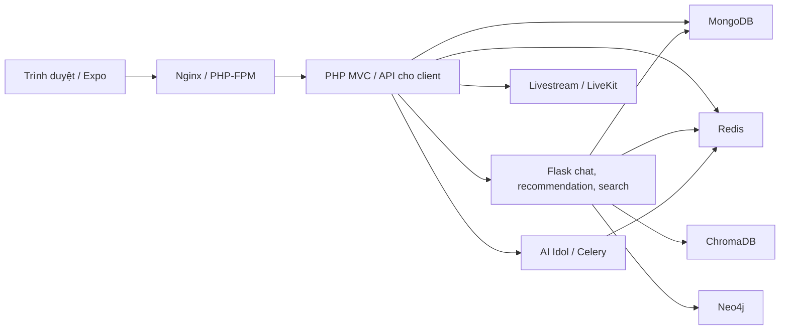

# CODEX THESIS AUDIT — SkinSyntaxVN

Ngày 17/11/2026 (Asia/Bangkok) · Rà soát kỹ thuật và nhu cầu skill cho khóa luận CNTT

## 1. Executive Summary

**Đã xác minh.** Tên sản phẩm trong README là **SkinSyntaxVN — Decoding Your Skin Language**. Bản nháp khóa luận mô tả hệ thống thương mại điện tử mỹ phẩm kết hợp tư vấn chăm sóc da. Hệ thống giải quyết việc tìm và chọn sản phẩm khi danh mục lớn, thành phần khó diễn giải và độ phù hợp phụ thuộc hồ sơ da, nhu cầu, ngân sách hoặc routine của người dùng. Web tập trung vào khám phá, mua hàng và quản trị. AI hỗ trợ tra cứu, xếp hạng, giải thích gợi ý và kiểm tra tương tác thành phần. Tác nhân gồm khách vãng lai, khách hàng, nhân viên và quản trị viên. Tên đăng ký đề tài chính thức với trường chưa xác minh. Nguồn [README](README.md#tính-năng-chính), [bản nháp khóa luận](report/THESIS_WRITING_DRAFT.md), [đặc tả use case](report/USECASE_SPEC.md).

**Nhận định.** Web và AI có đủ mã nguồn, tài liệu và bộ kiểm thử để chuẩn bị bản bảo vệ. Mức sẵn sàng nộp còn phụ thuộc việc chốt phạm vi, kiểm thử lại checkout và phân quyền, đồng bộ sơ đồ với cấu hình chạy thực tế, và hoàn thiện tài liệu theo mẫu trường. Mobile vẫn ở giai đoạn khung. AI Idol, livestream và phần thưởng đã có đường triển khai trong mã, với độ sẵn sàng tùy cấu hình và nhà cung cấp.

**Phạm vi và dấu mốc.** Báo cáo chọn checkout `SkinSyntaxVN---Decoding-Your-Skin-Language-1` làm dự án chính trong workspace `D:/xampp/htdocs/fe`. Nhánh `fix/stability-and-bug-fixes`, HEAD `23de852890f7f1fca7e158a372520bab83e39368`. Tại thời điểm khảo sát có 16 mục tracked đã sửa và 10 mục untracked theo Git. Kết luận bám theo file hiện có, gồm thay đổi từ trước. Hai worktree được nhận diện qua Git là `SkinSyntax-syna-merge-20261115-143746` (cùng HEAD, nhánh tích hợp) và `SkinSyntax-syna-audit-temp-20261107` (HEAD `360bfc3`, nhánh audit). Chúng được kiểm kê để xác định phạm vi. Kết quả code, test và tài liệu bên dưới thuộc checkout chính. Đường dẫn trong báo cáo tính từ gốc checkout này.

**Cách đọc.** “Có mã” nghĩa là tìm thấy điểm gọi và phần triển khai tương ứng trong khảo sát tĩnh. “Bằng chứng lưu sẵn” là tài liệu hoặc artifact có từ trước. “Chưa xác minh” áp dụng cho trạng thái chạy, cấu hình hiệu lực, số liệu chưa tái lập và tài liệu chưa đọc được trong phạm vi. “Đề xuất” là công việc có thể thực hiện sau audit. Phân tích dùng Git chỉ đọc, danh mục file, manifest, cấu hình trích trường an toàn và mã nguồn theo điểm kiểm tra. **NOT RUN** áp dụng cho lint, build, test, migration, truy vấn CSDL, dịch vụ, trình duyệt và deploy. Binary Word/PDF, ảnh có thể chứa dữ liệu người dùng, dataset, dump và bản ghi chạy chỉ dùng tên hoặc trạng thái tồn tại khi phù hợp. Tệp Markdown này là ghi mới duy nhất của audit.

## 2. Technology Stack

Phiên bản bên dưới là phiên bản từ lockfile, pin hoặc tag image theo cột bằng chứng. Các ràng buộc khoảng là khai báo dependency. Phiên bản runtime thực tế chưa xác minh.

| Lớp | Đã xác minh | Bằng chứng |
|---|---|---|
| Web khách hàng và quản trị | PHP render HTML, CSS và JavaScript thuần. Bootstrap **5.3.3**, Bootstrap Icons **1.11.3**, Font Awesome Free **6.5.1** theo header của asset. Admin tải Chart.js **4.4.1**. Trang live tải LiveKit JS **2.1.2**. Tổ chức theo page PHP, layouts, partials, components và asset theo chức năng. | [Views](frontend/views), [assets CSS](frontend/public/assets/css), [admin layout](frontend/views/admin/layouts/header.php#L12), [live](frontend/views/live.php#L340) |
| Build web và prototype | Web PHP chính dùng asset tĩnh và bundle Bootstrap đã phân phối. Chưa thấy manifest bundler chung Vite/Webpack cho web PHP trong phạm vi kiểm tra. Hai mascot prototype có manifest Node riêng và script `node --test`. Bản 3D có module Three.js lưu trong vendor của prototype. PWA có manifest và service worker. | [Dockerfile PHP](Dockerfile.php), [mascot 2D](frontend/public/ai-idol-mascot-demo/package.json), [mascot 3D](frontend/public/ai-idol-mascot-3d/package.json), [manifest](manifest.webmanifest), [service worker](sw.js) |
| Mobile | TypeScript, Expo với Metro và Expo Router theo file. Lockfile ghi Expo **57.0.24**, Expo Router **57.0.22**, React **19.2.3**, React Native **0.86.3**, TypeScript **6.0.3**. Có script Android, iOS, web và `typecheck` dùng `tsc --noEmit`. | [Manifest](mobile/package.json), [lockfile](mobile/package-lock.json), [routes](mobile/app), [HTTP client](mobile/src/services/api.ts) |
| Web backend | PHP **8.2 FPM Alpine** theo image, MVC tự tổ chức. Composer, MongoDB PHP library **1.19.1**, Predis **3.7.0** theo lockfile backend. Root Composer cũng khai báo MongoDB **1.19.1**. Nginx **1.27 Alpine** ở Compose. | [PHP Dockerfile](Dockerfile.php), [backend Composer lock](backend/composer.lock), [root Composer](composer.json), [router](backend/public/index.php), [Compose](docker-compose.yml) |
| Chat và recommendation | Python **3.11** theo image, Flask **3.0.3**, Gunicorn **23.0.0**, Chroma Python client **1.5.9**, `langchain-chroma` **1.1.0**, LangChain **>=0.3.7**, PyMongo **>=4.6.0**, Redis client **>=5.0.0**, Neo4j Python driver **>=5.20,<6**, RapidFuzz **>=3.9,<4**. Có Sentence Transformers và adapter cho LLM. | [Dockerfile AI](Dockerfile.ai), [AI requirements](ai-service-flask/requirements.txt), [recommendation requirements riêng](ai-service-flask/recommendation_service/requirements.txt) |
| Media, AI Idol và voice | AI Idol và agent dùng Flask **>=3.0,<4**, Gunicorn khai báo **>=22,<24**. AI Idol dùng Celery, Redis và PyMongo. Avatar sidecar khai báo Flask **3.0.3**, Gunicorn **22.0.0**, image CUDA **11.2.2**. Voice-service dùng FastAPI **>=0.100.0**, Pydantic **>=2.0.0**. LiveKit voice agent khai báo `livekit-agents>=0.8.0`. | [AI Idol](ai-idol-service/requirements.txt), [agent](ai-idol-agent-service/requirements.txt), [avatar](ai-idol-avatar-service/requirements.txt), [avatar Dockerfile](Dockerfile.ai-idol-avatar), [voice](voice-service/requirements.txt), [LiveKit agent](livekit-voice-agent/requirements.txt) |
| Lưu trữ và triển khai | MongoDB **7**, Neo4j **5.26 Community**, ChromaDB server **0.5.20**, Redis **7 Alpine** theo Compose. Có named volumes, môi trường Compose local và overlay production với Caddy **2.8 Alpine**. Overlay Atlas trong checkout này khai báo `services: {}`. Thư mục nghiên cứu có bằng chứng benchmark từ bản xuất Atlas. | [Compose chính](docker-compose.yml), [local](docker-compose.local.yml), [production](docker-compose.prod.yml), [Atlas](docker-compose.atlas.yml), [tái lập benchmark](research/ssrc_2026/README_REPRODUCE.md) |

## 3. Project Architecture

### Ranh giới thực thi

- **Web nghiệp vụ.** Nginx phục vụ static và chuyển trang/API tới PHP-FPM. PHP phân nhánh request bằng route query `r` và các file route bổ sung, render view hoặc trả JSON hoặc stream. Controller xử lý HTTP, model truy cập dữ liệu, service chứa logic theo chức năng và client gọi dịch vụ nội bộ. Mô hình triển khai là khối web PHP tập trung với các dịch vụ và worker Python chuyên biệt. [Nginx](nginx/nginx.conf#L55), [front controller](backend/public/index.php#L170), [routes bổ sung](backend/app/routes).
- **Tìm kiếm và recommendation.** `SearchRecommendClient` gọi `/api/search/recommend`, `/api/cart/analyze` và `/api/label/analyze`. Các blueprint search, home, label được đăng ký ở entrypoint Flask của Docker. Recommendation có pipeline retrieve, rerank, lọc an toàn và dựng routine. Alias `/api/recommend/llamaindex` xuất hiện cùng `/api/recommend/profile` và `/api/recommend/langchain-rag`. Tên alias chưa đủ để mô tả thuật toán đang chạy. Ưu tiên căn cứ handler, Docker entrypoint và pipeline khi viết chương kiến trúc. [Client PHP](backend/app/services/SearchRecommendClient.php#L64), [Flask](ai-service-flask/chatbot_service/chatbot_flask.py#L3344), [route search](ai-service-flask/search_service/routes.py#L74), [route recommendation riêng](ai-service-flask/recommendation_service/rcm_flask.py#L76), [pipeline](ai-service-flask/recommendation_service/pipeline.py).
- **Chat và hành động mua hàng.** Flask có API chat, conversation và recommendation. PHP có route cho chat agent và controller tương tác giỏ hàng, đơn hàng. Biên gọi ngược vào PHP có xác thực nội bộ. Sự hiện diện của route cho thấy cần kiểm thử riêng bước tạo draft, xác nhận, tác quyền theo tài khoản và retry. [Flask chat](ai-service-flask/chatbot_service/chatbot_flask.py#L3412), [route agent](backend/app/routes/chat_agent.php), [controller nội bộ](backend/app/controllers/ChatAgentInternalController.php).
- **Media và tác vụ nền.** AI Idol có API run, campaign, job, phê duyệt và video. Compose định nghĩa worker, beat và nhóm tác vụ điều khiển/phát sóng. Voice expose TTS/stream, LiveKit agent và PHP live có code kết nối luồng tương tác. Avatar sidecar có manifest và Dockerfile riêng, trạng thái chạy tùy cách triển khai. [AI Idol](ai-idol-service/app.py#L53), [Celery](ai-idol-service/celery_app.py), [Compose](docker-compose.yml#L279), [voice](voice-service/app.py#L60), [live controller](backend/app/controllers/LiveController.php).

### Mô hình dữ liệu và vòng đời

| Kho | Vai trò và quan hệ từ source |
|---|---|
| MongoDB | Kho nghiệp vụ. PHP dùng `MongoDB\Client` và truy vấn collection trực tiếp. Chưa thấy ORM cho đường chạy này. Catalog dùng `san_pham`, `danh_muc`, `thuong_hieu`. Tài khoản/hồ sơ dùng `nguoidung`, `khach_hang`, `skin_profiles`, `skin_profile_history`. Giỏ và giao dịch dùng `gio_hang`, `hoa_don`, `chi_tiet_hoa_don`, `voucher`. Có đánh giá, hỏi đáp, thông báo, hội thoại và bộ model dành cho media/phần thưởng. Các liên kết logic gồm khách → nhiều đơn theo `ma_kh`, đơn → nhiều dòng theo `ma_hoa_don`, dòng → sản phẩm theo `ma_san_pham`. Model có các đường tương thích ID cũ bên cạnh ObjectId. [Kết nối](backend/app/config/db.php#L86), [catalog](backend/app/models/SanPham.php), [tài khoản](backend/app/models/TaiKhoan.php), [đơn hàng](backend/app/models/HoaDon.php#L604), [tài liệu dữ liệu](report/DATABASE_ANALYSIS.md) |
| Neo4j | Đồ thị phục vụ smart search và gợi ý. Node `Product`, `Brand`, `Category`, `Ingredient`, `SkinType`, `Concern`, `Benefit`. Quan hệ ví dụ `SUITABLE_FOR`, `HAS_BENEFIT`. Có migration Cypher cho constraints và mã đồng bộ theo nhóm test. [Sơ đồ schema](docs/neo4j/schema.md), [constraints](migrations/neo4j/001_constraints.cypher), [tests đồng bộ](ai-service-flask/tests/graph_sync) |
| ChromaDB và Redis | Chroma phục vụ lưu và truy xuất vector với script import. Redis phục vụ cache, rate-limit, khóa/stream và hàng đợi Python. Các tác vụ đồng bộ cần xem độ trễ và đường fallback khi dữ liệu dẫn xuất cũ hoặc dịch vụ gián đoạn. [Import Chroma](database/import_chromadb.py), [Redis conventions](docs/redis/conventions.md), [Redis tests](ai-service-flask/tests/redis_kit) |
| SQL, migration và seed | Repo có schema SQL và scripts chuyển/import dữ liệu theo các pha core, identity, transactional, preflight, kiểm tra sau migration và seed demo. SQL là hiện vật schema/di chuyển dữ liệu trong khảo sát này. Luồng ứng dụng và Compose chính chỉ ra MongoDB cho nghiệp vụ. Chưa xác minh thời điểm hoặc thứ tự đã áp dụng ở từng môi trường. [Schema SQL](database/schema_new.sql), [phase 1](database/migrate_phase1_core.py), [phase 2](database/migrate_phase2_identity.py), [phase 3](database/migrate_phase3_transactional.py), [preflight](database/preflight_check_c1.py), [hậu kiểm](database/post_migration_verify_c3.py), [seed](database/seed_demo_user.js) |

## 4. Feature Completion Status

| Tác nhân / nhóm | Trạng thái khảo sát | Bằng chứng và phần cần chốt |
|---|---|---|
| Khách vãng lai | Có mã | Trang chủ, danh mục, tìm kiếm/lọc, chi tiết, gợi ý khám phá, đăng ký/đăng nhập. [Routes](backend/public/index.php#L170), [views](frontend/views), [UC khách vãng lai](report/USECASE_SPEC.md#2-use-case-của-khách-vãng-lai) |
| Khách hàng | Có mã | Hồ sơ, khảo sát da, gợi ý cá nhân, yêu thích, giỏ hàng, voucher, checkout, thanh toán, theo dõi/hủy đơn, đánh giá, hỏi đáp. Kiểm thử lại quyền sở hữu, voucher và các trạng thái đơn. [Routes](backend/public/index.php#L310), [model tài khoản](backend/app/models/TaiKhoan.php), [model đơn](backend/app/models/HoaDon.php) |
| Chat và thông tin chăm sóc da | Có mã | Chat lịch sử/stream, gợi ý theo hồ sơ, phân tích giỏ, phân tích nhãn/thành phần, hỗ trợ cửa hàng và agent mua hàng. Chưa xác minh độ chính xác, chất lượng lời giải thích, hoặc chất lượng fallback trên cấu hình hiện tại. [Chat UI](frontend/views/components/ai_chat_widget.php), [phân tích nhãn](backend/app/controllers/LabelScanController.php), [route store assistance](backend/app/routes/store_assistance.php), [E2E](e2e) |
| Nhân viên | Có mã | Dashboard, xử lý đơn, sản phẩm trong phạm vi được cấp, phản hồi đánh giá và hội thoại. Kiểm tra lại ma trận quyền theo action vì phạm vi nghiệp vụ đã mở rộng so với bản đặc tả cũ. [Routes staff](backend/public/index.php#L915), [controller](backend/app/controllers/QuanTriController.php#L992), [test case staff](report/TESTCASE_ADMIN_STAFF.md) |
| Quản trị viên | Có mã | Dashboard, sản phẩm/danh mục, người dùng/nhân viên, đơn, tồn kho theo lô, voucher/flash sale, báo cáo, đánh giá, hỏi đáp, quản lý live và AI Idol Studio. [Routes admin](backend/public/index.php#L657), [views admin](frontend/views/admin), [test case admin](report/TESTCASE_ADMIN_FULL.md) |
| Live, AI Idol và phần thưởng | Có mã và tài liệu thiết kế | Live, job tạo nội dung/video, replay, theo dõi xem video và điểm thưởng/check-in có handler, UI hoặc model. Cần xác nhận provider, cấu hình cho phép và hành vi khi trùng event. [Live UI](frontend/views/live.php), [AI Idol](ai-idol-service/app.py), [video watch](backend/app/controllers/VideoWatchController.php), [rewards](backend/app/controllers/RewardController.php), [thiết kế](docs/superpowers/specs) |
| Mobile và mascot | Đang làm / prototype | Expo có home và HTTP client. Bốn tab Khám phá, Routine, Giỏ hàng, Tài khoản còn render `PhasePlaceholder`. Hai mascot có cấu trúc demo và test riêng. [Expo tabs](mobile/app/(tabs)), [HTTP client](mobile/src/services/api.ts), [prototype 2D](frontend/public/ai-idol-mascot-demo), [prototype 3D](frontend/public/ai-idol-mascot-3d) |

## 5. Code Quality Assessment

Quy ước ưu tiên của báo cáo. **P0** dành cho rủi ro toàn vẹn giao dịch hoặc rào cản cần giải quyết trước khi chốt bản bảo vệ có luồng liên quan. **P1** dành cho rủi ro ảnh hưởng đáng kể tới chất lượng, demo hoặc hồi quy. **P2** dành cho các cải tiến có thể xếp sau baseline. Các mức này là đề xuất ưu tiên.

| Mức | Vấn đề và bằng chứng | Hướng cải thiện |
|---|---|---|
| **P0** | **Tính nhất quán checkout khi lỗi giữa chừng.** `taoDonHang()` giữ tồn, chèn đơn rồi chèn từng dòng. Nhánh catch tại đoạn ghi phục hồi tồn và ném lại lỗi. Trong đoạn kiểm tra chưa thấy transaction hoặc dọn các document đã chèn trước lỗi. Rủi ro đơn/dòng dở dang nếu lần ghi sau thất bại. Một đường voucher có `startTransaction`, cho thấy cần đánh giá từng luồng thay vì gán chung hành vi transaction. [HoaDon.php](backend/app/models/HoaDon.php#L662), [đoạn ghi](backend/app/models/HoaDon.php#L700), [CustomerVoucher.php](backend/app/models/CustomerVoucher.php#L441) | Thử lỗi có kiểm soát sau ghi đơn, sau dòng đầu và trước cập nhật voucher trên CSDL test. Xác minh topology hỗ trợ transaction. Chọn transaction hoặc cơ chế bù trừ có thể chạy lại theo idempotency key, rồi kiểm tra retry và tồn/đơn/voucher đồng nhất. |
| **P1** | **Route chẩn đoán tham chiếu phương thức thiếu.** Ba case `test_system`, `test_score_component`, `test_match_component` gọi method tương ứng trên `HomeController`. Class hiện tại không khai báo ba method, không kế thừa class khác và chưa thấy cơ chế dispatch động trong class. Đường PHP có thể lỗi khi đến các case này. [Router](backend/public/index.php#L438), [HomeController](backend/app/controllers/HomeController.php#L23) | Xác định các route còn thuộc giao kèo nào. Khôi phục có kiểm thử nếu cần dùng hoặc gỡ sau khi kiểm tra caller. Kiểm kê endpoint chẩn đoán trước khi public. |
| **P1** | **Router trùng và lệch.** Ba entrypoint có switch thực tế với lần lượt 191, 209 và 198 nhánh `case` khi đếm tại checkout. Route chat agent được nạp ở backend/public. Khác biệt khi chạy bằng Docker và web root khác là rủi ro thực tế cần kiểm tra. [Root](index.php#L143), [backend](backend/public/index.php#L969), [frontend](frontend/public/index.php#L155) | Chốt entrypoint được hỗ trợ, tạo ma trận route × entrypoint × phương thức × role và test parity trước khi gom routing theo nhóm nghiệp vụ. |
| **P1** | **Hợp đồng và tính nhất quán giữa các kho.** SQL, Mongo, graph schema và báo cáo kỹ thuật phản ánh các thời điểm khác nhau. Alias recommendation cũ còn xuất hiện trong route hiện tại. [Schema SQL](database/schema_new.sql), [DAO Mongo](backend/app/models/SanPham.php), [graph schema](docs/neo4j/schema.md), [route recommendation](ai-service-flask/recommendation_service/rcm_flask.py#L76), [tài liệu luồng](report/RECOMMENDATION_AND_CHATBOT_FLOW.md#3-recommendation-flaskllamaindex) | Nêu nguồn dữ liệu gốc, dữ liệu dẫn xuất, khóa nối và phiên bản schema. Đồng bộ inventory API, ghi rõ hợp đồng request/response/error và test giữa PHP–Flask–worker. |
| **P1** | **Hiệu năng cần chứng minh.** Fallback search tạo truy vấn regex trên nhiều trường. Một số index được bảo đảm trong model, ví dụ phiên xem video. Chưa có explain plan hoặc số đo runtime của checkout này. [Search fallback](backend/app/models/SanPham.php#L2468), [index phiên xem](backend/app/models/VideoWatchSession.php#L44) | Kiểm tra explain plan trên catalog thử với từ khóa có/không dấu, quy mô cố định. Đo p50/p95 cho cả cache nóng/lạnh và khi Neo4j/Redis gián đoạn. Đưa index cần thiết vào kế hoạch migration và kiểm tra cold start. |
| **P2** | **Tệp tập trung nhiều trách nhiệm.** PHP có partial, service và model riêng. Mặt khác controller, view chi tiết PHP và Flask chatbot entrypoint có nhiều trách nhiệm, khiến thay đổi bề mặt dễ ảnh hưởng tuyến khác. [HomeController](backend/app/controllers/HomeController.php), [chi tiết sản phẩm](frontend/views/chitiet.php), [Flask chatbot](ai-service-flask/chatbot_service/chatbot_flask.py) | Tách dần validation, use case, IO và template/JS quanh các điểm thường thay đổi, kèm regression test trước mỗi đợt tách. |

## 6. UI/UX Assessment

- **Đã xác minh từ source.** Giao diện Việt hóa, bố cục khách hàng và quản trị riêng, các thành phần dùng lại cho card, chat, tìm kiếm và routine. Header có viewport, các breakpoint và ARIA cho điều khiển tìm kiếm. Chi tiết sản phẩm có `:focus-visible`, CSS giảm chuyển động và media queries. Admin có toggle `data-theme` lưu tùy chọn. Root layout Expo cấu hình light/dark theo color scheme. Phạm vi dark mode toàn storefront và mức tuân thủ accessibility chưa xác minh. [Header](frontend/views/layouts/header.php#L192), [chi tiết](frontend/views/chitiet.php#L948), [admin theme](frontend/views/admin/layouts/footer.php#L17), [Expo layout](mobile/app/_layout.tsx#L46)
- **P1 · Accessibility và hành trình mua hàng.** Có ARIA và CSS focus ở điểm kiểm tra. Việc chuyển focus khi mở/đóng chat, điều hướng gợi ý bằng bàn phím, thông báo lỗi giỏ/checkout, tương phản theme và cách đọc phản hồi stream còn cần kiểm thử. Dùng Playwright trên viewport desktop/mobile với các bước bàn phím và screen reader cho tìm kiếm → chi tiết → giỏ → checkout. Tập trung vào trạng thái empty, loading, lỗi và fallback AI. [Chat widget](frontend/views/components/ai_chat_widget.php), [giỏ](frontend/views/giohang.php), [checkout](frontend/views/thanhtoan.php)
- **P2 · Tính nhất quán UI.** CSS/JS lớn nằm cùng view ở trang chi tiết và trang chủ, song song với CSS/JS trong asset. Chuẩn hóa trạng thái card, giá, badge tồn kho và phản hồi thao tác tại partial dùng chung. Dùng ảnh đã lọc dữ liệu hoặc ảnh lấy từ fixture demo làm bằng chứng. [Trang chủ](frontend/views/home.php), [chi tiết](frontend/views/chitiet.php), [partials](frontend/views/partials), [ảnh test tìm kiếm](report/search-final-e2e)

## 7. Security and Testing Assessment

### Bảo mật, validation và vận hành

**Đã xác minh.** PHP sử dụng session, kiểm tra băm mật khẩu qua `password_hash`/`password_verify`, có captcha/OTP email, luồng reset, đăng nhập social và throttle. Quản trị có `requireRole`. Nhánh label scan và quản trị live có kiểm tra CSRF cục bộ. Call nội bộ của chat agent dùng phép so sánh constant-time. VNPay có xác minh HMAC và handler return/IPN. Kiểm tra dữ liệu dùng hàm PHP như `filter_var`, ép kiểu hoặc kiểm tra method theo handler, và Pydantic trong schema recommendation. PHP có `error_log`. Python có logger và handler lỗi. Nginx cấu hình một số header bảo vệ. Mức bao phủ policy cho toàn API, cấu hình session hiệu lực và đường truyền production chưa xác minh. [Auth](backend/app/controllers/AuthController.php#L311), [model người dùng](backend/app/models/NguoiDung.php), [role](backend/app/controllers/QuanTriController.php#L50), [CSRF live](backend/app/controllers/QuanTriController.php#L1797), [label](backend/app/controllers/LabelScanController.php#L340), [VNPay](backend/app/services/VnpayService.php#L132), [schemas](ai-service-flask/recommendation_service/schemas.py), [Nginx](nginx/nginx.conf#L101)

| ID / mức | Bằng chứng và tác động | Hướng cải thiện |
|---|---|---|
| **SEC-01 / P1** | CSRF theo từng handler. `adminVoucherDelete` và `adminCustomerDelete` kiểm tra role và POST rồi gọi thao tác xóa, chưa thấy kiểm tra CSRF tại hai handler hay switch đã khảo sát. Khả năng khai thác phụ thuộc bộ chặn tại lớp khác và cookie thực tế. [Xóa voucher](backend/app/controllers/QuanTriController.php#L444), [xóa tài khoản](backend/app/controllers/QuanTriController.php#L530), [router](backend/public/index.php#L170) | Kiểm tra chuỗi auth, Origin và cookie với fixture. Áp dụng guard chung cho mutation dùng session cùng test request thiếu/sai CSRF, sai method và sai role. |
| **SEC-02 / P1** | Flask trả thông điệp exception thô ở các handler đã thấy, ví dụ conversation và AI Idol. Nếu exception chứa thông tin hạ tầng hoặc dữ liệu nhạy cảm, caller có thể nhận thông tin đó. Chưa xác minh biên truy cập runtime và đường PHP có lọc hết các phản hồi hay không. [Conversation](ai-service-flask/chatbot_service/chatbot_flask.py#L3709), [AI Idol](ai-idol-service/app.py#L65) | Chuẩn hóa mã lỗi và message công khai, log chi tiết đã lọc cùng request ID. Tạo fixture lỗi dependency và kiểm tra response xuyên lớp PHP–Flask. |
| **SEC-03 / P1** | Kiểm soát role nằm ở controller, auth nội bộ, CSRF cục bộ và kiểm tra sở hữu theo use case. Nhiều entrypoint cùng tồn tại. Chưa có kết quả tái kiểm ownership của hồ sơ, hội thoại, đơn, quyền staff/admin, replay payment và đồng thời claim thưởng. [Chat internal](backend/app/controllers/ChatAgentInternalController.php#L154), [Auth hồ sơ da](backend/app/controllers/AuthController.php#L934), [VNPay IPN](backend/app/controllers/HomeController.php#L5696), [video reward](backend/app/controllers/VideoWatchController.php#L293) | Tạo ma trận kiểm thử role × object × action, bổ sung test giao dịch lặp, lỗi giữa chừng và giả lập callback. Kiểm tra thuộc tính session/cookie và ranh giới public/internal trên môi trường test. |

### Năng lực kiểm thử và triển khai

| Hạng mục | Có trong repo | Bằng chứng còn cần |
|---|---|---|
| PHP | Script unit/contract, như AuthThrottle, cart, search fallback, route wiring và payment boundary, cùng các script smoke, benchmark và hỗ trợ trong `backend/tests`. Composer root/backend không khai báo PHPUnit. | Một lệnh chạy tập test an toàn, target và trạng thái DB test rõ ràng. [Unit](backend/tests/unit), [payment contract](backend/tests/payment_security_contract_test.php), [manifest](backend/composer.json) |
| Python | Pytest **>=8.0** trong dev requirements chính, fakeredis. Có nhóm chatbot/search/graph/label/Redis, các test AI Idol về publication và flow. | Báo cáo theo commit cho test tách unit và integration, ghi rõ fixture và dependency. [Dev requirements](ai-service-flask/requirements-dev.txt), [AI tests](ai-service-flask/tests), [AI Idol tests](ai-idol-service/tests) |
| JS/TS và E2E | Node `node:test` cho vanilla JS và hai mascot. Playwright Chromium dạng script CJS/JS thực hiện ca chat mua hàng, hồ sơ, scan nhãn, giỏ. Mobile có typecheck. | Chạy với tài khoản giả lập và DB cô lập, ghi kết quả web/mobile. Chưa thấy cấu hình test E2E tập trung, format/lint toàn repo hoặc báo cáo coverage hiện hành trong phạm vi. [JS tests](frontend/public/assets/js/tests), [E2E](e2e), [mobile manifest](mobile/package.json) |
| CI/CD | GitHub Actions có bước `php -l`, Python `compileall`, `docker compose` kiểm cấu hình, và một job deploy VPS qua SSH. Có Dockerfiles, Nginx và Caddy production. | Workflow đã khảo sát chưa gọi pytest, các suite PHP nghiệp vụ, E2E hoặc mobile typecheck. Trạng thái CI, máy chủ, DNS/TLS và traffic thực tế chưa xác minh. [CI/CD](.github/workflows/deploy.yml), [Compose production](docker-compose.prod.yml) |

## 8. Thesis Documentation Status

“Có” chỉ sự hiện diện của hiện vật. “Còn thiếu trong phạm vi khảo sát” là kết quả tìm theo tên, định dạng và cấu trúc tài liệu đã rà. “Chưa xác minh” áp dụng cho nội dung file nhị phân hoặc hồ sơ ngoài workspace.

| Hạng mục | Trạng thái và bằng chứng |
|---|---|
| Đề cương khóa luận | **Có khung nội dung. Chưa xác minh bản duyệt.** Bản nháp có bài toán, mục tiêu, phạm vi, phân hệ, kiểm thử, hạn chế và hướng phát triển. Kế hoạch kỹ thuật từng tính năng có trong docs. [Bản nháp](report/THESIS_WRITING_DRAFT.md), [kế hoạch](docs/plans) |
| Word/PDF mẫu của trường | **Chưa xác minh.** Có các DOCX khả dĩ là bản báo cáo/hướng dẫn và PDF nghiên cứu. Chưa có bằng chứng xác định file mẫu chính thức của khoa. [Báo cáo DOCX](report/BaoCao_KLTN_SkinSyntaxVN.docx), [hướng dẫn DOCX](report/TaiLieu_HuongDanSuDung_CongNgheMoi_SkinSyntaxVN.docx) |
| Đặc tả yêu cầu | **Có một phần.** Đặc tả use case có tác nhân, luồng và bảng actor–use case. Các feature mới có design/spec riêng. Cần ma trận yêu cầu chức năng/phi chức năng ↔ tiêu chí chấp nhận ↔ bằng chứng. [Use case](report/USECASE_SPEC.md), [spec](docs/superpowers/specs) |
| Sơ đồ Use Case | **Có đặc tả văn bản. Sơ đồ UML chưa xác minh.** [USECASE_SPEC.md](report/USECASE_SPEC.md) |
| Activity | **Có hiện vật luồng. Sơ đồ Activity chuẩn cho bản nộp chưa xác minh.** [User flow Mermaid](backend/experiments/recommendation_engine_master_audit/user_flow.mmd), [luồng chatbot](report/chatbot-audit-2026-09-09/current-flow.png) |
| Sequence | **Còn thiếu hiện vật riêng trong phạm vi khảo sát.** Tài liệu giải thích luồng chat/recommendation và OTP có thể làm nguồn dựng sơ đồ. [Luồng chat/gợi ý](report/RECOMMENDATION_AND_CHATBOT_FLOW.md), [OTP flow](report/OTP_PASSWORD_RESET_FLOW.md) |
| Class | **Còn thiếu hiện vật riêng trong phạm vi khảo sát.** Có source controller/model/service và sơ đồ kiến trúc Mermaid ở khu vực experiment. [Sơ đồ kiến trúc](backend/experiments/recommendation_engine_master_audit/system_architecture.mmd), [lớp backend](backend/app) |
| ERD/tài liệu CSDL | **Có tài liệu collection và graph. ERD cập nhật chưa xác minh.** Dùng sơ đồ document cho Mongo, và sơ đồ quan hệ riêng cho Neo4j. [Database analysis](report/DATABASE_ANALYSIS.md), [notes](report/DATABASE.md), [graph schema](docs/neo4j/schema.md) |
| API | **Có tài liệu một phần.** README và `ROUTES.md` có tuyến AI/PHP. Chưa thấy OpenAPI được lưu cho toàn hệ thống. Đối chiếu route docs với Docker entrypoint trước khi chốt. [README API](README.md#api-ai-service), [routes docs](report/ROUTES.md), [Dockerfile AI](Dockerfile.ai#L45) |
| Test case và kết quả | **Có bằng chứng lưu sẵn.** Có bộ khách hàng/admin/staff, báo cáo chạy admin 28/09/2026, tài liệu 200 ca AI Idol và artifact từ nhiều đợt E2E. Kết quả cần gắn với môi trường và commit của từng lần chạy. [Khách hàng](report/TESTCASE_CUSTOMER.md), [admin kết quả](report/ADMIN_TEST_EXECUTION_2026-09-28.md), [AI Idol test cases](docs/ai-idol-agent-200-testcases.docx) |
| Ảnh giao diện | **Có theo inventory.** Có thư mục ảnh cho tìm kiếm, scan nhãn, store support, product video, mascot. Nội dung ảnh và độ phù hợp để nộp cần kiểm tra bằng bộ fixture đã lọc dữ liệu. [Report](report), [scan nhãn](report/label-scan-e2e), [product video](report/product-video-e2e) |
| Các chương báo cáo | **Có bản nháp và DOCX.** Có phần thực nghiệm riêng bằng Markdown/LaTeX. Cấu trúc, mục lục, hình/bảng và định dạng DOCX theo mẫu trường chưa xác minh. [Draft](report/THESIS_WRITING_DRAFT.md), [DOCX](report/BaoCao_KLTN_SkinSyntaxVN.docx), [LaTeX](research/ssrc_2026/05_LATEX_EXPERIMENT_SECTION.tex) |
| Tài liệu tham khảo | **Chưa xác minh bộ tham khảo chính thức.** Có thư mục nghiên cứu với thiết kế thí nghiệm, cách tái lập và báo cáo, chưa thấy file BibTeX độc lập trong phạm vi. [Thiết kế](research/ssrc_2026/02_EXPERIMENT_DESIGN.md), [báo cáo thực nghiệm](research/ssrc_2026/04_EXPERIMENTAL_REPORT.md), [tái lập](research/ssrc_2026/README_REPRODUCE.md) |
| Slide bảo vệ | **Còn thiếu theo inventory.** Chưa tìm thấy PPT/PPTX trong checkout đã rà. Tài liệu trình bày nằm ngoài repo chưa xác minh. |

Nghiên cứu SSRC đã có thiết kế so sánh truy xuất lai, reranking, mô tả dataset, phân tích lỗi và độ trễ. Giá trị sử dụng cho khóa luận phụ thuộc việc khóa snapshot, điều kiện test, nhãn, baseline, seed/cấu hình và mapping từ pipeline thử nghiệm đến pipeline demo. Báo cáo này ghi nhận hiện vật và chưa tái lập số liệu. [Báo cáo thí nghiệm](research/ssrc_2026/04_EXPERIMENTAL_REPORT.md), [tái lập](research/ssrc_2026/README_REPRODUCE.md), [kế hoạch đánh giá đề xuất](recommendation_evaluation_plan.md)

## 9. Existing Codex Skills and Configuration

### Skill phát hiện được

Đường dẫn máy dùng `%USERPROFILE%` để có thể chia sẻ báo cáo. “Hiện diện” nghĩa là có `SKILL.md` hoặc có trong danh mục được host cung cấp. Tình trạng kết nối và gọi thành công được xác minh riêng khi có bằng chứng.

| Vị trí | Tên và tình trạng |
|---|---|
| `%USERPROFILE%/.codex/skills/` | Có file và được liệt kê cho phiên hiện tại gồm `playwright`, `security-best-practices`, `skinsyntax-architecture-documentation`, `skinsyntax-regression-testing`, `skinsyntax-safe-development`, `skinsyntax-thesis-support`. |
| `%USERPROFILE%/.codex/skills/.system/` | Có file `imagegen`, `openai-docs`, `skill-creator`, `skill-installer` và được phiên liệt kê. `review-agent` có file trên đĩa, không có trong danh mục skill của phiên này. |
| `%USERPROFILE%/.codex/plugins/cache/openai-bundled/` | Danh mục phiên có `browser:control-in-app-browser` và `computer-use:computer-use`. |
| `%USERPROFILE%/.codex/plugins/cache/openai-primary-runtime/` | Danh mục phiên có `documents:documents`, `pdf:pdf`, `presentations:Presentations`, `spreadsheets:Spreadsheets`, `spreadsheets:excel-live-control`, `template-creator:template-creator`. |
| `%USERPROFILE%/.codex/plugins/cache/openai-curated-remote/` | Danh mục phiên có `sites:sites`, `sites:sites-remix`, `visualize:visualize`, `plugin-management:plugin-management`, `work-pets:create-pet`, `work-pets:pets`, `work-pets:update-pet`. |
| `.agents/skills/` và `.claude/skills/` trong repo | Có `lint`, `frontend-testing`, `e2e`, và sáu skill GitNexus `exploring`, `impact-analysis`, `debugging`, `refactoring`, `guide`, `cli` trong mỗi cây. `.agents/skills/` có thêm Markdown cho design, testing, refactoring, review, debug, documentation. Các file được xác minh tồn tại. Danh mục phiên chưa chứng minh chúng được nạp tự động khi mở từ thư mục cha. [Project agents](.agents/README.md), [project guidance](AGENTS.md) |

Skill đã dùng cho audit là `skinsyntax-safe-development`, `skinsyntax-architecture-documentation`, `skinsyntax-thesis-support`, `openai-docs` và `security-best-practices` cho Python/JS. Kiểm kê skill dựa trên metadata của phiên và hiện diện file. Tài liệu OpenAI phân biệt workflow của skill và các điều kiện để agent nhận biết theo tên/mô tả. [Tài liệu skill](https://learn.chatgpt.com/docs/build-skills), [kiểm thử điều kiện kích hoạt skill](https://developers.openai.com/blog/eval-skills)

### AGENTS.md, MCP và hướng dẫn trùng

- **Global và repo.** Không tìm thấy `AGENTS.md` hoặc `AGENTS.override.md` ở `%USERPROFILE%/.codex/`, hoặc `AGENTS.md` ở thư mục làm việc cha và các cấp tổ tiên đã kiểm tra. Checkout chính có hai file hướng dẫn. File gốc mô tả workflow và tham chiếu GitNexus. Tài liệu trong `.agents` mô tả quy tắc chung. Khi cần nạp hướng dẫn repo, mở checkout chính trong Codex và kiểm tra phạm vi thư mục của hướng dẫn. [AGENTS.md](AGENTS.md), [.agents/AGENTS.md](.agents/AGENTS.md), [Tài liệu AGENTS.md](https://learn.chatgpt.com/docs/agent-configuration/agents-md)
- **MCP global.** `%USERPROFILE%/.codex/config.toml` khai báo `chrome-devtools`, `playwright`, `context7`, `node_repl` và `cua_repl`. Bốn tên đầu có nhóm tool tương ứng trong phiên. `cua_repl` có `enabled=false` và không có nhóm tool tương ứng trong phiên. Trạng thái kết nối hoặc lệnh khởi động server chưa kiểm tra. [Tài liệu MCP](https://learn.chatgpt.com/docs/extend/mcp?surface=cli)
- **MCP dự án và công cụ phiên.** Repo có cấu hình khai báo `gitnexus`. Nhóm tool GitNexus chưa xuất hiện trong phiên. Có runner và metadata local trong `.gitnexus/`. Hướng dẫn root ghi index pending và độ mới index chưa xác minh. Tool catalog còn cung cấp terminal/Git qua shell, đọc/sửa file, web, tạo ảnh, artifact session và các công cụ app tích hợp theo quyền phiên. Chưa kiểm tra quyền connector bên ngoài. [mcp.json](mcp.json), [GitNexus guidance](AGENTS.md)
- **Trùng lặp đã xác minh.** So sánh hash cho thấy hai cây skill có sáu file GitNexus cùng nội dung và hai file `lint`, `frontend-testing` giống nhau. Hai file `e2e` khác hash và bản `.claude` có mục hướng dẫn tài khoản kiểm thử bổ sung. Phạm vi tool chồng nhau giữa Playwright cục bộ, Playwright MCP, Chrome DevTools và trình duyệt trong app. Kiểm tra một workflow chạy suite, một công cụ chẩn đoán DOM/network và một cách ghi bằng chứng trước khi bổ sung skill. Chưa thấy xung đột có tác động trong audit tĩnh. Quy tắc phân tích GitNexus trước sửa symbol phục vụ các đợt chỉnh code tương lai. [E2E dự án](.agents/skills/e2e/SKILL.md), [E2E Claude](.claude/skills/e2e/SKILL.md), [AGENTS.md](AGENTS.md)

## 10. Recommended Skill Categories

| Lĩnh vực | Tận dụng hiện có | Khoảng thiếu và đầu ra cần yêu cầu |
|---|---|---|
| Phân tích yêu cầu và kế hoạch | `skinsyntax-thesis-support`, use case và spec dự án | **P1.** Ma trận truy vết yêu cầu, tiêu chí chấp nhận, vai trò và phạm vi demo. Một workflow ngắn theo môn học có giá trị nếu thường xuyên đồng bộ yêu cầu. |
| Frontend/UI/UX | `.agents/skills/frontend-testing`, browser, Playwright, Chrome DevTools | **P1.** Review PHP SSR, Bootstrap, keyboard, contrast, breakpoint và trạng thái lỗi. Ưu tiên năng lực audit accessibility cho frontend hiện tại. |
| Backend/API | `skinsyntax-safe-development`, `skinsyntax-architecture-documentation`, Context7 cho tra cứu chính thống | **P1.** Kiểm kê route/method/role, contract tests, request/response mẫu bằng fixture và timeout/fallback PHP–Flask. |
| Database | `skinsyntax-architecture-documentation` bao phủ một phần | **P0/P1.** Workflow Mongo/Neo4j cho transaction, idempotency, schema migration, index/explain, và kiểm tra độ tươi dữ liệu dẫn xuất. Đầu ra gồm sơ đồ dữ liệu và checklist rollback trên DB test. |
| Authentication và bảo mật | `security-best-practices` cho JS/TS/Python, `skinsyntax-safe-development` cho biên dự án | **P0/P1.** Bổ sung năng lực PHP session, RBAC/ownership, CSRF, upload, webhook và payment. Skill hiện có về security có giới hạn ngôn ngữ. |
| Debug, refactor, code review | Quy trình SkinSyntax an toàn, test hồi quy và skill GitNexus theo repo | **P1.** Xác minh GitNexus có thể gọi và index cập nhật trong một nhiệm vụ sau. Review theo symbol, caller và hợp đồng tương thích. |
| Testing và browser automation | `skinsyntax-regression-testing`, `playwright`, Playwright MCP, browser và Chrome DevTools | **P0/P1.** Tập trung vào fixture sạch, sandbox tích hợp giả lập, test checkout/permissions, negative tests, sao lưu artifact và test ở CI. Năng lực công cụ đã có, quy trình tái lập là khoảng thiếu chính. |
| UML, ERD và kiến trúc | `skinsyntax-architecture-documentation`, Mermaid hiện có trong experiment | **P1.** Quy trình vẽ Use Case, Activity, Sequence, Class, mô hình Mongo/Neo4j và xuất SVG/PDF có nhãn nhất quán với báo cáo. |
| DOCX/PDF | `documents:documents`, `pdf:pdf`, `template-creator:template-creator` khi có mẫu tái dùng | **P1.** Đầu vào là mẫu khoa đã xác nhận. Đầu ra gồm Heading styles, mục lục, chú thích hình/bảng, bố cục và kiểm tra từng trang render. |
| Nghiên cứu và trích dẫn | `skinsyntax-thesis-support`, web và bộ SSRC trong repo | **P1.** Quy trình tìm nguồn sơ cấp, theo dõi DOI, kiểm tra trích dẫn, chuẩn trích dẫn của trường, và đóng gói benchmark tái lập. Trình quản lý thư mục tham khảo hoặc kết nối thư viện chưa xác minh. |
| Slide bảo vệ | `presentations:Presentations`, `visualize:visualize` | **P2.** Slide bám câu hỏi nghiên cứu, kiến trúc, demo, thí nghiệm, hạn chế và backup demo. Kiểm tra thời lượng, khả năng đọc chart và khớp số liệu báo cáo. |

**Yêu cầu gợi ý khi gửi cho ChatGPT.** Dựa trên báo cáo này, hãy chọn tối đa năm skill hoặc tổ hợp skill hiện có phù hợp với SkinSyntaxVN. Với mỗi lựa chọn, nêu công việc cụ thể, điều kiện kích hoạt, đầu ra kiểm chứng được, phần trùng với công cụ đang có và khoảng thiếu cần bổ sung. Ưu tiên ổn định checkout/phân quyền và báo cáo có thể tái lập. Nếu đề xuất skill mới, nêu nguồn chính thức hoặc đề xuất workflow repo riêng với phạm vi rõ ràng.

## 11. Priority Improvements

1. **P0 · Chốt bản demo và bảo đảm checkout.** Xác nhận commit/entrypoint và các phần có trong tiêu chí bảo vệ. Dùng DB cô lập để kiểm tra nhất quán tồn–đơn–chi tiết–voucher khi gián đoạn, callback lặp, cập nhật đồng thời và sai quyền. Kết quả cần ghi fixture, phiên bản, bước thử và trạng thái dữ liệu cuối. [HoaDon](backend/app/models/HoaDon.php#L604), [payment contract test](backend/tests/payment_security_contract_test.php)
2. **P1 · Khóa hợp đồng HTTP và kiểm soát truy cập.** Xử lý route mồ côi, kiểm tra parity khi có nhiều entrypoint, rà CSRF và ownership theo vai trò, chuẩn hóa lỗi liên dịch vụ. Bổ sung các kiểm thử có thể chạy lại cho các luồng này trong CI. [Router](backend/public/index.php), [CI](.github/workflows/deploy.yml)
3. **P1 · Xác minh demo và đường fallback.** Chạy hành trình khách, khách hàng, staff và admin với dữ liệu giả lập trên desktop/mobile web. Ghi hành vi lúc Neo4j, vector store hoặc LLM gián đoạn. Ưu tiên kiểm tra tìm kiếm, gợi ý, accessibility, giỏ và thanh toán. [Khung E2E](e2e), [unit fallback](backend/tests/unit/SearchFallbackTest.php)
4. **P1 · Hoàn thiện bộ hồ sơ nộp.** Ghép ma trận yêu cầu–mã–test, diagram, data dictionary, API catalog, mẫu báo cáo trường, ảnh demo đã lọc và kết quả SSRC có baseline/snapshot. Cố định phiên bản benchmark và mô tả giới hạn nghiên cứu. [Use case](report/USECASE_SPEC.md), [draft](report/THESIS_WRITING_DRAFT.md), [tái lập SSRC](research/ssrc_2026/README_REPRODUCE.md)
5. **P2 · Giảm chi phí bảo trì và chuẩn bị bảo vệ.** Sau khi có test baseline, thu gọn router trùng, chuyển CSS/JS dùng chung ra khỏi view quá lớn và hợp nhất tài liệu skill trùng. Dựng slide theo phạm vi đã chốt và chuẩn bị kịch bản demo dự phòng với dữ liệu giả lập. [Frontend](frontend/views), [project guidance](AGENTS.md)

## 12. Unknowns and Questions

1. Tên đề tài được duyệt, mẫu DOCX/PDF của khoa, chuẩn trích dẫn, số trang và quy định slide nằm ở đâu?
2. Checkout, commit và profile Compose nào sẽ là bản nộp? Các thay đổi đang có cần xác nhận trước khi đóng dấu mốc.
3. Mobile, AI Idol, livestream, phần thưởng và PWA thuộc tiêu chí chấm bắt buộc hay sẽ trình bày như phần mở rộng?
4. Môi trường sandbox nào được dùng cho Mongo, Redis, Neo4j, Chroma, LLM, thanh toán và media? Có fixture đã ẩn danh và các tài khoản theo vai trò để tái lập kiểm thử hay chưa?
5. Migration/index nào đã áp dụng? Mongo chạy topology nào và API/worker có điều kiện gì để đảm bảo retry, fallback và tính nhất quán?
6. Kết quả E2E, CI và benchmark nào gắn được với commit dự kiến nộp? Có quy trình kiểm tra lại để tái tạo ảnh và số liệu trong thời gian bảo vệ hay chưa?
7. Có bản UML/ERD, thư mục tham khảo hoặc slide bên ngoài checkout không? Khi mở checkout chính thành project trong Codex, skill theo repo và GitNexus có xuất hiện và chạy được không?
