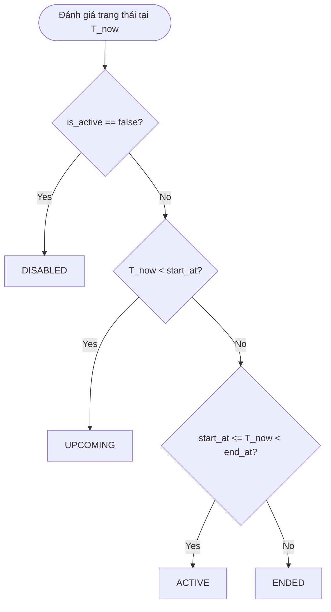

# THIẾT KẾ DOMAIN MODEL: FLASH SALE CAMPAIGNS (PHASE 2A)

## 1. Nguyên tắc cốt lõi (Domain Invariants)
1. **Bộ sưu tập độc lập (`flash_sale_campaigns`)**: Toàn bộ dữ liệu cấu hình sự kiện, khung giờ, và danh sách sản phẩm giảm giá Flash Sale được lưu trữ tại collection chuyên biệt `flash_sale_campaigns`.
2. **Không sao chép toàn bộ document sản phẩm**: Mỗi item trong chiến dịch chỉ lưu trữ định danh SKU (`ma_san_pham`) và giá bán Flash Sale (`flash_price`). Thông tin hiển thị khác (tên sản phẩm, hình ảnh, slug, thương hiệu, danh mục) được join/hydrate động từ collection gốc `san_pham` khi cần.
3. **Không ghi đè trường giá của `san_pham`**: Tuyệt đối không thay đổi `san_pham.gia_ban` hay `san_pham.gia_thi_truong`. Giá niêm yết của 2,473 sản phẩm được bảo toàn 100%.
4. **Không gắn trường Flash Sale hàng loạt lên 2,473 sản phẩm**: Không thêm các cờ `is_flash_sale`, `flash_price` vào từng document sản phẩm trong `san_pham` để tránh ô nhiễm schema và rủi ro race-condition khi chiến dịch kết thúc.
5. **Trạng thái vòng đời hoàn toàn tính toán từ server-time (Server-Derived Lifecycle)**: Không lưu trữ cứng trạng thái `ACTIVE` hay `ENDED` vào database vì sẽ gây lỗi stale data khi thời gian thực trôi qua. Trạng thái chỉ được suy luận từ `start_at`, `end_at`, `is_active` tại thời điểm query.

---

## 2. Cấu trúc Document `flash_sale_campaigns`

Tuân thủ quy ước đặt tên (naming convention) hiện có của SkinSyntaxVN (tiếng Việt không dấu / snake_case đồng nhất với `hoa_don`, `voucher`, `san_pham`):

```json
{
  "_id": ObjectId("..."),
  "ma_campaign": 1,
  "ten_campaign": "Siêu Sale Rạng Rỡ Giữa Tuần",
  "mo_ta": "Ưu đãi chớp nhoáng cho các dòng Serum và Kem chống nắng chọn lọc",
  "is_active": true,
  "start_at": ISODate("2026-10-07T12:00:00.000Z"),
  "end_at": ISODate("2026-10-07T16:00:00.000Z"),
  "items": [
    {
      "ma_san_pham": "93",
      "flash_price": 171500,
      "regular_price": 245000,
      "phan_tram_giam": 30
    },
    {
      "ma_san_pham": "1",
      "flash_price": 285600,
      "regular_price": 357000,
      "phan_tram_giam": 20
    }
  ],
  "created_at": ISODate("2026-10-07T08:00:00.000Z"),
  "updated_at": ISODate("2026-10-07T08:00:00.000Z")
}
```

### Ý nghĩa các trường:
- `ma_campaign` *(int)*: Khóa định danh số nguyên tự tăng (consistent với `ma_hoa_don`, `ma_voucher`, `ma_san_pham`).
- `ten_campaign` *(string)*: Tên chiến dịch hiển thị cho quản trị viên và người dùng (không được để trống).
- `mo_ta` *(string)*: Ghi chú hoặc mô tả ngắn về chiến dịch.
- `is_active` *(boolean)*: Cờ cho phép/bật chiến dịch (`true`/`false`). Nếu `false`, chiến dịch chuyển sang `DISABLED`.
- `start_at` *(\MongoDB\BSON\UTCDateTime)*: Thời điểm bắt đầu chiến dịch (lưu chuẩn UTC).
- `end_at` *(\MongoDB\BSON\UTCDateTime)*: Thời điểm kết thúc chiến dịch (lưu chuẩn UTC, bắt buộc `end_at > start_at`).
- `items` *(array)*: Danh sách SKU tham gia:
  - `ma_san_pham` *(string)*: Mã định danh sản phẩm canonical trong `san_pham`.
  - `flash_price` *(int)*: Giá bán chớp nhoáng trong thời gian diễn ra chiến dịch ($0 < \text{flash\_price} < \text{regular\_price}$).
  - `regular_price` *(int)*: Snapshot giá niêm yết tại thời điểm tạo chiến dịch để kiểm tra chênh lệch.
  - `phan_tram_giam` *(int)*: Tỷ lệ chiết khấu được tính toán tự động bằng công thức: $\text{round}\left(\frac{\text{regular} - \text{flash}}{\text{regular}} \times 100\right)$.
- `created_at`, `updated_at` *(\MongoDB\BSON\UTCDateTime)*: Dấu vết thời gian tạo và cập nhật.

---

## 3. Máy trạng thái vòng đời suy diễn (Server-Derived Lifecycle State Machine)

Trạng thái của một chiến dịch tại thời điểm thẩm định $T_{\text{now}}$ được suy diễn theo quy tắc:



### Bảng định nghĩa trạng thái:
| Trạng thái | Điều kiện logic | Ý nghĩa vận hành |
| :--- | :--- | :--- |
| **DISABLED** | `is_active == false` | Chiến dịch bị vô hiệu hóa thủ công bởi Admin. Giá Flash Sale không áp dụng kể cả khi nằm trong khung giờ. |
| **UPCOMING** | `is_active == true && now < start_at` | Chiến dịch sắp diễn ra. Hệ thống hiển thị đồng hồ đếm ngược, giá bán áp dụng vẫn là giá thường (`REGULAR`). |
| **ACTIVE** | `is_active == true && start_at <= now < end_at` | Chiến dịch đang diễn ra. Giá áp dụng là `FLASH_SALE` cho mọi người dùng. |
| **ENDED** | `is_active == true && now >= end_at` | Chiến dịch đã hết hạn. Hệ thống tự động phân giải lại về giá bán thông thường (`REGULAR`), không cần cronjob chuyển cờ. |

---

## 4. Lớp Model phụ trách: `FlashSaleCampaign.php`
Model được đặt tại: [backend/app/models/FlashSaleCampaign.php](file:///d:/xampp/htdocs/fe/SkinSyntaxVN---Decoding-Your-Skin-Language-1/backend/app/models/FlashSaleCampaign.php).
- Model này chịu trách nhiệm:
  - Chuẩn hóa document MongoDB BSON thành mảng dữ liệu nhất quán.
  - Xử lý chuyển đổi kiểu `MongoDB\Model\BSONArray` và `MongoDB\BSON\UTCDateTime`.
  - Cung cấp API thẩm định (`validateCampaign`), kiểm tra xung đột thời gian (`checkOverlappingCampaigns`), và phân giải giá hiệu lực (`resolveEffectivePrice`).
