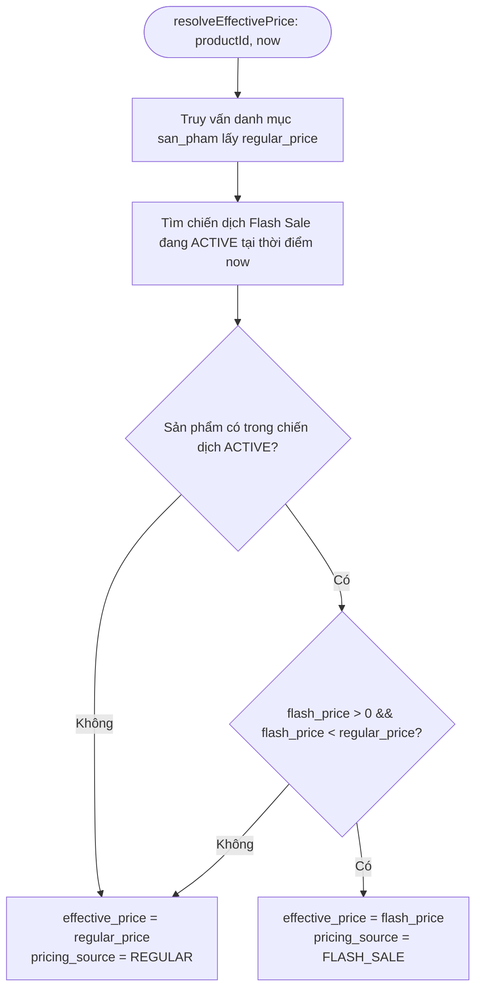

# THIẾT KẾ ĐỘNG CƠ PHÂN GIẢI GIÁ HIỆU LỰC (EFFECTIVE PRICING ENGINE)

## 1. Mục tiêu kiến trúc
Loại bỏ hoàn toàn tình trạng logic tính giá Flash Sale bị phân tán rải rác trong Controller, Views, hay Model hóa đơn.
Xây dựng một cổng phân giải giá duy nhất (**Single Source of Truth for Pricing**):
- **Class**: [FlashSaleCampaign](file:///d:/xampp/htdocs/fe/SkinSyntaxVN---Decoding-Your-Skin-Language-1/backend/app/models/FlashSaleCampaign.php)
- **Method**: `resolveEffectivePrice($productId, ?int $nowTimestamp = null, ?array $preloadedProduct = null): array`
- **Helper Global**: `get_effective_product_price($productId, ?array $preloadedProduct = null): array` trong [frontend/views/helpers.php](file:///d:/xampp/htdocs/fe/SkinSyntaxVN---Decoding-Your-Skin-Language-1/frontend/views/helpers.php).

---

## 2. Đặc tả giao diện phân giải giá (Resolution Interface)

### Đầu vào (Parameters):
1. `productId` *(string|int)*: Mã sản phẩm canonical (`ma_san_pham`).
2. `nowTimestamp` *(int|null)*: Thời gian server thẩm định (mặc định lấy `time()`). Tham số này cho phép time-traveling trong unit test hoặc mô phỏng đơn hàng quá khứ.
3. `preloadedProduct` *(array|null)*: Document sản phẩm đã được query trước đó (được tái sử dụng trong vòng lặp hiển thị giỏ hàng để tránh N+1 query).

### Đầu ra chuẩn hóa (Output Schema):
```php
[
    'product_id'       => '93',
    'regular_price'    => 245000,                  // Giá niêm yết bán thường canonical (gia_ban)
    'market_price'     => 320000,                  // Giá thị trường gốc (gia_thi_truong)
    'effective_price'  => 171500,                  // Đơn giá áp dụng thực tế
    'pricing_source'   => 'FLASH_SALE',            // 'FLASH_SALE' hoặc 'REGULAR'
    'is_flash_sale'    => true,                    // true khi và chỉ khi có Flash Sale hợp lệ
    'campaign_id'      => 1,                       // Khóa chiến dịch (null nếu REGULAR)
    'campaign_name'    => 'Siêu Sale Rạng Rỡ',     // Tên chiến dịch (null nếu REGULAR)
    'discount_percent' => 30,                      // Tỷ lệ giảm giá tính toán từ regular_price
    'savings_amount'   => 73500,                   // Số tiền tiết kiệm so với regular_price
    'valid_until'      => '2026-10-07 16:00:00',   // Hạn dùng giá Flash Sale (Asia/Ho_Chi_Minh)
    'valid_until_ts'   => 1791393600               // Timestamp UTC hết hạn
]
```

---

## 3. Quy tắc phân giải giá (Price Resolution Rules)



### Nguyên tắc bất biến (Pricing Invariants):
1. **Giá bằng nhau cho mọi khách hàng (No Personalized Pricing)**: Cùng sản phẩm $P$ trong cùng một chiến dịch Flash Sale đang $ACTIVE$, hệ thống trả về giá $effective\_price$ như nhau đối với khách vãng lai, người dùng đã đăng nhập, thành viên VIP hay Diamond. Cá nhân hóa chỉ được thực hiện ở tầng *ranking/recommendation* (Phase 2B/2C), tuyệt đối không can thiệp vào mức giá.
2. **Công thức tính tỷ lệ chiết khấu**:
   $$\text{discount\_percent} = \text{round}\left( \frac{\text{regular\_price} - \text{flash\_price}}{\text{regular\_price}} \times 100 \right)$$
   Không bao giờ tin vào con số phần trăm gửi từ client hoặc lưu cố định.
3. **Cơ chế Cache trong phạm vi vòng đời Request**: Danh sách các chiến dịch $ACTIVE$ được cache tĩnh (`self::$requestActiveCampaignsCache`) trong cùng một HTTP request/process để tối ưu hiệu năng khi duyệt qua 10-20 sản phẩm trong giỏ hàng.

---

## 4. Tích hợp các điểm chạm (Integration Touchpoints)

### A. Giỏ hàng & Xem trước thanh toán (Cart & Checkout Preview)
- [HomeController.php](file:///d:/xampp/htdocs/fe/SkinSyntaxVN---Decoding-Your-Skin-Language-1/backend/app/controllers/HomeController.php):
  - Phương thức `giohang()` phân giải giá hiệu lực cho từng sản phẩm qua `FlashSaleCampaign::resolveEffectivePrice()`.
  - Phương thức `buildCheckoutPreview()` tổng hợp danh sách đơn giá thực tế từ `resolveEffectivePrice()`.
  - Giỏ hàng (`$_SESSION['gio_hang']`) tiếp tục lưu trữ theo cấu trúc nguyên bản: `[ ma_san_pham => so_luong ]`. Tuyệt đối không lưu giá do client gửi trong session hay cookie.

### B. Chốt đơn hàng thực tế (Order Creation)
- [HoaDon.php](file:///d:/xampp/htdocs/fe/SkinSyntaxVN---Decoding-Your-Skin-Language-1/backend/app/models/HoaDon.php):
  - Hàm `fetchProductPrice($maSanPham)` gọi `resolveEffectivePrice()` tại chính thời điểm chốt đơn.
  - Đơn giá được lưu vào bảng `chi_tiet_hoa_don` (trường `don_gia`) là giá hiệu lực chính xác mà server đã phân giải.
  - Tổng tiền `hoa_don.tam_tinh` và `hoa_don.tong_tien` được tính toán lại 100% từ đơn giá này.

---

## 5. Xử lý kịch bản Flash Sale hết hạn trong quá trình Checkout (Campaign Expires Mid-Checkout)

### Kịch bản kiểm thử:
- $T_1$: Chiến dịch Flash Sale đang $ACTIVE$. Người dùng vào xem giỏ hàng và trang thanh toán với giá Flash Sale $X$. Tổng tiền hiển thị là $Subtotal_1$.
- $T_2$: Chiến dịch hết hạn ($now \ge end\_at$).
- $T_3$: Người dùng bấm "Đặt hàng".

### Cơ chế phản hồi của hệ thống:
1. `HomeController::thanhtoan()` ghi lại giá trị tạm tính đã hiển thị: `$_SESSION['checkout_preview_subtotal'] = $preview['subtotal']`.
2. `HomeController::xulydathang()` gọi `buildCheckoutPreview()` tại thời điểm submit $T_3$.
3. Nếu phát hiện `subtotal` đã thay đổi so với `checkout_preview_subtotal` (do giá Flash Sale đã hết hạn và hệ thống tự động quay về `regular_price`):
   - Đơn hàng **không tạo với giá cũ**.
   - Server lập tức chuyển hướng người dùng quay lại trang thanh toán kèm thông báo rõ ràng: *"Giá một số sản phẩm trong giỏ hàng đã thay đổi (chương trình Flash Sale đã kết thúc). Vui lòng kiểm tra lại đơn giá trước khi đặt hàng."*
   - Khách hàng không bị trừ tiền sai lệch và có quyền xác nhận lại tổng tiền mới.
