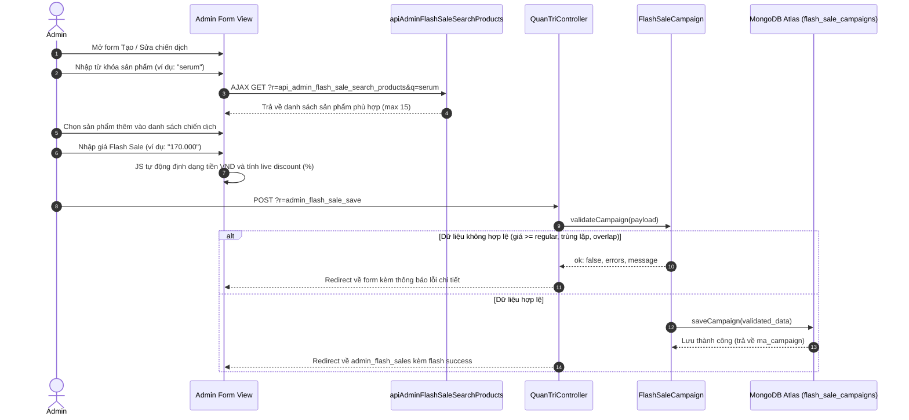

# THIẾT KẾ QUẢN TRỊ ADMIN CRUD FLASH SALE (ADMIN CRUD DESIGN)

## 1. Nguyên tắc thiết kế (Core Design Principles)

1. **Tuân thủ quy ước Admin hiện có**: Tái sử dụng `QuanTriController`, layout `header.php`/`footer.php`, hệ thống flash message `set_flash` và thiết kế bảng AdminCard hiện có.
2. **Trạng thái thuần túy từ Server**: Mọi nhãn trạng thái và badge hiển thị đều bắt nguồn từ `FlashSaleCampaign::getCampaignStatus()`, view không tự tính toán độc lập.
3. **Thẩm định giá phía Máy chủ (Server Authority)**: Giao diện người dùng có thể hỗ trợ tính nhẩm live discount để cải thiện trải nghiệm, nhưng server là nguồn chân lý duy nhất xác thực giá khi submit form.
4. **Không nạp 2,473 sản phẩm vào một dropdown**: Tránh làm sập trình duyệt và suy giảm hiệu năng bằng cơ chế tìm kiếm động (Dynamic Debounced Search) qua AJAX.

---

## 2. Bản đồ Trạng thái Hiển thị (Status Wording & Badges)

Toàn bộ nhãn trạng thái hiển thị trên giao diện Admin sử dụng tiếng Việt 100%:

| Trạng thái nội bộ | Nhãn tiếng Việt hiển thị | Badge Class Bootstrap / Style | Ý nghĩa vận hành |
| :--- | :--- | :--- | :--- |
| **`UPCOMING`** | **Sắp diễn ra** | `badge bg-info text-dark` | Chiến dịch đã được kích hoạt, thời gian bắt đầu trong tương lai. Có thể chỉnh sửa an toàn. |
| **`ACTIVE`** | **Đang diễn ra** | `badge bg-success` | Chiến dịch đang có hiệu lực. Hệ thống cảnh báo rõ ràng khi Admin chỉnh sửa giá/sản phẩm. |
| **`ENDED`** | **Đã kết thúc** | `badge bg-secondary` | Chiến dịch đã hết hạn. Hệ thống tự động trở về giá niêm yết thường. Không cho phép kích hoạt lại nếu không điều chỉnh thời gian. |
| **`DISABLED`** | **Đã tắt** | `badge bg-danger` | Chiến dịch bị vô hiệu hóa thủ công bởi Admin. Giá Flash Sale lập tức ngừng áp dụng. |

---

## 3. Quy trình Tạo và Cập nhật Chiến dịch (Create & Edit Workflow)



---

## 4. Xử lý Định dạng Tiền tệ Việt Nam (Currency UX)

- Khi Admin nhập số tiền: `199.000` hoặc `199,000` hoặc `199000`, Javascript hỗ trợ chuẩn hóa và tự động chèn dấu chấm phân cách hàng nghìn để người dùng dễ đọc.
- Phía backend tiếp nhận:
  ```php
  $cleanPrice = (int)preg_replace('/[^\d]/', '', (string)$rawPriceInput);
  ```
  Loại bỏ hoàn toàn mọi ký tự dấu chấm, dấu phẩy, khoảng trắng, đơn vị "đ", "VND", bảo đảm giá trị số nguyên VND chính xác trước khi gửi vào model validation.

---

## 5. Tính toán Giảm giá Trực tiếp (Live Discount Preview)

- Khi Admin nhập giá Flash Sale, trình duyệt lập tức tính:
  $$\text{discount} = \text{Math.round}\left( \frac{\text{regular\_price} - \text{flash\_price}}{\text{regular\_price}} \times 100 \right)$$
- Hiển thị badge phần trăm giảm (ví dụ: `-25%`) màu xanh lá nếu hợp lệ, hoặc cảnh báo màu đỏ nếu giá nhập vào $\ge$ giá niêm yết.
- Server **tuyệt đối không tin tưởng** tỷ lệ phần trăm gửi lên từ client mà luôn tính toán lại độc lập.

---

## 6. Chính sách An toàn khi Chỉnh sửa Chiến dịch ĐANG DIỄN RA (ACTIVE Edit Safety)

- Nếu một chiến dịch đang ở trạng thái `ACTIVE` (`start_at <= now < end_at` và `is_active = true`):
  - Form hiển thị banner cảnh báo nổi bật màu vàng hổ phách:
    > **"Cảnh báo: Chiến dịch này ĐANG DIỄN RA. Việc thay đổi giá hoặc thêm bớt sản phẩm có thể ảnh hưởng đến giỏ hàng và đơn giá thanh toán của khách hàng đang truy cập hệ thống."**
  - Mọi thao tác lưu đều bắt buộc trải qua toàn bộ chu trình validation như bình thường để bảo đảm không gây ra xung đột trùng lặp thời gian với các chiến dịch khác.

---

## 7. Chính sách Xóa và Lưu trữ Chiến dịch (Delete / Archive Policy)

Nhằm bảo vệ tính toàn vẹn của lịch sử kinh doanh và tránh xóa nhầm:
1. **Chiến dịch đang `ACTIVE`**: **KHÔNG ĐƯỢC PHÉP XÓA TRỰC TIẾP**. Admin phải thực hiện "Tắt chiến dịch" (`is_active = false`) trước.
2. **Chiến dịch đã kết thúc (`ENDED`)**: Hệ thống khuyến nghị giữ lại để tra cứu lịch sử ưu đãi và thống kê hiệu quả. Nếu Admin bấm xóa, hệ thống yêu cầu xác nhận rõ ràng trước khi giải phóng.
3. **Chiến dịch tương lai (`UPCOMING`) hoặc chiến dịch test chưa phát sinh đơn hàng**: Được phép xóa an toàn khỏi database.
