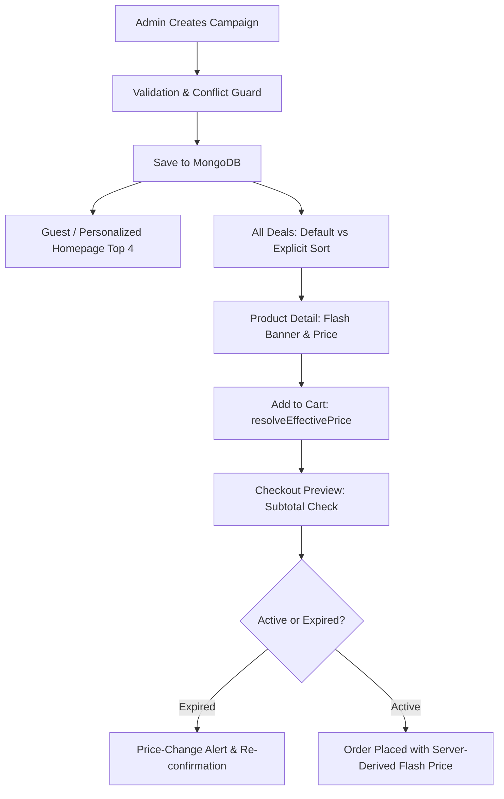

# Phase 2E: End-to-End Audit & Test Plan

## 1. Overview & Objective
This document outlines the final end-to-end audit and validation protocol for the **Personalized Flash Sale** feature across the SkinSyntaxVN platform. Phase 2E represents the capstone validation across all preceding technical phases:
- **Phase 2A**: Campaign Domain Model & Effective Pricing Engine (`resolveEffectivePrice()`).
- **Phase 2B**: Admin Flash Sale Lifecycle Management (`FlashSaleCampaign`, CRUD, Safety Locks).
- **Phase 2C**: Real Public Campaign UI, Time Countdown, and Honest Merchandising.
- **Phase 2D.1**: Ranking Calibration, Simple Recommender Preservation ($m=21.0, C=4.8890$), and Decoupling from CF/Synthetic Signals.
- **Phase 2D.2**: Personalized Deal Ranking Adapter (`PersonalizedDealRanker`), Heuristic Scoring, and Viewport Diversity.

The core objective of Phase 2E is to establish whether the Personalized Flash Sale behaves as a **coherent, tamper-resistant, context-sensitive business feature** from Admin configuration to order placement and campaign expiration.

---

## 2. Invariants & Guardrails
1. **Scope Boundary**: Strictly no new recommendation models (no CF, BPR, Funk MF, Item-kNN, KMeans, Apriori, or FP-Growth). Weights are engineering heuristics, not mathematically learned optima.
2. **Catalog Integrity**: Canonical catalog counts must remain invariant: `san_pham = 2473`, `danh_muc = 28`, `DB_MODE = atlas`, `database = skinsyntax`. Base prices (`san_pham.gia_ban`) must never be modified.
3. **Price Invariant**: For any given SKU in an active campaign, `regular_price`, `flash_price`, `effective_price`, and `discount_percent` must be **100% identical** across all user states (Guest, Behavior, Profile, Hybrid). Only rank and explanation tags may vary.
4. **Campaign Candidate Boundary**: Candidate set is strictly bounded by active campaign items ($\text{Ranked Deals} \subseteq \text{Campaign SKUs}$). No outside catalog products may leak into flash sale views.
5. **No Client Trust**: Client-submitted prices are completely disregarded. Prices are re-resolved server-side in Cart, Checkout Preview, and Order Placement.

---

## 3. End-to-End Business Flow

---

## 4. Test Matrix & Verification Protocols

| ID | Test Scenario | Target Component | Verification Metric | Pass Criterion |
|---|---|---|---|---|
| `PRE_01-03` | Database Precheck | MongoDB Atlas | Document counts | `san_pham=2473`, `danh_muc=28`, 0 stale test campaigns |
| `CAMP_01-02`| Controlled Campaign Creation | `FlashSaleCampaign::saveCampaign` | Campaign persistence | 16 SKUs, 20%–50% discount, ACTIVE window |
| `ADM_01-05` | Admin Operations & Policy | `QuanTriController` & Admin Views | Status & warnings | Status "Đang diễn ra", 16 items, Asia/Ho_Chi_Minh display, edit warning |
| `GUEST_01-04`| Guest Baseline Homepage | `HomeController::index`, `home.php` | Mode & prices | `ranking_mode=BASELINE`, `is_personalized=false`, Top 4 deals |
| `CTX_A_01-04`| Context A: Cleanser Behavior | `PersonalizedDealRanker` | Mode & Top 4 | `ranking_mode=BEHAVIOR`, cleansers elevated, behavioral tag |
| `CTX_B_01-03`| Context B: Profile Only | `PersonalizedDealRanker` | Mode & Top 4 | `ranking_mode=PROFILE`, budget proximity tag |
| `CTX_C_01-02`| Context C: Hybrid Signals | `PersonalizedDealRanker` | Mode & Top 4 | `ranking_mode=HYBRID`, composite scoring |
| `INV_01` | Price Invariant Check | `price_invariant.csv` | Price delta across contexts | 0 price differences across all 16 SKUs in all 4 contexts |
| `ALL_01, SORT_01-04`| All Deals & Sort Overrides | `flash_sale.php` | Candidate retention & monotonicity | 16 items retained, discount/price/rating monotonicity strictly held |
| `DET_01-02` | Product Detail Consistency | `SanPhamController::chitiet` | Effective price | Flash price matches Homepage/All Deals, `is_flash_sale=true` |
| `CART_01-02`| Cart Integrity & Eligibility Policy | `HomeController::giohang` | Price & SKU retention | Server-resolved price, cart SKU remains eligible in deals |
| `CHK_01-02`| Checkout Preview & Tampering | `buildCheckoutPreview` | Price tampering defense | Subtotal derived from server price, forged client price ignored |
| `EXP_01-03`| Campaign Expiry Lifecyle | `xulydathang` & `getPrimaryActiveCampaign` | Re-resolution on expiry | Reverts to regular price, blocks silent checkout, public UI clears |
| `DIS_01-02`| Manual Campaign Disable | `toggleCampaign` / `is_active=false` | Real-time disablement | Effective price reverts immediately to regular, UI hides campaign |
| `TAG_01` | Reason Tag Forensics | View Templates | Grounding & wording | Zero ungrounded clinical claims, factual signals only |
| `FAL_01` | Recommender Fallback | `rankCampaignCandidates` | Exception resilience | Falls back to Phase 2C deterministic baseline ranking |
| `SEC_01-03`| Data & Security Boundaries | Permissions & Source Code | Role guard & CF decoupling | Non-admin blocked, zero CF/fake popularity dependency |
| `REG_01-02`| Recommender & Taxonomy Regression| `SanPham`, `danh_muc` | Benchmark match | Simple Top 24 exact match (24/24), `danh_muc=28` |
| `PERF_01` | Execution Latency | `rankCampaignCandidates` | Benchmark timing | Measured execution time on 16 candidates reported |
| `BQA_01-08`| Browser Automation QA | Headless Chrome (CDP) | Visual QA & Overflow | Desktop 1440x900 & Mobile 375x812 pass with 0 horizontal overflow |
| `CLN_01-04`| Teardown & Final Integrity | MongoDB Atlas | Catalog & campaign counts | Test campaigns purged, catalog 2473/28 intact, base prices unchanged |
