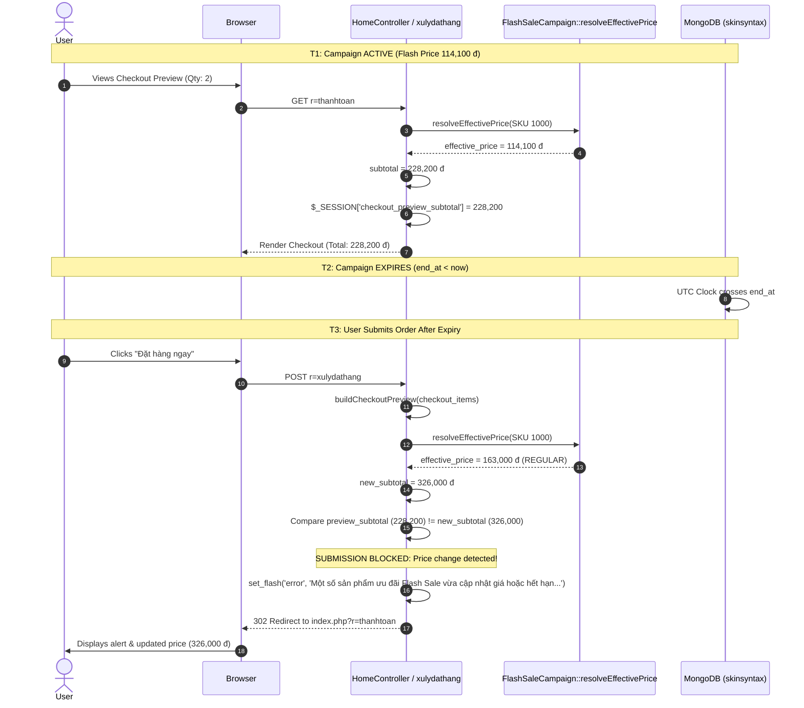

# Campaign Expiry & In-Flight Checkout Protection Audit

## 1. Overview
The most critical edge case in Flash Sale e-commerce is **in-flight campaign expiration**: a shopper initiates checkout while a Flash Sale is active, but the campaign expires before final order confirmation.

SkinSyntaxVN employs a strict server-side synchronization guard in `HomeController::xulydathang()`:
$$\text{Preview Subtotal Snapshot} \neq \text{Current Re-resolved Subtotal} \implies \text{Halt Order Placement \& Require Reconfirmation}$$

---

## 2. In-Flight Expiry Execution Timeline



---

## 3. Test Evidence & Verified Assertions

### Test Step 1: Pre-Expiry Preview (`EXP_01`)
- Campaign: `TEST_FLASHSALE_PHASE2E_E2E` active.
- Product: SKU `1000`, Quantity `2`.
- Active Flash Price: `114,100 đ`.
- Checkout Preview Subtotal: `228,200 đ`.
- Session Snapshot: `$_SESSION['checkout_preview_subtotal'] = 228200`.

### Test Step 2: Simulated Expiry
- Time elapsed past `end_at` (simulated via timestamp $+8000\text{s}$ and database update `end_at = now - 60s`).
- `resolveEffectivePrice('1000')` re-evaluated:
  - `effective_price`: `163,000 đ` (reverted to canonical `san_pham.gia_ban`).
  - `is_flash_sale`: `false`.

### Test Step 3: Order Submission Guard (`EXP_02`)
- `xulydathang` invoked:
  - Re-resolved subtotal: $163,000 \times 2 = 326,000\text{ đ}$.
  - Detection condition evaluated:
    ```php
    if (isset($_SESSION['checkout_preview_subtotal']) && (int)$_SESSION['checkout_preview_subtotal'] !== $subtotal) {
        $_SESSION['checkout_preview_subtotal'] = $subtotal;
        set_flash('error', 'Một số sản phẩm ưu đãi Flash Sale vừa cập nhật giá hoặc hết hạn. Vui lòng xác nhận lại tổng tiền trước khi đặt hàng.');
        redirect(BASE_URL . '/index.php?r=thanhtoan');
        return;
    }
    ```
  - Subtotal mismatch detected ($228,200 \neq 326,000$).
  - Order was **not** written to database.
  - User redirected to `r=thanhtoan` with mandatory confirmation message.

---

## 4. Post-Expiry Public UI Behavior (`EXP_03`)
1. **Homepage Flash Sale Section**:
   - `getPrimaryActiveCampaign()` returns `null`.
   - Section rendering condition `if (!empty($flashSaleCampaign) && !empty($flashSaleProducts))` evaluates to `false`.
   - The entire Flash Sale widget is omitted from the page.
2. **Countdown Behavior**:
   - Does **not** reset to an artificial 24:00 countdown.
   - Front-end timer script marks campaign as ended (`data-flash-status` "Đã kết thúc").
3. **All Deals Page (`r=flash_sale`)**:
   - Displays honest empty state: "Hiện không có chiến dịch Flash Sale nào đang diễn ra."
   - Does not list expired products at discounted prices.

---

## 5. Audit Verdict
**CAMPAIGN EXPIRY & CHECKOUT GUARD — 100% PASS**.  
Expired prices cannot be silently placed. The server enforces price re-verification, protects revenue integrity, and prevents deceptive post-expiry UI loops.
