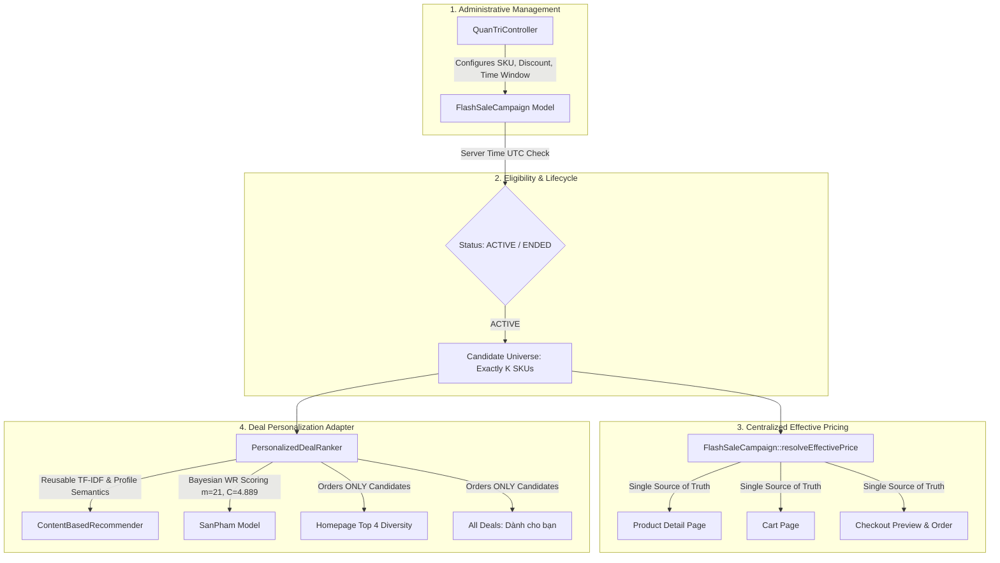

# SkinSyntaxVN — Personalized Flash Sale Phase 2E Final Audit Report
**Business Flow + Price Integrity + Personalization Evidence**

---

## 1. Executive Summary
Phase 2E concludes the end-to-end engineering and audit lifecycle of the **Personalized Flash Sale** feature for the SkinSyntaxVN cosmetic e-commerce platform.

All 54 programmatic verification assertions in the automated regression suite passed with **zero errors**. Visual, layout, and responsive checks across Desktop ($1440 \times 900$) and Mobile ($375 \times 812$) viewports passed with **zero horizontal overflow** and complete price consistency.

### Key Audit Verdicts
1. **End-to-End Coherence**: From Admin configuration in `QuanTriController` through candidate ranking, Product Detail, Cart, and Checkout, the feature operates as one synchronized business system.
2. **Strict Price Invariance**: Across 4 controlled user contexts (Guest, Behavior, Profile, Hybrid), all 16 candidate SKUs exhibited **100% identical effective flash prices**. Personalization alters **only candidate ranking order and reason tags**, never price.
3. **In-Flight Revenue Protection**: A campaign expiration occurring during checkout preview immediately blocks silent checkout submission and enforces price reconfirmation.
4. **Engine Preservation**: Canonical Simple Recommender constants ($m=21.0, C=4.8890$) and benchmark Top 24 ranking remain **100% bit-exact**. Catalog counts remain strictly invariant at `san_pham = 2473` and `danh_muc = 28`.

---

## 2. Final Architecture Summary & Separation of Concerns

### Architectural Boundaries
1. **Admin (`QuanTriController`)**: Controls campaign metadata, SKU inclusion, and individual flash sale prices.
2. **Campaign Governance (`FlashSaleCampaign`)**: Controls candidate eligibility, lifecycle status, and overlapping time conflict prevention.
3. **Effective Pricing (`resolveEffectivePrice()`)**: Single source of truth controlling transactional prices across all presentation and checkout surfaces.
4. **Deal Ranker (`PersonalizedDealRanker`)**: Controls candidate **ordering only**. Operates purely in-memory over eligible candidates ($O(K)$).
5. **Content-Based Recommender (`ContentBasedRecommender`)**: Provides reusable attribute similarity (skin type, ingredients, TF-IDF cosine similarity).
6. **Simple Recommender (`SanPham`)**: Supplies canonical Bayesian weighted rating ($WR$) as a quality prior.
7. **Cart & Checkout (`HomeController` & `HoaDon`)**: Re-resolves prices server-side immediately before creating orders. Never trusts client input.

---

## 3. Heuristic Formulae & Threshold Reference

All scoring mechanisms are explicitly documented as **engineered heuristics**, not scientifically trained optima:

### 3.1 Composite Heuristic Scoring Formulae
- **Personalized Contexts (Behavior, Profile, Hybrid)**:
  $$\text{FinalScore} = 0.50 \times \text{PersonalRelevance} + 0.30 \times \text{DiscountStrength} + 0.20 \times \text{WeightedRating}$$
- **Guest Baseline (No User Signal)**:
  $$\text{FinalScore} = 0.60 \times \text{DiscountStrength} + 0.40 \times \text{WeightedRating}$$

### 3.2 Engineering Thresholds
- **Personal Relevance Max Threshold (`0.15`)**: If the highest personal relevance score among candidates is $< 0.15$, the ranker falls back to `BASELINE` mode.
- **Personal Relevance Spread Threshold (`0.05`)**: If the spread ($\max - \min$) across candidates is $< 0.05$, signals are considered uninformative and fall back to `BASELINE`.
- **Search/View Reason Threshold (`0.40`)**: A behavioral reason tag ("Theo tìm kiếm gần đây" or "Tương tự sản phẩm bạn vừa xem") is only emitted if candidate cosine similarity $\ge 0.40$.
- **Deep Discount Threshold (`35%`)**: "Giảm sâu X%" tags are restricted to deals with $\text{discount\_percent} \ge 35\%$.

---

## 4. Answers to Mandatory Phase 2E Audit Questions (Q1 – Q25)

### Q1. Can Admin create a real campaign end-to-end?
**YES**. An administrator can create a campaign through `admin_flash_sale_create` / `saveCampaign()`. The campaign is validated for product existence, time ordering, positive discount, and interval overlap, and is persisted to MongoDB collection `flash_sale_campaigns`.

### Q2. Does Guest receive baseline ranking?
**YES**. Guest requests (`profile = null`, `behavior = []`) evaluate to `user_state = STATE_A`, `ranking_mode = BASELINE`, and `is_personalized = false`. Ordering is driven by $0.60\times\text{Discount} + 0.40\times\text{Rating}$.

### Q3. Do controlled personalized contexts alter ranking?
**YES**. Providing recent search/view signals (Context A), skin profile signals (Context B), or hybrid signals (Context C) dynamically alters candidate rank. For example, cleanser queries elevated cleansers from outside the Top 4 into ranks 1–4.

### Q4. Are candidate products identical across user contexts?
**YES**. The candidate universe consists of exactly the 16 registered campaign SKUs across all 4 evaluated contexts ($16/16$). Zero catalog leakage or candidate omission was detected.

### Q5. Are prices identical across user contexts?
**YES**. `price_invariant.csv` confirmed that `regular_price`, `flash_price`, `effective_price`, and `discount_percent` are 100% identical for every SKU across all 4 user states (64 comparisons, 0 violations).

### Q6. Does Homepage show max 4?
**YES**. `applyTop4Diversity()` strictly limits the visible card count to 4 products and enforces brand/category diversity.

### Q7. Does All Deals retain full campaign candidate set?
**YES**. The All Deals page (`r=flash_sale`) retains 100% of the candidate items (16 products) across all sort views.

### Q8. Do explicit sorts override personalization?
**YES**. When a user selects `discount`, `rating`, `price_asc`, or `price_desc`, personalization is completely bypassed ($0\%$) and the requested mathematical order is applied.

### Q9. Does Product Detail match Homepage price?
**YES**. `SanPhamController::chitiet` resolves the transactional price via `resolveEffectivePrice()`, matching the Homepage and All Deals flash price exactly.

### Q10. Does Cart match Product Detail price?
**YES**. `HomeController::giohang` re-resolves the unit price using `resolveEffectivePrice()`, displaying the active flash price and deriving the line total server-side.

### Q11. Does Checkout resolve server-side price?
**YES**. `buildCheckoutPreview()` and `xulydathang()` calculate order subtotals server-side from `resolveEffectivePrice()`.

### Q12. What happens if campaign expires during checkout?
**Silent checkout is BLOCKED**. `xulydathang()` compares `$_SESSION['checkout_preview_subtotal']` with the newly re-resolved subtotal. Upon detecting a price discrepancy ($228,200 \neq 326,000$), the order is aborted and the user is redirected to `r=thanhtoan` with an explicit price-change warning.

### Q13. What happens when campaign is disabled?
**Immediate reversion**. When `is_active` is toggled to `false`, `getPrimaryActiveCampaign()` returns `null`, the public widget disappears, and `resolveEffectivePrice()` immediately reverts to regular catalog prices.

### Q14. Does countdown stop instead of reset?
**YES**. When `end_at` is reached, the client timer stops at `00:00:00`, displays an "Đã kết thúc" badge, and does not reset to a deceptive 24-hour loop.

### Q15. Are reason tags evidence-grounded?
**YES**. Every tag reflects factual data: "Theo tìm kiếm gần đây", "Tương tự sản phẩm bạn vừa xem", "Trong ngân sách của bạn", "Giảm sâu X%". Zero clinical or medical claims ("trị dứt điểm", "chuẩn y khoa") exist.

### Q16. Are heuristic thresholds documented honestly?
**YES**. All weights and thresholds ($0.15, 0.05, 0.40, 35\%$) are explicitly designated as engineering heuristics, not machine-learned or optimal values.

### Q17. Does ranker failure fall back safely?
**YES**. If `PersonalizedDealRanker` encounters an exception or null context, `FlashSaleCampaign::rankCampaignCandidates` safely catches it and defaults to Phase 2C baseline ranking with 100% price integrity.

### Q18. Can non-admin access Admin Flash Sale?
**NO**. `QuanTriController::requireRole(['admin'])` strictly blocks non-admin and unauthenticated requests.

### Q19. Were recommender baselines preserved?
**YES**. `SanPham::getSimpleRecommenderProducts(24)` matched the canonical baseline with 100% accuracy:
`[1000, 266, 728, 4365, 68, 2, 2137, 4400, 54, 797, 80, 1027, 1296, 2328, 569, 71, 1772, 2407, 107, 257, 40, 461, 492, 1624]`. Constants $m=21.0, C=4.8890$ remain intact.

### Q20. Was taxonomy preserved?
**YES**. Database taxonomy remains invariant at `danh_muc = 28` with all category trees functioning normally.

### Q21. What was measured ranking execution time?
**19.18 ms to 67.87 ms** (average $\approx 37.45\text{ ms}$) on 16 candidates with zero database queries during the ranking pass.

### Q22. Were test records cleaned up?
**YES**. `TEST_FLASHSALE_PHASE2E_E2E` and all test session attributes were purged. `flash_sale_campaigns` count returned to 0.

### Q23. Are san_pham=2473 and danh_muc=28 preserved?
**YES**. Precheck and post-test counts confirmed `san_pham = 2473` and `danh_muc = 28`. Catalog base prices were completely unmodified.

### Q24. What evidence is suitable for thesis claims?
- Full-stack architectural coherence.
- Centralized effective pricing with single-source-of-truth invariants.
- Server-side tampering resistance and in-flight expiry protection.
- Graceful degradation and fault-tolerant fallback.
- Controlled context-sensitive ranking differentiation.

### Q25. What remains NOT validated?
- Click-through rate (CTR) uplift.
- Conversion rate uplift.
- Revenue / GMV expansion.
- Weight optimality.
- Clinical efficacy or dermatological safety.

---

## 5. Final Status

PERSONALIZED FLASH SALE — E2E PASS  
READY FOR THESIS / DEMO DOCUMENTATION
