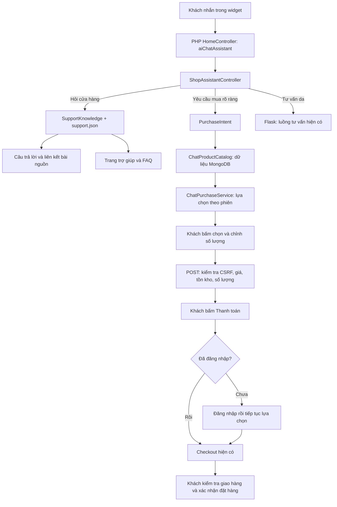

# Trung tâm trợ giúp và mua sản phẩm trong chat

Ngày kiểm tra: 12/09/2026. Môi trường local Docker, website `http://localhost:8080`.

## Kết quả đã triển khai

- 20 bài thuộc 5 nhóm: pháp lý, tài khoản, đặt hàng, vận chuyển và liên hệ. Có tìm kiếm, bài riêng, FAQ theo nhóm, liên kết từ đầu/cuối trang và các đường dẫn chính sách cũ.
- Nội dung trong `backend/app/content/support.json` được dùng chung cho trang web và câu trả lời hỗ trợ. Câu trả lời kèm liên kết tới bài nguồn, không qua LLM để suy diễn chính sách.
- Yêu cầu mua có tên sản phẩm đi qua danh mục MongoDB hiện có. Khách chọn đúng sản phẩm, chỉnh số lượng, xem tiền sản phẩm rồi bấm Thanh toán. Khách chưa đăng nhập được đưa tới đăng nhập và tiếp tục checkout sau khi đăng nhập thành công.
- Chọn/kiểm tra giá chưa sửa giỏ hàng hoặc tạo đơn. Chỉ thao tác Thanh toán ghi lựa chọn vào phiên checkout hiện có; xác nhận đặt hàng vẫn ở trang thanh toán.
- Mỗi lựa chọn có hạn 10 phút và gắn với phiên. Máy chủ kiểm tra CSRF, sản phẩm thuộc lựa chọn, số lượng nguyên 1–20, khả năng bán, tồn kho nếu có và giá mới nhất. Thay giá phía khách bị từ chối; giá thay đổi yêu cầu kiểm tra lại.
- Câu hỏi tư vấn như “có nên mua retinol” tiếp tục đi qua luồng tư vấn da. Câu vừa yêu cầu mua vừa hỏi COD/VAT vẫn giữ lựa chọn sản phẩm và bổ sung hướng dẫn phù hợp.
- Thẻ dùng ảnh thật từ dữ liệu sản phẩm. Nếu CDN không tải được, hiển thị “Ảnh chưa tải được”. Không thay bằng ảnh của sản phẩm khác.

Ví dụ đã chạy trên danh mục thật: **Serum CeraVe Retinol Hỗ Trợ Mờ Thâm Mụn 30ml**, mã **1077**, giá tại lúc kiểm tra **433.000 đ**. Chọn 2 chai hiển thị **866.000 đ tiền sản phẩm**. Phí giao hàng được thể hiện riêng ở checkout.

## Luồng thực tế

## Kiểm thử đã chạy

| Lệnh / phương thức | Kết quả | Phạm vi |
| --- | --- | --- |
| `php backend/tests/store_assistance_test.php` | PASS, 117 assertions | Phân biệt mua/tư vấn/phủ định, chọn tên thật, số lượng, phiên, hết hạn, giá thay đổi, hàng ngừng bán; dữ liệu kiểm soát |
| `php backend/tests/check_store_cases.php` | PASS, 80 câu | Xác định đúng chủ đề từ bộ câu hỏi hỗ trợ |
| `python -X utf8 backend/tests/run_store_live.py` | PASS, 100/100 | 100 yêu cầu HTTP thật: 80 câu hỗ trợ, 10 yêu cầu mua, 10 câu tư vấn để kiểm tra không chuyển nhầm sang mua |
| `python -X utf8 backend/tests/store_sessions_live.py` | PASS, 27/27 | Khách vãng lai; đăng nhập chưa có hồ sơ/có hồ sơ; đăng nhập tiếp tục checkout; chống đổi giá/ID, CSRF, số lượng, phiên chéo; route cũ, 404 và escaping |
| `python -X utf8 backend/tests/store_pages_live.py` | PASS, 20/20 | Từng URL bài trả HTTP 200, có tiêu đề/nội dung/phiên bản; bài pháp lý có thông báo đang hoàn thiện |
| `python -X utf8 -m unittest discover -s ai-service-flask/tests -p 'test_*.py' -q` | PASS, 57 tests | Bộ hồi quy tư vấn hiện có, đã chạy trong đợt triển khai; không phải 57 cuộc chat trên trình duyệt |
| `php -l` | PASS, 17 file PHP | Các controller/service/route/view/entrypoint và test liên quan |
| `node --check frontend/public/assets/js/chat-purchase.js` | PASS | Cú pháp JavaScript |
| `python -m py_compile backend/tests/run_store_live.py backend/tests/store_sessions_live.py` | PASS | Cú pháp hai script kiểm thử |
| `git diff --check` giới hạn các file đang theo dõi thuộc phần PHP/UI này | PASS | Không lỗi whitespace trong phạm vi này |
| `git diff --check` toàn workspace | FAIL từ thay đổi có sẵn | Trailing whitespace ở `ai-service-flask/chatvoice_service/voice_blueprint.py`: 272, 274, 283, 286, 294; không sửa phần ngoài phạm vi |
| PHPUnit/Pest, npm lint/test, E2E runner của repository | NOT RUN | Không tìm thấy cấu hình/harness tương ứng; không cài thêm để tạo một kết quả PASS hình thức |

100 câu và tiêu chí nằm trong `backend/tests/store_chat_cases.json`; kết quả từng câu ở `report/store-assistance/live-100.json`. Báo cáo lưu hash các file xử lý để kiểm tra cùng phiên bản suốt lượt chạy. Đây là kiểm tra định tuyến và dữ liệu đầu ra; **không phải điểm chính xác y khoa 100%**.

Lượt cuối: trung vị hỗ trợ **0,08 giây**, mua hàng **0,11 giây**, nhánh tư vấn **11,34 giây**, trên máy local với 3 yêu cầu đồng thời. Đây không phải benchmark tải doanh nghiệp hay cam kết SLA.

Hai tài khoản kiểm thử được tạo với địa chỉ `example.invalid`, có/không có hồ sơ, rồi xóa đúng các bản ghi do test tạo trong `finally`. Đã xác minh dọn xong. Không gửi OTP/email, không tạo đơn và không thực hiện thanh toán thật.

## Kiểm tra trình duyệt thật

Dùng Playwright qua công cụ trình duyệt Codex, không phải bộ E2E tự động cấu hình sẵn. Phiên khách riêng ở `127.0.0.1:8080`, không đăng xuất tài khoản người dùng ở `localhost`.

1. Gửi câu mua CeraVe Retinol kèm hỏi COD → có sản phẩm 1077 và câu trả lời dẫn tới bài phương thức thanh toán.
2. Bấm Chọn sản phẩm này → số lượng 2 → tiền sản phẩm 866.000 đ.
3. Hỏi tiếp phí ship → thẻ vẫn giữ sản phẩm và số lượng 2.
4. Bấm Thanh toán → hiện biểu mẫu đăng nhập. Việc đăng nhập tiếp tục đến checkout được kiểm tra bằng HTTP với tài khoản thử.
5. Chuyển trang rồi mở lại chat → lựa chọn còn trong lịch sử trên thiết bị. Khi đã quá 10 phút, kiểm tra lại giá hiện thông báo hết hạn.
6. Ảnh CDN không tải được → hiện nhãn dự phòng; tên và nút thao tác vẫn dùng được.
7. Tìm OTP → có bài phù hợp và giữ từ khóa; mở bài OTP; mở nhóm tài khoản và bung FAQ về thời hạn mã.
8. Xem ở 1440×900 và 390×844: nội dung vừa bề ngang. Mobile đo chiều rộng trang 390px, vùng chat 380px và không tràn ngang. Cuộn trong chat làm `scrollTop` của chat tăng từ khoảng 787 lên 1165, cuộn trang nền giữ 0.

## Ghi nhận lỗi trong quá trình kiểm tra

Lượt đầu sau khi khởi động lại dịch vụ có 2 yêu cầu danh mục không thành công (STORE-087: dung tích 999ml không tồn tại; STORE-088: tên sản phẩm không tồn tại). Cả hai đúng khi chạy riêng; các lượt 100 câu sau đạt đủ, kể cả lượt cuối chạy đồng thời với test phiên. Log cũ chỉ có thông báo chung nên **chưa xác định được nguyên nhân gốc của hai lỗi gián đoạn đó**. Đã thêm loại exception và mã lỗi vào log, không ghi câu hỏi, thông tin khách hoặc chuỗi kết nối. Không coi việc chạy lại thành công là đã chứng minh hết mọi lỗi gián đoạn.

Docker Desktop ban đầu không lên vì socket tạm cũ trong thư mục `Docker/run`. Đã giữ nguyên thư mục đó bằng cách đổi tên rồi khởi động lại Docker; không xóa dữ liệu hay volume.

## File và trách nhiệm

| Phần | File |
| --- | --- |
| Nội dung và chủ đề | `backend/app/content/support.json`, `backend/app/services/SupportKnowledge.php` |
| Nhận biết yêu cầu mua | `backend/app/services/PurchaseIntent.php` |
| Tra cứu sản phẩm | `backend/app/services/ChatProductCatalog.php` |
| Lựa chọn, giá và bàn giao checkout | `backend/app/services/ChatPurchaseService.php`, `backend/app/controllers/ShopAssistantController.php` |
| Trang trợ giúp | `backend/app/controllers/SupportController.php`, `frontend/views/info/support.php`, `frontend/public/assets/css/support-center.css` |
| UI mua trong chat | `frontend/public/assets/js/chat-purchase.js`, `frontend/public/assets/css/chat-purchase.css` |
| Điểm tích hợp | `backend/app/routes/store_assistance.php`, ba `index.php`, `HomeController::aiChatAssistant`, widget và layout header/footer |

GitNexus impact trước sửa: `aiChatAssistant` LOW, đi qua `aiChatApi`/`aiChatStream` và ba entrypoint. File/widget và các lớp mới chưa có caller được graph phân giải đầy đủ: UNKNOWN, đã đối chiếu thủ công với route, require và nơi gọi; không coi tập caller rỗng là an toàn. Không commit/push/deploy trong đợt này; các thay đổi có sẵn ngoài phạm vi được giữ nguyên.

## Thông tin còn cần chủ website xác nhận

- Tên pháp lý, mã số thuế, địa chỉ, đại diện và mô hình hoạt động để hoàn thiện bản chính sách công bố chính thức.
- Phạm vi/đối tác/thời gian giao hàng, thời gian hoàn tiền, phí gửi trả, quy trình hóa đơn và giờ có nhân viên trực.
- Thông tin đơn vị xử lý dữ liệu, địa điểm xử lý, thời hạn lưu và quy trình giải quyết quyền dữ liệu.

Trang pháp lý đang có nhãn đang hoàn thiện. Hướng dẫn được điều chỉnh theo tính năng thật: đăng ký OTP **email 6 số/10 phút/60 giây gửi lại**, quên mật khẩu bằng **liên kết email 30 phút**. Chưa triển khai SMS OTP, đổi email bằng OTP hai đầu, tự xóa tài khoản, tự xuất VAT, tạo ticket khiếu nại hoặc tra đơn riêng trực tiếp trong chat.

Các câu trả lời hỗ trợ/mua hàng mới đi qua **PHP BFF của website**; gọi thẳng Flask hoặc ChatVoice không dùng module này. Lịch sử phần mới hiện có trên trình duyệt và lựa chọn trong phiên PHP, chưa đồng bộ các lượt hỗ trợ này vào kho hội thoại Flask/Mongo để dùng xuyên thiết bị. Tìm sản phẩm dùng truy vấn từ khóa có giới hạn ứng viên; chưa cam kết nhận ra mọi cách viết lại tên sản phẩm. Không đổi model/embedding hoặc triển khai LangGraph trong phần việc này.
