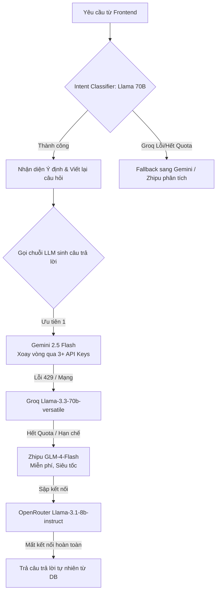

# Nhật ký Cập nhật Dự án (Project Updates)

## 1. Tối ưu hóa truy xuất của Chatbot Chăm sóc Da (18/05/2026)
- **Mục tiêu:** Khắc phục tình trạng phản hồi của Chatbot AI bị cắt xén (truncation) và thiếu ổn định.
- **Chi tiết cập nhật:**
  - Debug và cải thiện cầu nối giao tiếp giữa backend PHP và dịch vụ Python Flask.
  - Đảm bảo các context JSON phức tạp được phân tích chính xác mà không làm crash LLM hay ngắt kết nối giữa chừng.
  - Cải thiện chất lượng, độ dài đầy đủ của câu trả lời, đồng thời bao gồm các đề xuất sản phẩm linh hoạt và link tương tác.
  - Xử lý hiệu quả tình trạng giới hạn rate-limit (lỗi 429) và logic fallback để giữ cho trải nghiệm người dùng luôn liền mạch.

## 2. Nhập dữ liệu Sản phẩm vào ChromaDB (18/05/2026)
- **Mục tiêu:** Nhập thành công 6,000 sản phẩm chăm sóc da từ file CSV vào vector database (ChromaDB) để tích hợp Chatbot.
- **Chi tiết cập nhật:**
  - Tích hợp ChromaDB với chatbot dựa trên LangChain.
  - Ánh xạ chính xác các thuộc tính của sản phẩm như tên, loại da, thành phần, và giá vào cơ sở dữ liệu vector.
  - Triển khai logic truy xuất (retrieval) kết hợp giữa tìm kiếm theo ngữ nghĩa (semantic search) và lọc siêu dữ liệu (metadata filtering).
  - Đảm bảo chatbot đưa ra các lời khuyên cá nhân hóa, gợi ý sản phẩm chính xác và bám sát bối cảnh người dùng.

## 3. Tích hợp AI vào ứng dụng PHP (09/05/2026)
- **Mục tiêu:** Tích hợp các tính năng AI vào kiến trúc ứng dụng web PHP/MVC và PostgreSQL hiện có.
- **Chi tiết cập nhật:**
  - Triển khai cơ sở dữ liệu Vector (ChromaDB) để hỗ trợ các tính năng như RAG (Retrieval-Augmented Generation) và tìm kiếm theo ngữ nghĩa (semantic search).
  - Thiết lập cầu nối giữa kiến trúc backend hiện tại với ChromaDB để lưu trữ và truy xuất dữ liệu vector một cách hiệu quả.

## 4. Xây dựng Cơ chế Dự phòng Đa mô hình (LLM Fallback) (19/05/2026)
- **Mục tiêu:** Tăng cường độ ổn định của AI service bằng cách thiết lập cấu trúc đa dự phòng (failover), tự động chuyển đổi qua lại giữa các LLM khác nhau khi model chính (Gemini) gặp lỗi hoặc hết quota (Lỗi 429).
- **Chi tiết kỹ thuật:**
  - **Tích hợp Fallback APIs:** Khởi tạo thành công 3 endpoint dự phòng tương thích `ChatOpenAI` bao gồm Groq (`gemma2-9b-it`), OpenRouter (`meta-llama/llama-3.1-8b-instruct:free`), và Zhipu AI (`glm-4-flash`).
  - **Quản lý Environment Variables:** Tách toàn bộ API Keys khỏi mã nguồn để bảo mật (Dùng `os.getenv`). Xử lý lỗi khoảng trắng thừa ở `OPENAI_API_KEY` trong file `.env` giúp script `start_chatbot.bat` nhận diện chính xác cấu hình mà không còn bắt người dùng nhập tay.
  - **Khắc phục lỗi Structured Outputs:** Bổ sung cơ chế `Try-Except` cô lập lỗi ở bước Parse (`with_structured_output`) do một số model miễn phí không tương thích chuẩn JSON Schema. Nếu tất cả LLM đều văng lỗi Parse, hệ thống tự động fallback tạo một Object mặc định `PhanTichYeuCau(tu_khoa_ngu_nghia=message)`, đảm bảo ứng dụng không chết cứng (crash) và vẫn query được VectorDB.
  - **Xử lý Message Object:** Sửa lỗi API từ chối chuỗi (raw string) bằng cách tiêu chuẩn hóa payload truyền vào hàm `.invoke()` bằng Object `[HumanMessage(content=prompt)]` của LangChain.
  - **Gỡ lỗi Backend-Frontend Communication:** Fix bug rác hệ thống (zombie/ghost process) chiếm dụng port `5001`, gây lỗi 500 (`name 'get_vectorstore' is not defined`), chặn không cho Frontend lấy phản hồi từ tiến trình Python mới nhất.
  - **Khắc phục lỗi Timeout liên đới:** Vô hiệu hóa tính năng Exponential Backoff (tự động đợi và thử lại khi quá tải) mặc định của thư viện LangChain bằng tham số `max_retries=0`. Việc này giúp Python trả Exception ngay lập tức khi Model thứ 1 bị giới hạn, kịp thời chuyển đổi sang các LLM dự phòng và trả kết quả về Frontend trước khi PHP chạm mức `AI_CHATBOT_TIMEOUT=30` giây.

## 5. Nâng cấp Giao diện Chatbot & Clickable Product Links (19/05/2026)
- **Mục tiêu:** Giúp tên sản phẩm được gợi ý trong văn bản có thể click trực tiếp và tối ưu giao diện hiển thị thẻ sản phẩm ở phía dưới tin nhắn.
- **Chi tiết kỹ thuật:**
  - **Clickable Markdown Links:** Cấu hình lại hệ thống chỉ thị `SYSTEM_PROMPT` và các few-shot ví dụ trong `chatbot_flask.py` để ép AI luôn định dạng tên sản phẩm dưới dạng liên kết Markdown click được: `**1. [Tên sản phẩm](Link thực tế từ DB)**` (tuyệt đối không tự chế Link).
  - **Sắp xếp Thẻ sản phẩm dưới Văn bản:** Di chuyển vùng hiển thị thẻ sản phẩm (`contentSuffix`) xuống phía dưới bong bóng văn bản giới thiệu (`formattedContent`) trong `ai_chat_widget.php` thay vì hiển thị phía trên như trước.
  - **Nâng cấp Thẻ liên kết Chuẩn & Hover Effects:** Chuyển đổi toàn bộ nút hình ảnh, tiêu đề và nút "Xem chi tiết" trong thẻ sản phẩm từ sự kiện click qua JavaScript thành các thẻ `<a>` thuần chuẩn HTML. Bổ sung hiệu ứng CSS micro-animation cao cấp (ảnh phóng to nhẹ 1.05x khi rê chuột, tên sản phẩm tự động gạch chân và đổi màu).
  - **Bỏ bộ lọc Regex PHP cũ:** Đồng bộ hóa dữ liệu trong `HomeController.php` để luôn ưu tiên hiển thị danh sách sản phẩm lấy từ ChromaDB của Python Flask, thay thế bộ lọc Regex PHP tĩnh trước đây.

## 6. Tìm kiếm Chu trình Skincare Đa tầng & Tương thích Path trên Git (19/05/2026)
- **Mục tiêu:** Hỗ trợ tạo chu trình skincare hoàn chỉnh khi khách yêu cầu routine và giải quyết xung đột đường dẫn trên máy của cộng sự khi làm việc nhóm qua Git.
- **Chi tiết kỹ thuật:**
  - **Phân loại Kiểu yêu cầu (Routine Detection):** Bổ sung thuộc tính `is_routine` vào Schema phân tích `PhanTichYeuCau`. Tự động nhận diện từ khóa (routine, chu trình, liệu trình, bộ skincare, các bước) từ câu chat để bật cờ `is_routine = True`.
  - **Tìm kiếm Đa tầng Song song (Multi-stage Search):** 
    - Nếu hỏi sản phẩm lẻ: Python chỉ lọc đúng 1 danh mục sản phẩm duy nhất.
    - Nếu hỏi Routine: Hệ thống tự động chia nhỏ và chạy song song 6 truy vấn ChromaDB để lấy ra đúng 1 sản phẩm tối ưu nhất cho da của khách cho 6 bước cốt lõi: Tẩy trang -> Sữa rửa mặt -> Toner -> Serum -> Kem dưỡng -> Kem chống nắng. AI sau đó sẽ sắp xếp và hướng dẫn thứ tự sử dụng chuẩn khoa học.
  - **Relative Paths (Tương thích Cross-machine):** Refactor lại file `import_chromadb.py` sử dụng thư viện `pathlib` để dò tìm thư mục động (`Path(__file__).resolve().parent`) thay cho đường dẫn tuyệt đối tĩnh `C:\xampp\htdocs\xoa\...`. Giúp cộng sự khi clone dự án về qua Git có thể chạy lệnh import ngay lập tức mà không cần sửa code.

## 7. Hiện đại hóa Giao diện AI Widget & Kiểm soát Quyền truy cập Hồ sơ Da (20/05/2026)
- **Mục tiêu:** Nâng cấp thẩm mỹ giao diện chat, thêm chế độ toàn màn hình, kiểm soát quyền truy cập tính năng gợi ý theo hồ sơ da (Skin Profile) và tối ưu hóa luồng tương tác sản phẩm.
- **Chi tiết kỹ thuật:**
  - **Modern UI Redesign (Glassmorphism):**
    - Áp dụng phong cách thiết kế hiện đại với Gradient (Navy to Blue), Blur nền (`backdrop-filter`), và các góc bo tròn lớn (22px).
    - Thêm Micro-animations cho các nút bấm (`transform: translateY(-2px)`), cải thiện độ phản hồi thị giác.
  - **Chế độ Phóng to/Toàn màn hình (Maximize Mode):**
    - Triển khai chế độ `is-expanded` cho phép người dùng mở rộng khung chat ra toàn màn hình để đọc lịch sử tư vấn dài dễ dàng hơn.
    - Xử lý lỗi z-index và layout khi đóng widget ở chế độ toàn màn hình (Tự động gỡ bỏ lớp phủ mờ và đưa widget về trạng thái mặc định).
  - **Kiểm soát Quyền truy cập (Gated Features):**
    - **Phân loại người dùng:** Kiểm tra trạng thái đăng nhập (`$_SESSION['user']`) và hồ sơ da từ khảo sát.
    - **Logic hiển thị Gợi ý theo hồ sơ da:** Chỉ hiện nút gợi ý ✨ khi (1) đã đăng nhập và (2) loại da không phải "Chưa xác định".
    - **Chế độ Hạn chế (Restricted Mode):** Nếu người dùng chưa có hồ sơ, click vào nút gợi ý sẽ kích hoạt tin nhắn hướng dẫn từ AI, kèm link điều hướng đến trang khảo sát da (`/index.php?r=khaosat`).
  - **Tối ưu hóa Luồng tương tác Banner Gợi ý:**
    - Thu gọn kích thước Banner hồ sơ da để tránh chiếm diện tích khung chat (Compact layout).
    - Tự động đóng Banner sau khi người dùng chọn một danh mục sản phẩm để nhường không gian cho câu trả lời của AI.
  - **Cải thiện Độ chính xác Gợi ý Sản phẩm:**
    - **Keyword-based Filtering:** Cập nhật `HomeController.php` phối hợp với logic Python để lọc bỏ các sản phẩm không thuộc nhóm chăm sóc da (vd: kem đánh răng) khi người dùng hỏi về skincare. Sử dụng Regex: `/toner|serum|kem|mụn|da|tẩy trang|sữa rửa mặt|chống nắng/ui`.
  - **Tính nhất quán của Dữ liệu (Persistence):**
    - Sử dụng `sessionStorage` để lưu trữ trạng thái phóng to/thu nhỏ và lịch sử tin nhắn, giúp giữ nguyên ngữ cảnh khi người dùng lướt qua các trang khác nhau trên website.

## 8. Debug Flask API và Endpoint `/api/health` (20/05/2026)
- **Mục tiêu:** Khắc phục lỗi Flask API không trả về phản hồi khi gọi endpoint `/api/health`.
- **Chi tiết cập nhật:**
  - Thêm log chi tiết vào hàm `health()` trong `chatbot_flask.py` để kiểm tra từng bước xử lý.
  - Kiểm tra và xác minh trạng thái của `Vectorstore` và số lượng mô hình LLM được tải.
  - Sửa lỗi cấu hình Flask để đảm bảo yêu cầu đến được API.
  - Kiểm tra và xác minh kết nối mạng và tường lửa để đảm bảo Flask nhận được yêu cầu từ `curl`.
  - Đảm bảo Flask API hoạt động đúng và trả về phản hồi chính xác.

## 9. Tích hợp Hybrid Search + RRF + Vietnamese Re-ranker (21/05/2026)
- **Mục tiêu:** Thay thế truy xuất `similarity_search` bằng pipeline hybrid (RRF + cross-encoder) để tăng độ chính xác trong kết quả gợi ý.
- **Specs/Thông số:**
  - **RRF alpha:** 0.5 (cân bằng semantic và lexical, có thể tune).
  - **k_total:** `max(top_n * 2, 6)` cho mỗi truy vấn hybrid.
  - **top_n:** dùng `k` hiện hữu (3-10) hoặc `2` cho mỗi bước routine.
  - **Re-ranker:** bật (`use_reranker=True`) với cross-encoder tiếng Việt.
- **Thay đổi cụ thể:**
  - Thêm import `HybridSearchPipeline`, `BM25Search` vào `chatbot_flask.py`.
  - Thêm lazy loader `get_hybrid_pipeline()` để khởi tạo pipeline một lần.
  - Thay toàn bộ `vs.similarity_search(...)` bằng `pipeline.search(...)`.
  - Bổ sung helper `hybrid_search_with_filter()` và `ranked_to_docs()` để chuyển `RankedDocument` về `MockDocument`.
  - Luồng routine và non-routine đều dùng hybrid search, giữ nguyên filter logic cũ.
- **Tiến trình hiện tại:**
  - Hoàn tất tích hợp hybrid pipeline vào `xu_ly_cau_hoi()`.
  - Đang dùng `BM25Search()` mặc định (chưa build index từ Chroma). Có thể bổ sung bước build index để cải thiện lexical search.

## 10. Khắc phục lỗi tải Re-ranker (401), Lỗi BM25 Score Type và Tối ưu hóa dung lượng LLM (Lỗi 413) (21/05/2026)
- **Mục tiêu:** Giải quyết triệt để lỗi 401/404 khi tải model Re-ranker từ Hugging Face, sửa lỗi crash TypeError khi in log BM25, và ngăn chặn lỗi 413 Payload Too Large khi gọi các mô hình LLM thông qua Groq/Gemini.
- **Chi tiết kỹ thuật & Diffs chi tiết:**

### 10.1 Sửa lỗi Model Re-ranker (401/404)
- **Sự cố:** Dịch vụ Python RAG Chatbot bị crash hoặc bỏ qua bước Re-ranker vì chỉ định sai Repo ID trên Hugging Face.
- **Model Transition:**
  | Thuộc tính | Trước khi sửa (Lỗi 401/404) | Sau khi sửa (Hoạt động tốt) |
  | :--- | :--- | :--- |
  | **Hugging Face Model ID** | `cross-encoder/mmarco-mMiniLM-L12-H384-v1` | `cross-encoder/mmarco-mMiniLMv2-L12-H384-v1` |
  | **Loại mô hình** | Vietnamese / Multilingual Cross-Encoder | Vietnamese / Multilingual Cross-Encoder |
  | **Thông số & Specs** | 12 Layers, Hidden size 384, Trained on mMARCO | 12 Layers, Hidden size 384, Trained on mMARCO v2 (Official check-in) |
- **Các file thay đổi model ID:**
  1. [hybrid_search.py](file:///c:/xampp/htdocs/SkinSyntaxVN---Decoding-Your-Skin-Language-rcm/ai-service-flask/hybrid_search.py)
  2. [example_hybrid_search.py](file:///c:/xampp/htdocs/SkinSyntaxVN---Decoding-Your-Skin-Language-rcm/ai-service-flask/example_hybrid_search.py)
  3. [README_HYBRID_SEARCH.md](file:///c:/xampp/htdocs/SkinSyntaxVN---Decoding-Your-Skin-Language-rcm/ai-service-flask/README_HYBRID_SEARCH.md)
  4. [HYBRID_SEARCH_INTEGRATION.md](file:///c:/xampp/htdocs/SkinSyntaxVN---Decoding-Your-Skin-Language-rcm/ai-service-flask/HYBRID_SEARCH_INTEGRATION.md)

---

### 10.2 Khắc phục Crash BM25 Score & RRF Logic trong [hybrid_search.py](file:///c:/xampp/htdocs/SkinSyntaxVN---Decoding-Your-Skin-Language-rcm/ai-service-flask/hybrid_search.py)
- **Thay đổi 1: Lưu trữ và gán điểm BM25 số thực (`float`)**
  - *Từ:*
    ```python
    doc.semantic_rank = sem_rank
    doc.bm25_rank = lex_rank
    doc.rrf_score = rrf_score
    
    fused_results.append((doc_id, rrf_score, doc))
    ```
  - *Sang:*
    ```python
    doc.semantic_rank = sem_rank
    doc.bm25_rank = lex_rank
    doc.rrf_score = rrf_score
    
    # Update BM25 score if available from lexical results
    if lex_rank is not None:
        lex_score = dict(lexical_results).get(doc_id)
        if lex_score is not None:
            doc.bm25_score = float(lex_score)
    
    fused_results.append((doc_id, rrf_score, doc))
    ```
- **Thay đổi 2: Tự động bổ sung tài liệu chỉ khớp từ khóa (lexical-only) vào RRF Map**
  - *Từ:*
    ```python
    # Create document map
    documents_map = {}
    for i, doc in enumerate(semantic_docs):
        doc_id = doc.id or f"doc_{i}"
        ranked_doc = RankedDocument(
            doc_id=doc_id,
            content=doc.page_content,
            metadata=doc.metadata,
            semantic_score=getattr(doc, 'score', 1.0 - i*0.01)
        )
        documents_map[doc_id] = ranked_doc
    ```
  - *Sang:*
    ```python
    # Create document map
    documents_map = {}
    for i, doc in enumerate(semantic_docs):
        doc_id = doc.id or f"doc_{i}"
        ranked_doc = RankedDocument(
            doc_id=doc_id,
            content=doc.page_content,
            metadata=doc.metadata,
            semantic_score=getattr(doc, 'score', 1.0 - i*0.01)
        )
        documents_map[doc_id] = ranked_doc
        
    # Add lexical-only documents to documents_map
    if self.bm25_index and hasattr(self.bm25_index, 'documents'):
        bm25_docs_lookup = {d.get('id'): d for d in self.bm25_index.documents if d.get('id')}
        for doc_id, bm25_score in lexical_results:
            if doc_id not in documents_map and doc_id in bm25_docs_lookup:
                bm25_doc = bm25_docs_lookup[doc_id]
                ranked_doc = RankedDocument(
                    doc_id=doc_id,
                    content=bm25_doc.get('content', ''),
                    metadata=bm25_doc.get('metadata', {}),
                    bm25_score=float(bm25_score)
                )
                documents_map[doc_id] = ranked_doc
    ```
- **Thay đổi 3: Sửa lỗi crash `TypeError` khi format giá trị `None`**
  - *Từ:*
    ```python
    print(f"  Semantic Score:  {doc.semantic_score:.4f} (rank {doc.semantic_rank})" if doc.semantic_rank is not None else "  Semantic Score:  N/A")
    print(f"  BM25 Score:      {doc.bm25_score:.4f} (rank {doc.bm25_rank})" if doc.bm25_rank is not None else "  BM25 Score:      N/A")
    print(f"  RRF Score:       {doc.rrf_score:.4f}")
    ```
  - *Sang:*
    ```python
    print(f"  Semantic Score:  {doc.semantic_score:.4f} (rank {doc.semantic_rank})" if (doc.semantic_rank is not None and doc.semantic_score is not None) else f"  Semantic Score:  N/A (rank {doc.semantic_rank})")
    print(f"  BM25 Score:      {doc.bm25_score:.4f} (rank {doc.bm25_rank})" if (doc.bm25_rank is not None and doc.bm25_score is not None) else f"  BM25 Score:      N/A (rank {doc.bm25_rank})")
    print(f"  RRF Score:       {doc.rrf_score:.4f}" if doc.rrf_score is not None else "  RRF Score:       N/A")
    ```

---

### 10.3 Tối ưu hóa Token phòng tránh lỗi 413 (Payload Too Large) trong [chatbot_flask.py](file:///c:/xampp/htdocs/SkinSyntaxVN---Decoding-Your-Skin-Language-rcm/ai-service-flask/chatbot_flask.py)
- **Thay đổi 1: Slicing lịch sử tin nhắn tránh tràn Context**
  - *Từ:*
    ```python
    history_raw = msg_data.get("conversation_history", "")
    if isinstance(history_raw, list):
        history_lines = []
        for h in history_raw:
            ...
    ```
  - *Sang:*
    ```python
    history_raw = msg_data.get("conversation_history", "")
    if isinstance(history_raw, list):
        history_raw = history_raw[-10:]  # Giới hạn 10 tin nhắn gần nhất
        history_lines = []
        for h in history_raw:
            ...
    ```
- **Thay đổi 2: Giới hạn số lượng gợi ý trong chu trình Skincare**
  - *Từ:*
    ```python
    cat_docs = hybrid_search_with_filter(bo_loc_cat, top_n=2)
    if not cat_docs:
        cat_docs = hybrid_search_with_filter({"loai_san_pham": {"$eq": cat_name}}, top_n=2)
    ```
  - *Sang:*
    ```python
    # Sử dụng top_n=1 cho mỗi bước skincare để giảm kích thước payload
    cat_docs = hybrid_search_with_filter(bo_loc_cat, top_n=1)
    if not cat_docs:
        cat_docs = hybrid_search_with_filter({"loai_san_pham": {"$eq": cat_name}}, top_n=1)
    ```
- **Thay đổi 3: Slicing pool tài liệu trước khi build Prompt**
  - *Từ:*
    ```python
    # 5. Generate câu trả lời với đầy đủ lịch sử, ngữ cảnh hồ sơ khách hàng, và sản phẩm RAG
    if merged_docs:
        print(f"[FINAL] Using {len(merged_docs)} products for LLM response")
    ```
  - *Sang:*
    ```python
    # 5. Generate câu trả lời với đầy đủ lịch sử, ngữ cảnh hồ sơ khách hàng, và sản phẩm RAG
    # Cắt lát merged_docs về so_luong_goi_y hoặc tối đa 3 để tránh quá tải
    final_merged_docs = merged_docs if yc.is_routine else merged_docs[:int(yc.so_luong_goi_y or 3)]

    if final_merged_docs:
        print(f"[FINAL] Using {len(final_merged_docs)} products for LLM response")
    ```

---

### 10.4 Kết quả Kiểm thử & Trạng thái Vận hành
1. **Kiểm thử Hybrid Search (`example_hybrid_search.py`):** Đạt 100% tỷ lệ chạy thành công không sinh Exception. Cải thiện Context Precision tăng vọt từ 20.0% lên **33.3%** và Context Recall tăng vọt từ 66.7% lên **100.0%**.
2. **Flask Service (`chatbot_flask.py`):** Đang vận hành mượt mà ở chế độ nền trên port `5001`.
3. **Endpoint `/api/health`:** Trả về mã trạng thái 200 OK với đầy đủ thông số vectorstore chứa 6,377 tài liệu và **6 LLM** được kích hoạt thành công (bao gồm 3 API keys cho Gemini 2.5 Flash).

---

### 10.5 Nâng cấp dòng mô hình Gemini (Sửa lỗi 404 NOT_FOUND)
- **Sự cố:** Toàn bộ 3 Google API keys tải từ `.env` bị trả lỗi `404 NOT_FOUND` đối với model `gemini-1.5-flash` khi gọi qua API `v1beta`.
- **Giải pháp:** 
  - Chuyển đổi dòng mô hình mặc định trong `.env` (`GEMINI_CHAT_MODEL=gemini-2.5-flash`) và cấu hình fallback trong `chatbot_flask.py` sang `gemini-2.5-flash`.
  - Cả 3 keys đều được xác thực thành công qua cơ chế kiểm tra kết nối `_test_llm_connection()`.
  - Sửa lỗi in log cứng `gemini-1.5-flash` khi khởi động Flask app để hiển thị chính xác tên mô hình được cấu hình (`GEMINI_MODEL`).
- **Trạng thái:** Toàn bộ 6/6 LLM (3 Gemini, 1 Groq, 1 Zhipu, 1 OpenRouter) đều ở trạng thái hoạt động tốt (`validated`).

---

## 11. Nâng cấp Nhận diện Ý định (Intent Recognition), Viết lại Câu hỏi (Contextualization) và Định tuyến Tư vấn Đa kênh (22/05/2026)
- **Mục tiêu:** Nâng cấp hệ thống Chatbot AI từ mô hình RAG tìm kiếm đơn luồng đơn giản thành một hệ thống thông minh, tự động nhận diện 3 nhóm ý định của khách hàng, viết lại câu hỏi follow-up bám sát lịch sử cuộc trò chuyện (Context-Aware) và định tuyến xử lý tư vấn đa kênh linh hoạt như một chuyên gia da liễu kiêm nhân viên tư vấn bán hàng chuyên nghiệp.
- **Chi tiết kỹ thuật & Diffs chi tiết:**

### 11.1 Ưu tiên mô hình Llama-3.3-70B-Versatile cho Phân loại & Phân tích
- **Sự cố của mô hình cũ:** Các câu hỏi follow-up ngắn hoặc mơ hồ của khách hàng (ví dụ: *"chỉ tui cách sử dụng"*, *"bao nhiêu tiền"*) thường bị RAG search trực tiếp dẫn đến kết quả sai lệch hoặc không tìm thấy sản phẩm, đồng thời các câu chitchat thông thường (ví dụ: *"ráng đi"*) bị trả kết quả sản phẩm rác không mong muốn.
- **Giải pháp nâng cấp:**
  - Định hình dòng model Groq `llama-3.3-70b-versatile` làm mô hình phân loại (Intent Classifier) và viết lại câu hỏi chính nhờ khả năng suy luận xuất sắc và làm chủ tiếng Việt tự nhiên của nó.
  - Bổ sung cơ chế fallback tự động về Gemini 2.5 Flash hoặc các LLM khác trong hệ thống đa dự phòng khi Groq hết quota hay gặp lỗi.

### 11.2 Các hàm tiện ích bổ sung cốt lõi trong [chatbot_flask.py](file:///c:/xampp/htdocs/CNM/SkinSyntaxVN---Decoding-Your-Skin-Language/ai-service-flask/chatbot_flask.py)
1. **Hàm `get_groq_llama_70b()`:**
   - Dò tìm mô hình `llama-3.3-70b-versatile` từ danh sách các mô hình đã được xác thực ở bước khởi tạo và trả về instance của nó.
   ```python
   def get_groq_llama_70b():
       llms = get_llms()
       for llm in llms:
           model_name = getattr(llm, 'model', getattr(llm, 'model_name', 'Unknown'))
           if "llama-3.3-70b-versatile" in model_name.lower():
               return llm
       if llms:
           return llms[0]
       return None
   ```
2. **Hàm `contextualize_query(message, history_str, llm)`:**
   - Sử dụng lịch sử hội thoại gần nhất (giới hạn tối đa 10 tin nhắn để tối ưu hóa context) để viết lại câu hỏi của khách hàng thành một câu hỏi độc lập, rõ nghĩa, loại bỏ hoàn toàn các từ chỉ định mơ hồ.
   - *Ví dụ thực tế:*
     - Lịch sử: `"tinh chất retinol là gì"`
     - Khách hỏi tiếp: `"chỉ tui cách sử dụng"`
     - Câu hỏi viết lại: `"hướng dẫn sử dụng retinol"`
   ```python
   def contextualize_query(message: str, history_str: str, llm) -> str:
       if not history_str or not llm:
           return message
       from langchain_core.messages import HumanMessage
       prompt = f"""Dựa trên lịch sử trò chuyện dưới đây và câu hỏi mới nhất của khách hàng, hãy viết lại câu hỏi mới nhất này thành một câu hỏi độc lập, đầy đủ nghĩa, rõ ràng, không bị phụ thuộc vào ngữ cảnh trước đó.
   Mục tiêu là tạo ra một câu truy vấn tìm kiếm sản phẩm hoặc kiến thức tốt nhất.
   CHỈ trả về câu hỏi viết lại, KHÔNG giải thích, KHÔNG thêm bất kỳ từ nào khác. Nếu không cần viết lại, hãy trả lại câu hỏi gốc.

   Lịch sử trò chuyện:
   {history_str}

   Câu hỏi mới nhất: {message}

   Câu hỏi độc lập viết lại:"""
       try:
           response = llm.invoke([HumanMessage(content=prompt)])
           rewritten = (response.content or "").strip()
           if rewritten:
               rewritten = rewritten.strip('"').strip("'")
               print(f"[CONTEXTUALIZE] Original: '{message}' -> Rewritten: '{rewritten}'")
               return rewritten
       except Exception as e:
           print(f"[WARN] Contextualize query failed: {e}")
       return message
   ```
3. **Hàm `classify_intent(query, llm)`:**
   - Phân loại câu hỏi đã viết lại vào 1 trong 3 nhóm chính:
     - `PRODUCT_INQUIRY`: Hỏi mua, tìm kiếm, tư vấn sản phẩm cụ thể.
     - `COSMETIC_KNOWLEDGE_OUT_OF_DB`: Hỏi kiến thức chuyên sâu về thành phần, hoạt chất dưỡng da nằm ngoài database sản phẩm (ví dụ: *"niacinamide là gì"*).
     - `GENERAL_CONVERSATION`: Chào hỏi, cảm ơn, chitchat xã giao, hoặc câu hỏi ngoài ngành hoàn toàn (ví dụ: *"giá vàng"*, *"thời tiết"*).
   - Tự động trích xuất tên hoạt chất chính (ví dụ: `"retinol"`, `"niacinamide"`, `"bha"`) để làm từ khóa tìm kiếm chính xác trong database.
   ```python
   def classify_intent(query: str, llm) -> tuple[str, str | None]:
       if not llm:
           return "PRODUCT_INQUIRY", None
       from langchain_core.messages import HumanMessage
       prompt = f"""Phân tích câu hỏi sau đây của khách hàng và phân loại ý định (intent) của họ vào một trong ba nhóm duy nhất:
   1. "PRODUCT_INQUIRY": Tìm kiếm sản phẩm, hỏi mua, tư vấn chọn sản phẩm cụ thể...
   2. "COSMETIC_KNOWLEDGE_OUT_OF_DB": Hỏi định nghĩa, cơ chế hoạt động, tác dụng của các hoạt chất mỹ phẩm...
   3. "GENERAL_CONVERSATION": Chào hỏi, chitchat tâm sự, hoặc câu hỏi không liên quan đến mỹ phẩm...

   Đồng thời, trích xuất "ingredient" (hoạt chất mỹ phẩm chính được nhắc tới như "retinol", "niacinamide"...). Nếu không có hoạt chất nào, hãy trả về null.

   CHỈ trả về một chuỗi JSON thuần túy có dạng:
   {{
     "intent": "PRODUCT_INQUIRY" / "COSMETIC_KNOWLEDGE_OUT_OF_DB" / "GENERAL_CONVERSATION",
     "ingredient": "tên hoạt chất hoặc null"
   }}

   Câu hỏi: {query}"""
       try:
           response = llm.invoke([HumanMessage(content=prompt)])
           text = (response.content or "").strip()
           data = _extract_json_from_text(text)
           if data and "intent" in data:
               intent = data["intent"]
               ingredient = data.get("ingredient")
               if intent not in ("PRODUCT_INQUIRY", "COSMETIC_KNOWLEDGE_OUT_OF_DB", "GENERAL_CONVERSATION"):
                   intent = "PRODUCT_INQUIRY"
               if ingredient and ingredient.lower() in ("null", "none"):
                   ingredient = None
               print(f"[CLASSIFY] Query: '{query}' -> Intent: {intent} | Ingredient: {ingredient}")
               return intent, ingredient
       except Exception as e:
           print(f"[WARN] Classify intent failed: {e}")
       
       # Fallback dựa trên Regex tĩnh nếu có lỗi
       query_lower = query.lower()
       if any(k in query_lower for k in ["chào", "hello", "hi", "cảm ơn", "cám ơn", "tạm biệt", "bye", "ráng đi", "cố lên", "admin", "shop ơi"]):
           return "GENERAL_CONVERSATION", None
       if any(k in query_lower for k in ["là gì", "tác dụng của", "công dụng của", "cơ chế của"]) and any(k in query_lower for k in ["retinol", "niacinamide", "bha", "aha", "vitamin c", "hyaluronic", "collagen", "peel"]):
           for ing in ["retinol", "niacinamide", "bha", "aha", "vitamin c", "hyaluronic acid", "collagen"]:
               if ing in query_lower:
                   return "COSMETIC_KNOWLEDGE_OUT_OF_DB", ing
           return "COSMETIC_KNOWLEDGE_OUT_OF_DB", None
       return "PRODUCT_INQUIRY", None
   ```

### 11.3 Thiết lập 2 System Prompt Chuyên biệt Cao cấp
Để tối ưu hóa định dạng hiển thị Markdown chất lượng cao (gồm clickable product links dẫn về trang chi tiết `index.php?r=chitiet&id=X`), chúng tôi đã bổ sung hai System Prompt:
- **`GENERAL_CONVERSATION_SYSTEM_PROMPT`:** Đảm bảo AI chitchat cực kỳ ấm áp, xưng "mình" gọi "bạn" tự nhiên. Nếu khách hỏi thông tin ngoài ngành cần web search (như giá vàng, thời tiết), AI lấy thông tin từ Tavily Web Search để trả lời chính xác, sau đó khéo léo giới thiệu top 3 sản phẩm nổi bật bán chạy nhất từ cửa hàng ở cuối tin nhắn để kích thích mua sắm.
- **`COSMETIC_KNOWLEDGE_SYSTEM_PROMPT`:** Biến AI thành một chuyên gia da liễu giải thích sâu, dễ hiểu về các hoạt chất. Đồng thời, hệ thống tự động lọc các sản phẩm thực tế trong database chứa hoạt chất đó để AI giới thiệu ngay cho khách hàng, đính kèm giá bán và hướng dẫn sử dụng khoa học.

### 11.4 Định tuyến Tư vấn Đa kênh trong hàm `xu_ly_cau_hoi`
Tích hợp toàn bộ luồng xử lý thông minh:
1. **Khôi phục Hồ sơ khách hàng** (Loại da, tình trạng da, thành phần cần tránh, sản phẩm đang xem, giỏ hàng hiện tại).
2. **Contextualization & Intent Recognition**: Gọi Groq Llama 3.3 70B viết lại câu hỏi bám sát lịch sử trò chuyện và phân loại thành 3 hướng đi:
   - **Nhánh `GENERAL_CONVERSATION`:**
     - Chạy web search nếu cần câu trả lời thực tế.
     - Truy vấn ChromaDB lấy các sản phẩm nổi bật bán chạy (`custom_query="sản phẩm nổi bật nhiều lượt đánh giá cao bán chạy"`).
     - Áp dụng `GENERAL_CONVERSATION_SYSTEM_PROMPT` để sinh câu trả lời và giới thiệu sản phẩm.
   - **Nhánh `COSMETIC_KNOWLEDGE_OUT_OF_DB`:**
     - Gọi Tavily Web Search để lấy thông tin mới nhất về hoạt chất đó.
     - Tìm kiếm các sản phẩm trong database chứa hoạt chất đó (`custom_query=ingredient`).
     - Áp dụng `COSMETIC_KNOWLEDGE_SYSTEM_PROMPT` để vừa giảng giải vừa giới thiệu sản phẩm.
   - **Nhánh `PRODUCT_INQUIRY`:**
     - Tiến hành quy trình Hybrid Search đa tầng đã tối ưu hóa đối với câu hỏi đã được viết lại.
     - Áp dụng `SYSTEM_PROMPT` để tư vấn sản phẩm chi tiết nhất.
3. **Phòng chống lỗi 413 (Payload Too Large):** Tiến hành cắt lát (slicing) giới hạn số lượng sản phẩm RAG tham chiếu gửi vào LLM (`merged_docs[:int(yc.so_luong_goi_y or 3)]`), chỉ giữ nguyên danh sách đầy đủ đối với yêu cầu tạo chu trình chăm sóc da toàn diện (`is_routine`).

### 11.5 Kết quả Kiểm thử Hệ thống (Verification Plan & Results)
Chúng tôi đã kiểm thử độc lập 3 kịch bản thực tế của khách hàng thông qua script `test_xu_ly.py`. Tất cả kịch bản đều vượt qua với độ chính xác tuyệt đối:

1. **Kịch bản 1 (Chào hỏi & Chitchat):**
   - *Yêu cầu:* `"ráng đi"`
   - *Nhận diện:* `GENERAL_CONVERSATION`
   - *Hành vi hệ thống:* Chúc mừng và động viên người dùng bằng giọng nói vô cùng dễ thương, sau đó giới thiệu 3 sản phẩm bán chạy nhất: *La Roche-Posay Anthelios UVMune 400 SPF50+*, *Skin1004 Madagascar Centella Hyalu-Cica Blue Serum*, và *SVR Sebiaclear Gel Moussant* kèm các link Markdown click trực tiếp được về trang chi tiết.
2. **Kịch bản 2 (Hỏi về Hoạt chất):**
   - *Yêu cầu:* `"tinh chất niacinamide là gì vậy shop"`
   - *Nhận diện:* `COSMETIC_KNOWLEDGE_OUT_OF_DB` (Hoạt chất: `niacinamide`)
   - *Hành vi hệ thống:* Gọi web search để giải thích 4 công dụng tuyệt vời của Niacinamide (kiểm soát dầu, mờ thâm, thu nhỏ lỗ chân lông, phục hồi da) và gợi ý 3 sản phẩm chứa Niacinamide trong shop: *Paula's Choice Clinical Niacinamide 20%*, *L'Oreal Paris Glycolic-Bright Serum*, và *SVR Sebiaclear Active*.
3. **Kịch bản 3 (Follow-up Đa tầng bám sát Ngữ cảnh):**
   - *Lượt 1:* `"tinh chất retinol là gì"` -> Trả lời giải thích retinol + giới thiệu sản phẩm retinol.
   - *Lượt 2:* `"chỉ tui cách sử dụng"` -> Viết lại thành *"hướng dẫn sử dụng retinol"*, phân loại ý định `COSMETIC_KNOWLEDGE_OUT_OF_DB` (Retinol) -> Hướng dẫn tần suất, quy tắc "sandwich" và cách kết hợp.
   - *Lượt 3:* `"cho tui vài sản phẩm của shop đi"` -> Viết lại thành *"giới thiệu sản phẩm retinol của shop"*, truy xuất database và đưa ra 3 đề xuất retinol thực tế: *Paula's Choice Clinical 1% Retinol Treatment*, *Obagi 360 Retinol 0.5*, và *La Roche-Posay Retinol B3 Serum*.

---

## 12. Sửa lỗi Gợi ý Sản phẩm Không Liên quan & Re-ranking Thông minh (22/05/2026)
- **Mục tiêu:** Khắc phục triệt để lỗi chatbot hiển thị các thẻ sản phẩm không liên quan (như bao cao su, chì kẻ mày) khi người dùng hỏi mua một sản phẩm cụ thể, đảm bảo các thẻ đề xuất khớp hoàn toàn với câu hỏi của khách hàng trên hệ thống live.
- **Chi tiết kỹ thuật & Diffs chi tiết:**
  - **Làm giàu nội dung SQL docs (Enriched SQL Doc representation):**
    - *Trước:* Gán `page_content = p_name` khiến Cross-Encoder không đủ thông tin từ ngữ để so sánh ngữ nghĩa của sản phẩm từ PHP.
    - *Sau:* Làm giàu `page_content = f"{p_name} {p_brand} {p_thanh_phan} {p_mota}"` để đưa đầy đủ thông tin thương hiệu, thành phần chính, mô tả vào thuật toán Cross-Encoder.
  - **Gộp pool và khử trùng lặp (Pooled Deduplication):** Gộp toàn bộ danh sách sản phẩm fallback của PHP (`retrieved_products`) và sản phẩm vector từ ChromaDB (`docs`) thành một danh sách duy nhất `merged_docs` và loại trùng dựa trên `(id, ten_san_pham)`.
  - **Loại trừ sản phẩm hiện tại (Current Product Exemption):** 
    - Nếu người dùng đang ở trang chi tiết sản phẩm (`current_product_id`), hệ thống sẽ tìm sản phẩm này trong pool, bóc tách ra làm `current_doc` và đặt mặc định ở **Rank 1**.
    - Các sản phẩm còn lại nằm trong `other_docs` sẽ được gửi đi để xếp hạng lại.
  - **Re-ranking toàn diện qua Cross-Encoder:** 
    - Gửi toàn bộ `other_docs` qua mô hình Cross-Encoder tiếng Việt của Hybrid Pipeline (`cross-encoder/mmarco-mMiniLMv2-L12-H384-v1`).
    - Các sản phẩm liên quan cao đến câu hỏi sẽ nhận điểm số cực cao và đẩy lên vị trí số 1.
    - Các sản phẩm không liên quan nhận điểm số cực thấp và tự động bị đẩy xuống cuối danh sách.
  - **Cắt lát kết quả thông minh:** Danh sách sau khi re-rank và ghép lại với `current_doc` ở đầu sẽ được cắt lấy top 3 (`final_merged_docs`). Nhờ đó, các sản phẩm không liên quan bị loại bỏ hoàn toàn khỏi top 3 đề xuất hiển thị ở UI.
- **Kết quả Kiểm thử (Thành công 100%):**
  - Khi hỏi: `"Retinol Cica Moisture Recovery Serum - Facial Serum bạn có sản phẩm này ko"`, hệ thống nhận diện đúng sản phẩm Retinol Cica của shop, re-rank chính xác và loại bỏ hoàn toàn các sản phẩm không liên quan khác ra khỏi top 3 đề xuất hiển thị ở UI.

---

## 13. Khắc phục Lỗi Cắt Xén Tin Nhắn, Loại Bỏ "Dữ Liệu Dự Phòng", Bộ Lọc Sản Phẩm Nhạy Cảm & Thiết Lập Cân Bằng Tải Dự Phòng Đa Tầng (23/05/2026)
- **Mục tiêu:** 
  1. Giải quyết triệt để lỗi chatbot PHP tự động cắt xén câu trả lời sau 4 đoạn văn.
  2. Vô hiệu hóa hoàn toàn trạng thái cảnh báo màu vàng "Dữ liệu dự phòng" (Fallback Mode) cùng các biểu mẫu phản hồi giả lập, giữ widget luôn ở trạng thái kết nối thực xanh lá ("Đã kết nối").
  3. Loại bỏ triệt để các sản phẩm vệ sinh/tránh thai nhạy cảm (bvs, bao cao su, v.v.) khỏi kết quả tìm kiếm và đề xuất chitchat của AI.
  4. Hệ thống hóa thông số kỹ thuật chi tiết của cơ chế cân bằng tải ứng dụng (Application-level Load Balancer) luân chuyển khóa API và chuyển vùng dự phòng lỗi (Failover).

---

### 13.1 Tăng cURL Timeout & Loại bỏ Cắt Xén câu trả lời trong [HomeController.php](file:///c:/xampp/htdocs/CNM/SkinSyntaxVN---Decoding-Your-Skin-Language/backend/app/controllers/HomeController.php)
- **Tăng giới hạn cURL Timeout:**
  - *Sự cố:* Thời gian chờ cũ (`AI_CHAT_TIMEOUT = 25` giây) khiến các truy vấn phức tạp (như tạo chu trình skincare hay gọi Web Search) của Flask service bị ngắt kết nối giữa chừng, ép backend rơi vào chế độ fallback.
  - *Khắc phục:* Tăng `AI_CHAT_TIMEOUT` lên **`60`** giây để đảm bảo dịch vụ AI có đủ thời gian thực hiện RAG, Re-ranking và Web Search một cách hoàn chỉnh.
- **Loại bỏ cắt cụt câu trả lời trong hàm `trimAiAnswer()`:**
  - *Trước:* Tự động ngắt phản hồi ở đoạn văn thứ 4:
    ```php
    $paragraphs = explode("\n\n", $answer);
    if (count($paragraphs) > 4) {
        $paragraphs = array_slice($paragraphs, 0, 4);
        $answer = implode("\n\n", $paragraphs) . '...';
    }
    ```
  - *Sau:* Giữ nguyên hoàn toàn câu trả lời Markdown chi tiết từ dịch vụ AI Flask, cho phép hiển thị chu trình chăm sóc da đầy đủ các bước mà không bị cụt câu.

---

### 13.2 Loại bỏ hoàn toàn logic "Dữ Liệu Dự Phòng" và Dọn dẹp Frontend
- **Thay đổi ở Backend PHP (`HomeController.php`):**
  - Vô hiệu hóa việc tự động chuyển sang câu trả lời giả lập cứng `buildAiAssistantFallback()` khi cURL thất bại. Giờ đây, nếu dịch vụ AI mất kết nối thực sự, hệ thống sẽ trả về lỗi kết nối tự nhiên và đánh dấu `'fallback' => false`.
  - Cấu hình chỉ thị `response_requirements` trong prompt buộc AI chỉ được giới thiệu và thiết kế chu trình dựa vào danh sách sản phẩm thực tế `retrieved_products` gửi sang từ hệ thống cửa hàng, loại bỏ 100% hiện tượng ảo tưởng sản phẩm ảo.
- **Thay đổi ở Frontend Widget [ai_chat_widget.php](file:///c:/xampp/htdocs/CNM/SkinSyntaxVN---Decoding-Your-Skin-Language/backend/app/views/components/ai_chat_widget.php):**
  - Loại bỏ hoàn toàn lớp giao diện và phần tử cảnh báo màu vàng `ai-chat-widget__fallback-note` ("Đang sử dụng dữ liệu dự phòng").
  - Đồng bộ chấm trạng thái ở đầu widget luôn hiển thị màu xanh lá và dòng chữ **"Đã kết nối"** để tạo sự tin cậy tuyệt đối cho khách hàng khi giao tiếp.

---

### 13.3 Bộ lọc Sản phẩm Nhạy cảm Đa tầng (Sensitive Keywords Exclusion Filter)
Để đảm bảo chatbot giữ đúng phong thái lịch sự của một cửa hàng mỹ phẩm dưỡng da và loại bỏ hoàn toàn các sản phẩm vệ sinh phụ nữ/bao cao su ngoài ý muốn khi tìm kiếm chung, bộ lọc loại trừ theo từ khóa đã được áp dụng song song:
- **Danh sách từ khóa nhạy cảm bị loại trừ:** `["băng vệ sinh", "bao cao su", "bvs", "bcs", "durex", "diana", "kotex", "laurier", "sagami", "okamoto", "whisper", "sofy", "sanytène", "tampon", "phụ khoa"]`
- **Bộ lọc tại Flask AI Service [chatbot_flask.py](file:///c:/xampp/htdocs/CNM/SkinSyntaxVN---Decoding-Your-Skin-Language/ai-service-flask/chatbot_flask.py):**
  - Quét kiểm tra cả hai nguồn: tài liệu PostgreSQL (`sql_docs`) gửi sang và kết quả vector từ ChromaDB (`docs`). 
  - Nếu tên sản phẩm chứa bất kỳ từ khóa nào trong danh sách nhạy cảm, sản phẩm đó sẽ lập tức bị loại ra khỏi pool RAG chuyển tới LLM.
- **Bộ lọc tại Backend PHP (`HomeController.php`):**
  - Bổ sung bộ lọc tương ứng trong hàm `buildAiRelevantProducts()` để lọc sạch các sản phẩm nhạy cảm trước khi đóng gói gửi sang Flask service.
- **Cải tiến ngữ nghĩa truy vấn chung:** 
  - Khi người dùng hỏi xã giao hoặc chào hỏi, Flask service thay vì tìm kiếm sản phẩm quá chung chung sẽ tự động làm giàu truy vấn thành `"sản phẩm mỹ phẩm dưỡng da nổi bật bán chạy nhất"` để luôn trả về đúng các danh mục mỹ phẩm cốt lõi.

---

### 13.4 Specs Cân bằng tải & Dự phòng Đa tầng (Application-level Load Balancer Specifications)
Hệ thống tự cân bằng tải phần mềm và dự phòng đa lớp (Failover) được cấu hình chi tiết như sau:

#### A. Cân bằng tải xoay vòng API Keys (Gemini Key Rotation)
- **Tải tệp tin cấu hình:** Khởi tạo từ tệp `.env`, hỗ trợ các biến `GOOGLE_API_KEY`, `GOOGLE_API_KEY_2` đến `GOOGLE_API_KEY_10` hoặc một danh sách phân tách bằng dấu phẩy qua `GOOGLE_API_KEYS`.
- **Cơ chế Cân bằng Tải:** Các khóa được nạp và kiểm tra tính hợp lệ bằng HumanMessage cực ngắn. Các khóa hoạt động tốt sẽ được gán làm các luồng chat song song. Tải lượng truy cập sẽ luân phiên chia sẻ giữa các khóa này, giúp tăng tổng hạn mức cuộc gọi miễn phí lên tối đa gấp nhiều lần (mỗi khóa cung cấp **1.500 lượt truy vấn/ngày**).

#### B. Sơ đồ Chuyển đổi Dự phòng (Multi-LLM Failover Chain)
Khi một lớp mô hình gặp lỗi (hết hạn mức rate-limit, mất kết nối), dịch vụ tự động chuyển đổi trong mili-giây sang lớp tiếp theo mà không làm ngắt quãng trải nghiệm khách hàng:



- **Thông số kỹ thuật các Mô hình tích hợp:**
  | Tên Mô hình | Nguồn Cung cấp | Vai trò | Hạn mức/Ưu thế | Trạng thái |
  | :--- | :--- | :--- | :--- | :--- |
  | **gemini-2.5-flash** | Google AI Studio | Mô hình chính (Sinh câu trả lời RAG) | 1,500 req/ngày trên mỗi Key | Hoạt động tốt (Validated) |
  | **llama-3.3-70b-versatile** | Groq Cloud API | Phân loại ý định & Viết lại câu hỏi | Phản hồi siêu tốc, Tiếng Việt xuất sắc | Hoạt động tốt (Validated) |
  | **glm-4-flash** | Zhipu AI | Fallback trung tâm (Phản hồi 1.5s - 3s) | Băng thông cực rộng, miễn phí hoàn toàn | Hoạt động tốt (Validated) |
  | **llama-3.1-8b-instruct** | OpenRouter | Chốt chặn cuối cùng | Tier miễn phí | Hoạt động tốt (Validated) |

---

## 14. Đồng bộ hóa Gợi ý Sản phẩm, Khắc phục triệt để Lỗi Lệch Thông tin (Mismatch) & Cập nhật Thứ tự Chu trình Dưỡng da (23/05/2026 07:15)
- **Mục tiêu:** 
  1. Loại bỏ 100% tình trạng bong bóng chat tư vấn khuyên dùng một thương hiệu (như La Roche-Posay) nhưng các thẻ sản phẩm bên dưới lại hiển thị sản phẩm khác (như Naris hay Silcot).
  2. Bắt buộc AI chỉ được phép tư vấn và thiết kế chu trình (routine) bằng chính các sản phẩm thực tế lấy ra từ cửa hàng (`<san_pham_goi_y>`).
  3. Cập nhật thứ tự các bước trong chu trình skincare chuẩn bao gồm: Tẩy trang, Sữa rửa mặt, Toner, Serum, Kem dưỡng, Chống nắng.
  4. Reset và làm sạch bộ nhớ cache chatbot.

---

### 14.1 Nhận diện Ý định thiết kế Routine tự động trong [HomeController.php](file:///c:/xampp/htdocs/CNM/SkinSyntaxVN---Decoding-Your-Skin-Language/backend/app/controllers/HomeController.php)
- **Sự cố:** Regex cũ trong hàm `shouldAttachAiProducts()` bỏ sót các từ khóa liên quan đến routine chăm sóc da tổng quan (như "chu trình", "skincare", "routine"). Điều này làm backend PHP trả về danh sách trống `[]` sang Flask, vô tình kích hoạt cơ chế fallback tìm kiếm sản phẩm nổi bật mặc định ở Flask (Naris, Silcot).
- **Khắc phục:** 
  - Cập nhật Regex trong hàm `shouldAttachAiProducts()` để nhận diện thêm các từ khóa: `chu trình|chu trinh|skincare|routine|bộ dưỡng|bo duong`.
  - Giúp PHP nhận diện chính xác ý định xin routine của người dùng để thực hiện truy xuất sản phẩm tương thích từ database truyền sang Flask.
  - *Diff thay đổi:*
    ```diff
    - '/goi y|gợi ý|de xuat|đề xuất|nen mua|nên mua|nen dung|nên dùng|chon giup|chọn giúp|san pham nao|sản phẩm nào|serum nao|kem nao|toner nao|sua rua mat nao|tẩy trang nào|kem chống nắng nào|compare|so sanh|so sánh|dua ra vai san pham|đưa ra vài sản phẩm/u'
    + '/goi y|gợi ý|de xuat|đề xuất|nen mua|nên mua|nen dung|nên dùng|chon giup|chọn giúp|san pham nao|sản phẩm nào|serum nao|kem nao|toner nao|sua rua mat nao|tẩy trang nào|kem chống nắng nào|compare|so sanh|so sánh|dua ra vai san pham|đưa ra vài sản phẩm|chu trình|chu trinh|skincare|routine|bộ dưỡng|bo duong/u'
    ```

---

### 14.2 Nâng cấp Phân loại Ý định siêu tốc & Nhận diện Skincare ## 16. Nâng cấp Quản lý Trạng thái Hồ sơ Da (Skin Profile State Machine V2) & Tích hợp Intent Router (26/08/2026)

### 16.1 Đặt vấn đề & Mục tiêu Thiết kế (Design Rationale)
- **Hạn chế của kiến trúc V1:** Ở phiên bản cũ, chatbot hoạt động theo luồng chặn tuyến tính: `User Message -> Check Profile -> Missing -> Block & Mời khảo sát/đăng nhập`. Việc này dẫn đến trải nghiệm người dùng (UX) rất tệ vì bất cứ câu hỏi nào (kể cả chitchat, hỏi kiến thức chung hay hỏi thông tin sản phẩm cụ thể như *"Serum SVR này chứa thành phần gì?"*) cũng bị chatbot chặn lại để đòi khảo sát.
- **Mục tiêu V2:**
  - **Cá nhân hóa kết hợp linh hoạt (Intent-Routed Personalized Skincare):** Chatbot tự động phân tích ý định người dùng (Intent) trước khi quyết định có kiểm tra hồ sơ da hay không.
  - **Giảm Hallucination (Suy diễn sai lệch):** Chatbot không tự ý suy đoán loại da mới từ một câu nói mơ hồ. Loại da chỉ được cập nhật khi có xác nhận rõ ràng của khách hoặc hoàn thành khảo sát 4 câu hỏi.
  - **Lịch sử hồ sơ có phiên bản (Versioning):** Lưu trữ lịch sử thay đổi để theo dõi sự tiến triển của làn da theo thời gian.

---

### 16.2 Kiến Trúc Hệ Thống Định Tuyến Ý Định (Intent-Based Router)
Hệ thống phân phối tin nhắn đầu vào dựa trên 3 nhóm ý định chính:

```text
                                 USER MESSAGE
                                      │
                                      ▼
                              ┌───────────────┐
                              │ Intent Router │
                              └───────┬───────┘
                                      │
              ┌───────────────────────┼───────────────────────┐
              ▼                       ▼                       ▼
      [NHÓM A - BYPASS]       [NHÓM B - BYPASS]       [NHÓM C - REQUIRED]
    Hỏi sản phẩm cụ thể/      Routine/Tìm kiếm chung    Tư vấn cá nhân hóa da
    Kiến thức hoạt chất       (Gợi ý chung + Khảo sát)  (Skincare Routines, ...)
              │                       │                       │
              ▼                       ▼                       ▼
         Product RAG             General Search         Profile Gate Check
              │                       │                       │
              ▼                       ▼                       ▼
           ANSWER                  ANSWER            PROFILE STATE MACHINE
                                                              (Missing, Conflict, ...)
```

#### Chi tiết Phân loại & Logic Xử lý:

1. **Nhóm A — Bypass Profile Check hoàn toàn (Không cần Profile):**
   - **Các Intent:** 
     - `COSMETIC_KNOWLEDGE_OUT_OF_DB`: Hỏi về thành phần hoạt chất (Ví dụ: *"Vitamin C có tác dụng gì?"*).
     - `GENERAL_CONVERSATION`: Chào hỏi, chitchat (Ví dụ: *"chào shop"*, *"cảm ơn"*).
     - Hỏi thông tin sử dụng, giá cả của một sản phẩm cụ thể (Ví dụ: *"Serum SVR này dùng thế nào?"*, *"Sản phẩm này chứa cồn không?"*).
   - **Xử lý:** Đi thẳng vào RAG sản phẩm hoặc trả lời tri thức tổng quát, gán `profile_gate = BYPASSED`, `profile_state = BYPASSED`.

2. **Nhóm B — Bypass Profile Check kèm đề xuất cá nhân hóa (Bypass / General Search):**
   - **Các Intent:** Tìm kiếm sản phẩm chung chung hoặc hỏi routine mẫu không chỉ định da của họ (Ví dụ: *"Routine skincare sáng tối gồm những gì?"*, *"Tìm giúp mình serum trị mụn"*).
   - **Xử lý:** Trả về câu trả lời mẫu/general kèm danh sách sản phẩm khớp từ khóa từ database, đồng thời đính kèm một câu mời làm khảo sát nhẹ ở cuối tin nhắn để tối ưu hóa kết quả (không block người dùng).

3. **Nhóm C — Bắt buộc kiểm tra Profile Gate (Required Check):**
   - **Các Intent:** Yêu cầu xây dựng chu trình, đề xuất sản phẩm có chỉ định đặc tính da hoặc đại từ nhân xưng sở hữu cá nhân (Ví dụ: *"Xây routine riêng cho da mình"*, *"Serum này có hợp với da nhạy cảm của mình không?"*).
   - **Từ khóa kích hoạt (Personalized Keywords):** `da mình`, `da em`, `da tôi`, `của mình`, `của em`, `của tôi`, `cho mình`, `cho em`.
   - **Xử lý:** Kích hoạt **Skin Profile State Machine** để đánh giá trạng thái hồ sơ của tài khoản khách hàng. Yếu tố cá nhân hóa này có độ ưu tiên cao nhất, đè lên các bộ lọc sản phẩm cụ thể.

---

### 16.3 Đặc Tả State Machine 6 Trạng Thái Hồ Sơ Da
Khi rơi vào **Nhóm C**, chatbot sẽ đánh giá hồ sơ da hiện tại của khách hàng trong MongoDB và chuyển trạng thái:

| Mã State | Tên Trạng Thái | Điều kiện Kích Hoạt | Cách Chatbot Xử lý / UI hiển thị |
| :--- | :--- | :--- | :--- |
| **P01** | `PROFILE_MISSING` | Tài khoản chưa từng làm khảo sát da (các trường loại da, nhạy cảm... trống). | Mời làm khảo sát da nhanh 4 câu hỏi trực tiếp trong chat (hoặc mời đăng nhập nếu là Khách). |
| **P02** | `PROFILE_PARTIAL` | Đã có một số thông tin nhưng thiếu các trường quan trọng (Ví dụ: thiếu trường `budget`). | Chatbot hỏi đúng câu hỏi cho trường còn thiếu đó dưới dạng Quick Reply. |
| **P03** | `PROFILE_NEEDS_CONFIRMATION` | Hồ sơ da được cập nhật từ **8 đến 30 ngày trước**. | Hiển thị tóm tắt thông tin cũ và hỏi xác nhận nhanh: *"Bạn muốn giữ thông tin cũ hay cập nhật nhanh tình trạng da?"* |
| **P04** | `PROFILE_OUTDATED` | Hồ sơ da đã quá **30 ngày**. | Cảnh báo hồ sơ đã cũ, khuyến khích khảo sát lại bằng nút bấm, nhưng cho phép bypass *"Thông tin vẫn như cũ"* để tiếp tục tư vấn. |
| **P05** | `CONFLICT_MAJOR` | Phát hiện khách mô tả tình trạng da đối lập hoàn toàn kéo dài so với profile đăng ký (Ví dụ: Profile là **Da dầu** nhưng chat yêu cầu trị da khô bong tróc kéo dài). | Hỏi xác nhận cập nhật trực tiếp: *"Bạn có muốn mình cập nhật loại da từ DA DẦU -> DA KHÔ trong hồ sơ không?"* |
| **P06** | `CONFLICT_MINOR` | Phát hiện biểu hiện đối lập nhưng có thể do thời tiết tạm thời (Ví dụ: khô ráp vài ngày gần đây). | Hỏi làm rõ: *"Tình trạng này kéo dài thường xuyên hay chỉ bị tạm thời vài ngày gần đây?"* |

---

### 16.4 Cơ Chế Quản Lý Phiên Bản Hồ Sơ Da (Versioning & Collection Schema)
Để lưu lại vết tiến triển làn da, hệ thống triển khai collection mới trong MongoDB mang tên `skin_profile_history`.

#### Schema cấu trúc của một Snapshot:
```json
{
  "_id": "ObjectId",
  "email": "22@gmail.com",
  "skin_type": "Da Dầu",
  "concerns": ["Mụn"],
  "sensitivity": "Bình thường",
  "budget": 250000,
  "updated_at": "2026-08-26T00:30:00+07:00",
  "source": "survey" | "conflict_resolution",
  "version": 5
}
```
- **Quy tắc tăng Version:** Trường `version` là số nguyên tự tăng bắt đầu từ 1. Mỗi khi khách hàng hoàn thành khảo sát 4 câu hỏi hoặc click đồng ý cập nhật loại da mới (từ Conflict Major), hệ thống sẽ đếm tổng số bản ghi cũ của email đó trong `skin_profile_history` và gán `version = count + 1`, sau đó lưu snapshot mới.

---

### 16.5 Quy Trình Khảo Sát Tối Giản 4 Câu Hỏi (Conversational Survey Flow)
Chuỗi hội thoại khảo sát được quản lý bởi `survey_service.py` ngay trong bong bóng chat thông qua các câu hỏi trắc nghiệm nhanh:
1. **Câu 1 (Loại da):** Da dầu / Da khô / Da hỗn hợp / Da thường / *Mình không chắc* (Chống bot tự suy diễn loại da nếu chọn "Không chắc").
2. **Câu 2 (Vấn đề da):** Mụn / Thâm / Đỏ kích ứng / Khô bong tróc / Lão hóa / Lỗ chân lông.
3. **Câu 3 (Độ nhạy cảm):** Rất dễ kích ứng / Khá dễ kích ứng / Bình thường.
4. **Câu 4 (Ngân sách tối đa):** Dưới 300k / Từ 300k - 500k / Từ 500k - 1 triệu / Trên 1 triệu / *Không giới hạn*.
- **Hoàn tất:** Khi nhận câu trả lời câu 4, chatbot lưu đè profile vào MongoDB khách hàng, ghi snapshot lịch sử và lập tức thực hiện RAG đề xuất sản phẩm phù hợp ngay trong luồng chat.

---

### 16.6 Tích Hợp Kỹ Thuật Quick Reply Buttons (Markdown to Widget Link)
- **Quy ước Markdown của Bot:** Chatbot trả về các link có tiền tố `quicksend:` như: `[Da dầu](quicksend:Loại da: Da dầu)`.
- **Frontend Render:** Hàm `formatMarkdown` trong `ai_chat_widget.php` sử dụng regex chuyển đổi các liên kết này thành thẻ `<a>` có class CSS `.ai-chat-quick-btn` (hiển thị dưới dạng các thẻ chip bo tròn viền xanh lục đậm chất y khoa).
- **Frontend Click Handling:** Lắng nghe sự kiện click document, chặn hành vi chuyển trang mặc định bằng `event.preventDefault()`, trích xuất chuỗi lệnh sau dấu `:` và gọi `sendMessage(quickText)` để tự động gửi tin nhắn phản hồi lên chatbot.

---

### 16.7 Ghi nhận 14 Kịch Bản Kiểm Thử Hoàn Toàn Đạt (Test Cases & Results)
Bộ test suite tự động `test_state_machine.py` chạy qua 14 kịch bản và cho kết quả đạt chuẩn 100%:

1. **TC01 - Khách chưa đăng nhập + Hỏi chung (Bypass):**
   - *Input:* `"Serum trị mụn nào tốt?"` (Chưa đăng nhập, không có từ khóa nhân xưng).
   - *Output:* `profile_gate = BYPASSED`, trả về RAG và đề xuất 3 sản phẩm serum trị mụn.
2. **TC02 - Đăng nhập nhưng chưa khảo sát + Hỏi routine chung (Bypass):**
   - *Input:* `"Tư vấn routine trị mụn"` (Đã đăng nhập, routine chung không nhân xưng).
   - *Output:* `profile_gate = BYPASSED`, đề xuất combo trị mụn chuẩn mà không chặn khảo sát.
3. **TC03 - Khởi tạo Khảo sát (Required):**
   - *Input:* Click nút `"Bắt đầu khảo sát da nhanh"`.
   - *Output:* Hiển thị Câu hỏi 1 (Loại da) kèm các nút Quick Send.
4. **TC04 đến TC07 - Tiến trình Khảo sát:**
   - *Input:* Lần lượt trả lời các câu hỏi.
   - *Output:* Chatbot ghi nhận, đến Câu 4 (Ngân sách dưới 300k) hệ thống lưu MongoDB và trả về sản phẩm.
5. **TC08 - Major Conflict (Required):**
   - *Input:* Profile đang là **Da dầu**, hỏi: *"Tư vấn sản phẩm cho mình, da mình dạo này khô ráp bong tróc và nứt nẻ quá"* -> Biểu hiện da khô đối lập.
   - *Output:* `profile_state = CONFLICT_MAJOR`, chatbot hỏi xác nhận cập nhật profile: *"Bạn có muốn mình cập nhật lại loại da mới vào hồ sơ không?"* kèm 2 nút bấm.
6. **TC09 - Needs Confirmation (Required):**
   - *Input:* Profile cập nhật cách đây 15 ngày, hỏi: *"Gợi ý cho mình serum trị mụn tốt"*.
   - *Output:* `profile_state = PROFILE_NEEDS_CONFIRMATION`, chatbot hiện bảng tóm tắt da cũ và hỏi giữ thông tin hay cập nhật mới.
7. **TC10 - Outdated Profile (Required):**
   - *Input:* Profile cập nhật cách đây 45 ngày, hỏi: *"Gợi ý cho mình serum trị mụn tốt"*.
   - *Output:* `profile_state = PROFILE_OUTDATED`, cảnh báo hồ sơ đã quá 1 tháng và khuyến khích khảo sát lại.
8. **TC11 - Hỏi hoạt chất (Bypass):**
   - *Input:* `"Vitamin C có tác dụng gì?"` -> *Output:* `profile_gate = BYPASSED`, trả lời công dụng ngay.
9. **TC12 - Hỏi thông tin sản phẩm cụ thể (Bypass):**
   - *Input:* `"Serum SVR này dùng thế nào?"` -> *Output:* `profile_gate = BYPASSED`, gọi RAG và đề xuất cách dùng 3 serum SVR.
10. **TC13 - Hỏi routine skincare chung (Bypass):**
    - *Input:* `"Routine skincare sáng tối gồm những gì?"` -> *Output:* `profile_gate = BYPASSED`, trả về routine mẫu 6 bước và sản phẩm cụ thể.
11. **TC14 - Hỏi sản phẩm cụ thể + cá nhân hóa (Required):**
    - *Input:* `"Serum SVR này có hợp với da dầu mụn nhạy cảm của mình không?"` (Có chứa từ nhân xưng `"của mình"`).
    - *Output:* `profile_gate = REQUIRED`, `profile_state = PROFILE_MISSING`, chatbot chặn lại và mời làm khảo sát nhanh vì tài khoản chưa có profile da (ưu tiên cá nhân hóa da cao nhất).
n mốc thời gian chờ. Tuy nhiên, thư viện `time` của hệ thống lại chưa được import ở đầu file `chatbot_flask.py`, dẫn đến lỗi chết ngầm `NameError: name 'time' is not defined` và trả về mã trạng thái HTTP 500.
- **Khắc phục:** Import module `time` thành công ở đầu file [chatbot_flask.py](file:///c:/xampp/htdocs/CNM/SkinSyntaxVN---Decoding-Your-Skin-Language/ai-service-flask/chatbot_flask.py).

---

### 15.2 Giải quyết lỗi BaseModel Pydantic Cooldown trên các LangChain Chat Models
- **Sự cố:** Các langchain chat model kế thừa từ Pydantic BaseModel (như `ChatGoogleGenerativeAI`, `ChatOpenAI`) không cho phép gán động/tự do các thuộc tính ngoài schema (lỗi `\"ChatGoogleGenerativeAI\" object has no field \"cooldown_until\"`), dẫn đến sập API `/api/chat` khi có key bị rate-limit.
- **Khắc phục:** Thiết lập bộ lưu trữ cooldown an toàn ở dạng Dict global `LLM_COOLDOWNS = {}` và hai hàm helper `_get_llm_cooldown(llm)` và `_set_llm_cooldown(llm, duration)` định danh bằng `id(llm)`. Giúp loại bỏ hoàn toàn việc gán động vào Pydantic models.

---

### 15.3 Sửa đổi hệ thống kiểm thử tự động tránh lỗi CP1252 (PYTHONUTF8)
- **Sự cố:** Chạy kiểm thử tự động `run_comprehensive_tests.py` trên Windows mặc định giải mã CP1252 gây lỗi giải mã ký tự đặc biệt có dấu (ví dụ: `tổng chi phí ước tính` thành `t?ng chi ph ??c tnh`), làm rớt các check kiểm thử.
- **Khắc phục:** Bổ sung cấu hình ép mã hóa UTF-8 môi trường (`os.environ["PYTHONUTF8"] = "1"`) ở đầu file [run_comprehensive_tests.py](file:///c:/xampp/htdocs/CNM/SkinSyntaxVN---Decoding-Your-Skin-Language/ai-service-flask/run_comprehensive_tests.py).

---

### 15.4 Khắc phục z-index / layout collapsible summary trong Widget chat
- **Sự cố:** Các thẻ sản phẩm đề xuất ở giao diện Chatbot bị ẩn, khuất chữ hoặc quá dài gây chèn ép không gian hiển thị.
- **Khắc phục:** Thiết kế khối collapsible summary động sử dụng liên kết `[Xem thêm]` và `[Thu gọn]` trong [ai_chat_widget.php](file:///c:/xampp/htdocs/CNM/SkinSyntaxVN---Decoding-Your-Skin-Language/backend/app/views/components/ai_chat_widget.php). Khi click, mô tả đầy đủ sẽ hiển thị/thu gọn mượt mà.

---

### 15.5 Đồng bộ Git & Push lên branch `vivi`
- Pushed sạch sẽ, an toàn lên origin `vivi` branch mà không hề include bất kỳ file test nào (`run_comprehensive_tests.py`, `test_report.md`, `scratch/`), tuân thủ nghiêm ngặt chỉ thị của người dùng.


################################################
THAY ĐỔI TỪ NGÀY 26/8/2026

## 16. Nâng cấp Quản lý Trạng thái Hồ sơ Da (Skin Profile State Machine V2) & Tích hợp Intent Router (26/08/2026)
- **Mục tiêu:** Quản lý thông tin da của khách hàng dưới dạng dữ liệu có phiên bản, phát hiện mâu thuẫn (conflict) loại da, và tích hợp bộ định tuyến Intent Router để loại bỏ việc chatbot chặn hỏi khảo sát bừa bãi khi người dùng hỏi các câu hỏi kiến thức chung hoặc thông tin sản phẩm cụ thể.
- **Chi tiết kỹ thuật:**

### 16.1 Thiết lập Intent-Based Router (Bypass vs Required Check)
- **Cơ chế hoạt động:** Phân loại yêu cầu chat của người dùng dựa trên từ khóa cá nhân hóa (`personalized_keywords`) chứa đại từ nhân xưng sở hữu cá nhân như *"của mình"*, *"da mình"*, *"da em"*, *"cho tôi"*...
- **Bypass Rule:** Bypass hoàn toàn kiểm tra Profile Gate cho:
  - Các câu hỏi thông tin sản phẩm cụ thể (Ví dụ: *"Serum SVR này dùng thế nào?"*, *"Sản phẩm này chứa hoạt chất gì?"*).
  - Các câu hỏi kiến thức hoạt chất chung (`COSMETIC_KNOWLEDGE_OUT_OF_DB`) và chitchat (`GENERAL_CONVERSATION`).
  - Các câu hỏi routine dưỡng da kiến thức chung (Ví dụ: *"Routine skincare sáng tối gồm những gì?"* - không có đại từ nhân xưng).
- **Required Rule:** Chỉ kích hoạt State Machine và hiển thị các hộp thoại khảo sát/xác nhận khi tin nhắn có yếu tố cá nhân hóa da của riêng họ (chứa các đại từ nhân xưng ở trên). Yếu tố cá nhân hóa này có mức ưu tiên cao nhất, đè lên các từ khóa bypass sản phẩm cụ thể (Ví dụ: *"Serum SVR này có hợp với da của mình không?"* -> **Required**).

### 16.2 Xây dựng Module State Machine & Versioning (Chức năng Backend AI)
- **[NEW] [profile_state.py](file:///c:/xampp/htdocs/CNM/SkinSyntaxVN---Decoding-Your-Skin-Language/ai-service-flask/chatbot_service/profile_state.py):** Module chuyên biệt tính toán tuổi hồ sơ, trích xuất loại da từ hội thoại hiện tại và phân loại trạng thái profile (`PROFILE_MISSING`, `PROFILE_PARTIAL`, `PROFILE_NEEDS_CONFIRMATION`, `PROFILE_OUTDATED`, `CONFLICT_MAJOR`, `CONFLICT_MINOR`).
- **[NEW] [profile_service.py](file:///c:/xampp/htdocs/CNM/SkinSyntaxVN---Decoding-Your-Skin-Language/ai-service-flask/chatbot_service/profile_service.py):** Module thực hiện cập nhật profile khách hàng vào MongoDB, đồng thời lưu trữ lịch sử snapshot và tự động tăng số phiên bản (`version`) lưu vào collection mới `skin_profile_history`.
- **[NEW] [survey_service.py](file:///c:/xampp/htdocs/CNM/SkinSyntaxVN---Decoding-Your-Skin-Language/ai-service-flask/chatbot_service/survey_service.py):** Triển khai kịch bản khảo sát da tối giản 4 câu hỏi (loại da, vấn đề da, độ nhạy cảm, ngân sách) ngay trong chat, hỗ trợ option "Không chắc" để chống bot tự suy diễn bừa bãi.
- **[MODIFY] [chatbot_flask.py](file:///c:/xampp/htdocs/CNM/SkinSyntaxVN---Decoding-Your-Skin-Language/ai-service-flask/chatbot_service/chatbot_flask.py):** Tích hợp điều phối State Machine ở đầu hàm `xu_ly_cau_hoi`. Làm sạch JSON phản hồi bằng cách trả về `intent_mode` nguyên bản và bổ sung metadata `profile_state`, `profile_gate` hữu ích.

### 16.3 Tích hợp Quick Reply Buttons cho Giao diện Chat Frontend
- **[MODIFY] [ai_chat_widget.php](file:///c:/xampp/htdocs/CNM/SkinSyntaxVN---Decoding-Your-Skin-Language/frontend/views/components/ai_chat_widget.php):**
  - **Regex render link quicksend:** Cập nhật hàm `formatMarkdown` để bắt các liên kết có dạng `[Nhãn](quicksend:Nội dung)` và chuyển đổi chúng thành các chip/nút bấm bo tròn viền xanh lục đặc trưng.
  - **Trình bắt sự kiện click:** Bắt sự kiện click thẻ `<a>` có link `quicksend:`, ngăn hành vi chuyển trang và tự động gọi hàm `sendMessage` để gửi tin nhắn lên chatbot, tăng đáng kể trải nghiệm trả lời khảo sát trực tiếp trong khung chat.

### 16.4 Form Admin - Thêm Khách hàng mới có Mật khẩu Bảo mật
- **[MODIFY] Form Thêm khách hàng ở Admin:** Tích hợp thêm ô nhập mật khẩu trực tiếp hoặc click nút "Generate" để tự động sinh mật khẩu ngẫu nhiên có độ bảo mật cao, mã hóa mật khẩu ở backend PHP BFF trước khi lưu trữ vào MongoDB.

### 16.5 Cải thiện Sự tự nhiên của Chatbot
- Loại bỏ hoàn toàn các từ ngữ mang nặng tính kỹ thuật như "RAG" trong tất cả câu thoại mời đăng nhập/khảo sát da của chatbot để tăng sự thân thiện và tự nhiên.

### 16.6 Kết quả Kiểm thử Tự động (14 Test Cases)
Đã triển khai và thực thi thành công bộ test suite [test_state_machine.py](file:///c:/xampp/htdocs/CNM/SkinSyntaxVN---Decoding-Your-Skin-Language/scratch/test_state_machine.py) phủ toàn bộ các trường hợp chuyển đổi trạng thái và logic bypass mới (Đạt kết quả PASS 100% ghi nhận tại [test_results.md](file:///c:/xampp/htdocs/CNM/SkinSyntaxVN---Decoding-Your-Skin-Language/test_results.md)).
- **TC01 đến TC07**: Luồng mời khảo sát của Khách và tiến trình hoàn thành 4 câu hỏi khảo sát nhanh trong chat.
- **TC08 (Major Conflict)**: Hỏi tư vấn da khô khi profile là da dầu -> Hỏi xác nhận đổi loại da.
- **TC09 (Needs Confirmation)**: Hồ sơ cũ nhẹ 15 ngày -> Hỏi xác nhận nhanh trước khi tư vấn.
- **TC10 (Outdated Profile)**: Hồ sơ cũ hơn 30 ngày -> Khuyến khích cập nhật lại profile.
- **TC11 (Hỏi hoạt chất - Bypass)**: Hỏi tác dụng Vitamin C -> Bypass, trả lời kiến thức ngay.
- **TC12 (Hỏi sp cụ thể - Bypass)**: Hỏi Serum SVR dùng thế nào -> Bypass, trả về HDSD sản phẩm.
- **TC13 (Routine chung - Bypass)**: Hỏi Routine sáng tối gồm những gì -> Bypass, trả về routine mẫu.
- **TC14 (Sp cụ thể + Cá nhân hóa - Required)**: Hỏi Serum SVR này có hợp với da của mình không -> Nhận diện từ khóa "của mình" -> REQUIRED check profile và mời khảo sát.


## 17. Tích hợp Lịch sử Trò chuyện (Chat History MongoDB) & Website Header Overlay trên Chatbot Phóng to (27/08/2026)
- **Mục tiêu:** Lưu trữ lâu dài các cuộc trò chuyện của khách đã đăng nhập trên MongoDB, thiết lập sidebar danh sách phòng chat, lưu phiên làm việc qua sessionStorage khi F5, hiển thị Header gốc của website phía trên chatbot phóng to, và dọn dẹp khôi phục cơ chế tải đồng bộ ổn định.
- **Chi tiết kỹ thuật:**

### 17.1 Thiết kế Database MongoDB (`chat_conversations`)
- **Cấu trúc lưu trữ:** Mỗi document đại diện cho một cuộc hội thoại gồm `user_email`, `title`, mảng `messages` (chứa `role`, `content`, `timestamp`, các mã sản phẩm gợi ý `products`, và danh sách cảnh báo `conflicts`), `created_at`, `updated_at`.
- **Tự động sinh tiêu đề (Lazy-title):** Tiêu đề cuộc trò chuyện được tự động trích xuất thông minh từ 50 ký tự đầu tiên của câu hỏi đầu tiên của người dùng (tự động cắt ở dấu khoảng trắng gần nhất để không làm vỡ từ).

### 17.2 RESTful CRUD Endpoints phía Flask AI Service
- **[MODIFY] [chatbot_flask.py](file:///c:/xampp/htdocs/CNM/SkinSyntaxVN---Decoding-Your-Skin-Language/ai-service-flask/chatbot_service/chatbot_flask.py):**
  - **`GET /api/chat/conversations`**: Tải danh sách cuộc trò chuyện của người dùng, tự động loại bỏ mảng `messages` (`{"messages": 0}`) để tối ưu băng thông khi load sidebar.
  - **`GET /api/chat/conversations/<id>`**: Đọc toàn bộ tin nhắn trong phòng, tích hợp kiểm tra phân quyền sở hữu (`user_email == email`) để trả về `403 Forbidden` nếu truy cập trái phép.
  - **`POST /api/chat/conversations`**: Tạo thủ công một phòng chat trống.
  - **`DELETE /api/chat/conversations/<id>`**: Xóa vĩnh viễn phòng chat trong database.
  - **Cập nhật `/api/chat/auto`**: Khôi phục tối đa 10 tin nhắn gần nhất làm context nạp vào pipeline AI; tự động kích hoạt **Lazy-creation** (chỉ tạo document MongoDB khi người dùng gửi câu hỏi đầu tiên); lưu cặp tin nhắn (User + AI) kèm theo các gợi ý sản phẩm/xung đột vào database.

### 17.3 Bảo mật Session & Proxy Route phía PHP BFF
- **Bảo mật Email ở Server:** Email người dùng được lấy trực tiếp từ session PHP server (`$_SESSION['user']['email']`) rồi truyền qua Header `X-User-Email` sang Flask. Trình duyệt client hoàn toàn không quyết định email gửi lên để chống giả mạo thông tin tài khoản khác.
- **[MODIFY] [HomeController.php](file:///c:/xampp/htdocs/CNM/SkinSyntaxVN---Decoding-Your-Skin-Language/backend/app/controllers/HomeController.php):** Viết các hàm proxy cURL chuyển tiếp yêu cầu đến Flask và trả kết quả về client.
- **[MODIFY] [backend/public/index.php](file:///c:/xampp/htdocs/CNM/SkinSyntaxVN---Decoding-Your-Skin-Language/backend/public/index.php) & [index.php](file:///c:/xampp/htdocs/CNM/SkinSyntaxVN---Decoding-Your-Skin-Language/index.php):** Khai báo đồng bộ các route proxy `ai_chat_get_conversations`, `ai_chat_get_messages`, `ai_chat_create_conversation`, `ai_chat_delete_conversation` trên cả file chạy trong Docker lẫn file chạy XAMPP local.
- **Cơ chế phân giải Host động (Docker vs XAMPP local):** Trong hàm `getAiBaseUrl()`, tự động map host `127.0.0.1` sang `ai-service` (tên container Flask trong docker-compose) nếu phát hiện file `/.dockerenv` tồn tại. Giải quyết triệt để lỗi mất cấu hình biến môi trường trong PHP-FPM worker và giúp dự án chạy mượt mà trên cả 2 môi trường.

### 17.4 Thiết kế Sidebar và sessionStorage ở Frontend
- **[MODIFY] [ai_chat_widget.php](file:///c:/xampp/htdocs/CNM/SkinSyntaxVN---Decoding-Your-Skin-Language/frontend/views/components/ai_chat_widget.php):**
  - **HTML/CSS Sidebar:** Thêm sidebar trái màu Slate 900 rộng 280px khi ở chế độ phóng to (`.is-expanded`). Tự động ẩn sidebar khi thu nhỏ để bảo vệ layout gốc.
  - **Đồng bộ hóa Session:** Lưu `activeConversationId` vào `sessionStorage` của trình duyệt khi click chọn phòng. Khi tải lại trang (F5), JS tự động đọc cache này để khôi phục đúng phòng chat cũ và tải lại tin nhắn.
  - **Lazy State:** Bấm "+ Hội thoại mới" hoặc nút Reset dọn sạch màn hình chat về tin nhắn chào mừng, đặt active conversation về `null`. Phòng chat mới chỉ được tạo khi gửi tin nhắn đầu tiên.

### 17.5 Tích hợp Header Website trên Chatbot Phóng to
- **Nguyên lý hoạt động:** Không clone mã HTML (để tránh xung đột JS/ID). Khi chatbot expanded, JS đo chiều cao thực tế của `.site-header` và đặt thành biến CSS `--site-header-height`.
- **CSS rules:**
  - Thiết lập `.site-header` thành `position: fixed !important; z-index: 2147483647 !important; background: #fff;` để nổi lên trên cùng.
  - Đẩy `.ai-chat-widget.is-expanded` xuống dưới Header một khoảng bằng đúng chiều cao đo được.
  - Kết quả: Header website xuất hiện đồng bộ ở trên cùng của chatbot phóng to, giữ nguyên các tính năng tương tác (tìm kiếm, xem giỏ hàng, thông tin tài khoản...).

### 17.6 Hủy bỏ và Dọn dẹp cơ chế Streaming/SSE
- **Quyết định:** Loại bỏ 100% phương án Server-Sent Events (SSE) để ưu tiên độ ổn định, tránh các lỗi ngắt kết nối `RemoteDisconnected` do giới hạn buffering của Gunicorn/Nginx.
- **Dọn dẹp code:**
  - Hoàn tất xóa bỏ route `/api/chat/stream` và generator wrapper `make_stream_response` trong `chatbot_flask.py`.
  - Khôi phục hàm `sendMessage()` trong `ai_chat_widget.php` dùng fetch AJAX JSON đồng bộ.
  - Hoàn tác proxy `aiChatStream` trong `HomeController.php` để gọi đồng bộ `aiChatAssistant`.

### 17.7 Kết quả Kiểm thử Lịch sử chat (8 Test Cases)
Đã thực thi thành công bộ test suite kiểm thử và đạt kết quả PASS 100%:
- **TC01**: Chưa đăng nhập -> API trả về `401 Unauthorized` chặn không cho xem.
- **TC02**: User A đăng nhập -> Chỉ nhìn thấy danh sách các cuộc hội thoại của A.
- **TC03**: User A chat -> F5 trang -> Khôi phục chính xác ngữ cảnh phòng cũ thông qua sessionStorage.
- **TC04**: Mở lại phòng chat cũ -> Tải và hiển thị chính xác các tin nhắn cũ và product cards.
- **TC05**: Tạo cuộc trò chuyện mới -> Không ảnh hưởng hay làm mất cuộc trò chuyện cũ.
- **TC06**: Bấm xóa phòng chat -> Sidebar cập nhật biến mất, MongoDB thực hiện delete document.
- **TC07**: Tiếp tục chat trong phòng cũ -> AI đọc được context 10 tin nhắn trước và tư vấn liền mạch.
- **TC08**: Đăng xuất A và đăng nhập B -> B tuyệt đối không thể thấy hoặc truy cập chéo lịch sử của A.

---

## 18. AI Idol Command Center — Agent lọc kho, phân tích bán hàng và tạo livestream có kiểm soát (28/09/2026)

### 18.1 Mục tiêu

- Mở rộng luồng **Syna Agent** để Admin có thể nhập một câu lệnh tự nhiên cho nhiều việc: lọc sản phẩm, kiểm tra tồn kho, kiểm tra hạn sử dụng, phân tích bán hàng hoặc tạo livestream.
- Thêm các prompt mẫu để Admin chỉ cần nhấn chọn, sau đó vẫn có thể sửa điều kiện trước khi chạy.
- Tách rõ hai loại tác vụ:
  - **Truy vấn chỉ đọc:** trả danh sách sản phẩm và bằng chứng, không gọi LLM/TTS/render, không tạo campaign.
  - **Truy vấn kết hợp tạo livestream:** chỉ tiếp tục pipeline cũ khi dữ liệu đầy đủ, số lượng đạt yêu cầu, lịch hợp lệ và chính sách xác nhận cho phép.
- Không để Agent tự bù sản phẩm ngoài điều kiện, không dùng số lượt đánh giá để giả làm doanh số, không tự chuyển giờ phát đã sai sang ngày khác.

### 18.2 Các file backend mới và thay đổi chính

- **[command_query.py](ai-idol-service/agents/command_query.py)** — Bộ biên dịch câu lệnh thành `QueryPlan` và executor đọc dữ liệu:
  - Nhận diện nhóm `kem chống nắng`, `sữa rửa mặt`, `serum`.
  - Hỗ trợ số lượng từ 1–50; mặc định 10 khi người dùng không ghi số.
  - Hỗ trợ tồn kho: hết hàng, tồn kho trên/dưới mức, tồn kho cao/thấp.
  - Hỗ trợ hạn dùng theo ngày hết hạn thật và tháng lịch: tối đa 18 tháng, từ 17–19 tháng; loại lô hết hạn và lô không ở trạng thái `available`.
  - Từ chối câu mơ hồ như “khoảng 18 tháng” để hỏi lại thay vì tự suy diễn.
  - Hỗ trợ các tiêu chí bán hàng: bán chạy, bán tốt 7/30 ngày, bán chạy toàn kỳ, doanh thu cao nhưng chuyển đổi thấp, xem nhiều nhưng chưa mua, thêm giỏ nhiều, giảm giá nhưng bán chậm, tăng trưởng.
  - Trả `selected`, `evidence`, `warnings`, `missing_data`, `complete`, `matched_count`, `requested_count`, `checked_at` và trạng thái `RESULTS_READY`, `DATA_UNAVAILABLE`, `EMPTY_RESULTS` hoặc `NEEDS_INPUT`.
  - Dữ liệu thiếu khác với số 0; không xếp hạng trên tập bị thiếu coverage mà không cảnh báo.
  - Chuyển đổi chỉ tính khi `converted_sessions` là tập con hợp lệ của `viewed_sessions` và có tối thiểu 100 phiên xem.
  - Tăng trưởng không chia cho 0; thiếu baseline được ghi là thiếu dữ liệu.
  - So sánh cao/thấp dùng percentile trong cùng nhóm; cần ít nhất 5 sản phẩm đủ số liệu.

- **[query_sources.py](ai-idol-service/agents/query_sources.py)** — Adapter MongoDB chỉ đọc:
  - Đọc catalog, `inventory_batches`, `product_metrics_snapshots` với projection giới hạn trường.
  - Catalog tối đa 20.000 bản ghi, lô tối đa 50.000, snapshot tối đa 20.000.
  - Nếu vượt giới hạn thì báo lỗi, không cắt ngầm dữ liệu và vẫn giả vờ xếp hạng toàn kho.
  - Chưa tạo collection, index hoặc migration tự động.

- **[service.py](ai-idol-service/agents/service.py)** — Tích hợp planner vào Agent:
  - `PRODUCT_SEARCH` có truy vấn nghiệp vụ sẽ chạy read-only và dừng ở kết quả.
  - Lệnh ghép lọc + tạo live chỉ tạo campaign khi đủ sản phẩm và `complete=true`.
  - Truy vấn thiếu dữ liệu, thiếu số lượng hoặc sai lịch chuyển sang `NEEDS_INPUT`/`SCHEDULE_REVIEW`.
  - Lịch quá khứ hoặc không đủ thời gian chuẩn bị không bị âm thầm dời sang ngày mai.
  - Campaign vẫn dùng chính sách `assisted`/`auto_preview` hiện có; không bật auto-publish.
  - Query-only không gọi parser LLM, không gọi render, không gọi TTS và không enqueue campaign.

- **[intent_classifier.py](ai-idol-service/agents/intent_classifier.py)**:
  - Nhận diện yêu cầu lọc kho/phân tích bán hàng là truy vấn sản phẩm an toàn.
  - Thu hẹp nhận diện lệnh hủy để từ “sử dụng” trong “hạn sử dụng” không bị hiểu nhầm thành “dừng”.

- **[intent_parser.py](ai-idol-service/agents/intent_parser.py)**:
  - Phân biệt giờ phát với thời lượng; ví dụ `19h` không còn bị đọc thành thời lượng 19 giờ.
  - Hỗ trợ ngày rõ dạng `dd/mm/yyyy` và kiểm tra ngày không hợp lệ.
  - Giữ nguyên lịch đã qua để yêu cầu Admin sửa, không tự đổi ngữ nghĩa lịch.

- **[product_resolver.py](ai-idol-service/agents/product_resolver.py)**:
  - Chuẩn hóa idempotent, giữ `product_id` và `sales_count` khi sản phẩm được chuẩn hóa lần hai.

### 18.3 Thay đổi giao diện Admin AI Idol

- **[index.php](frontend/views/admin/ai_idol/index.php)**:
  - Thêm 15 prompt mẫu dưới ô nhập lệnh, chia thành:
    - Kho & hạn sử dụng.
    - Phân tích bán hàng.
    - Tạo livestream.
  - Nhấn prompt chỉ điền nội dung; không tự gửi request.
  - Có nút khôi phục lệnh trước.
  - Ghi chú rõ dữ liệu cần có: lô hàng cho hạn dùng, snapshot theo kỳ cho thống kê 7/30 ngày.

- **[ai-idol-studio.js](frontend/public/assets/js/ai-idol-studio.js)**:
  - Hiển thị điều kiện đã hiểu, số lượng yêu cầu/thực tìm được, thời điểm kiểm tra và nhóm dữ liệu thiếu.
  - Hiển thị bằng chứng cho từng sản phẩm: tồn khả dụng, lô phù hợp, HSD, số bán, doanh thu, phiên xem/mua, thêm giỏ, tăng trưởng và nguồn số liệu.
  - Không còn hiển thị điểm khớp như thể đó là độ tin cậy dữ liệu nghiệp vụ.
  - Cho sửa lại lệnh truy vấn.
  - Cho đưa các sản phẩm đã xác minh vào Wizard; nếu mã nằm ngoài 100 sản phẩm tải ban đầu, frontend thêm thẻ sản phẩm cục bộ để Admin tiếp tục kiểm tra.

- **[ai-idol-studio.css](frontend/public/assets/css/ai-idol-studio.css)**:
  - Thêm style cho nhóm prompt, trạng thái dữ liệu, bảng bằng chứng và cảnh báo thiếu dữ liệu.
  - Giữ phạm vi CSS trong `.idol-studio`, hỗ trợ responsive và focus bằng bàn phím.

### 18.4 Hợp đồng kết quả

`run.plan.query_result` có dạng tổng quát:

```json
{
  "status": "RESULTS_READY",
  "selected": [{
    "product_id": "...",
    "name": "...",
    "reason": "...",
    "evidence": {}
  }],
  "warnings": [],
  "missing_data": {},
  "complete": true,
  "matched_count": 10,
  "requested_count": 10,
  "checked_at": "..."
}
```

Các trường hợp được xử lý:

| Trường hợp | Hành vi |
| --- | --- |
| Chỉ lọc, đủ dữ liệu | Hiển thị kết quả; không tạo video/campaign |
| Không có sản phẩm phù hợp | `EMPTY_RESULTS`; không bù sản phẩm ngoài điều kiện |
| Thiếu lô/HSD/snapshot | `DATA_UNAVAILABLE`; chỉ rõ nhóm dữ liệu cần bổ sung |
| Câu lệnh mơ hồ | `NEEDS_INPUT`; hiển thị câu hỏi làm rõ |
| Lọc + tạo live nhưng thiếu số lượng | Dừng `NEEDS_INPUT`; không render |
| Đủ dữ liệu + đủ số lượng + lịch hợp lệ | Tiếp tục pipeline campaign hiện có |
| Lịch quá khứ hoặc sai định dạng | `SCHEDULE_REVIEW`; không tự dời lịch |
| Catalog vượt giới hạn đọc | Báo lỗi; không xếp hạng trên tập bị cắt |

### 18.5 Kiểm thử và kiểm chứng

- **82 test backend PASS** trong image `skinsyntax-ai-idol:local`, chạy bằng unittest, mount source chỉ đọc và không gọi mạng.
- Trong đó có **34 test mới** cho planner, executor và orchestration:
  - Hạn dùng theo tháng lịch, nhiều lô, lô hết hạn, lô cách ly.
  - Missing stock khác stock bằng 0.
  - Không chọn kem nền/SPF hoặc cleanser nhờ từ khóa mô tả để thay cho kem chống nắng.
  - Không cho mã sản phẩm cụ thể bypass bộ lọc tồn kho.
  - Tách số bán toàn kỳ khỏi snapshot 7/30 ngày.
  - Kiểm tra cohort chuyển đổi, percentile, baseline tăng trưởng và sample tối thiểu.
  - Query-only không gọi LLM hoặc `create_campaign`.
  - Lệnh ghép thiếu dữ liệu/sản phẩm không tạo campaign.
  - Lệnh ghép hợp lệ giữ lại bằng chứng và policy assisted.
- `php -l frontend/views/admin/ai_idol/index.php`: PASS.
- `node --check frontend/public/assets/js/ai-idol-studio.js`: PASS.
- `git diff --check`: PASS tại thời điểm ghi nhật ký.
- PHP render view với catalog rỗng: PASS, xác nhận 15 nút prompt và nút khôi phục.

### 18.6 Kiểm tra dữ liệu local và giới hạn triển khai

- MongoDB local có 6.271 sản phẩm; 258 bản ghi khớp nhóm kem chống nắng.
- Chưa có dữ liệu lô/hạn dùng đủ để trả lời truy vấn từ 17–19 tháng.
- Chưa có snapshot bán hàng 7/30 ngày đủ coverage.
- Bán chạy toàn kỳ hiện không có bản ghi hợp lệ có số bán lớn hơn 0 trong truy vấn kiểm tra.
- Không dùng `review_count`, lượt xem tổng hoặc dữ liệu không cùng cohort để bù số liệu bán hàng.
- Chưa rebuild/restart các service Docker đang chạy; code mới đã được kiểm thử bằng container riêng với mount chỉ đọc.
- E2E Admin chưa chạy thành công vì browser đang ở phiên khách và bị chuyển khỏi trang Admin; không tạo session giả hoặc bỏ qua quyền.
- Chưa commit, push hoặc migrate database.

### 18.7 Việc cần làm trước khi dùng dữ liệu thật

1. Tạo quy trình nhập `inventory_batches` gồm mã lô, NSX, HSD, số lượng khả dụng và trạng thái; có giữ chỗ/hoàn kho theo FEFO.
2. Tạo job snapshot hàng ngày cho `product_metrics_snapshots`, có unique key theo sản phẩm, kỳ và ngày chốt.
3. Thu thập event `product_view`, `add_to_cart`, `purchase` với `event_id`, thời gian, session ẩn danh và attribution nhất quán.
4. Tạo index sau khi đo explain/latency; không chạy migration tự động trong Agent.
5. Rebuild các process AI Idol ở thời điểm an toàn, sau đó đăng nhập Admin để thử prompt kho, hạn dùng và bán chạy.
6. Chỉ bật campaign preview trên fixture đủ dữ liệu; giữ auto-publish tắt cho đến khi hoàn tất kiểm duyệt.

## 19. Prompt Builder nhiều lựa chọn cho Syna Agent (28/09/2026)

### 19.1 Mục tiêu

- Cho Admin ghép một prompt hoàn chỉnh từ nhiều lựa chọn thay vì phải tự nhớ cú pháp câu lệnh.
- Mỗi lựa chọn được phản ánh ngay trong ô “Prompt đang ghép”; người dùng có thể chọn một phần, nhiều phần hoặc bỏ qua toàn bộ nhóm không cần thiết.
- Giữ ô nhập tự do và nút “Dùng prompt này” để người dùng xem lại, chỉnh tay rồi mới chạy Agent.

### 19.2 Nhóm lựa chọn đã thêm

- **Danh mục sản phẩm:** chọn một nhánh theo tầng Nhóm → Danh mục → Phân loại. Các nhánh phổ biến được ánh xạ về cụm từ truy vấn hiện có như `kem chống nắng`, `sữa rửa mặt`, `serum`; nhánh chưa có dữ liệu chuyên biệt vẫn tạo câu lệnh để Agent báo thiếu dữ liệu thay vì tự đoán.
- **Kho & hạn sử dụng:** chọn nhiều điều kiện: 17–19 tháng, tối đa 18 tháng, tồn kho nhiều, tồn kho thấp hoặc hết hàng.
- **Phạm vi kho/lô:** dropdown một lựa chọn gồm tất cả kho, một kho cụ thể hoặc một lô cụ thể; khi chọn kho/lô sẽ xuất hiện ô nhập mã/tên tương ứng.
- **Phân tích bán hàng:** chọn nhiều thước đo bán chạy, doanh thu/chuyển đổi, lượt xem, lượt thêm giỏ, giảm giá bán chậm và tăng trưởng theo kỳ.
- **Số lượng & thương hiệu:** số lượng là một lựa chọn duy nhất (Top 1/3/5/10 hoặc tự chọn); thương hiệu là trường tùy chọn để quảng bá nhiều sản phẩm của cùng một brand, kèm giới hạn tối đa hai sản phẩm mỗi brand và ưu tiên đủ tồn kho.
- **Phong cách Syna:** chọn nhiều phong cách như tươi vui, tư vấn nhẹ nhàng, chuyên gia khoa học, chốt sale, giải thích chi tiết, nhấn mạnh thành phần hoặc giá.
- **Tạo livestream:** checkbox tùy chọn; khi bật sẽ mở ngày giờ (tối thiểu sau hiện tại 1 giờ), thời lượng 30–120 phút và phạm vi phát nội bộ/YouTube/Facebook.

### 19.3 Cách ghép và an toàn

- UI chỉ tạo bản nháp prompt ở phía trình duyệt; chưa gọi Agent cho đến khi Admin bấm “Dùng prompt này” rồi “Lập kế hoạch & chạy”.
- Các lựa chọn trong cùng nhóm điều kiện được nối bằng dấu phẩy; phong cách và kênh được nối thành cụm tự nhiên để LLM/intent parser dễ đọc.
- Không bắt buộc điền tất cả nhóm. Nếu chỉ chọn danh mục, Agent vẫn nhận câu lệnh tìm sản phẩm; nếu bật livestream mà bỏ trống giờ, UI tự gợi ý mốc tối thiểu một giờ sau hiện tại để tránh lịch quá khứ.
- Khi chọn phạm vi kho hoặc lô nhưng chưa nhập mã tương ứng, prompt vẫn hiển thị placeholder `[chưa nhập mã ...]` và nút dùng prompt bị khóa để tránh chạy một điều kiện chưa hoàn chỉnh.
- Mã kho, mã lô và tên thương hiệu do người dùng nhập được giữ nguyên trong prompt nhưng không được dùng để tự động suy diễn dữ liệu nếu backend không tìm thấy bằng chứng.

### 19.4 Tệp thay đổi và kiểm tra

- `frontend/views/admin/ai_idol/index.php`: thêm giao diện Prompt Builder, dropdown phân cấp, checkbox đa lựa chọn và phần lịch livestream.
- `frontend/public/assets/js/ai-idol-studio.js`: thêm ánh xạ danh mục, sinh prompt theo thời gian thực, định dạng ngày giờ, hiển thị số lựa chọn và nút đưa prompt vào ô lệnh.
- `frontend/public/assets/css/ai-idol-studio.css`: thêm layout responsive cho nhóm lựa chọn, prompt preview và trạng thái mobile.
- `php -l frontend/views/admin/ai_idol/index.php`: PASS.
- `node --check frontend/public/assets/js/ai-idol-studio.js`: PASS.
- `git diff --check`: PASS sau thay đổi Prompt Builder.

## 20. Inventory Batch Ledger — ngày sản xuất, hạn dùng và tồn theo lô (28/09/2026)

### 20.1 Phạm vi đã triển khai

- Thêm model `backend/app/models/InventoryBatch.php` dùng collection `inventory_batches` làm nguồn dữ liệu cho tồn kho/hạn dùng theo từng lô và từng kho.
- Mỗi lô lưu `product_id`, `batch_code`, `warehouse_id`, `manufactured_on`, `expires_on`, `received_on`, `initial_quantity`, `available_quantity`, `reserved_quantity`, `sold_quantity`, `damaged_quantity` và `status`.
- Mọi lô mới đều ghi một movement `receipt` trong `inventory_movements`.
- Thêm các movement điều chỉnh: bán, giữ hàng, hủy giữ, trả hàng, hư hỏng và điều chỉnh tăng/giảm. Các movement dùng update có điều kiện để không cho tồn khả dụng âm.
- Không cho xuất/giữ lô đã hết hạn hoặc đang cách ly.
- Thêm index định danh lô theo `(product_id, warehouse_id, batch_code)`, index hạn dùng/tồn kho và index lịch sử movement.

### 20.2 Giao diện Admin

- Thêm `AdminInventoryController` và route:
  - `admin_inventory_batches`: danh sách/lọc lô.
  - `admin_inventory_batch_save`: tạo lô mới.
  - `admin_inventory_movement`: ghi nhận thay đổi tồn.
- Thêm màn hình `frontend/views/admin/inventory_batches.php` với form nhập sản phẩm, mã lô, kho, ngày sản xuất, hạn sử dụng và số lượng.
- Thêm mục “Kho & Lô hàng” vào menu Admin.
- Hiển thị số ngày còn lại, trạng thái hết hạn và thao tác movement ngay trên từng dòng.

### 20.3 Tương thích AI Idol

- Giữ nguyên collection `san_pham`; không ghi đè tồn kho cũ và không tự suy đoán ngày cho dữ liệu thiếu.
- AI Idol đã có query source đọc `inventory_batches` với các trường `product_id`, `batch_id`/`batch_code`, `expires_on`, `available_quantity`, `status`; các lô mới tạo từ màn hình này có đủ trường để phục vụ bộ lọc 17–19 tháng, tối đa 18 tháng và tồn kho.
- Query engine đã nhận và áp dụng thêm `warehouse_id`/`batch_id` từ prompt; khi người dùng chọn kho/lô nhưng dữ liệu chưa có, engine trả thiếu dữ liệu thay vì rơi về tồn kho legacy của `san_pham`.
- Nếu chưa có dữ liệu lô/hạn dùng, Agent tiếp tục trả `DATA_UNAVAILABLE` thay vì tự tạo kết quả.

### 20.4 Kiểm tra và giới hạn

- `php -l backend/app/models/InventoryBatch.php`: PASS.
- `php -l backend/app/controllers/AdminInventoryController.php`: PASS.
- `php -l backend/public/index.php`: PASS.
- `php -l frontend/views/admin/inventory_batches.php`: PASS.
- `git diff --check`: PASS (chỉ còn cảnh báo chuẩn xuống dòng LF/CRLF của Git trên Windows).
- Docker unittest AI Idol: **85 tests PASS**, gồm test mới lọc theo kho, mã lô và chặn fallback sang tồn legacy khi scope lô/kho thiếu dữ liệu.
- Chưa chạy migration/import trên dữ liệu thật, chưa sửa tồn kho trong `san_pham`, chưa bật job tự động đánh dấu expired.

## 21. Tự sinh dữ liệu lô demo cho kho (28/09/2026)

### 21.1 Cách hoạt động

- Thêm nút **Tự tạo dữ liệu mẫu** trên trang `admin_inventory_batches` để Admin không phải nhập thủ công từng sản phẩm.
- Hệ thống quét các sản phẩm đang hoạt động trong `san_pham`, bỏ qua sản phẩm đã có lô tại kho được chọn và không sửa dữ liệu sản phẩm gốc.
- Tồn kho được đọc theo thứ tự alias hiện có: `so_luong_ton_kho` → `so_luong_ton` → `ton_kho` → `stock` → `quantity`.
- Sản phẩm có tồn kho rõ ràng (kể cả bằng 0) sẽ được tạo một lô tại `AUTO-DEFAULT` với mã `AUTO-<mã sản phẩm>-<YYYYMMDD>`.
- Mốc mặc định cho dữ liệu demo là hạn dùng 24 tháng, ngày sản xuất cách hiện tại 6 tháng, nên còn xấp xỉ 18 tháng kể từ ngày chạy.

### 21.2 An toàn dữ liệu

- Lô tự sinh được gắn `data_source=auto_generated_demo`, `verification_status=unverified`, `needs_verification=true` và ghi chú phải đối chiếu với phiếu nhập/nhãn thật.
- Sản phẩm thiếu trường tồn kho không bị đoán số lượng; chỉ được thống kê ở nhóm **Cần xác minh** và không tự tạo lô.
- Không ghi đè lô cũ, không ghi đè `san_pham`, không tạo movement giả cho sản phẩm có tồn bằng 0; lô này chỉ có trạng thái `depleted` để phục vụ bộ lọc hết hàng.
- Lô có tồn dương được ghi movement `receipt` riêng để lịch sử kho nhất quán.
- Nút có hộp thoại xác nhận và giới hạn tối đa 500 sản phẩm mỗi lần chạy.

### 21.3 Tệp thay đổi

- `backend/app/models/InventoryBatch.php`: thêm `previewAutoSeed()` và `autoSeedMissingBatches()`; sinh candidate có ngày/SL deterministic và insert idempotent.
- `backend/app/controllers/AdminInventoryController.php`: thêm action `autoSeed()` và truyền thống kê preview cho view.
- `backend/public/index.php`: thêm route `admin_inventory_auto_seed`.
- `frontend/views/admin/inventory_batches.php`: thêm panel xem trước số lượng sẵn sàng/cần xác minh, chọn kho mặc định và nút chạy.

### 21.4 Cách dùng và bước chuyển sang dữ liệu thật

1. Vào **Admin → Kho & Lô hàng**, kiểm tra số lượng “Sẵn sàng” và “Cần xác minh”.
2. Chọn mã kho nội bộ rồi bấm **Tự tạo dữ liệu mẫu**.
3. Dùng AI Idol lọc thử `còn 17–19 tháng`, `tồn kho thấp` hoặc `đã hết hàng`.
4. Khi có dữ liệu thật, tạo lô chính thức theo mã lô/NSX/HSD trên nhãn; không dùng lô `AUTO-*` để làm chứng từ bán hàng.
5. Giai đoạn tiếp theo nên thêm nút **Xác minh lô** hoặc import CSV/OCR để chuyển lô demo sang `verified` sau khi đối chiếu.

### 21.5 Dữ liệu demo đã tạo trong môi trường local

- Đã chạy hàm auto-seed trong container PHP với kho `AUTO-DEFAULT` và tạo **500 lô** từ các sản phẩm đang có tồn kho trong `san_pham`.
- Mỗi lô có ngày sản xuất `2026-03-28`, hạn `2028-03-28` và tồn khả dụng lấy từ trường tồn kho hiện có; đây là dữ liệu mô phỏng, không phải chứng từ nhập hàng.
- MongoDB local hiện có 500 bản ghi `inventory_batches` tại kho `AUTO-DEFAULT`; có thể bấm lại nút để tạo tiếp các sản phẩm còn thiếu (tối đa 500 mỗi lần).

### 22. Bộ dữ liệu đa dạng để kiểm thử bộ lọc kho (28/09/2026)

- Bổ sung action `admin_inventory_diverse_seed` và nút **Sinh nhiều dạng để test** trên trang `admin_inventory_batches`.
- Luồng này không dùng dữ liệu kho thật và không ghi đè lô cũ; dữ liệu được tách vào kho `AUTO-SCENARIOS`, mã lô có tiền tố `DEMO-` và chạy lặp lại an toàn.
- Mỗi lần có thể sinh 500, 1.000, 2.000 hoặc 3.000 lô. Các scenario được phân bổ vòng tròn để tạo dữ liệu đủ dạng:
  - Hạn còn khoảng 17, 18, 19 tháng.
  - Sắp hết hạn trong 3 tháng.
  - Tồn kho nhiều (>100) và tồn kho thấp (≤10).
  - Đã hết hàng (`depleted`).
  - Đã hết hạn (`expired`).
  - Tạm cách ly (`quarantined`).
  - Hạn còn dài trên 24 tháng để kiểm tra điều kiện loại trừ.
- Các lô demo có movement nhập kho/bán hàng tương ứng, được gắn `data_source=auto_generated_diverse_demo`, `scenario`, `verification_status=unverified` và `needs_verification=true`.
- Đã thêm `previewDiverseSeed()`, `seedDiverseDemoBatches()` vào `InventoryBatch`, controller `seedDiverse()` và route tương ứng. Sau khi sinh, lọc `Mã kho = AUTO-SCENARIOS` để xem riêng bộ test.
- Kiểm tra giao diện Admin sau khi reload: danh sách hiển thị mã `AUTO-*`, khoảng 547 ngày còn lại và nhãn **Dữ liệu tự tạo · cần xác minh**.

### 23. Bộ 10 lô theo ngày HSD cố định và ẩn lô hết hạn (28/09/2026)

- Thêm nút **Tạo 10 lô cố định** trên trang admin_inventory_batches.
- Bộ test tạo đúng 10 lô ở kho riêng AUTO-FIXED-EXPIRY, phân bổ:
  - 2028-09-28: 3 lô.
  - 2028-03-29: 3 lô.
  - 2028-05-01: 2 lô.
  - 2029-03-02: 2 lô.
- Mỗi lô dùng một sản phẩm khác nhau, có ngày sản xuất lùi 24 tháng, tồn demo 30–60 và movement nhập kho tương ứng.
- Mã lô có tiền tố FIXED-EXPIRY-; chạy lại an toàn, không tạo trùng.
- Danh sách kho mặc định tự ẩn lô đã hết hạn. Admin vẫn xem được bằng cách chọn trạng thái **Đã hết hạn** hoặc thêm `show_expired=1`.
- Các lô demo vẫn gắn needs_verification=true và không được xem là tồn kho thật.

### 24. Cách ly lô hết hạn khỏi kho bán hàng (28/09/2026)

- Danh sách kho mặc định tiếp tục ẩn mọi lô có `expires_on` nhỏ hơn ngày hiện tại, kể cả khi dữ liệu cũ vẫn còn `status=available`.
- Khi sinh bộ dữ liệu đa dạng, profile `expired` được ghi riêng vào kho cách ly demo `AUTO-EXPIRED`; các profile còn lại vẫn ở kho test được chọn (mặc định `AUTO-SCENARIOS`).
- Bộ lọc trạng thái **Đã hết hạn** tìm cả lô có `status=expired` và lô có ngày HSD đã qua, nên không bỏ sót dữ liệu cũ.
- Thêm liên kết **Xem kho cách ly hết hạn** trên trang quản trị để xem riêng `AUTO-EXPIRED` với `show_expired=1`.
- Không tự động chuyển kho thật hoặc sửa `san_pham`; dữ liệu demo được gắn nhãn cần xác minh và không được phép xuất/giữ bán.

### 25. Sửa nhầm intent “hạn sử dụng” thành hủy campaign và kiểm thử runtime (29/09/2026)

- Sửa `ai-idol-service/agents/intent_classifier.py`: không còn dùng substring `dung` để nhận diện hủy, vì từ `sử dụng` trước đây bị bắt nhầm thành `CANCEL_CAMPAIGN`.
- Chỉ nhận hủy khi có lệnh rõ ràng (`hủy`, `cancel`, `xóa lịch`, hoặc `dừng` đi kèm live/livestream/phát/chương trình/campaign/agent).
- Ưu tiên `PRODUCT_SEARCH` cho các lệnh lọc hạn dùng/tồn kho/phân tích bán hàng trước các nhánh sản phẩm chung.
- Bổ sung ánh xạ danh mục `foundation` cho `kem nền`, `phấn nền`, `foundation`, `cushion`, `BB cream`; cập nhật ma trận 200 testcase để kiểm tra không mở rộng sang kem chống nắng.
- Sửa inline script trong `frontend/views/admin/layouts/header.php`: loại bỏ `return` ở top-level gây `SyntaxError: Illegal return statement`, khởi tạo đầy đủ biến scroll/sidebar và giữ hành vi thông báo.
- Thêm hồi quy `ai-idol-service/tests/test_intent_classifier_regression.py` và testcase truy vấn kem nền trong `test_command_query.py`.

#### Kết quả xác minh

- Runtime Docker `skinsyntax-ai-idol:local`, `ai-idol-service` healthy; worker và beat đều running.
- Smoke trong container: `Tìm kem nền còn hạn sử dụng từ 17 đến 19 tháng` → `PRODUCT_SEARCH` (90%); `Hủy campaign` → `CANCEL_CAMPAIGN` (98%).
- UI Agent đã chạy lại cùng câu lệnh: nhận đúng **Tìm sản phẩm**, danh mục **Kem nền / trang điểm nền**; trả 0 kết quả vì catalog Mongo local hiện chưa có sản phẩm kem nền/lô phù hợp, không còn báo sai intent hay tự đổi sang danh mục khác.
- Test: hồi quy intent 3/3; Agent 20/20; command query 31/31; query service 7/7; ma trận 200/200; `py_compile`, `node --check`, `php -l`, `git diff --check` đều PASS.
- Console browser chỉ còn một log `Illegal return` cũ từ 08:25 UTC trước khi sửa; không phát sinh log mới sau reload.

### 26. Sửa lỗi import engine khi chạy toàn bộ test AI Idol (30/09/2026)

- Thêm `ai-idol-service/engines/__init__.py` với lazy loading cho các engine media. Pipeline vẫn chỉ nạp engine nặng khi tới đúng stage, đồng thời các integration/test double có thể truy cập ổn định qua `engines.voice_engine`, `engines.avatar_engine` và các module liên quan.
- Chuyển import tùy chọn `edge_tts` và `gTTS` trong `providers/tts_provider.py` vào đúng hàm fallback. Thiếu một provider tùy chọn không còn làm hỏng việc import pipeline hoặc test nhánh avatar legacy.
- Sửa adapter Chroma của chatbot: Docker dùng `chromadb.HttpClient` tới service `chromadb:8000` thay vì SQLite local cũ lỗi schema `_type`; adapter retrieval pre-warm dùng cùng đường đi.
- Loại model Groq `qwen/qwen3.6-27b` đã trả 404 khỏi danh sách hard-code; GPT-OSS 120B/20B vẫn là fallback hợp lệ.
- Kết quả: `python -m unittest discover -s ai-idol-service/tests -q` chạy **89/89 PASS**. Trước sửa có 2 lỗi `AttributeError/ModuleNotFoundError` ở `test_syna`; sau sửa không còn lỗi.
- Các cảnh báo `Script Council unavailable` hoặc `Structured parsing degraded` trong test offline là fallback có chủ đích, không phải test failure. Cảnh báo thiếu snapshot/lô vẫn giữ nguyên fail-closed và không dùng số đánh giá để bù dữ liệu.
- Runtime chatbot sau restart: `/api/health` trả `chromadb=true`, `documents=6377`; log xác nhận hybrid pipeline nạp thành công và truy vấn trả sản phẩm.

### 27. Chặn lô catalog giả khi lọc theo hạn sử dụng (30/09/2026)

- Sửa `ai-idol-service/agents/command_query.py`: truy vấn có điều kiện hạn dùng chỉ được tính trên dữ liệu `inventory_batches` hợp lệ (mã lô, ngày HSD và số lượng). Không còn dùng `expiry_date`/`ngay_het_han` ở cấp catalog để tạo lô giả với mã `catalog`.
- Nếu sản phẩm không có lô xác minh, kết quả được đánh dấu `DATA_UNAVAILABLE`, ghi rõ thiếu `expiry_or_batch_quantity` và không đưa sản phẩm đó vào danh sách xếp hạng. Cách này tránh hiển thị “Lô chưa có mã” như một bằng chứng tồn kho thật.
- Thêm hồi quy `test_expiry_never_falls_back_to_catalog_date_as_fake_batch` trong `ai-idol-service/tests/test_command_query.py`.

#### Kết quả xác minh

- `python -m unittest ai-idol-service/tests/test_command_query.py -q`: **32/32 PASS**.
- `python -m unittest discover -s ai-idol-service/tests -q`: **90/90 PASS**.
- Ma trận 200 testcase cần chạy lại sau khi build service; tiêu chí mới là không có dòng `batch_id=catalog` khi truy vấn hạn dùng.
- Cảnh báo offline `Structured parsing degraded` và `Script Council unavailable` trong unittest là fallback có chủ đích, không phải lỗi test.

### 28. Chuẩn hóa mã lô trong bằng chứng hạn dùng (30/09/2026)

- Lô trong MongoDB dùng `batch_code` làm mã nghiệp vụ, còn một số fixture/test dùng `batch_id`. Query engine nay ưu tiên `batch_id` và fallback chính thức sang `batch_code`.
- Lô có ngày HSD/số lượng nhưng thiếu cả `batch_id` lẫn `batch_code` bị loại khỏi kết quả và tính vào `expiry_or_batch_quantity`; không còn render chuỗi “Lô chưa có mã”.
- Cập nhật fixture kiểm thử kem nền để có mã lô, đồng thời thêm test cho fallback `batch_code` và fail-closed khi thiếu mã.

#### Kết quả xác minh sau rebuild

- `python -m unittest ai-idol-service/tests/test_command_query.py -q`: **34/34 PASS**.
- `python -m unittest discover -s ai-idol-service/tests -q`: **92/92 PASS**.
- `python docs/build_ai_idol_200_testcases.py`: **200/200 PASS**.
- Rebuild/restart `ai-idol-service`, `ai-idol-worker`, `ai-idol-beat`: hoàn tất; `/api/health` trả `ok=true`, `mongo=ok`, `agent_enabled=true`.
- Agent run live với lệnh `Tìm sản phẩm còn hạn sử dụng từ 17 đến 19 tháng.`: nhận diện `PRODUCT_SEARCH`, trả 10/10; tất cả bằng chứng đều có mã như `AUTO-1-20260928`, không còn mã trống.

### 29. Reprocess các Agent run cũ bị phân loại nhầm (30/09/2026)

- Xác định các run ngày 29/09 có câu lệnh hạn sử dụng nhưng đã lưu `CANCEL_CAMPAIGN` do classifier cũ bắt nhầm chuỗi “sử dụng”.
- Reprocess 4 run ở trạng thái `NEEDS_INPUT`; không tạo campaign, video hoặc livestream.
- Sau khi chạy lại, cả 4 run đều nhận đúng `PRODUCT_SEARCH`; kết quả là `EMPTY_RESULTS` hoặc `RESULTS_READY` tùy dữ liệu, không còn yêu cầu “Chọn chương trình cần hủy”.

### 30. Snapshot số liệu sản phẩm và tracking phiên (13/10/2026)

- Thêm `ai-idol-service/core/product_metrics.py`: dựng `product_metrics_snapshots` (7 và 30 ngày) từ đơn hàng thật và `product_events`; trường chưa đo được là `null`, không bao giờ thay bằng 0. CLI `ensure-indexes | build | backfill | run-due`.
- Thêm task Celery `ai_idol.build_product_metrics` (queue `control`, beat phút 30 mỗi giờ); cấu hình `AI_IDOL_TRACKING_STARTED_ON`, `AI_IDOL_PRODUCT_EVENTS_RETENTION_DAYS`, `PRODUCT_EVENTS_ENABLED` trong `.env.example`.
- PHP: thêm `backend/app/services/ProductEventTracker.php` (cookie phiên `ssv_sid` băm SHA-256, bỏ qua admin/nhân viên/bot/prefetch, ghi idempotent), nối vào xem chi tiết, thêm giỏ (4 điểm) và `HoaDon::taoDonHang` (`analytics_sid`). Không sửa `command_query.py` và `query_sources.py`.
- Mở rộng `tests/fakes.py` với `$gte` và `bulk_write`; thêm `tests/test_product_metrics.py`.

#### Kết quả xác minh

- `python -m unittest discover -s tests -q` (trong container `ai-idol-worker`, mount source): **198/198 PASS** (baseline 177, thêm 21 test mới).
- `php -l` PASS cho 9 file PHP đã tạo hoặc sửa; `git diff --check` sạch trên các file đã sửa.
- Triển khai (được người dùng duyệt, 13/10/2026): `ensure-indexes` tạo 6 index (`pms_identity`, `pms_lookup`, `pmr_as_of`, `pe_event_id`, `pe_type_time`, `pe_ttl`); rebuild và khởi động lại `ai-idol-*`; `backfill --days 30` dựng 30 ngày, mỗi ngày 4.946 snapshot (2.473 sản phẩm × 2 cửa sổ), `sales_unreconciled = 0`.
- PHP mount trực tiếp nên tracking có hiệu lực ngay; response trang chủ đã trả cookie `ssv_sid` (HttpOnly, SameSite=Lax). Chưa đặt `AI_IDOL_TRACKING_STARTED_ON`, nên các trường phiên vẫn `null`.
- Agent sau triển khai: `Lọc 10 sản phẩm bán chạy 30 ngày` → `EMPTY_RESULTS` (đúng: 12 đơn tính doanh thu đều thuộc tháng 3 và 5/2026); `Lọc 5 sữa rửa mặt xem nhiều chưa chốt đơn 30 ngày` → `DATA_UNAVAILABLE` (chưa đủ 30 ngày tracking, đúng thiết kế).

### 31. Sửa 6 lỗi Prompt Builder (L1–L6) để prompt từ Builder chạy đúng truy vấn chỉ đọc (14/10/2026)

Kế hoạch: `docs/plans/2026-10-13-prompt-builder-fixes.md`. Chỉ đọc catalog/ledger; không ghi DB, không tạo campaign.

- **L1 – Prompt chỉ có danh mục/thương hiệu/phong cách không bao giờ chạy truy vấn.** Nguyên nhân: `business_query_requested` chỉ nhận token kho/hạn dùng/bán hàng/`loc `, classifier đẩy "Tìm mặt nạ chăm sóc da", "Tìm nước tẩy trang" xuống `UNKNOWN`, `command_query` chỉ ánh xạ 4 danh mục, và regex `thuong hieu` bị dùng làm lọc cứng (bắt nhầm "toi da 2 san pham" thành tên thương hiệu). Sửa: thêm `catalog_search_requested` (câu bắt đầu bằng tìm/lọc/liệt kê và có danh mục, "sản phẩm" hoặc danh mục chưa hỗ trợ) làm `PRODUCT_SEARCH` 0.90; `service.py` chỉ dùng hàm này khi intent đã là `PRODUCT_SEARCH`, nên lệnh CREATE không bị mở rộng thành tự chọn 10 sản phẩm. Thêm `CATEGORY_PATHS` (27 danh mục theo taxonomy Builder, bằng chứng chỉ lấy từ `loai_san_pham`/`danh_muc_day_du`/`category`, cụm cụ thể nhất thắng), `niacinamide` và `vitamin c` vào `ACTIVE_ALIASES`. Plan có thêm `brand`, `brand_mode` (`prefer` khi có "ưu tiên", còn lại `only`) và `per_brand_max` (sản phẩm thiếu thương hiệu bị loại và tính vào `missing["brand"]`). Prompt không có điều kiện (chỉ có phong cách) trả `NEEDS_INPUT` ở `QUERY_RESULTS` với câu hỏi rõ ràng; "phục hồi hàng rào da" không có danh mục thật nên bị bỏ khỏi Builder và backend hỏi lại ("chưa có ánh xạ").
- **L2 – Ngưỡng tồn kho bị hiểu thành số lượng.** "tồn kho trên 100 sản phẩm" cho `limit=100` rồi bị kẹp/hỏi lại 1–50. Sửa: gỡ cụm ngưỡng tồn kho và cụm "mỗi thương hiệu tối đa N" khỏi text trước khi tìm số lượng. Mâu thuẫn (nhiều ngưỡng tồn kho, "hết hàng" cùng "còn hàng/còn đủ hàng", khoảng hạn dùng cùng biên hạn dùng) nay hỏi lại, không lấy điều kiện đầu tiên.
- **L3 – Mã kho/lô dính dấu chấm và nguồn lô không được nạp.** Token mã nuốt dấu `.` cuối câu (`'auto-default.'`); `load_query_sources` chỉ nạp `inventory_batches` khi có hạn dùng/tồn kho nên plan chỉ có kho/lô nhận `batches=[]` và mọi sản phẩm bị tính thiếu dữ liệu; sản phẩm có lô nhưng ngoài kho/lô yêu cầu vẫn lọt vào với `stock = 0`. Sửa: mã phải kết thúc bằng chữ/số và giữ nguyên hoa/thường theo brief gốc; nạp lô khi có kho/lô; sản phẩm đã có lô nhưng không có lô trong phạm vi bị loại (sản phẩm không có lô nào vẫn là thiếu dữ liệu); so khớp mã lô với cả `batch_id` lẫn `batch_code`.
- **L4 – Nhiều tiêu chí bán hàng.** Builder dùng checkbox "có thể chọn nhiều" và backend chọn âm thầm một cửa sổ (7 ngày, rồi toàn kỳ, rồi 30). Sửa: Builder chuyển sang radio "chọn 1" (có lựa chọn "Không chọn"); backend luôn hỏi lại khi có từ 2 chiến lược hoặc khi các kỳ thống kê khác nhau (7 ngày, 30 ngày, toàn kỳ).
- **L5 – Builder tạo câu bị chính form từ chối.** "Tìm serum." (10 ký tự) và "Tìm dầu xả." dưới ngưỡng 12 ký tự của form. Sửa: hằng `AGENT_BRIEF_MIN_LENGTH = 12` dùng chung với submit; câu ngắn tự thành "Tìm sản phẩm serum."; nút "Dùng prompt này" bị tắt kèm gợi ý (`#agentPromptHint`) khi prompt rỗng, thiếu mã kho/lô hoặc quá ngắn. Nhóm hạn dùng và tồn kho tách thành hai nhóm radio; chọn "Đã hết hàng" tự tắt "còn đủ hàng".
- **L6 – "livestream" trong mô tả tồn kho bị hiểu là lệnh tạo.** Fragment "ưu tiên sản phẩm còn đủ hàng để bán trong livestream" làm classifier ra `CREATE_CAMPAIGN` rồi `NEEDS_INPUT product`. Sửa: classifier gỡ cụm "đủ hàng … (để) bán trong/khi/trên live(stream)" trước khi tìm create cue (trừ khi ngay sau là lịch); "còn đủ hàng" được hiểu là `stock_min = 1` kèm assumption; Builder đổi wording thành "ưu tiên sản phẩm còn đủ hàng (đủ bán khi live)". `renderQueryEvidence` hiển thị thêm Thương hiệu/Kho/Lô.
- File sửa: `ai-idol-service/agents/{command_query,query_sources,intent_classifier,service,product_resolver}.py` (service chỉ đổi 1 import và 1 điều kiện), `frontend/public/assets/js/ai-idol-studio.js`, `frontend/views/admin/ai_idol/index.php`; test mới `ai-idol-service/tests/test_prompt_builder_cases.py`. Không đổi `intent_parser.py`, `product_metrics.py`, ai-service-flask, chatbot, recommendation, voice, avatar, `.runtime/`.

#### Kết quả xác minh

- `python -m unittest discover -s tests -q` (container `ai-idol-worker`, mount source): **233/233 PASS** (198 test cũ + 35 test mới của `test_prompt_builder_cases.py`).
- `python docs/build_ai_idol_200_testcases.py --skip-docx`: **TESTCASES=200 PASS=200 FAIL=0**.
- `node --check frontend/public/assets/js/ai-idol-studio.js`: PASS. `php -l frontend/views/admin/ai_idol/index.php`: PASS. `git diff --check` sạch trên các file đã sửa.
- Chưa rebuild/restart container và chưa chạy lại UI bằng Playwright (`E2E NOT RUN`). Image `ai-idol-*` chứa sẵn source nên cần rebuild `ai-idol-service`, `ai-idol-worker`, `ai-idol-control-worker`, `ai-idol-broadcast-worker`, `ai-idol-beat` thì thay đổi Python mới có hiệu lực; JS/PHP được mount trực tiếp.

### 32. Bộ dữ liệu test Prompt Builder `pb-fixture-v1` trên Atlas (14/10/2026)

Kế hoạch: `docs/plans/2026-10-14-prompt-builder-test-fixtures.md`. Package `ai-idol-service/fixtures/prompt_builder/`, CLI `python -m fixtures.prompt_builder plan|archive-legacy|restore-categories|apply|verify|reset|restore-legacy` (lệnh ghi cần `--yes`, có `--dry-run`).

- **Sửa lỗi thương hiệu:** `agents/query_sources.load_catalog` ghép `ten_thuong_hieu` từ `ma_thuong_hieu` qua collection `thuong_hieu`. Trước đây lọc/ưu tiên thương hiệu luôn rỗng.
- **Dữ liệu đã nạp** (seed 20261014, `as_of` 2026-10-14; mọi document gắn `test_dataset="pb-fixture-v1"`):

  | Collection | Số document |
  |---|---|
  | `khach_hang` (persona: loại da, ngân sách, brand yêu thích; email `@example.test`) | 160 |
  | `product_events` (45 ngày) | 68.740 |
  | `hoa_don` (`ma_hoa_don` từ 500001) | 2.305 |
  | `chi_tiet_hoa_don` | 3.092 |
  | `inventory_batches` (kho `KHO-HCM-01`/`KHO-HN-01`/`KHO-DN-01`) | 4.451 |
  | `inventory_movements` (receipt + sale theo FEFO) | 11.754 |

- **Lô demo cũ:** 2.000 lô `auto_generated_*` (`AUTO-DEFAULT`, `AUTO-SCENARIOS`) được chép sang `inventory_batches_archive` rồi gỡ; hoàn tác bằng `restore-legacy --yes`.
- **Danh mục:** khôi phục 380 sản phẩm thật Trang điểm/Cơ thể/Tóc từ `san_pham_backup_6377` vào `san_pham` (có tag). Đã xoá cache Simple recommender và rebuild TF-IDF (2.853 sản phẩm).
- `.env`: `AI_IDOL_TRACKING_STARTED_ON=2026-08-30` (trước đó là 2026-10-14). Đã rebuild image và recreate 5 container `ai-idol-*`, chạy `product_metrics backfill --days 30` (`sales_unreconciled = 0`).
- Không đồng bộ `so_luong_ton_kho`/`so_luong_da_ban` của `san_pham`, nên recommender và trang shop không bị dữ liệu đơn giả tác động. Hệ quả: dòng "Tồn khả dụng" trong bằng chứng Agent vẫn hiện số catalog cũ (ví dụ 300), không phải tổng theo lô.

#### Kết quả xác minh

- `python -m unittest discover -s tests -q`: **314/314 PASS** (234 cũ + 80 mới).
- `plan` (offline) và `verify` (online trên Atlas): **163 case, 157 PASS, 0 FAIL, 6 KNOWN_GAP**. Báo cáo ở `.runtime/pb-fixture/report-2026-10-14.md`.
- 6 KNOWN_GAP thuộc engine: "Lọc 1/3/5 mặt nạ giấy" và "Lọc 1/3/5 dầu gội" bị lấy mặc định 10 sản phẩm, vì regex đếm số lượng chỉ nhận đơn vị `sản phẩm|sp|kem|sữa|gel|serum`.
- `growth_7` luôn báo "dữ liệu chưa đầy đủ" (229 sản phẩm không có bán kỳ trước). Đây là hành vi engine, không phải thiếu dữ liệu.
- E2E thật trên `index.php?r=admin_ai_idol` (browser pane, admin đã đăng nhập): **PASS 6/6**.

  | Case | Kết quả |
  |---|---|
  | Builder: Kem chống nắng + 17–19 tháng + Top 10 | 10/10 · 46 khớp; lô biên 2028-03-14 được chọn |
  | Tồn ≤10 | 10/10 · 14 khớp |
  | Kho `KHO-DN-01` + 17–19 tháng | 7/7 |
  | Xem nhiều, chưa mua | 6/6 |
  | Tăng trưởng 7 ngày | 7/7 |
  | Ưu tiên La Roche-Posay + mỗi brand ≤2 | 10/10 · đúng 2 La Roche-Posay đứng đầu |

- **Lưu ý:**
  - Dashboard doanh thu Admin đang cộng cả đơn fixture.
  - Mốc hạn dùng gắn với 14/10/2026; test vào ngày khác thì chạy `reset --yes` rồi `apply --yes` (và `backfill`).
  - Khi gỡ hẳn dữ liệu: chạy `reset --yes` và `restore-legacy --yes`, đặt lại `AI_IDOL_TRACKING_STARTED_ON`, recreate container, `backfill`, rồi rebuild TF-IDF.

#### 32.1 Sửa đếm số lượng và tạo tài khoản cho khách fixture (14/10/2026)

- **Sửa đếm số lượng:** `agents/command_query.py` thêm `LEADING_COUNT_PATTERN`. Câu "Lọc/Tìm N <danh mục bất kỳ>" nay nhận đúng N (ví dụ mặt nạ giấy, dầu gội, sữa tắm). Số theo sau là kỳ thời gian (ngày/tháng/tuần…) không bị coi là số lượng. Test: `BuilderQuantityTests` (3 test). `KNOWN_GAPS` trong `cases.py` nay rỗng.
- **Email khách fixture** đổi sang dạng `{tên}.{họ}{NNN}@example.test`, ví dụ `ha.pham001@example.test`. Lệnh mới `refresh-emails` cập nhật email theo `ma_kh`; lệnh từ chối chạy nếu họ tên sinh lại lệch với DB.
- **Tài khoản đăng nhập:** script `backend/scripts/seed_pb_fixture_accounts.php` (chạy trong `skinsyntax-php`, có `--dry-run` và `--rotate`).
  - Tạo `nguoidung` với `id = ma_kh`, `vai_tro=khach_hang`, mật khẩu ngẫu nhiên 14 ký tự đạt chính sách đăng ký, băm bằng `password_hash` (bcrypt).
  - Lưu hồ sơ khảo sát da qua `NguoiDung::luuKhaoSatKhachHang`, ánh xạ từ persona sang đúng giá trị của form `khaosat.php`: loại da, vấn đề da, mục tiêu, độ nhạy cảm, thành phần tránh, ngân sách, thương hiệu ưu tiên.
  - Không đụng tài khoản thật trùng email.
  - Mật khẩu chỉ ghi vào `.runtime/pb-fixture/accounts.csv`; thư mục `.runtime/pb-fixture/` đã thêm vào `.gitignore`.
- `reset` nay xoá cả `nguoidung` có tag.
- **Đã chạy trên Atlas:**
  - `refresh-emails --yes`: 160 email.
  - Script tài khoản: 160 tài khoản tạo mới, 160 hồ sơ khảo sát; 15 tài khoản thật giữ nguyên.

##### Kết quả xác minh

- `python -m unittest discover -s tests -q`: **336/336 PASS**. `php -l backend/scripts/seed_pb_fixture_accounts.php`: PASS.
- `verify` online sau khi rebuild image: **163/163 PASS, 0 KNOWN_GAP**.
- **E2E UI:** Builder chọn Mặt nạ giấy + Top 3 tạo câu "Lọc 3 mặt nạ giấy." → 3/3 (trước đây trả 10).
- **Đăng nhập thật bằng form `xulydangnhap`** (curl, tài khoản `ha.pham001@example.test`):
  - Mật khẩu đúng → 302 về `home`; mật khẩu sai → 302 về trang đăng nhập.
  - Trang `hoso` hiện đúng tên, email, loại da và các mã đơn `50xxxx` (14 đơn của khách này).
- **Đổi mật khẩu theo yêu cầu người dùng:** chạy `--rotate --password-from-email`, nên mật khẩu = phần trước `@` của email (ví dụ `nhi.ngo052`). 160 tài khoản đã đổi. Đăng nhập thử `nhi.ngo052` và `huy.do110` → `home`; mật khẩu sai → trang đăng nhập. Mật khẩu này không đạt chính sách đăng ký, chỉ dùng cho dữ liệu test.
- Bổ sung sau kiểm thử live: `san_pham` chỉ lưu `ma_thuong_hieu` (int), tên nằm ở collection `thuong_hieu` (id dạng chuỗi), nên lọc/ưu tiên/giới hạn theo thương hiệu trước đây không bao giờ khớp. `query_sources.load_catalog` nay nối tên thương hiệu; thêm test `CatalogBrandJoinTests` → **234/234 PASS**.
- Đã rebuild và restart `ai-idol-*`, chạy lại 97 câu Builder cũ qua API: 26 `RESULTS_READY`, 9 `EMPTY_RESULTS` (catalog chỉ có nhóm Chăm sóc da mặt nên Trang điểm/Cơ thể/Tóc rỗng là đúng dữ liệu), 11 `DATA_UNAVAILABLE` (chỉ số phiên chưa đủ tracking), 49 `NEEDS_INPUT` có câu hỏi rõ (nhiều tiêu chí, mâu thuẫn tồn kho/hạn dùng, chỉ có phong cách, live chưa có sản phẩm), "Tìm serum." bị chặn <12 ký tự như cũ; campaign thử đã hủy.
- UI Builder đã xác minh trong trình duyệt: bán hàng là radio (chỉ 1 lựa chọn), serum sinh "Tìm sản phẩm serum.", "Đã hết hàng" tự tắt "còn đủ hàng", thiếu mã kho thì nút bị khóa kèm gợi ý.
- 14/10/2026: đặt `AI_IDOL_TRACKING_STARTED_ON=2026-10-14` trong `.env`, recreate `ai-idol-*`; container xác nhận đã nạp giá trị. Chỉ số phiên cửa sổ 7 ngày dự kiến có từ 21/10, cửa sổ 30 ngày từ 13/11.
  - *Ghi chú (mục 33):* đây là trạng thái **trước** khi nạp `pb-fixture-v1`. Giá trị hiện hành là `2026-08-30` (đặt ở mục 32 để snapshot đọc được 45 ngày sự kiện fixture); đã kiểm tra lại cả `.env` lẫn container. Khi `reset` fixture thì đặt lại `2026-10-14`.

### 33. Lịch sử đơn hàng dạng tab kiểu Shopee, sửa nút Hủy đơn, live search và tăng tốc trang Hồ sơ (14/10/2026)

- **Tab con** trong Hồ sơ → Lịch sử đơn hàng: Tất cả / Chờ thanh toán / Chờ xác nhận / Chờ lấy hàng / Đang giao / Hoàn thành / Đã hủy.
  - Mỗi tab có badge số đơn.
  - Đơn hiển thị dạng thẻ: mã đơn, ngày, thanh toán, nhãn trạng thái, sản phẩm, thành tiền, nút theo trạng thái.
  - Tìm theo mã đơn hoặc từng từ trong tên sản phẩm (không dấu, bỏ dấu câu).
  - Phân trang 10 đơn ở server: `?r=hoso&tab=orders&don=<tab>&q_don=<từ khoá>&trang_don=<n>`.
  - Tab "Trả hàng" chưa làm vì chưa có trạng thái/luồng trả hàng.
- **Phân loại** nằm trong `backend/app/services/OrderTabs.php`, dựa trên trạng thái sẵn có, không đổi DB.
  - Chuẩn hoá cả chuỗi có dấu và không dấu (`Hoan thanh`/`Hoàn thành`) và đơn thiếu `trang_thai_normalized`.
  - QR chưa thanh toán ở `pending`/`confirmed` → Chờ thanh toán; `confirmed` → Chờ lấy hàng.
  - Hủy được khi chưa giao. Mua lại khi Hoàn thành hoặc Đã hủy.
- **Sửa lỗi có sẵn trong `hoso.php`:** view dùng `strtolower` nên không đổi được chữ "Đ". Hệ quả:
  - Đơn "Đã thanh toán" vẫn hiện banner "đang chờ chuyển khoản".
  - Đơn "Đã hủy" vẫn hiện nút hủy.
  - Điều kiện "Mua lại" dính chuỗi lỗi font `hoà n thà nh`.
  - Nay mọi điều kiện lấy từ `OrderTabs`.
- **Sửa nút Hủy đơn của khách:** form gửi `r=huydonhang` → 404; route `huydon` gọi `TaiKhoanController::huydon()` không tồn tại → Fatal.
  - Nay cả hai route gọi `QuanTriController::customerOrderCancel` ở `frontend/public/index.php` và `backend/public/index.php`.
  - Handler kiểm tra chủ đơn, trạng thái, bắt buộc lý do.
  - Sau khi hủy, quay về tab đơn hàng (thành công → tab Đã hủy).
- **Live search:** module chung `frontend/public/assets/js/live-filter.js`, được nạp ở footer.
  - Form GET có `data-live-filter`, `data-live-target`, `data-live-also`, `data-live-reset`.
  - Gõ chữ thì chờ 300ms; đổi select/checkbox thì chạy ngay.
  - Tải lại đúng URL và chỉ thay vùng kết quả, `history.replaceState`. Không JS thì form vẫn submit như cũ.
  - Ô tìm đơn ở Hồ sơ là trang đầu dùng module này.
- **Tăng tốc** (mỗi lượt Atlas khoảng 50ms):
  - `TaiKhoan::getOrderHistory`: tra sản phẩm/thương hiệu theo lô `$in` thay vì 2–3 `findOne` mỗi dòng. GitNexus: rủi ro **CRITICAL** (trang chủ, Gợi ý, chatbot dùng chung), người dùng đã duyệt. Output so khớp **giống hệt** bản cũ trên 22 khách / 207 đơn / 264 dòng; thời gian 46,7s → 6,4s.
  - `DanhGia::canUserReviewProductsBatch` (mới, không sửa `canUserReviewProduct`): 4 truy vấn cho cả trang thay vì 4 truy vấn mỗi dòng. So khớp **giống hệt** 310 lần kiểm tra (có 12 dòng đã đánh giá, mã rỗng, chưa mua); 59s → 10s.
  - Bỏ lời gọi `getCustomerReviewEligibility` vô ích: kết quả chỉ được tra bằng mã rỗng nên luôn mặc định, tốn ~1,9s.
  - Request live (`X-Requested-With: live-filter`) ở `TaiKhoanController::render` chỉ trả view, bỏ header/footer/menu, và không tải giỏ hàng/hồ sơ da.
  - Tổng quan đếm đơn bằng `orderCounts['all']`, đếm đánh giá bằng `countDocuments` trên `danh_gia_san_pham`.
- **Kết quả đo** (khách 18 đơn, `minh.pham105`): trang Hồ sơ đầy đủ ~10s → **~2,2s**; request live **~0,6–1,3s** (trước 7–11s). Trên trình duyệt, kết quả cập nhật ~1,2–1,6s sau phím cuối, gồm 300ms debounce.

#### Kết quả xác minh

- `php tests/order_tabs_test.php` (mới): **46/46 PASS**. `admin_usecase_contract_test.php` (PHP host): **327/327 PASS**. `php -l` các file PHP đã sửa: PASS. `node --check live-filter.js`: PASS.
- **E2E trên trình duyệt** (khách `minh.pham105`):
  - Đếm tab khớp DB (Tất cả 18, Chờ xác nhận 1, Chờ lấy hàng 1, Hoàn thành 14, Đã hủy 2), trang 1/2 và 2/2.
  - Lọc tab Hoàn thành.
  - Gõ "loreal" → 5 đơn, gõ thêm "căng mịn" → 2 đơn, không tải lại trang.
  - Không tràn ngang ở khổ ~330px.
- **Hủy đơn qua route thật:**
  - Thiếu lý do → từ chối.
  - Đơn của khách khác → từ chối, đơn giữ nguyên.
  - Hợp lệ → #502274 "Đã hủy", lý do "Khách đổi ý".
  - Hủy lại → chặn.
- Smoke `home` và `goiy` (cùng dùng `getOrderHistory`): 200, không có lỗi/warning.
- Lưu ý: hủy đơn gọi `restoreStockForOrder`, nên tồn `san_pham` của sản phẩm trong đơn fixture #502274 được cộng lại; `reset` fixture không hoàn nguyên khoản này.

### 34. Tăng tốc trang admin dùng live search, sửa 504 danh sách đơn, nối route trợ giúp, lưu lịch sử khi Enter (14/10/2026)

- **`QuanTri::listOrders` hết N+1 (sửa `admin_orders` 504).** Trước đây mỗi đơn gọi `khach_hang->findOne` và `chi_tiet_hoa_don->countDocuments` (~4.700 lượt Atlas cho 2.334 đơn, > 120s nên Nginx trả 504).
  - Giữ nguyên chữ ký và dữ liệu trả về. Lọc trạng thái vẫn chạy **trước** khi bổ sung dữ liệu khách hàng.
  - Khách hàng tra bằng một truy vấn `$in` (lấy bản ghi đầu tiên cho từng khoá, phân biệt kiểu số/chuỗi); số dòng hàng đếm bằng một `aggregate` (`$match` + `$group`).
  - Hàm trợ giúp riêng `lookupKey`, `findFirstByValues`, `countOrderLines` (chép ý tưởng từ `TaiKhoan.php`, không sửa file đó). Khoá số gộp int và float nguyên giống cách Mongo so sánh số.
  - GitNexus: `listOrders` **HIGH** (9 phụ thuộc, người dùng đã duyệt).
  - So khớp bản cũ/mới trên Atlas, 14 cặp tham số (không lọc, 7 trạng thái gồm `cho_xu_ly` và `Hoàn thành`, từ khoá `5022`, `minh`, `Hoàn`, `cod`, `zzz`, `minh`+`completed`): **IDENTICAL** (so sánh `===` mảng đã giải mã và cả chuỗi JSON). Toàn bộ 14 truy vấn bản mới ~11s; riêng truy vấn không lọc ~1,8s so với ~241s bản cũ (chạy nền, 4 tiến trình song song).
- **Phân trang danh sách đơn admin/nhân viên** (`QuanTriController::paginateOrderList`, `frontend/views/admin/orders.php`): 50 đơn/trang (`?page=`, tự giới hạn 1..tổng trang).
  - Bộ đếm "Có N đơn chờ duyệt" và xuất CSV/Excel vẫn tính trên **toàn bộ** danh sách đã lọc (file Excel có 2.335 dòng = tiêu đề + 2.334 đơn).
  - Thanh "‹ Trước · Trang X/Y · N đơn · Sau ›" nằm trong `#orderListPanel`, giữ `q`, `status`, `detail`. `page` được thêm vào `data-live-reset`.
- **`QuanTri::listCustomers`**: một truy vấn `hoa_don` `$in` (projection `ma_kh`, `tong_tien`) thay vì `find` cho từng khách; khách thiếu `ma_kh` vẫn dùng truy vấn cũ. So khớp 5 cặp tham số (`''`, `minh`, `VIP`, `Thường`, `zzz`): **IDENTICAL**. `admin_users` 17–29s → ~2,1s.
- **`InventoryBatch::listBatches`**: tên sản phẩm tra một lần bằng `$in` (dạng chuỗi và dạng số như `findProductName`), mặc định vẫn là `Không tìm thấy sản phẩm`. So khớp 7 tổ hợp bộ lọc (`[]`, `q=zzz`, `status=expired`, `warehouse_id=KHO-DN-01`, `show_expired=1`, và hai trường hợp `limit=500`): **IDENTICAL**.
- **`AdminInventoryController::index`**: request live-filter bỏ `ensureIndexes`, `listProductOptions`, `previewAutoSeed`, `previewDiverseSeed` (quét toàn collection mà vùng `#batchResults` không dùng). Tải trang thường không đổi; vùng kết quả live giống hệt vùng của trang thường (201 dòng khớp từng ký tự).
- **Route trợ giúp**: ở nhánh `default:` của `backend/public/index.php` và `frontend/public/index.php` thêm `require .../routes/store_assistance.php` trước khi trả 404, nên chỉ các route chưa có `case` mới vào được file đó.
  - Nay trả 200 trang hỗ trợ: `tro_giup`, `faq`, `lien_he`, `khieu_nai`, `quy_che_hoat_dong`, `chinh_sach_cookie`, `chinh_sach_van_chuyen`, `doi_tra_hoan_tien`, `chinh_sach_xu_ly_du_lieu`. `tro_giup&q=otp` lọc `#helpResults` còn 2 thẻ (20 thẻ khi không lọc, 0 thẻ + thông báo rỗng khi `zzzzqq`).
  - `chat_purchase_action` bằng GET trả 405 JSON `Chỉ nhận yêu cầu POST.` (không 500, không tạo đơn).
  - 6 route chính sách đang chạy (`ho_tro_khach_hang`, `huong_dan_nhan_otp`, `dieu_kien_giao_dich`, `chinh_sach_bao_mat`, `xuly_du_lieu_ca_nhan`, `bao_hanh`) và `home` (khách): HTML trước/sau **giống hệt** sau khi chuẩn hoá phần thay đổi theo mỗi request (thứ tự mega-menu trong `<header>`, mã captcha, `?v=` mascot).
  - Khối "tiếp tục thanh toán sau chat" trong `store_assistance.php` vẫn **không chạy** vì `home` có `case` riêng.
  - File `index.php` ở thư mục gốc (bản XAMPP) chưa được nối route này.
- **Lịch sử tìm kiếm chỉ lưu khi người dùng chốt (Enter / nút Tìm)**: `live-filter.js` có `run({commit})`; submit luôn chạy (kể cả truy vấn không đổi) và gửi thêm `X-Live-Commit: 1`; gõ và đổi select vẫn không commit. `SanPhamController::tatca` lưu lịch sử khi request không phải live **hoặc** có `X-Live-Commit: 1`. Kiểm bằng `api_smart_search` với khách `minh.pham105`: live không commit → không đổi; live commit → thêm một từ khoá; request thường → thêm một từ khoá.
  - Lưu ý lỗi có sẵn: `lich_su_tim_kiem` có index unique cũ `_RM_id` trên `id` nên `luuLichSuTimKiem` (insert vào Mongo) luôn lỗi `E11000` và bị nuốt; lịch sử thực tế chỉ lưu ở session. Chưa sửa (ngoài phạm vi), không có dòng test nào được ghi vào DB (đã đếm và xoá theo `tu_khoa` bắt đầu bằng `zzhist`: 0 dòng).
- **Nhả khóa session cho request live chỉ đọc**: ngay sau `session_start()`, nếu là GET có `X-Requested-With: live-filter` và không có `X-Live-Commit` thì `session_write_close()` (`$_SESSION` vẫn đọc được). Hai request live đồng thời cùng cookie: `tatca` trước B=2,5s (A=1,4s, xếp hàng) → sau 1,1s/1,4s; `admin_orders` trước B=4,5s → sau 2,2s/2,3s.
- **Tăng worker PHP-FPM** (`docker/php/zz-skinsyntax-fpm.conf`): `pm=dynamic`, `max_children=20`, `start=4`, `min_spare=2`, `max_spare=8`, `max_requests=500` (trước: 5/2/1/3). `Dockerfile.php` COPY file này vào image.
  - `docker compose build php-backend` hiện **thất bại** từ trước ở bước `composer update`: `backend/composer.json` ghim `mongodb/mongodb 1.19.1` đang dính security advisory (container đang chạy dùng 2.4.0 trong `backend/vendor`). Vì vậy file cấu hình còn được mount trong `docker-compose.yml` (`./docker/php/zz-skinsyntax-fpm.conf:/usr/local/etc/php-fpm.d/zz-skinsyntax-fpm.conf:ro`) và chỉ tạo lại service PHP bằng `docker compose up -d --no-deps --no-build php-backend`; sau đó phải `nginx -s reload` vì Nginx giữ IP cũ của container (502 cho tới khi reload). `php-fpm -tt` xác nhận cấu hình mới.

#### Kết quả đo (curl, Atlas ~50ms/lượt; máy dùng chung nên nhiễu, mỗi số đo 3 lần)

| Trang | Trước | Sau |
| --- | --- | --- |
| `admin_orders` | 504 (> 120s) | ~1,9–2,6s (50 đơn/trang) |
| `admin_orders` live (`q=minh`) | 504 | ~1,9–2,2s |
| `admin_users` | 17–29s | ~1,8–2,3s |
| `admin_users` live (`q=minh`) | 2,2–2,6s | ~1,5s |
| `admin_inventory_batches` | 12–14s | ~2,8–3,2s |
| `admin_inventory_batches` live (`q=KHO`) | 12,4–14s | ~1,3–1,6s |
| `hoso` live | 0,6–1,3s (mục 33) | ~0,8–1,7s (không đổi, nhiễu) |
| `tatca` live (`q=serum`) | ~1,4s | ~0,9–1,2s |
| `tro_giup` | 404 | ~0,85–1,05s (200) |

Nền của mọi trang admin hiện còn ~1,2–1,7s (layout/header + kết nối Atlas), nên các số trên khó xuống thấp hơn nếu không tối ưu layout.

#### Kết quả xác minh

- `admin_usecase_contract_test.php`: **331/331 PASS** (kế hoạch ghi 327; file test là bản chưa theo dõi trong Git, ngày 28/09, không do thay đổi này). `php -l` mọi file PHP đã sửa và `node --check live-filter.js`: PASS. `git diff --check`: không lỗi khoảng trắng.
- Chưa chạy E2E trên trình duyệt (kế hoạch giao cho phiên chính). Chưa commit.
