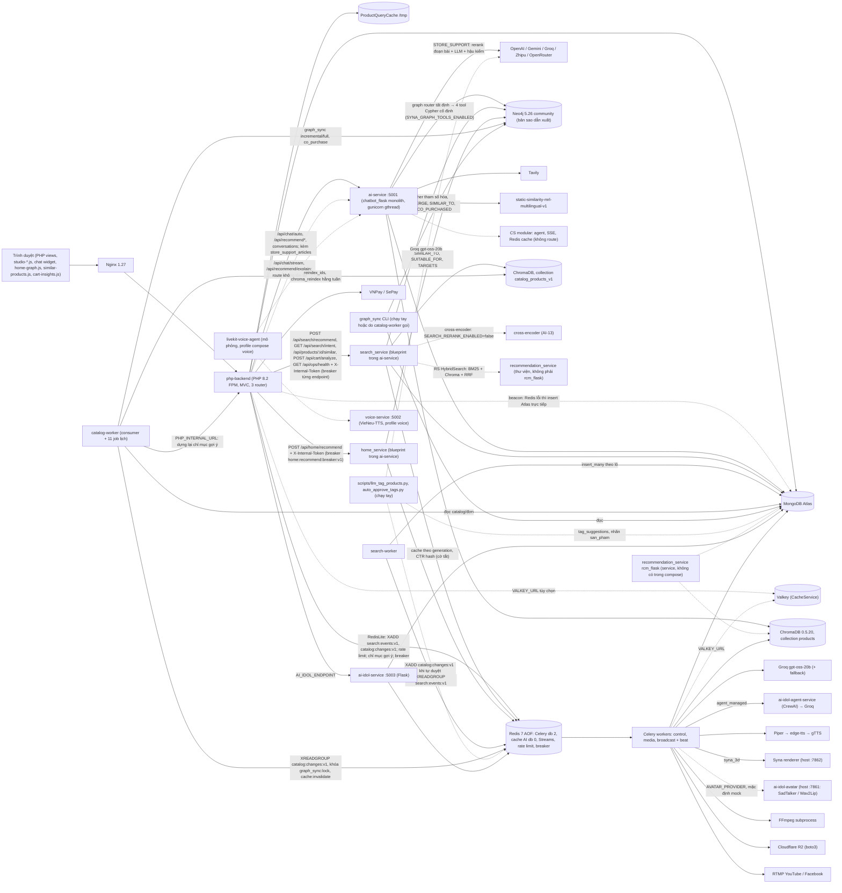

# Technology Inventory & Implementation Traceability (SkinSyntaxVN)

**Cập nhật 2026-10-22 (HEAD `42a3dfc`):** thêm Smart Search / Neo4j / graph_sync (8 commit sau `5994967`). **Rà soát bổ sung 2026-10-22 tối (HEAD `fcd021f`):** thêm số liệu runtime chỉ đọc (Neo4j, Chroma, container PHP/AI), đính chính số dòng compose/`SanPham.php`, hai commit ai-idol `284fda5`, `fcd021f` (§1 IDOL-15, §6) và khối "đang làm dở, chưa commit" §6.2.
- §1: thêm hàng BE-26..BE-31, DB-08..DB-10, AI-29..AI-34, IDOL-14, IDOL-15, INF-11, FE-15; sửa BE-02..BE-04, BE-14, BE-15, BE-17, BE-24, DB-03..DB-05, AI-01, AI-10..AI-12, AI-21, AI-34, IDOL-02, INF-01, INF-03.
- §0 thêm phát hiện 6; §2.2, §2.3, §2.5 thêm cache/compose/proxy của Smart Search; §3.2 sửa phần Chroma (collection thứ hai `catalog_products_v1`).
- §3.3 viết lại (Neo4j: ABSENT → INTEGRATED); §3.4 thêm cột search_service; §3.5, §3.6, §3.7 bổ sung; §4 vẽ lại Mermaid; §5 thêm 4 hàng; §6 thêm 8 mục chi tiết (6.1); §7 đổi trạng thái GraphRAG, Neo4j, ChromaDB, Product Knowledge Graph, RRF; §8, §10 cập nhật.
- Test đã chạy lại 2026-10-22 (không chạm DB thật): `ai-service-flask` pytest `tests/search_service` + `tests/graph_sync` = 201 passed, 8 skipped (integration cần Neo4j thật, không chạy); PHP `SanPhamSearchTokenTest` 13, `SearchEventTest` 52, `SearchFallbackTest` 47 (đều 0 failed). (Lần chạy đầu không chạy `ai-idol-service` pytest; bản rà soát tối đã chạy một nhóm nhỏ, xem dòng "Test tự chạy lại" bên dưới.)
- Số liệu mật độ graph/latency lấy từ tài liệu bàn giao (`docs/plans/smart-search-handoff.md`, `update_neo4j_search_recommendation.md`) là **bằng chứng phụ, chưa tái lập** trong lần cập nhật này. Riêng số node/cạnh Neo4j và số vector Chroma đã được **đọc lại trực tiếp ngày 2026-10-22** (chỉ đọc, thông tin đăng nhập lấy từ env của container, không in): xem DB-05, DB-08, §3.2, §3.3.
- Test tự chạy lại 2026-10-22 (host `.venv`, không DB thật; lúc chạy `ai-service-flask/` chưa có sửa đổi chưa commit): `ai-service-flask` `tests/search_service` + `tests/graph_sync` + `tests/test_recommendation_service.py` + `recommendation_service/tests` = **207 passed, 8 skipped** (8 test tích hợp Neo4j bị skip vì không đặt `NEO4J_*`); `ai-idol-service` `tests/test_multi_product_resolve.py` = 17 passed (buổi sáng), cùng `tests/test_script_selector.py` + `tests/test_script_prompt_quality.py` = **33 passed** (đêm cùng ngày, chạy trên working tree có sửa đổi chưa commit của phiên khác ở thư mục `agents/`).
- Từ sau thời điểm trên, working tree `ai-service-flask/` (search_service, graph_sync, chatbot_service, gunicorn_config), `docker-compose.yml`, `backend/`, `frontend/` có thêm nhiều sửa đổi **chưa commit** (nâng cấp giai đoạn 2, `docs/plans/upgrade-handoff.md` U01-U07). Số liệu 207 passed **không** áp dụng cho trạng thái đó. Mô tả ở mức công nghệ tại §6.2.

**Rà soát 2026-10-23 → 2026-10-27 (HEAD `8531657`, 30 commit sau `fcd021f`; giai đoạn 2 U01–U13, home-graph, store-support, tagging, bảo mật, sửa route đều đã commit):**
- 2026-10-23 (HEAD lúc đó `6ba48d8`): §0 thêm phát hiện 7; §1 thêm FE-16..FE-19, BE-32..BE-40, DB-11..DB-13, AI-35..AI-51, INF-12..INF-16, IDOL-16; bổ sung §2.2, §2.4, §2.5, §3.1–§3.5, §3.7, §3.9 theo giai đoạn 2.
- 2026-10-27: thêm home-graph (FE-20, BE-41, AI-52) và bảo mật secret (BE-42); sửa AI-37, AI-49, BE-05, BE-39 theo commit `0dda2fc`..`8531657`; viết lại §4 (Mermaid), thêm hàng §5, thêm bảng và mục `TC-2026-10-23..26` ở §6, thay §6.2; cập nhật §7, §8.1, §8.3, §8.5, §8.6, §8.7, §10 (đóng mục 21–23, thêm 27–31); thêm §9.1 (checklist 12 bước), §11 (hồ sơ 15 mục cho 14 công nghệ chính), §12 (roadmap chi tiết), §13 (quality gates); thêm bảng đối chiếu yêu cầu I–XI ngay dưới thang trạng thái.
- Kết quả test chạy lại ngày 2026-10-27 và các kiểm tra chất lượng: §13.
- **Ghi chú lúc commit (2026-11-03, HEAD `50c61ab`):** (1) `50c61ab` (2026-10-29) đổi thứ tự pool LLM của chatbot thành Groq → Gemini → Zhipu → OpenRouter → OpenAI (trả phí, cuối cùng) trong `CS/chatbot_flask.py::_build_llms`; `CS/llm_pool.py` thêm Groq và Gemini trước OpenAI; agent không còn ép model `gpt-*` cho tool calling; test mới `AF/tests/test_llm_provider_order.py`. Các chỗ ghi "OpenAI đứng đầu" (AI-03..AI-06, §11.1) là mô tả trước commit này. (2) Working tree có `ai-service-flask/agent_graph/` dùng LangGraph `StateGraph` (`agent_graph/graph.py:13,254`), **đã stage bởi một phiên khác nhưng chưa commit**, và `AF/requirements.txt` thêm `langgraph>=1.0,<2` (chưa stage). Chưa kiểm chứng; khi phần này được commit, dòng LangGraph ở §7 không còn ABSENT. Hai thay đổi này chưa được rà soát đầy đủ trong file.

Nhánh `syna`, HEAD lúc kiểm kê: `42a3dfc` (2026-10-22; bản đầu kiểm kê ở `5994967`, 2026-10-21; lúc rà soát cuối HEAD đã là `fcd021f`, hai commit thêm chỉ đụng `ai-idol-service/` và index.php allow-list). Working tree còn nhiều thay đổi chưa commit — tài liệu này mô tả HEAD, các thay đổi đó chỉ được tóm tắt ở §6.2. Tài liệu bàn giao kỹ thuật cho AI Coding Agent kế tiếp.
File tổng của dự án vẫn là [`update.md`](update.md) (handoff Syna self-healing: state machine, data model, API, validation, TTS normalize). File này **không lặp lại** nội dung đó mà trỏ tới mục tương ứng (`update.md §N`). Chi tiết catalog constraints: [`update_catalog_constraints.md`](update_catalog_constraints.md). Chi tiết Smart Search/Neo4j (bằng chứng phụ): [`update_smart_search_neo4j.md`](update_smart_search_neo4j.md), [`update_neo4j_search_recommendation.md`](update_neo4j_search_recommendation.md), [`docs/plans/smart-search-handoff.md`](docs/plans/smart-search-handoff.md), schema đồ thị [`docs/neo4j/schema.md`](docs/neo4j/schema.md). Khi lệch giữa các tài liệu này và code, **code là nguồn đúng**.

**Phương pháp:** đọc manifest/lockfile, Dockerfile, `docker-compose.yml`, source, `git log`; grep có loại trừ `.git`, `.venv`, `vendor`, `node_modules`, `chroma_data`, `__pycache__`, `.gitnexus`. Chỉ đọc; không sửa code, không ghi DB, không chạy `backend/tests/*` (ghi Atlas thật).
**Bằng chứng:** `đường/dẫn:dòng` hoặc commit hash. Viết tắt: `AF/` = `ai-service-flask/`, `CS/` = `ai-service-flask/chatbot_service/`, `RS/` = `ai-service-flask/recommendation_service/`, `SS/` = `ai-service-flask/search_service/`, `GS/` = `ai-service-flask/graph_sync/`, `IS/` = `ai-idol-service/`, `AG/` = `ai-idol-agent-service/`, `AV/` = `ai-idol-avatar-service/`; thêm từ 2026-10-23: `WK/` = `ai-service-flask/workers/`, `RK/` = `ai-service-flask/shared/redis_kit/`, `TG/` = `ai-service-flask/tagging/`, `BA/` = `backend/app/`.
**Không có bí mật** trong tài liệu: chỉ ghi TÊN biến môi trường, không ghi giá trị `.env`. Không có benchmark tự đo; số liệu hiệu năng duy nhất là số do commit message tự ghi (nói rõ ở chỗ dùng).
Số dòng có thể lệch vài dòng sau các commit mới; khi lệch, tìm theo tên hàm/biến được nêu kèm. Số dòng trong phần cập nhật 2026-10-22 tính theo HEAD `42a3dfc` (kiểm bằng `git grep ... HEAD`); working tree hiện dịch dòng vì có sửa đổi chưa commit (ví dụ `getSimpleRecommenderProducts` ở `SanPham.php` nằm `:1328` ở HEAD nhưng `:1555` ở working tree).

### Thang trạng thái

| Status | Nghĩa |
|---|---|
| INSTALLED | Có trong manifest/lockfile/image, chưa thấy code dùng |
| REFERENCED | Có import/tên/biến/cấu hình nhưng không có luồng chạy thật |
| IMPLEMENTED | Có code thực thi, nhưng chưa nối vào entry point đang chạy hoặc chưa chứng minh chạy end-to-end |
| INTEGRATED | Được gọi trong luồng thật từ entry point (route, task, beat) |
| VERIFIED | INTEGRATED + có test/E2E/số đo thật có ghi nhận |
| PARTIAL | Chỉ một phần hoạt động (một nhánh rỗng, mặc định tắt, mô phỏng...) |
| PLANNED | Chỉ có trong docs/plan/báo cáo |
| DEPRECATED | Còn dấu vết nhưng đã thôi dùng |
| UNKNOWN | Không xác minh được bằng bằng chứng hiện có |
| ABSENT | Không có dấu vết nào (dùng cho mục roadmap) |

Có trong manifest **không** có nghĩa là đang hoạt động.

### Bản đồ yêu cầu I–XI → mục trong file

File giữ cách đánh số §0–§13 vì các tài liệu khác đang trỏ tới `§N`. Bảng dưới cho biết mỗi mục của yêu cầu kiểm kê (MASTER PROMPT I–XI, `docs/tech-inventory/MASTER_PROMPT.md`) nằm ở đâu.

| Yêu cầu | Mục trong file |
|---|---|
| I. Technology Discovery & Audit | Phần đầu file (phương pháp, nguồn bằng chứng, thang trạng thái), §0 (phát hiện chính), §10 (UNKNOWN) |
| II. Complete Technology Matrix | §1: 1.1 Frontend (A), 1.2 Backend (B), 1.3 Databases (C), 1.4 AI (D), 1.5 Multimedia (E), 1.6 Infrastructure (F) |
| III. Detailed Technology Profile | §2 (web/DB/infra, dạng rút gọn), §11 (đủ 15 mục cho 14 công nghệ chính) |
| IV. AI Technology Deep Dive | §3 (3.1 LLM, 3.2 Embedding/vector, 3.3 GraphRAG/Neo4j, 3.4 Hybrid Search, 3.5 Agent orchestration, 3.6 Constraint solver, 3.7 Recommender, 3.8 Video AI Idol, 3.9 Voice) |
| V. Technology Dependency Graph | §4 (Mermaid) |
| VI. Technology-to-Feature Traceability | §5 |
| VII. Technology Change History | §6 (bảng theo commit, 6.1 chi tiết từ 2026-10-21, 6.2 working tree chưa commit) |
| VIII. Technology Roadmap | §7 (trạng thái thật của 14 công nghệ), §12 (thiết kế cho công nghệ chưa bật hoặc chưa có) |
| IX. Quick Reference for Next AI Agent | §8 (8.6: bốn câu hỏi bắt buộc), §11 |
| X. Automatic Documentation Update Rule | §9, §9.1 |
| XI. Quality Gates | §13 |

---

## 0. Bảy phát hiện quan trọng nhất (đọc trước khi sửa)

Số dòng trong mục 1-6 dưới đây là số lúc viết (HEAD `42a3dfc`) trừ khi có ghi "2026-10-23". Vị trí đã dịch ở HEAD `6ba48d8` của các điểm hay dùng nằm ở §8.2 (bảng "Đính chính số dòng").

1. **Chatbot có hai bộ code, chỉ một bộ chạy.** Docker chạy monolith `CS/chatbot_flask.py` (`Dockerfile.ai:45` CMD `chatbot_service.chatbot_flask:app`). Bộ modular (`CS/pipeline.py`, `agent.py`, `agent_stream.py`, `router.py`, `llm_pool.py`, `session_cache.py`, `response_cache.py`, `redis_store.py`, `cart_analysis.py`) **không được route nào import** (grep không có lệnh import nào trong `AF/`). Toàn bộ route của monolith nằm ở `CS/chatbot_flask.py:3316-3741` (đo 2026-10-23; số cũ `~3134-3508`): `/health`, `/api/health`, `/api/chat`, `/api/chat/auto`, `/api/recommend`, `/api/recommend/profile|llamaindex|langchain-rag`, `/api/chat/conversations`. Từ `9dbc34c` monolith còn đăng ký thêm blueprint `search_bp` (`CS/chatbot_flask.py:3305-3312` đo 2026-10-23, số cũ `3124-3131`; bọc try/except, lỗi import không chặn chat): `POST /api/search/recommend`, `GET /api/search/health` (xem phát hiện 6). Từ 2026-10-23 blueprint còn có `GET /api/search/intent`, `GET /api/products/<product_id>/similar`, `POST /api/cart/analyze`, `GET /api/ops/health` (`SS/routes.py:104,132,169,234`; commit `eebfadb`, `917a5c8`, `8a40395`). Bộ modular nói trên vẫn không có route nào dùng; chỉ `gunicorn_config.py::post_fork` import `retrieval`/`llm_pool`/`session_cache` để làm ấm (đã có từ trước `42a3dfc`) và script `scripts/llm_tag_products.py` import `llm_pool.get_llms` (AI-49).
2. **Hybrid search của chat đang chạy gần như chỉ còn dense.** Monolith khởi tạo `BM25Search()` rỗng (`CS/chatbot_flask.py:157` đo 2026-10-23, số cũ `:137`), nên nhánh BM25 trả `[]`; lời gọi tìm kiếm chính đặt `use_reranker=False` (`:2688`, `:2754`; số cũ `:2506`, `:2572`). RRF vẫn chạy nhưng thực chất chỉ xếp lại một nhánh.
3. **Compose trỏ PHP tới hai route Flask không tồn tại:** `AI_CHAT_STREAM_ENDPOINT=.../api/chat/stream` và `AI_RECOMMENDATION_ENDPOINT=.../api/recommend/explain` (`docker-compose.yml:350-351` đo 2026-10-23; từng là `:252-253`, rồi `:216-217` trước khi thêm service neo4j). Monolith không có hai route này; `/api/recommend/explain` chỉ có ở `RS/rcm_flask.py`, mà service đó không có trong compose. PHP có nhánh fallback khi stream lỗi (`HomeController.php` khoảng `:4020-4067` đo 2026-10-23, số cũ `:4160`; `stream_request_failed`).
4. **Recommender "Simple IMDb WR / TF-IDF / Hybrid V1" nằm ở PHP, không ở Python.** `backend/app/models/SanPham.php:1320-1332` (`getSimpleRecommenderProducts`, WR, m=21, C=4.8890; số dòng cũ `1176-1187` đã lệch sau `e42f4ac`/`42a3dfc`; ở HEAD 2026-10-23 hàm định nghĩa tại `SanPham.php:1566`), `backend/app/services/ContentBasedRecommender.php` (TF-IDF tự cài), `PersonalizedDealRanker.php`. Python không có scikit-learn.
5. **Kiểm tra xung đột thành phần trong giỏ là 4 luật cứng trong PHP** (`HomeController::detectCartIngredientConflicts`, `backend/app/controllers/HomeController.php:1707` đo 2026-10-23, số cũ `:1858`; gọi tại `:3019`), chạy trước khi gọi Flask, không dùng LLM; vẫn đúng 4 luật `retinol_vitamin_c`, `retinol_aha_bha`, `benzoyl_peroxide_retinol`, `aha_bha_vitamin_c` (đọc lại 2026-10-23). **Bổ sung từ `917a5c8`:** trang giỏ (`giohang.php`) có thêm một đường thứ hai, độc lập với chatbot: `POST /api/cart/analyze` dùng `conflict_rules.yaml` (11 luật, 55 cặp INCI) qua Neo4j `CONFLICTS_WITH`, rơi về luật Python khi Neo4j lỗi (BE-16, BE-37, AI-39). Hai đường này chưa được hợp nhất.
6. **Smart Search là đường truy xuất thứ hai, tách khỏi chatbot, và là nơi Neo4j + hybrid thật sự chạy.** Khi trang `tatca` tìm ra `< 4` kết quả ở trang 1, PHP gọi `POST /api/search/recommend` (`SanPhamController.php:400-401`, `buildSearchFallback`); Flask chạy song song tối đa 5 nhánh (semantic, trending, same_brand, category_alt, personalized), mỗi nhánh có timeout chung `SEARCH_TIMEOUT_MS` (mặc định 800), rồi xếp hạng bằng trọng số, không dùng LLM (`SS/service.py`, `SS/ranker.py`). Nhánh `semantic` **tái dùng** `recommendation_service.HybridSearch` (BM25 + Chroma + RRF của RS) trên collection **riêng** `catalog_products_v1` (không phải `products`); nên code RS không còn "không chạy" hoàn toàn, nhưng `rcm_flask` vẫn không có trong compose. Neo4j chỉ Flask kết nối (PHP không). Neo4j hỏng → `degraded:true`, vẫn trả `semantic` + `trending`, không 5xx; Flask hỏng → PHP rơi về "bán chạy" (`SearchFallbackBuilder`, `SanPham::bestSellers`) và breaker 3 lỗi/60 s (`SearchRecommendClient.php`). (Cập nhật 2026-10-23: breaker nay riêng cho mỗi endpoint, xem BE-27.)
7. **Từ 2026-10-23 (giai đoạn 2, commit `ae3170a`..`72e37d1`) chatbot Syna dùng Neo4j theo kiểu graph-as-tool, hai container nền mới giữ đồ thị đồng bộ, và Redis thành nền chung.** (a) `CS/graph_router.py` (router tất định, không function-calling) chọn một trong 4 tool Cypher cố định của `CS/graph_tools.py` (`find_products`, `check_conflicts`, `explain_product`, `similar_products`); móc vào `xu_ly_cau_hoi` sau nhánh STORE_SUPPORT và trước `contextualize_query` (`CS/chatbot_flask.py:2287-2305`); LLM không viết Cypher, chỉ diễn đạt kết quả, giá/tồn kho đọc lại từ Mongo; cờ `SYNA_GRAPH_TOOLS_ENABLED` (code mặc định false, compose mặc định true); Neo4j lỗi, quá hạn 0,6 s hoặc không khớp thì trả `None` và chạy RAG cũ. Đây vẫn chưa phải GraphRAG đầy đủ (§7). (b) Nhánh `STORE_SUPPORT` (`CS/store_support.py`, `chatbot_flask.py:2264-2285`) trả lời câu hỏi chính sách/hướng dẫn từ các bài PHP gửi sang (`store_support_articles`), nên các câu này không còn rơi vào Tavily/web của shop khác. (c) Hai container dùng chung image `skinsyntax-ai-service`: `search-worker` (Redis Stream `search:events:v1` → Mongo `search_events`) và `catalog-worker` (consumer `catalog:changes:v1` + 11 job lịch Asia/Ho_Chi_Minh, gồm `graph_sync_full` 02:30), nên đồng bộ Neo4j/Chroma không còn chạy tay (§10 #21). (d) Redis được dùng làm nền chung (`RK/`, PHP `RedisLite`/`RateLimiter`): Streams, Pub/Sub invalidation theo bộ đếm "generation", rate limit, khóa phân tán, AOF bật. Chi tiết: AI-35..AI-51, BE-32..BE-40, DB-11..DB-13, INF-12..INF-16, §6.1 TC-2026-10-23-02..10.

---

## 1. Ma trận công nghệ

Version lấy từ manifest/lockfile/image tag; `>=` là cận dưới, "không pin" khi manifest không ghi. "Host" là bản cài trong Python máy kiểm kê, không chắc bằng image Docker.

### 1.1 Frontend

| ID | Technology | Category | Version | Purpose | Module | Status | Evidence |
|---|---|---|---|---|---|---|---|
| FE-01 | PHP views (server-rendered) | UI | PHP 8.2 (image) | UI khách + admin | `frontend/views/*.php` | INTEGRATED | `Dockerfile.php:1`; router `backend/public/index.php:99-775` |
| FE-02 | Bootstrap CSS/JS (vendored) | UI lib | không pin | Layout | `frontend/public/assets/css/bootstrap.min.css`, `assets/js/bootstrap.bundle.min.js` | INTEGRATED | thư mục assets |
| FE-03 | Bootstrap Icons, FontAwesome (vendored) | UI lib | không pin | Icon | `assets/css/bootstrap-icons.min.css`, `fontawesome.min.css` | INTEGRATED | thư mục assets |
| FE-04 | Google Fonts (CDN) | UI | không pin | Font | `frontend/views/layouts/*` | INTEGRATED | grep `fonts.googleapis.com` |
| FE-05 | Chart.js (CDN jsdelivr) | Chart | 4.4.1 | Biểu đồ admin | `frontend/views` | INTEGRATED | grep `chart.js@4.4.1` |
| FE-06 | livekit-client (CDN) | Realtime | 2.1.2 | Live stream phía client | `frontend/views/live.php` | IMPLEMENTED (chưa xác minh chạy với LiveKit thật) | grep; token tự ký `LiveController.php:294` |
| FE-07 | Vanilla JS live-filter / live-search / smart-search | UI logic | n/a | Tìm/lọc tức thì; từ `eebfadb` `smart-search.js` là dropdown gợi ý theo nhóm (Sản phẩm, Thương hiệu, Danh mục, Tìm kiếm phổ biến), debounce 150 ms, `AbortController` hủy request cũ, ARIA listbox (`aria-activedescendant`), chỉ nhận `*_html` đã escape | `frontend/public/assets/js/live-filter.js`, `live-search.js`, `smart-search.js` | INTEGRATED; E2E Playwright :8080 (gõ "tor" ra nhóm hãng Torriden, bàn phím, 375 px) chỉ có trong sổ U04 (ảnh `report/upgrade-e2e/u04-*.png`), tôi không chạy lại | `backend/public/index.php:12-17` (`session_write_close` cho live-filter); `smart-search.js:12` (`DEBOUNCE_MS`), `:82` (`aria-activedescendant`), `:255` (`AbortController`) |
| FE-08 | Chat widget (JS inline trong view) | UI | n/a | Chat + thẻ xung đột | `frontend/views/components/ai_chat_widget.php:1667-1823` | INTEGRATED | route `ai_chat_*` `backend/public/index.php:241-268` |
| FE-09 | goiy-recommendation.js, chat-purchase.js, product-video.js | UI logic | n/a | Gợi ý, mua trong chat, video PDP | `frontend/public/assets/js/` | INTEGRATED | `backend/app/routes/store_assistance.php:22-24` |
| FE-10 | AI Idol Studio JS (`studio-*.js`) | UI | n/a | Studio tạo kịch bản/video | `frontend/public/assets/js/studio-*.js`, `frontend/views/admin/ai_idol/index.php` | VERIFIED (node --test 109/109, update.md §1.2; E2E mock §12.4) | `backend/app/routes/ai_idol.php` |
| FE-11 | Three.js (vendored) mascot 3D/demo | 3D | không pin | Mascot Syna | `frontend/public/ai-idol-mascot-3d/`, `ai-idol-mascot-demo/` | IMPLEMENTED (trang tĩnh độc lập) | `ai-idol-mascot-3d/package.json` |
| FE-12 | `node --test` | Test | Node không pin | Unit test JS | `frontend/public/assets/js/tests/*.test.js`, mascot `tests/` | VERIFIED (studio, update.md §1.2) | lệnh trong update.md §1.2 |
| FE-13 | Playwright (qua Playwright MCP) | E2E | không pin (không có package.json/playwright.config ở gốc) | E2E Studio, product video | `e2e/syna-self-healing.e2e.js`, `scripts/e2e/*.cjs` | PARTIAL (route backend bị mock: chứng minh UI, không chứng minh backend) | `e2e/syna-self-healing.e2e.js:2-4,15-30` |
| FE-14 | Expo / React Native | Mobile | expo ~57.0.24, react-native 0.86.3, react 19.2.3 | App di động | `mobile/` | INSTALLED (chưa xác minh gọi backend) | `mobile/package.json` |
| FE-15 | Khối "Gợi ý thêm" khi tìm ít kết quả (partial PHP + JS/CSS vanilla, gửi sự kiện bằng `navigator.sendBeacon`, fallback `fetch keepalive`, tới `r=search_event`) | UI | n/a | Hiển thị section Smart Search, chip, gửi sự kiện | `frontend/views/partials/search_fallback.php`, `frontend/public/assets/js/search-fallback.js`, `assets/css/search-fallback.css`, `frontend/views/tatca.php` | INTEGRATED; E2E Playwright MCP có ghi nhận trong handoff (ảnh `report/search-fallback-e2e/`, `report/search-final-e2e/`; bằng chứng phụ, chưa tái chạy). Từ `eebfadb` (JS) beacon gửi thêm `product_ids` (thứ tự hiển thị, impression), `position` (click/add_to_cart), `experiment` + `variant` (từ `data-ssf-experiment`/`data-ssf-variant`); phía nhận là `SearchEventTracker` (`b7db97b`, BE-29); các section `similar`, `routine`, `conflict` dùng chung `search_event` (`search-fallback.js:53-54,107,122`) | commit `2f90ba0`, `8820877`, `eebfadb`; `docs/plans/smart-search-handoff.md` |
| FE-16 | Khối "Sản phẩm tương tự" ở trang chi tiết (partial PHP, JS vanilla tải lười bằng `IntersectionObserver` + `fetch`, CSS scroll-snap; lỗi hoặc 204 thì tự ẩn) | UI | n/a | Carousel gợi ý SP tương tự có nhãn lý do và nút thêm giỏ; không làm chậm TTFB; beacon section `similar` (`q = similar:<id>`) | `frontend/views/partials/similar_products.php`, `frontend/public/assets/js/similar-products.js`, `assets/css/similar-products.css`, `frontend/views/chitiet.php:1682-1691`; endpoint PHP `SanPhamController::similarProducts` (BE-37) | INTEGRATED. Bằng chứng phụ (sổ U08, chưa tái chạy): `SimilarProductsTest` 41 pass, E2E Playwright :8080 (ảnh `report/upgrade-e2e/u08-*.png`); tôi không chạy PHP/E2E | commit `917a5c8`; `update_similar_products.md` |
| FE-17 | Khối giỏ hàng "Lưu ý khi dùng chung hoạt chất" + "Hoàn thiện routine" (partial PHP, JS bọc `fetch` của giỏ để phân tích lại khi thêm/xóa, CSS) | UI | n/a | Cảnh báo cặp hoạt chất kỵ nhau (high/medium/low) và gợi ý bước routine còn thiếu; không chặn thanh toán; lỗi hoặc rỗng thì ẩn | `frontend/views/partials/cart_insights.php`, `assets/js/cart-insights.js`, `assets/css/cart-insights.css`, `frontend/views/giohang.php:155-159`; endpoint PHP `SanPhamController::cartInsights` (BE-37) | INTEGRATED. Bằng chứng phụ (sổ U09, chưa tái chạy): `CartInsightsTest` 37 pass, E2E Playwright (ảnh `report/upgrade-e2e/u09-*.png`, kể cả tắt Neo4j); tôi không chạy PHP/E2E | commit `917a5c8`; `update_cart_conflicts.md` |
| FE-18 | Trung tâm hỗ trợ accordion 4 cấp (`
` lồng nhau, lọc tức thì không dấu, deep-link, `quicksend:` "Hỏi Syna"; chạy được khi tắt JS) | UI | n/a | Một trung tâm hỗ trợ thay cho các trang `ho_tro_khach_hang`, `bao_hanh` và trang pháp lý riêng; nhóm "Hướng dẫn sử dụng" (9 bài) | `frontend/views/info/support.php`, `frontend/public/assets/js/support-center.js`, `assets/css/support-center.css`; `SupportController::show` (BA/controllers) | INTEGRATED. Bằng chứng phụ (sổ store-support Bước 03, Playwright :8080, ảnh `report/store-support-e2e/step-03/`, chưa tái chạy) | commit `ae3170a` |
| FE-19 | Giao diện admin mới: duyệt nhãn công dụng (`admin_tag_review`), khối checkbox nhãn trong form sửa SP, trang chỉ-đọc "Vận hành tìm kiếm" (`admin_search_ops`), hai mục menu | UI | n/a | Người duyệt nhãn do AI gợi ý; xem sức khỏe Neo4j, Chroma, Redis, job | `frontend/views/admin/tag_review.php`, `admin/search_ops.php`, `admin/suaSP.php`, `admin/layouts/header.php` | INTEGRATED. Bằng chứng phụ (sổ U07/U11): Playwright với tài khoản admin test, ảnh `report/upgrade-e2e/u07-*.png`, `u11-admin-search-ops.png`; tôi không chạy E2E | commit `69b575a`, `8a40395` |
| FE-20 | Khối gợi ý trang chủ từ đồ thị: "Vì bạn đã xem …", "Hợp với {loại da} của bạn", "Bạn đang quan tâm vấn đề da nào?" (9 chip `role="tab"` + lưới 8 thẻ); JS vanilla bấm chip → `AbortController` hủy request cũ → skeleton → `fetch(r=home_concern)`, lỗi thì nút thử lại | UI | n/a | Thêm 3 khối cá nhân hóa, không đổi các khối cũ; khối `null` thì không in gì | `frontend/views/partials/home_graph_{seen,skin,concern,concern_grid}.php`, `partials/home_product_card.php`, `frontend/public/assets/js/home-graph.js`, `frontend/views/home.php` (3 include + 1 script) | INTEGRATED (merge `cd9924e`, sửa `6b7c021`, `07ceff1`). E2E trình duyệt chỉ ghi trong `update_home_graph_recommend.md` (bằng chứng phụ, chưa tái chạy) | commit `627d75e`; `update_home_graph_recommend.md` |

### 1.2 Backend (PHP)

| ID | Technology | Category | Version | Purpose | Module | Status | Evidence |
|---|---|---|---|---|---|---|---|
| BE-01 | PHP-FPM | Runtime | `php:8.2-fpm-alpine` | Chạy PHP | `Dockerfile.php:1` | INTEGRATED | compose `php-backend` |
| BE-02 | ext-mongodb (PECL) | Driver | không pin; runtime container `skinsyntax-php` (2026-10-22): ext-mongodb 2.4.0, PHP 8.2.33 | BSON/driver | `Dockerfile.php:5-8` | INTEGRATED | idem |
| BE-03 | mongodb/mongodb | Library | 1.19.1 (lock); **runtime container: 2.4.0** (`vendor/composer/installed.json`, 2026-10-22) | Client/Collection API | `backend/app/config/db.php:55-97` | INTEGRATED (lệch lock vì `composer update --ignore-platform-reqs` trong `Dockerfile.php:16`, xem BE-23 và §10) | `backend/composer.lock`; `Dockerfile.php:16` |
| BE-04 | predis/predis | Library | ^3.7 (lock v3.7.0); **không có trong vendor của container** (2026-10-22) | Client Valkey cho CacheService | `backend/app/services/CacheService.php` | PARTIAL (chỉ bật khi có `VALKEY_URL`; `class_exists('Predis\Client')` = false trong container nên đường Valkey không chạy được ở image hiện tại) | `backend/composer.json`; commit `39c6b88` |
| BE-05 | Front-controller `switch ($_GET['r'])` | Router | n/a | ~200 route | `backend/public/index.php:99-775`; bản XAMPP `index.php` gốc | INTEGRATED (ba bản router lệch nhau: `backend/public/index.php` (Docker), `frontend/public/index.php`, `index.php` gốc (XAMPP)). `8531657` (2026-10-26) nối lại ở cả ba file các handler có sẵn nhưng thiếu route: `capnhatthongtin`/`capnhathoso`, `apdung_voucher`, `bo_voucher`, `apdung_diem`, `bo_diem`, `guidanhgia`/`danhgia_sanpham`, `guicauhoi`/`hoidap_sanpham`, `lichsuchat`, `chat_send`; bỏ case chết `diachi_macdinh`, `xoa_diachi`; test tĩnh `backend/tests/unit/BrokenRoutesWiringTest.php`. Thao tác ghi khi đăng nhập NOT RUN (theo commit message). `home_concern` vẫn thiếu ở `frontend/public/index.php` | so sánh ba file; commit `8531657`, `07ceff1` |
| BE-06 | MVC thuần (không framework) | Architecture | n/a | Nghiệp vụ | `backend/app/{controllers,models,services}` | INTEGRATED | `HomeController.php` 5432 dòng |
| BE-07 | Session PHP + bcrypt | Auth | n/a | Đăng nhập khách/nhân viên | `AuthController.php:297,331`; `NguoiDung.php:40` | INTEGRATED | idem |
| BE-08 | OAuth Google/Facebook | Auth | n/a | Social login | `AuthController.php`, `config.php:97-102` | IMPLEMENTED (chưa xác minh kiểm chữ ký JWT, xem §11) | `backend/public/index.php:359-366` |
| BE-09 | CSRF token | Security | n/a | Chống CSRF | `AdminAiIdolController.php:81-110`, `ShopAssistantController`; từ `69b575a` thêm `AdminTagController::csrfOk` (token theo phiên khóa `admin_tag_csrf`, `TagCuration::csrfValid`); beacon `search_event` dùng CSRF HMAC không trạng thái (BE-29) | PARTIAL (AI Idol admin, mua trong chat, duyệt nhãn admin, beacon; giỏ hàng và đa số form khác vẫn không CSRF) | grep `csrf` |
| BE-10 | JWT HS256 tự ký | Auth | n/a | Token phòng LiveKit | `LiveController.php:294` | IMPLEMENTED | idem |
| BE-11 | Proxy cURL PHP → ai-service | Integration | ext-curl | Chat/gợi ý | `HomeController.php:1770-1795,3222-3260,3344-3382,3503-3530` | INTEGRATED | `config.php:122-131` |
| BE-12 | Proxy cURL PHP → ai-idol-service | Integration | ext-curl | Studio, video PDP | `AdminAiIdolController.php:39,166-170,342-348,509-516`; `ProductVideoClient.php` | INTEGRATED | update.md §6.1 |
| BE-13 | RecommendationClient (retry 2) | Integration | n/a | Client gợi ý có retry | `backend/app/services/RecommendationClient.php:134-148` | REFERENCED (không có chỗ nào khởi tạo) | grep `new RecommendationClient` = 0 |
| BE-14 | ProductQueryCache (file cache) | Performance | n/a | Giảm round-trip Atlas | `backend/app/services/ProductQueryCache.php` | VERIFIED (test `backend/tests/product_query_cache_test.php`; số đo trong commit message). Từ `42a3dfc` dùng thêm cho `suggest`/`trending`/`collection`/`recsections` (TTL 120 s) và `filterOptions:*` (600 s); từ `2f90ba0` cho `search:bestSellers:*` (300 s) | commit `bdc14ec`, `42a3dfc`, `2f90ba0`; `SanPham.php`, `HomeController.php` |
| BE-15 | CacheService (Valkey + L1 + file) | Performance | n/a | Cache-aside | `backend/app/services/CacheService.php` | PARTIAL (`VALKEY_URL` mặc định rỗng → L1 + file) | `docker-compose.yml:268-269` |
| BE-16 | Luật xung đột thành phần giỏ (4 luật) | Rule engine | n/a | Cảnh báo phối hợp hoạt chất | `HomeController.php:1858-1935`, gọi tại `:3143` (HEAD 2026-10-23: định nghĩa `:1707`, gọi `:3019`, vẫn 4 luật; grep `backend/tests` không thấy test gọi hàm này). Đường độc lập thứ hai cho trang giỏ từ `917a5c8`: AI-39 (11 luật YAML, 55 cặp INCI) + BE-37 | INTEGRATED (4 luật PHP: chưa thấy test riêng; đường trang giỏ xem AI-39/BE-37) | idem |
| BE-17 | Simple IMDb Weighted Rating | Recommender | n/a | Top sản phẩm theo rating | `backend/app/models/SanPham.php:1176-1190` (gọi), `:1320-1332` (`getSimpleRecommenderProducts`); `PersonalizedDealRanker.php:198-203` | INTEGRATED | m=21, C=4.8890 `SanPham.php:1330-1332` (đã chỉnh số dòng 2026-10-22) |
| BE-18 | Content-based TF-IDF (tự cài) | Recommender | n/a | Tương tự theo nội dung | `backend/app/services/ContentBasedRecommender.php:892-1037` | INTEGRATED | cache `backend/app/content/tfidf_cache.json` |
| BE-19 | Hybrid V1 (hành vi + hồ sơ + loại da + ngân sách) | Recommender | n/a | Xếp hạng cá nhân hóa | `ContentBasedRecommender.php:1-40`; `PersonalizedDealRanker.php:34-48` | INTEGRATED (trọng số ghi "engineering baseline", chưa tune) | `ContentBasedRecommender.php:25-40` |
| BE-20 | CF/SVD/kNN, FP-Growth, BPR | Recommender | n/a | Collaborative + luật kết hợp | `backend/app/services/*`, `backend/experiments/` | PARTIAL/UNKNOWN (BPR cô lập trong experiments; cache `cf_model_cache.json`, `frequently_bought_together.json` chưa kiểm logic) | commit `6009104`, `25b792b` |
| BE-21 | VNPay | Payment | sandbox mặc định | Thanh toán | `backend/app/services/VnpayService.php`; route `index.php:202-212` | IMPLEMENTED (chưa xác minh với VNPay thật) | `config.php:116-119` |
| BE-22 | SePay / chuyển khoản | Payment | n/a | Xác nhận chuyển khoản | `config.php:104-114`; route `admin_sepay_webhook` | IMPLEMENTED | idem |
| BE-23 | Composer | Tooling | composer:2 | Cài deps | `Dockerfile.php:10-16` | INTEGRATED (dùng `composer update`, bỏ qua lock: build không tái lập) | `Dockerfile.php:16` |
| BE-24 | OPcache | Performance | memory 128; từ `42a3dfc` thêm `validate_timestamps=1`, `revalidate_freq=60`, `realpath_cache_size=4096K`, `realpath_cache_ttl=600` | Tăng tốc PHP; giảm kiểm tra timestamp trên bind-mount Windows | `Dockerfile.php:25-26`; `docker/php/zz-skinsyntax-opcache.ini` (COPY `Dockerfile.php:24`, mount ở compose) | INTEGRATED; runtime chỉ đọc 2026-10-22 trong container `skinsyntax-php` (`ini_get`): `opcache.revalidate_freq=60`, `validate_timestamps=1`, `realpath_cache_size=4096K`, `realpath_cache_ttl=600`, file `zz-skinsyntax-opcache.ini` có mặt trong `conf.d`; số đo duy nhất là do commit message `42a3dfc` tự ghi (trang chủ khi cách 3 s: 0.80 s → ~0.07 s, không kèm file đo, chưa tái lập). Hệ quả: sửa PHP có thể mất tới 60 s mới áp dụng, trừ khi reload FPM | `docker/php/zz-skinsyntax-opcache.ini:1-3` |
| BE-25 | Test runner PHP | Test | không có | n/a | `backend/tests/*.php` chạy tay; không `phpunit.xml` | UNKNOWN (không runner, không CI). Test thuần PHP không DB trong `backend/tests/unit/` chạy trực tiếp bằng `php <file>`. Từ 2026-10-23 thư mục này có 16 file: `SanPhamSearchToken`, `SearchEvent`, `SearchFallback`, `SearchOpsClient`, `SearchRanking`, `SearchSuggest`, `SimilarProducts`, `CartInsights`, `CatalogEvents`, `HoaDonStockEvent`, `RateLimiter`, `RedisLite`, `TagCuration`, `SupportContent`, `SupportRank`, `AdminStatsTestAccounts` (đều `*Test.php`); rà soát này **không chạy** chúng (luật không chạy `backend/tests/*`), mọi số PHP pass trong tài liệu là bằng chứng phụ từ các sổ bàn giao | glob `backend/tests/unit/*.php` (2026-10-23) |
| BE-26 | Token search không dấu (regex `[aàáạ...]` theo ký tự + AND giữa token, OR giữa trường, tối đa 6 token, stopword) | Search | n/a | Tìm sản phẩm theo từng token, không phân biệt dấu | `backend/app/models/SanPham.php` (`tokenizeSearchQuery`, `buildAccentInsensitiveRegex`, `buildTokenSearchFilter`); `SanPhamController.php` | VERIFIED (test `backend/tests/unit/SanPhamSearchTokenTest.php`: 13 passed, chạy 2026-10-22, thuần PHP không DB; truy vấn Atlas thật chỉ có trong handoff) | commit `e42f4ac` |
| BE-27 | SearchRecommendClient (cURL, timeout 1200/300 ms, không retry, circuit breaker 3 lỗi → mở 60 s) | Integration | ext-curl | PHP → Flask `/api/search/recommend`; validate response. Từ `b7db97b` (commit gộp client của nhiều bước U03-U11, còn Flask endpoint nằm ở `eebfadb`/`917a5c8`/`8a40395`) có thêm `intent()` (`:133`, GET `/api/search/intent`, timeout 300 ms), `similar()` (`:198`, timeout `SEARCH_SIMILAR_TIMEOUT_MS` 800), `cartAnalyze()` (`:252`), `opsHealth()` (`:171`); **breaker riêng mỗi endpoint** (`search:recommend:breaker:v1`, `search:intent:breaker:v1`, `search:similar:breaker:v1`, `search:cart:breaker:v1`, 3 lỗi → mở 60 s); Flask trả 429 được PHP coi như lỗi | `backend/app/services/SearchRecommendClient.php` (+ `SearchBreakerRedis` nay bọc `RedisLite`, BE-32; breaker ưu tiên CacheService/Valkey nếu cấu hình) | VERIFIED (test `SearchFallbackTest.php`: 47 passed, 2026-10-22, transport giả, tự chạy; sổ U12 ghi 53 pass sau khi thêm các endpoint, 2026-10-23, chưa tự chạy lại) | commit `2f90ba0`, `b7db97b`; env `SEARCH_RECOMMEND_ENDPOINT`, `SEARCH_INTERNAL_TOKEN`, `SEARCH_RECOMMEND_TIMEOUT_MS`, `SEARCH_BREAKER_REDIS_URL` |
| BE-28 | SearchFallbackBuilder / SearchReasonFormatter / SearchSkinProfile / `config/search_reasons.php` | Search UI logic | n/a | Dựng section + chip + lý do tiếng Việt; hồ sơ da rút gọn `{skin_type, concerns}`; fallback "bán chạy" khi Flask lỗi | `backend/app/services/Search{FallbackBuilder,ReasonFormatter,SkinProfile}.php`, `backend/app/config/search_reasons.php` | VERIFIED (cùng `SearchFallbackTest.php` 47 passed; `SearchEventTest.php` 52 passed) | commit `2f90ba0`, `8820877` |
| BE-29 | SearchEventTracker (route `r=search_event`, CSRF HMAC không trạng thái, rate limit 60 sự kiện/60 s/phiên, body ≤ 4096 B) | Analytics | n/a | Ghi impression/click/add_to_cart/chip_click vào Mongo `search_events` (không lưu email/IP/UA). Từ `b7db97b`: XADD vào Redis Stream `search:events:v1` (`SearchEventTracker::STREAM`, MAXLEN ~100000), worker `search-worker` (AI-42) ghi lô vào Mongo; sự kiện nào Redis từ chối hoặc Redis chết thì ghi thẳng Mongo; `SEARCH_EVENTS_STREAM_ENABLED=0` = luôn ghi thẳng. `SECTIONS` thêm `similar`, `routine`, `conflict` (`SearchEventTracker.php:17`) và các trường tùy chọn `product_ids`, `position`, `experiment`, `variant` (tương thích ngược); toàn bộ thay đổi tracker này nằm trong `b7db97b` dù một phần thuộc U08/U09/U12 | `backend/app/services/SearchEventTracker.php`; `backend/public/index.php` case `search_event` | VERIFIED một phần (unit `SearchEventTest.php` 52 passed 2026-10-22; E2E beacon 204/403/400 ghi trong handoff, chưa tái chạy). Case chỉ được thêm ở `backend/public/index.php` và `frontend/public/index.php`; `index.php` gốc (XAMPP) không có case này (grep), tiếp tục lệch router (§2.4) | commit `2f90ba0`, `8820877`, `b7db97b`; env `SEARCH_EVENTS_ENABLED`, `SEARCH_EVENTS_STREAM_ENABLED`, `SEARCH_USER_HASH_SALT` |
| BE-30 | AfterResponse (`register_shutdown_function` + `fastcgi_finish_request`) | Performance | n/a | Ghi `InteractionLogger::logSearch/logView` sau khi đã trả response | `backend/app/services/AfterResponse.php`, `InteractionLogger.php` (`captureContext`), `SanPhamController.php` | IMPLEMENTED/INTEGRATED (chưa có test riêng; chưa có số đo riêng; comment trong `AfterResponse.php` chỉ ước lượng ~40-60 ms mỗi round-trip Atlas) | commit `42a3dfc` |
| BE-31 | `SanPham::findVisibleByIds`, `orderByIds`, `bestSellers` | Model | n/a | Nạp sản phẩm theo id Flask trả về (đúng thứ tự) và danh sách bán chạy | `backend/app/models/SanPham.php` | VERIFIED một phần (`orderByIds` thuần, có test trong `SearchFallbackTest.php`; `findVisibleByIds`/`bestSellers` chạm Atlas, chưa có test không DB) | commit `e42f4ac` |
| BE-32 | RedisLite (client Redis RESP tự viết bằng `fsockopen`, timeout 0,2 s, cờ file tạm 5 s chống treo DNS khi Redis dừng, không ném lỗi) | Integration | không phụ thuộc predis; URL lấy từ `SEARCH_BREAKER_REDIS_URL`, không có thì `REDIS_URL` | Lệnh Redis cho PHP: get/set/setex/del/incr/zadd/zrevrange/xadd/publish/eval/pipeline | `backend/app/services/RedisLite.php` (`shared()` `:37`, `command()` `:225`, `pipeline()` `:247`, `xadd()` `:335`, `eval()` `:359`) | INTEGRATED. Bằng chứng phụ: `RedisLiteTest` 23 pass (29 khi có `REDIS_TEST_URL`) theo sổ U03; tôi không chạy PHP. Hệ quả: câu "PHP không đọc `REDIS_URL`" (DB-04 cũ) không còn đúng | commit `b7db97b`; `docs/redis/conventions.md` |
| BE-33 | RateLimiter (cửa sổ cố định, Lua INCRBY+EXPIRE; `degraded` khi Redis lỗi thì caller tự fallback) | Security | n/a | Giới hạn tốc độ theo phiên và IP cho beacon `search_event`, gợi ý tìm kiếm/sửa lỗi gõ, `similar_products`, `cart_analyze` | `backend/app/services/RateLimiter.php` (`shared()`, `hit()` `:46`, `clientIdentity()` `:65`); dùng ở `SanPhamController.php:483,487,552,973,992`, `SearchEventTracker.php:260` | INTEGRATED. Bằng chứng phụ: `RateLimiterTest` 16 pass (sổ U03). Giới hạn theo IP chỉ hiệu lực khi nginx cấu hình `real_ip` (sổ U03 ghi `clientIdentity()` trả null sau nginx; chưa kiểm) | commit `b7db97b` |
| BE-34 | CatalogEvents (XADD Redis Stream `catalog:changes:v1`, MAXLEN ~50000; Redis lỗi chỉ ghi log, không ném lỗi; `classifyChange` phân loại giá/kho/thông tin) | Event | n/a | Báo cho `catalog-worker` (AI-43) đồng bộ Neo4j, Chroma, cache khi admin thêm, sửa, ẩn, hiện SP, đổi giá/kho, đơn làm SP hết hoặc còn hàng, duyệt nhãn | `backend/app/services/CatalogEvents.php` (`publish` `:57`, `publishMany` `:81`, `classifyChange` `:106`); hook ở `SanPham.php:680,706,2328,2356,2398`, `HoaDon.php:213` | INTEGRATED. Bằng chứng phụ: `CatalogEventsTest` 19 và `HoaDonStockEventTest` 26 (Mongo/Redis giả, chứng minh việc phát sự kiện không đổi lệnh ghi kho) theo sổ U11/U13; GitNexus báo `HoaDon::restoreStockForItems` HIGH (13 caller) vì thêm một lời gọi bọc try/catch sau `updateOne`; tôi không chạy PHP | commit `8a40395` |
| BE-35 | Gợi ý khi gõ theo token: `SearchSuggestService`, `SearchSuggestIndex` (chỉ mục JSON ~2,1 MB trong Redis, soft TTL 300 s, dựng lại sau response), `SearchPopularity` (ZSET), `SearchDictionary` (đọc DB-13) | Search | n/a | Dropdown nhóm Sản phẩm, Thương hiệu, Danh mục, Tìm kiếm phổ biến; khớp token không dấu, `*_html` đã escape; popular chỉ ghi khi tìm có kết quả và đã lọc SĐT/email/URL | `backend/app/services/Search{SuggestService,SuggestIndex,Popularity,Dictionary}.php`, `SanPham::searchSuggestions` `:1236`, `buildSuggestIndex` `:1278`, `SanPhamController::apiSmartSearch` `:1038`; Redis `search:suggestidx:v1`, `search:popular:v1`, `search:prefix:v1`, `search:suggest:v1:g<gen>:*` | INTEGRATED. Bằng chứng phụ: `SearchSuggestTest` 106 pass (sổ U04). Số p95 server 26-30 ms (miss) và ~1 ms (hit) là số tự ghi trong sổ, chưa tái lập | commit `eebfadb` |
| BE-36 | Xếp hạng kết quả `tatca` và "Có phải bạn muốn tìm": `SanPham::rankingScoreExpression` (aggregate `$facet`, trọng số `RANK_W_*`: cụm 100, tiền tố 60, token 40, hãng 30, đã bán 10·log10, hết hàng -50) + `SanPhamController::tatca` gọi `SearchRecommendClient::intent` | Search ranking | n/a | Thứ tự kết quả theo độ khớp; tự sửa lỗi gõ khi 0 kết quả (banner link `exact=1`) hoặc gợi ý "Có phải bạn muốn tìm" | `backend/app/models/SanPham.php:13-18,1148,1191`, `SanPhamController.php:483`, `SearchRecommendClient.php:133`; công tắc `SEARCH_RANKING_ENABLED` (0 = thứ tự cũ), `SEARCH_CORRECTION_ENABLED` | INTEGRATED. Bằng chứng phụ: `SearchRankingTest` 37 pass; so sánh total cũ/mới trên 14 truy vấn và thời gian Atlas là số của sổ U05 (chưa tái lập); hãng chỉ khớp qua `ma_thuong_hieu` vì `thuong_hieu` của `san_pham` luôn null (sổ U05) | commit `eebfadb`, `b7db97b` |
| BE-37 | Endpoint PHP cho khối SP tương tự và phân tích giỏ: `SanPhamController::similarProducts`, `cartInsights` (+ `CartInsights` view model thuần) gọi `SearchRecommendClient::similar`/`cartAnalyze` | Integration/UI logic | ext-curl | Trả HTML partial (204 khi tắt, lỗi, breaker mở, rỗng; 400 id sai; 429 quá giới hạn); `exclude` = SP hiện tại và giỏ; hồ sơ da qua `SearchSkinProfile` | `backend/app/controllers/SanPhamController.php:816` (`similarProducts`), `:904` (`cartInsights`), `backend/app/services/CartInsights.php`; route `similar_products`, `cart_analyze` ở `backend/public/index.php:149,154` và `frontend/public/index.php:149,154` (không có ở `index.php` gốc); công tắc `SIMILAR_PRODUCTS_ENABLED`, `CART_INSIGHTS_ENABLED`, timeout `CART_ANALYZE_TIMEOUT_MS` | INTEGRATED. Bằng chứng phụ: `SimilarProductsTest` 41, `CartInsightsTest` 37 (sổ U09, 2026-10-23); tôi không chạy PHP | commit `917a5c8` |
| BE-38 | Nhãn công dụng do người duyệt: `TagCuration`, `TagCatalog` (đọc `tag_keys.json`), model `TagSuggestion`, `AdminTagController` (`saveProductTags`, `reviewIndex`, `reviewAction`; chỉ admin; CSRF theo phiên) | Data curation | n/a | Admin nhập tay nhãn hoặc duyệt, sửa, từ chối đề xuất của LLM; ghi 6 trường trên `san_pham`, không đổi `updated_at`; phát sự kiện catalog | `backend/app/services/Tag{Curation,Catalog}.php`, `backend/app/models/TagSuggestion.php`, `backend/app/controllers/AdminTagController.php`; route `admin_sp_tags`, `admin_tag_review`, `admin_tag_review_act` ở `backend/public/index.php:500-508` và `frontend/public/index.php:484-492`; DB-11 | INTEGRATED. Bằng chứng phụ: `TagCurationTest` 46 pass; E2E admin (sổ U07) ghi nhãn thấy Neo4j `source=manual`/`llm_approved`, dữ liệu SP 1496 đã khôi phục sau test theo sổ | commit `69b575a` |
| BE-39 | SupportKnowledge (xếp hạng bài hỗ trợ) + SupportController: `rank` (điểm cụm + điểm token, ngưỡng LOW 3.0, HIGH 8.0, tối đa 3 bài, mỗi bài ≤ 2500 ký tự), `toChatContext`, `fallbackResponse`, `shouldBypassChatCache`, `contact()` | Rule/ranking | n/a | Một nguồn sự thật `support.json` (version 2026-10-21, 29 bài, 6 nhóm, 9 bài `guide`) cho header/footer/trang hỗ trợ/chatbot; `aiChatAssistant` gửi khóa `store_support_articles` sang Flask (AI-37); Flask lỗi và bài đầu ≥ HIGH thì PHP trả bản soạn sẵn; bỏ qua cache chat cho câu chính sách | `backend/app/services/SupportKnowledge.php` (`rank` `:148`), `backend/app/content/support.json`, `HomeController.php:2940,3009`; `ss_load_env` không còn ghi đè biến môi trường thật (`backend/app/config/config.php:28-61`) | INTEGRATED. Bằng chứng phụ: `SupportRankTest` 50, `SupportContentTest` 38, `store_assistance_test` 156 assertion (sổ store-support 2026-10-22/23); tôi không chạy PHP. Đã xóa 7 hàm trang chính sách riêng khỏi `HomeController`. **Sau 2026-10-23:** `043a1ae` thêm `SupportKnowledge::toChatContext($ranked, $message)` (bài dài giữ các đoạn khớp câu hỏi theo token thay vì cắt đuôi), sửa bài `dat-hang`, `doi-lien-he`; `8531657` thêm bài `dung-voucher`, `danh-gia`, `hoi-dap-san-pham` và bỏ ghi đè văn bản "khám phá sản phẩm" cho câu trả lời STORE_SUPPORT trong `HomeController` | commit `ae3170a`, `043a1ae`, `8531657` |
| BE-40 | AdminSearchOpsController + `SearchRecommendClient::opsHealth` | Ops UI | ext-curl | Trang admin chỉ đọc `admin_search_ops` hiển thị `GET /api/ops/health` (Neo4j RAM, lệch số SP, backlog stream, trạng thái job, cảnh báo); token nội bộ ở phía server | `backend/app/controllers/AdminSearchOpsController.php`, `frontend/views/admin/search_ops.php`, route ở `backend/public/index.php:512` và `frontend/public/index.php:496`, `SearchRecommendClient.php:171` | INTEGRATED. Bằng chứng phụ: `SearchOpsClientTest` 8 pass; Playwright admin test (sổ U11, ảnh `report/upgrade-e2e/u11-admin-search-ops.png`) | commit `8a40395` |
| BE-41 | Gợi ý trang chủ phía PHP: `HomeRecommendClient` (cURL 800 ms tổng, 300 ms connect, không retry, breaker 3 lỗi → mở 60 s, key `home:recommend:breaker:v1`), `HomeGraphRecommender` (nạp SP một lần qua `SanPham::findVisibleByIds`), `HomeReasonText`, route `home_concern` (whitelist 9 key, key lạ → 400, `Cache-Control: private, no-store`) | Integration / Recommender | ext-curl | Lấy 3 section từ Flask (AI-52) rồi nạp và hiển thị SP; hồ sơ da `{skin_type, concerns}` cache trong `$_SESSION['home_graph_skin_profile']` 10 phút | `backend/app/services/{HomeRecommendClient,HomeGraphRecommender,HomeReasonText}.php`; `HomeController::index` (khóa view `homeGraph`, `:234`), `HomeController::concern` (`:334`); route `backend/public/index.php:115`, `index.php:102` (**không có** ở `frontend/public/index.php`) | INTEGRATED. Test PHP `backend/tests/home_{reason_text,recommend_client,graph_recommender}_test.php` đi kèm commit `6104724`/`6b7c021`, chưa chạy lại lần này | env `HOME_GRAPH_ENABLED`, `HOME_RECOMMEND_ENDPOINT`, `HOME_RECOMMEND_TIMEOUT_MS`, `HOME_RECOMMEND_CONNECT_TIMEOUT_MS`; commit `07ceff1` (route Docker) |
| BE-42 | Secret ứng dụng chỉ đọc từ biến môi trường (bỏ giá trị mặc định thật trong source) | Security | n/a | `config.php` không còn giá trị mặc định thật cho `FACEBOOK_OAUTH_CLIENT_SECRET`, `BANK_TRANSFER_WEBHOOK_SECRET`, `SEPAY_API_TOKEN` (đọc qua `ss_env`, mặc định rỗng); 11 script `backend/experiments/**` đọc `MONGO_URI` thay vì URI Atlas có thông tin đăng nhập viết cứng | `backend/app/config/config.php:107,115,118`; `backend/experiments/{association_rules,clustering}/**` | INTEGRATED (commit `7e0c095`, 2026-10-25). Giá trị cũ vẫn nằm trong lịch sử git; commit message yêu cầu xoay vòng ở từng nhà cung cấp, chưa có bằng chứng đã xoay (§10 mục 27) | commit `7e0c095` |

### 1.3 Databases

| ID | Technology | Category | Version | Purpose | Module | Status | Evidence |
|---|---|---|---|---|---|---|---|
| DB-01 | MongoDB Atlas (`mongodb+srv`) | Primary DB | server UNKNOWN | CSDL chính, giữ Atlas | `backend/app/config/db.php:55-97`; compose `DB_MODE: ${DB_MODE:-atlas}` | VERIFIED (truy vấn thật trong `bdc14ec`, `update_catalog_constraints.md §2`) | idem |
| DB-02 | MongoDB local `mongo:7` | DB dev | 7 | Dev/fallback | compose `mongodb` (27018:27017) | INSTALLED (php-backend vẫn `depends_on` nó dù mặc định Atlas) | `db.php:56-60` chỉ dùng khi `DB_MODE=local` |
| DB-03 | Valkey (PHP cache) | Cache | server UNKNOWN | Cache-aside PHP, purge video PDP | `CacheService.php`; `IS/core/publications.py:47-52` | PARTIAL (phụ thuộc `VALKEY_URL`). Runtime 2026-10-22: container `skinsyntax-php` không có `predis/predis` (`class_exists('Predis\Client')` = false), nên đường Valkey không thể chạy trong container hiện tại (§10) | `docker-compose.yml:268-269` (số dòng đã dịch từ `229-230` sau khi thêm service neo4j) |
| DB-04 | Redis 7 | Broker/cache | `redis:7-alpine` | Celery broker/backend (db 2), cache AI (db 0); từ `9dbc34c`/`2f90ba0`: cache kết quả `search:rec:v2:*` (TTL `SEARCH_CACHE_TTL` 300 s) và `search:trending:v1` phía Flask, khóa chống chạy trùng `graph_sync:lock` (`SET NX EX 1800`), breaker PHP `search:recommend:breaker:v1` qua `SEARCH_BREAKER_REDIS_URL`. **Từ giai đoạn 2 (2026-10-23):** bật AOF (`redis-server --appendonly yes --appendfsync everysec`, `docker-compose.yml:111`; `docker inspect skinsyntax-redis` 2026-10-23 xác nhận lệnh khởi động), khóa cache theo "generation" (`search:rec:v3:g<gen>:*` thay `search:rec:v2:*`; `search:suggest:v1:g<gen>:*`, `search:intent:v1:g<gen>:*`, `product:similar:v1:g<gen>:*`, `cart:analyze:v1:g<gen>:*`), nền cho Streams `search:events:v1` và `catalog:changes:v1` (+ `:dead`) và Pub/Sub `cache:invalidate` (DB-12), ZSET `search:popular:v1`/`search:prefix:v1`, chỉ mục `search:suggestidx:v1`, Hash `search:ctr:v1:<section>`, `ops:*`, `rl:*`, `lock:*`; breaker PHP riêng mỗi endpoint (BE-27) | compose `redis` | INTEGRATED (phía AI, PHP qua `RedisLite` BE-32, hai worker AI-42/AI-43); DB 0 cho search/ops, DB 2 của AI Idol không đổi; phần cache sản phẩm của PHP vẫn đi ProductQueryCache/CacheService, không qua Redis | `docker-compose.yml:15,144,266` (trước `42a3dfc` là `15,116,227`; 2026-10-23: `redis` ở `:105`, `SEARCH_BREAKER_REDIS_URL` `:357`); `RedisLite.php:50-52` nay đọc `SEARCH_BREAKER_REDIS_URL` rồi `REDIS_URL` (grep `REDIS_URL` trong `backend/app` còn 2 file: `RedisLite.php`, `SearchRecommendClient.php`); `RK/keys.py`; `docs/redis/conventions.md` |
| DB-05 | ChromaDB server | Vector DB | `chromadb/chroma:0.5.20` | RAG sản phẩm (collection `products`) và Smart Search (collection `catalog_products_v1`) | compose `chromadb` (8000) | INTEGRATED (rủi ro lệch phiên bản client, §3.2). Runtime chỉ đọc 2026-10-22: `get_version()` = 0.5.20; collection trên server: `products` 6377, `catalog_products_v1` 2853, `langchain` 0. Cập nhật 2026-10-23 (đọc code, không đọc lại server): `catalog_products_v1` nay được cập nhật tăng dần theo sự kiện catalog (`reindex_ids`, `SS/scripts/reindex_chroma.py:68`) và job `chroma_reindex` Chủ nhật 03:30; script gọi `get_collection` trước `get_or_create_collection` vì client 1.5.9 lỗi `KeyError('_type')` với server 0.5.20 (`reindex_chroma.py:37-42`, theo sổ U11); `docker ps` cho `skinsyntax-chromadb` healthy | `docker-compose.yml:59-60` |
| DB-06 | ChromaDB persistent local | Vector DB | Host chromadb 1.5.9 | Index tạo bởi script import | `database/chroma_db/` (gitignored) | INTEGRATED khi không có `CHROMA_HOST` | `database/import_chromadb.py` |
| DB-08 | Neo4j Community | Graph DB | `neo4j:5.26-community` + plugin APOC (`NEO4J_PLUGINS`), heap 512m, pagecache 128m, `mem_limit 1g` | Bản sao dẫn xuất của Mongo, chỉ để suy luận quan hệ cho Smart Search; xóa/dựng lại được, không ghi ngược Mongo | compose `neo4j` (`127.0.0.1:7474`, `127.0.0.1:7687`; volume `neo4j_data`, `neo4j_logs`); schema `docs/neo4j/schema.md`; ràng buộc `migrations/neo4j/001_constraints.cypher` | VERIFIED (Flask `search_service` đọc, `graph_sync` ghi). Server không `depends_on` ở ai-service: tắt Neo4j thì degraded, không sập (compose chú thích). **Runtime chỉ đọc 2026-10-22** (Cypher chạy trong container `skinsyntax-ai`, thông tin đăng nhập lấy từ env của container, không in): container `skinsyntax-neo4j` `neo4j:5.26-community` healthy, `dbms.components()` = Neo4j Kernel **5.26.32** community; 7 ràng buộc unique + fulltext `entity_name` đúng `001_constraints.cypher`; số node/cạnh ở §3.3; `GET /api/search/health` = `{chroma:ok, neo4j:ok, redis:ok}`. **Cập nhật 2026-10-23:** (1) `mem_limit` nay **1536m** (`docker-compose.yml:82`; `docker inspect skinsyntax-neo4j` = 1610612736 B; thay đổi do người dùng chọn theo sổ U13, commit `b7db97b`), heap 512m và pagecache 128m không đổi; `docker ps` cho container healthy (Up 5 hours). (2) Chatbot Syna nay đọc Neo4j qua 4 tool (AI-35); trang chi tiết/giỏ đọc `SIMILAR_TO`/`CONFLICTS_WITH` (AI-38, AI-39). (3) `CONFLICTS_WITH` nay nạp từ `conflict_rules.yaml` (11 luật, 55 cặp: 20 high, 8 medium, 27 low, tính lại bằng `graph_sync.conflicts.expand_pairs`) bằng `python -m graph_sync --conflicts-only`; cạnh có thêm `timing`, `advice_vi`, `rule_id`, `evidence`; quan hệ `HAS_BENEFIT`/`TARGETS`/`SUITABLE_FOR` có `source` = manual, llm_approved, inferred, data (AI-49). (4) Các số node/cạnh nêu ở §3.3 là số đọc trực tiếp 2026-10-22 và **đã lỗi thời** sau `--full` của U06 và `--conflicts-only` của U09 (sổ ghi Ingredient 4.153, CONTAINS 67.165, HELPS 90, CONFLICTS_WITH 55); chưa đọc lại trực tiếp. (5) RAM: đỉnh 84,6% (docker stats) và 88,5% (JMX) khi `graph_sync --full` theo sổ U13, ngưỡng cảnh báo 90% | `docker-compose.yml:77-103` (đo 2026-10-23); commit `818184a`, `b7db97b`, `917a5c8` |
| DB-09 | Neo4j Python driver | Library | `neo4j>=5.20,<6` | Kết nối bolt, breaker, truy vấn tham số hóa | `AF/requirements.txt:34`; `SS/neo4j_client.py`, `GS/*` | INTEGRATED; phiên bản cài thật trong container `skinsyntax-ai` (`pip show`, 2026-10-22 và đọc lại 2026-10-23): `neo4j` 5.28.8 (host `.venv` cũng 5.28.8). Từ `917a5c8` `SS/neo4j_client.py` có `run_with_deadline` (`:179`, `NEO4J_CALL_DEADLINE_S` mặc định 0,6 s): lệnh treo quá hạn thì mở breaker ngay để các request sau trả `neo4j_down` tức thì; test `tests/search_service/test_neo4j_failfast.py` nằm trong lần chạy 2026-10-23 | commit `818184a`, `917a5c8` |
| DB-10 | Mongo collection `search_events` (TTL 180 ngày) | Event log | n/a | Sự kiện hiển thị/click/add_to_cart khối gợi ý; nguồn cho `scripts/search_metrics.py` | tạo bởi `AF/scripts/setup_search_events.py` (index `{ts:-1}` TTL + `{q_norm:1, ts:-1}`); ghi bởi `SearchEventTracker.php` (nay qua Redis Stream `search:events:v1` rồi `WK/search_events_flusher.py::flush` `insert_many` lô 500 hoặc 5 s, `_id = sev1-<id stream>` nên idempotent; Redis lỗi thì ghi thẳng). Từ 2026-10-23 tài liệu có thêm các trường `product_ids`, `position`, `experiment`, `variant` và các section `similar`, `routine`, `conflict` (`q_norm` bắt đầu `similar:` hoặc `cart:analyze`, tách khỏi truy vấn tìm kiếm trong `search_service/metrics.py`) | IMPLEMENTED/INTEGRATED trong code; collection có tồn tại trên Atlas hay không: sổ U03/U08/U09 ghi đã thấy sự kiện được ghi (+3 sau flush, impression/click thật), nhưng tôi không truy vấn Atlas nên mức bằng chứng vẫn là phụ; script setup là schema write, không chạy | commit `8820877`, `2f90ba0`, `b7db97b`, `fcecbae` |
| DB-07 | SQL legacy (MySQL/PostgreSQL) | DB | n/a | Schema/crawl cũ | `database/*.sql`, `spiders/skinSyntaxVN/step2_import_dbPostgresQL.py`; `RS/product_repository.py` (nguồn MySQL tùy chọn) | DEPRECATED (PHP dùng `$pdo` là `MongoDatabaseCompat`, `db.php:25-41`) | idem |
| DB-11 | Mongo collection `tag_suggestions` + 6 trường nhãn mới trên `san_pham` (`cong_dung_keys`, `van_de_da_keys`, `loai_da_keys`, `tag_source`, `tag_updated_at`, `tag_updated_by`) | Review queue / dữ liệu curated | n/a | Hàng đợi đề xuất nhãn của LLM chờ duyệt (`pending`, `approved`, `rejected`); nhãn người duyệt ưu tiên manual, rồi llm_approved, rồi rule | `BA/models/TagSuggestion.php` (`COLLECTION`), `TG/{labeler,runner,products,keys_export}.py`, `AF/scripts/llm_tag_products.py`, `GS/curation.py`; chỉ mục `status_created`, `product_status` do script tạo (không chạy ở đây) | INTEGRATED trong code. Dữ liệu: pilot 30 SP ở trạng thái `pending` và 2 mục đã duyệt giữ lại theo sổ U07; chưa chạy toàn catalog (2.817 SP ứng viên, chờ chủ sản phẩm); tôi không truy vấn Atlas. `tag_updated_by` là `adm_` + 16 hex HMAC (không lưu email) | commit `69b575a`; `update_tag_curation.md` |
| DB-12 | Redis Streams và Pub/Sub invalidation theo "generation" (`search:events:v1`, `catalog:changes:v1`, `:dead`, `cache:invalidate`, `search:cachegen:v1`) | Messaging | server `redis:7-alpine`; redis-py 8.1.0 trong container `skinsyntax-ai` (`pip show` 2026-10-23), host `.venv` 6.4.0 | Hàng đợi sự kiện có ack/retry/dead-letter (giao tối đa 5-6 lần rồi sang `:dead`), xóa cache hàng loạt bằng một lệnh INCR thay vì SCAN | `RK/streams.py` (`publish`, `consume`, `replay_dead`), `RK/pubsub.py` (`publish_invalidate`, `current_generation`, `start_listener`), `RK/keys.py`, `RK/lock.py`, `RK/ratelimit.py`, `RK/popular.py`, `RK/ops.py`; PHP `RedisLite.php` | INTEGRATED; VERIFIED mức unit (host 2026-10-23: `tests/redis_kit` 70 passed, 2 skipped = cần Redis thật; dùng fakeredis 2.40.0 và lupa 2.8). Test với Redis thật (20 passed theo sổ U13) tôi không chạy | commit `b7db97b`; `docs/redis/conventions.md` |
| DB-13 | Tệp dữ liệu dẫn xuất cho PHP: `backend/app/data/search_dictionary.json` (243 hãng, 55 danh mục, kèm alias) và `backend/app/data/tag_keys.json` (11 benefit, 9 concern, 5 loại da) | Static data | n/a | PHP đọc từ điển hãng/danh mục và khóa nhãn chuẩn mà không gọi Flask; hai tệp được commit | sinh bởi `AF/scripts/export_search_dictionary.py` (job `dictionary_export` 04:00 ghi qua mount `/export`) và `AF/scripts/export_tag_keys.py`; đọc bởi `SearchDictionary.php`, `TagCatalog.php` | INTEGRATED; đếm lại 2026-10-23 bằng Python đọc JSON (243/55 và 11/9/5); test chống lệch với YAML nằm trong lần chạy 2026-10-23 (`tests/search_service/test_dictionary_export.py`, `tests/tagging/test_keys_export.py`) | commit `eebfadb`, `69b575a` |

### 1.4 AI (ai-service-flask, ai-idol-service, ai-idol-agent-service)

| ID | Technology | Category | Version | Purpose | Module | Status | Evidence |
|---|---|---|---|---|---|---|---|
| AI-01 | Flask + gunicorn (chatbot) | Web | flask==3.0.3, gunicorn==23.0.0, gevent==24.11.1 | API chatbot + Smart Search :5001. Từ `9dbc34c`: worker class mặc định `gthread` (`GUNICORN_WORKER_CLASS`, `GUNICORN_THREADS` mặc định 8; compose đặt `gthread`) thay cho `sync`, vì một request chat/LLM dài làm nghẽn `/api/search/recommend` xếp sau (comment trong file) | `CS/chatbot_flask.py`, `AF/gunicorn_config.py` | INTEGRATED; runtime container `skinsyntax-ai` (2026-10-22 sáng, `pip show` + env): gunicorn 23.0.0, gevent 24.11.1, `GUNICORN_WORKER_CLASS=gthread`, `GUNICORN_THREADS=8`, `GUNICORN_WORKERS=1` (giá trị `.env` đè mặc định 2 của compose) | `AF/requirements.txt:2-5`; `gunicorn_config.py` timeout 120, `worker_class` gthread, hook `post_fork` gọi `search_service.service.warm_up()`. Từ `8a40395`/`917a5c8` `post_fork` làm ấm thêm singletons của `chatbot_flask` (`get_vectorstore`, `get_hybrid_pipeline`, `get_llms`; LLM được kiểm ở luồng nền, AI-51) và gọi `start_invalidation_listener()` (Pub/Sub `cache:invalidate`); `GUNICORN_WORKERS` mặc định 2 trong code và compose (`docker-compose.yml:136`), `GUNICORN_WORKER_CLASS` gthread, `GUNICORN_THREADS` 8. `skinsyntax-ai` Up 5 hours healthy (`docker ps` 2026-10-23) |
| AI-02 | LangChain core/community | LLM framework | langchain>=0.3.7 | Wrapper LLM | monolith gọi `llm.invoke` trực tiếp | PARTIAL (không dùng chain; `with_fallbacks` chỉ ở `CS/llm_pool.py:66-77`, không chạy) | `CS/chatbot_flask.py:3066` |
| AI-03 | OpenAI gpt-4o-mini / gpt-4o | LLM | langchain-openai>=0.2.10 | Sinh câu trả lời | `get_llms` | INTEGRATED (cần khóa) | `CS/chatbot_flask.py:281-296` |
| AI-04 | Gemini (`gemini-flash-latest`, `-flash-lite-latest`, `gemini-2.5-flash`) | LLM | langchain-google-genai>=1.0.0 | Fallback, xoay nhiều key | `get_llms` | INTEGRATED (cần khóa) | `CS/chatbot_flask.py:73-94,309-338` |
| AI-05 | Groq qua ChatOpenAI (`openai/gpt-oss-120b`, `openai/gpt-oss-20b`) | LLM | langchain-openai | Fallback | `get_llms` | INTEGRATED (cần khóa) | `CS/chatbot_flask.py:338-362` |
| AI-06 | Zhipu `glm-4-flash`, OpenRouter (llama-3.1-8b, mistral-7b, gemma-2-9b) | LLM | n/a | Fallback cuối | `get_llms` | INTEGRATED (cần khóa) | `CS/chatbot_flask.py:364-412` |
| AI-07 | LLM pool + cooldown 300 s | Resilience | n/a | Bỏ qua LLM bị 429/quota | `LLM_COOLDOWNS` | INTEGRATED; từ `917a5c8` pool được dựng không gọi LLM thật, kiểm tra chạy ở luồng nền và khóa khởi tạo chống pool rỗng khi nhiều luồng (AI-51). `_store_support_generate` (`chatbot_flask.py:2148`) tái dùng đúng vòng cooldown này cho STORE_SUPPORT và graph tools (AI-36, AI-37) | `CS/chatbot_flask.py:199-205,254-268,3066-3082` (số dòng 2026-10-22; đã dịch, tìm theo `LLM_COOLDOWNS`, `get_llms`) |
| AI-08 | Structured output Pydantic (`with_structured_output(PhanTichYeuCau)`) | LLM output | pydantic>=2,<3 | Parse yêu cầu | `parse_yeu_cau` | PARTIAL (chỉ khi model là Gemini; còn lại parse JSON bằng regex) | `CS/chatbot_flask.py:1124,1138-1149` |
| AI-09 | Embedding `sentence-transformers/static-similarity-mrl-multilingual-v1` | Embedding | sentence-transformers>=2.2.2, langchain-huggingface>=0.1.2 | Vector hóa query + sản phẩm | `AF/shared/embedding_provider.py:24-42` | INTEGRATED | `AF/shared/model_config.py:7-17` |
| AI-10 | ChromaDB collection `products` (chatbot, RS, AI Idol) và `catalog_products_v1` (Smart Search, thêm ở `9dbc34c`) | Vector DB | client chromadb>=1.0.0 (`AF/requirements.txt`); pin 0.4.24 (`CS/requirements_hybrid.txt`) | Retrieval sản phẩm | `CS/chatbot_flask.py:100-127`, `CS/retrieval.py:49-72` | INTEGRATED (rủi ro phiên bản) | §3.2 |
| AI-11 | BM25 tự cài | Lexical | n/a | Keyword search | `CS/hybrid_search.py:79-195`, `RS/hybrid_search.py:46-130` | PARTIAL (chat: index rỗng; RS: có nạp). Từ `9dbc34c` bản RS được dùng thật trong luồng Smart Search: `BM25Index(ttl_seconds=SEARCH_CATALOG_TTL*12)` nạp từ `CatalogStore` (Mongo), không rỗng | `CS/chatbot_flask.py:137`; `SS/branches.py:build_hybrid_search` |
| AI-12 | RRF (Reciprocal Rank Fusion), k=60 | Fusion | tự cài | Gộp dense + BM25 | `CS/hybrid_search.py:198-295`, `RS/hybrid_search.py:182-195` | INTEGRATED (chat: một nhánh rỗng; Smart Search: hai nhánh đều có dữ liệu, dùng bản RS) | alpha 0.5 `CS/chatbot_flask.py:138` |
| AI-13 | Cross-encoder `cross-encoder/mmarco-mMiniLMv2-L12-H384-v1` | Neural rerank | sentence-transformers | Rerank | `CS/hybrid_search.py:298-384`, `RS/reranker.py` | PARTIAL (chat chính tắt; rerank routine pool `CS/chatbot_flask.py:3047` (số cũ `2852-2865`); RS có fallback heuristic). Từ `ae3170a` còn một chỗ chạy thật: nhánh STORE_SUPPORT xếp đoạn bài chính sách bằng `pipeline.reranker.rerank` (`store_support.select_passages`, lỗi thì giữ thứ tự PHP và log `rerank_unavailable`). Smart Search vẫn tắt (`SEARCH_RERANK_ENABLED=false`; `SEARCH_RERANK_TOP_N` mặc định đổi 40 → 20, `SS/config.py:45`); benchmark U12 (AI-50) cho p95 tốt nhất 305 ms với 40 cặp, chưa đạt cổng 120 ms | `Dockerfile.ai:24-36` tải trước model |
| AI-14 | Chroma metadata filter (`$eq`, `$and`) | Retrieval | n/a | Lọc loại da/loại SP/thương hiệu/xuất xứ | `CS/retrieval.py:109-122` | INTEGRATED | `CS/chatbot_flask.py:1195` |
| AI-15 | Intent router (từ khóa → LLM) | Routing | n/a | Phân loại câu hỏi | `classify_intent`, `rule_based_parse` | INTEGRATED | `CS/chatbot_flask.py:477-676,992` |
| AI-16 | LangChain tool-calling agent (4 tool, max_iterations=6) | Agent | n/a | Câu hỏi nhiều bước | `CS/agent.py` | IMPLEMENTED, không chạy (không route gọi `run_agent`) | `CS/agent.py:148-458` |
| AI-17 | SSE streaming | Streaming | n/a | Stream token | `CS/agent_stream.py`, `CS/pipeline.py` | IMPLEMENTED, không chạy (không có `/api/chat/stream`) | route list `CS/chatbot_flask.py:3125-3499` |
| AI-18 | Redis session/response cache (CS) | Cache | redis>=5.0.0 | Lịch sử, cache câu trả lời | `CS/session_cache.py`, `CS/response_cache.py`, `CS/redis_store.py` | IMPLEMENTED, không chạy | §3.4 |
| AI-19 | Tavily web search | Tool | langchain-tavily, tavily-python | Tra cứu web | `_query_web` | INTEGRATED (cần `TAVILY_API_KEY`) | `CS/chatbot_flask.py:160-180` |
| AI-20 | Structured recommendation `/api/recommend` | Recommender | n/a | Gợi ý theo hồ sơ, không LLM | `AF/structured_recommendation.py` | INTEGRATED | gọi từ `CS/chatbot_flask.py:3317-3335` |
| AI-21 | Recommendation service 5 giai đoạn (`rcm_flask`) | Recommender | n/a | Profile → plan → hybrid → safety → rerank → conflict → output | `RS/pipeline.py:101-150`, `RS/rcm_flask.py` | IMPLEMENTED (không có trong compose; service `rcm_flask` vẫn không chạy). Các lớp `HybridSearch`/`ChromaRetrieval`/`product_text` của RS được `search_service` import và chạy trong tiến trình ai-service (xem AI-31). Nhánh vector của `rcm_flask` trên collection `products` vẫn nghi trả rỗng (§3.6) | compose không có service rcm; `SS/branches.py:88-94`, `SS/scripts/reindex_chroma.py` |
| AI-22 | LlamaIndex recommend | Recommender | llama-index>=0.10 | Vector + BM25 retriever | `AF/services/llamaindex_recommend_service.py`, `AF/recommendation/*` | IMPLEMENTED, mồ côi (blueprint không được đăng ký) | `AF/recommendation/routes.py`; không có `register_blueprint` |
| AI-23 | Luật xung đột hoạt chất (Python) | Rule engine | n/a | Xung đột trong combo gợi ý | `RS/knowledge/ingredient_rules.py`, `RS/conflict_checker.py:41-79`; `CS/agent.py:30-80`; từ `917a5c8` còn nguồn luật có trích dẫn `AF/data/graph/conflict_rules.yaml` (AI-39), chứa đủ 12 cặp của `ingredient_rules.py` (test chặn thụt lùi `tests/graph_sync/test_conflicts.py`) | PARTIAL (RS có chạy khi bật service; bảng trong `CS/agent.py` không chạy; `rules.conflict_pairs()` của `graph_sync` nay trả luật cũ hợp YAML, và là tầng dự phòng cuối của phân tích giỏ) | idem |
| AI-24 | TruLens (RAG triad qua LiteLLM) | Evaluation | trulens, litellm (`CS/requirements_eval.txt`) | Đánh giá chatbot | `CS/eval_trulens.py` | IMPLEMENTED, chưa có kết quả lưu | không tìm thấy file kết quả |
| AI-25 | `RAGEvaluator` heuristic | Evaluation | n/a | Chỉ số từ khóa trên mỗi request | `CS/rag_evaluation.py:196-266` | INTEGRATED (chạy mỗi request, chỉ là telemetry heuristic) | `CS/chatbot_flask.py:3084-3101` |
| AI-26 | `eval_recommendation.py` (20 case) | Evaluation | n/a | Harness tất định | `AF/eval_recommendation.py`, `AF/tests/recommendation_eval_cases.json` | IMPLEMENTED, chưa có báo cáo | không có `recommendation_eval_report_*.json` |
| AI-27 | RAGAS, wandb | Evaluation | ragas==0.1.12, wandb==0.15.12 | n/a | `CS/requirements_hybrid.txt` | INSTALLED (không import) | grep |
| AI-29 | Smart Search recommend API (`search_service`) | Retrieval/Recommender | Flask blueprint trong ai-service | `POST /api/search/recommend` (nhánh song song, timeout, xếp hạng trọng số, cache Redis, log JSON có `correlation_id`), `GET /api/search/health`; xác thực header `X-Internal-Token` = `SEARCH_INTERNAL_TOKEN`, trống thì chỉ loopback/private | `SS/{routes,service,branches,ranker,schemas,config,catalog,metrics}.py`; hợp đồng `SS/contract/recommend_response.schema.json` | VERIFIED mức unit (2026-10-22: 201 passed cùng graph_sync, 8 skipped; **chạy lại 2026-10-23**: `tests/search_service` = 324 passed, 12 skipped (test tích hợp Neo4j, không đặt `NEO4J_*`), không dịch vụ thật; E2E/latency chỉ trong handoff). Blueprint nay có 6 route (`SS/routes.py:74,104,132,169,206,234`): `recommend`, `GET /api/search/intent` (AI-40), `GET /api/products/<product_id>/similar` (AI-38), `POST /api/cart/analyze` (AI-39), `GET /api/search/health`, `GET /api/ops/health` (AI-44); cả 6 route đều qua `is_authorized()` (`X-Internal-Token`, kể cả hai route health); bốn route recommend, intent, similar, cart có thêm rate limit theo IP `SEARCH_RATE_LIMIT_RPS` (mặc định 50/s, trả 429 + `Retry-After`; scope `search_recommend`, `search_intent`, `product_similar`, `cart_analyze`); cache `search:rec:v3:g<gen>:<sha1>` (khóa chứa thêm variant A/B và cờ `cop1`/`ctr1`); logger `search_service` ra stdout (`SEARCH_LOG_LEVEL`) | commit `9dbc34c`, `d2dc693`, `eebfadb`, `917a5c8`, `8a40395`; `CS/chatbot_flask.py:3305-3312` (số cũ `3124-3131`) |
| AI-30 | Intent parser tiếng Việt tất định (không LLM) | NLU | `rapidfuzz>=3.9,<4` (`AF/requirements.txt:37`) | Tách hãng/danh mục/thành phần/loại da/mối quan tâm/lợi ích/khoảng giá từ câu truy vấn: làm sạch → bỏ dấu → giá → n-gram khớp dài nhất → fuzzy hãng (cutoff `SEARCH_FUZZY_CUTOFF` 88) → phủ định ("không", "free") → confidence | `SS/intent_parser.py`, `SS/dictionary.py` (EntityDictionary từ Neo4j, fallback Mongo/YAML), `AF/data/graph/{synonyms,ingredient_aliases}.yaml` | VERIFIED mức unit (`test_intent_parser.py`, `test_dictionary.py`, chạy 2026-10-22 trong 201 passed và chạy lại 2026-10-23 trong 664 passed). Từ `eebfadb`/`917a5c8`: tham số `trace` ghi lại các lần sửa fuzzy cho AI-40; `Intent` có thêm `exclude_ingredients` ("không chứa cồn") và `avoid_conflict_with` ("không kỵ retinol", "không xung đột với BHA"), phạm vi phủ định mở rộng tới 3 từ đệm và danh sách; token phủ định vẫn nằm trong `residual_terms` | commit `9dbc34c`, `818184a`, `eebfadb`, `917a5c8` |
| AI-31 | Nhánh `semantic` của Smart Search: RS `HybridSearch` (BM25 + Chroma + RRF) trên `catalog_products_v1` | Hybrid retrieval | tái dùng RS; embedding `shared.embedding_provider` | Tìm theo nghĩa, nhân điểm ×1.2 nếu trùng danh mục của intent, lọc giá | `SS/branches.py:97-185`, `SS/scripts/reindex_chroma.py` (idempotent, Mongo read-only) | VERIFIED một phần (unit `test_service.py`, `test_mode_b.py` với giả lập; nạp thật vào Chroma chỉ có trong handoff) | commit `9dbc34c` |
| AI-32 | Nhánh đồ thị Neo4j: `same_brand`, `category_alt`, `personalized` (+ `similar_to` làm gợi ý theo seed ngữ nghĩa) | Graph retrieval | Cypher tham số hóa, plan cache theo kiểu tham số | §3.3 | `SS/graph_repository.py`, `SS/branches.py:281-379`, `SS/neo4j_client.py` | VERIFIED (unit giả lập đã chạy 2026-10-22; `test_graph_integration.py` cần Neo4j thật: 8 test skipped ở lần chạy này, ghi nhận passed trong handoff) | commit `9dbc34c` |
| AI-33 | Ranker trọng số + (tùy chọn) cross-encoder blend | Ranking | n/a | `WEIGHTS = graph .35 / semantic .30 / popularity .20 / personal .15` (+ `W_COP 0.10` khi bật CO_PURCHASED), phạt hết hàng 0.5, dedupe giữ section mạnh nhất, cắt `SEARCH_LIMIT_PER_SECTION` (8). Cross-encoder blend `0.7·score + 0.3·sigmoid(ce)` mặc định **tắt** (`SEARCH_RERANK_ENABLED`) | `SS/ranker.py`, `SS/config.py:38-46` | VERIFIED mức unit (`test_ranker.py`, `test_co_purchase_rank.py`; chạy lại 2026-10-23 trong 664 passed). Từ `917a5c8` (hook ranker/service cho U07 và U12; hai module `ctr.py`, `experiments.py` nằm ở `fcecbae`): `combine(..., curated=, w_curated=, ctr=, w_ctr=)` (`SS/ranker.py:84-89`): cộng phẳng `W_CURATED` 0,05 (`SEARCH_W_CURATED`) cho SP có nhãn manual hoặc llm_approved (không đổi lý do hiển thị), và `W_CTR` 0,08 × (ctr_norm − 0,5) cho SP đủ ≥ 50 impression khi `SEARCH_CTR_BOOST_ENABLED` hoặc override A/B (mặc định **tắt**, AI-45); trọng số có thể bị đè theo nhánh thí nghiệm (AI-46) | commit `9dbc34c`, `818184a`, `917a5c8`, `fcecbae` |
| AI-34 | `graph_sync` ETL Mongo → Neo4j (CLI `python -m graph_sync`) | Data pipeline | `neo4j>=5.20,<6`, `redis>=5.0.0` (khóa), `pymongo`; `import yaml` nhưng PyYAML **không** ghi trong `AF/requirements.txt` (đến gián tiếp; image `skinsyntax-ai` thực tế có PyYAML 6.0.3, `pip show` 2026-10-22, nên chạy được, nhưng build mới không bảo đảm) | `--full`, `--since`, `--dry-run`, `--similarity-only`, `--derive co_purchase --days N`; MERGE theo batch 500; khóa Redis `graph_sync:lock` TTL 1800 s; Mongo chỉ đọc | `GS/{__main__,extract,transform,load,ingredients,normalize,rules,similarity,co_purchase,report,migrate,config}.py`; `AF/data/graph/*.yaml` | VERIFIED mức unit (`tests/graph_sync`: 2026-10-22 nằm trong 201 passed; **chạy lại 2026-10-23 = 120 passed**, không Mongo/Neo4j thật; chạy thật `--full` chỉ có trong sổ, chưa tái chạy). Cờ CLI hiện có (`GS/__main__.py:259-268`): `--full`, `--since`, `--ids` (đồng bộ theo sự kiện, SIMILAR_TO cục bộ), `--similarity-only`, `--derive co_purchase`, `--conflicts-only` (nạp `CONFLICTS_WITH` từ YAML, không đọc Mongo), `--days`, `--dry-run`, `--no-similarity`. Module mới: `GS/incremental.py` (`sync_ids`, `run_ids`), `GS/conflicts.py`, `GS/curation.py`; `GS/ingredients.py` viết lại một phần (AI-48); `--full` nay xóa nút `Ingredient` mồ côi; khóa dùng `RK/lock.py::RedisLock` (key `graph_sync:lock` giữ nguyên). Vẫn khai báo thiếu PyYAML trong `AF/requirements.txt` (grep 2026-10-23; container có PyYAML 6.0.3) | commit `818184a`, `69b575a`, `917a5c8`, `8a40395` |
| AI-35 | Graph tools của chatbot: 4 tool Cypher cố định, tham số hóa (`find_products`, `check_conflicts`, `explain_product`, `similar_products`) | Graph retrieval / tool | Cypher `FIND_PRODUCTS` (`SS/graph_repository.py:199`), `EXPLAIN_PRODUCT` (`:230`), dùng lại `CART_CONFLICTS`, `SIMILAR_PRODUCTS`; PyYAML đọc `ingredient_groups.yaml` | LLM **không** viết Cypher; mọi tham số kiểm theo từ điển (key danh mục, loại da, hoạt chất, hãng, khoảng giá, số lượng ≤ 10); kết quả JSON ≤ 2048 byte (`fit_result`), kèm bằng chứng (`why`, rule, severity, advice); giá, tồn kho, ẩn/hiện, ảnh đọc lại từ Mongo (`max_time_ms=400`, rơi về snapshot catalog); thành phần "không chứa X" chỉ xét SP đọc được ≥ 3 INCI | `CS/graph_tools.py:255` (`GraphTools`, `TOOLS`, `call`), `:653` (`make_facts_loader`); nhóm thành phần `AF/data/graph/ingredient_groups.yaml` (cồn khô, hương liệu, paraben, sulfate, silicone, dầu khoáng; họ vitamin C, hyaluronic, ceramide) | INTEGRATED khi `SYNA_GRAPH_TOOLS_ENABLED`; VERIFIED mức unit (host 2026-10-23: `tests/chatbot_graph/test_graph_tools.py` 37 passed; `test_chat_tools_neo4j.py` 6 skipped vì cần Neo4j). Bộ đánh giá 32 câu / 444 ràng buộc = 100% và 18 test tích hợp Neo4j pass là số của sổ U10 (bằng chứng phụ; tôi không chạy vì cần Neo4j và `scripts/eval_graph_tools.py` chạy trong container) | commit `917a5c8`; `update_syna_graph_tools.md` |
| AI-36 | Graph router tất định (không function-calling): `build_plan`, `try_answer`, `compose_answer`, `accept_llm_answer` | Orchestration | `search_service.intent_parser` + regex từ khóa; pool LLM sẵn có chỉ để diễn đạt | Chọn tool theo câu hỏi có điều kiện (loại da + không chứa/không kỵ, giá, hãng, "dùng chung A với B được không", SP đang xem); câu thường, routine, kiến thức, chính sách, so sánh, khảo sát, nhiều danh mục, hồ sơ nhạy cảm hỏi retinol/vitamin C thì không định tuyến (RAG cũ); loại câu LLM nếu có link id ngoài kết quả tool, luôn thêm khuyến nghị bác sĩ khi xung đột high; log `syna_graph_tool` chỉ có tool + tham số chuẩn hóa | `CS/graph_router.py:182` (`build_plan`), `:405` (`compose_answer`), `:453` (`try_answer`), `:492` (`get_runtime`); hook `CS/chatbot_flask.py:2287-2305`; `_warm_chat_tools` (`SS/service.py:551`) làm ấm các tổ hợp Cypher | INTEGRATED khi `SYNA_GRAPH_TOOLS_ENABLED` (code false, compose true `docker-compose.yml:163`); lỗi, quá hạn 0,6 s (`NEO4J_CALL_DEADLINE_S`) hoặc không khớp thì RAG cũ. VERIFIED mức unit một phần (host 2026-10-23: `test_graph_router.py` 38 passed, 3 bị loại vì cần import `chatbot_flask` nạp `.env` gốc). Chat thật 5 câu + E2E widget (sổ U10, ảnh `report/upgrade-e2e/u10-*.png`) là bằng chứng phụ | commit `917a5c8` |
| AI-37 | Nhánh `STORE_SUPPORT` (RAG trên bài hỗ trợ chính thức) | RAG có hậu kiểm | cross-encoder dùng chung (AI-13); LLM từ pool AI-03..AI-06 | Trả lời chính sách/hướng dẫn từ ≤ 3 bài PHP gửi sang: `extract_articles` → `has_product_intent` (câu sản phẩm đi luồng cũ) → `select_passages` (rerank) → `build_prompt` (quy tắc 1-11, chống tự đặt bước) → LLM → `canonicalize_links` → `validate_answer` (hậu kiểm thời lượng, tiền, %, giờ, SĐT, email, URL, lời hứa, `no_info_with_steps`) → bản soạn sẵn khi sai; phản hồi `intent_mode=STORE_SUPPORT`, `pipeline_mode` = `store_support_rag` hoặc `verified_store_content`, `sources`, `suggested_questions` | `CS/store_support.py` (`extract_articles` `:79`, `has_product_intent` `:165`, `select_passages` `:263`, `build_prompt` `:354`, `validate_answer` `:431`); hook `CS/chatbot_flask.py:2264-2285`, `_store_support_generate` `:2148`; PHP phía gửi: BE-39 | INTEGRATED. VERIFIED mức unit (host 2026-10-23, chạy với guard chặn import `chatbot_flask`: `tests/test_store_support.py` 57 test, 47 passed, 9 skipped (cần `chatbot_flask`), 1 failed `test_has_product_intent_rule_based_parse_branches` do chính guard làm `_default_parse` không import được `rule_based_parse`, không phải lỗi code). 9 test tích hợp qua `xu_ly_cau_hoi` và live 12 câu (11 `store_support_rag`) là bằng chứng phụ (sổ Bước 05). Giới hạn: câu mở đầu khẳng định quá mức không có số không bị hậu kiểm bắt. **Sau 2026-10-23:** `0dda2fc` thêm quy tắc prompt 12-13 (chỉ nói có/không khi nguồn nói rõ, còn lại khuyên liên hệ hỗ trợ) và hậu kiểm `unsupported_claim` cho câu mở đầu, giao diện widget "Thông tin chính thức" + thẻ nguồn + menu "Trợ giúp" 2 cấp, bộ eval 45 case (`tests/store_support_eval_cases.json`, `tests/run_store_support_eval.py`); `043a1ae` không bao giờ lặp lại chữ số của khách khi câu hỏi có OTP/mật khẩu/số thẻ và luôn kèm cảnh báo không chia sẻ; `8531657` đặt ngân sách tổng 15 s cho các lượt gọi LLM (`STORE_SUPPORT_LLM_BUDGET_S`), timeout từng lượt, bỏ nhanh khi lỗi kết nối, rồi rơi về câu trả lời soạn sẵn (test `tests/test_store_support_budget.py`). Kết quả eval do commit tự ghi (bằng chứng phụ, chưa tái chạy vì gọi LLM thật): r3 slug 25/25, số bịa 0, câu sản phẩm 10/10, p95 4,69 s | commit `ae3170a`, `0dda2fc`, `043a1ae`, `8531657`; `docs/plans/store-support-handoff.md` |
| AI-38 | Sản phẩm tương tự: `GET /api/products/<product_id>/similar` | Recommender | Cypher `SIMILAR_PRODUCTS` (`SS/graph_repository.py:135`); Chroma `catalog_products_v1` làm dự phòng | Đọc `SIMILAR_TO` không hướng, xếp lại `final = score + 0.15·cùng danh mục lá + 0.05·log1p(đã bán) chuẩn hóa − 0.5·hết hàng + 0.1·hợp loại da`, tối đa 3 SP/hãng (nới nếu còn < 4); Neo4j lỗi hoặc chưa có cạnh thì lấy embedding của chính SP, giữ láng giềng cùng danh mục lá, `degraded:true`, `source:"semantic"`; cache `product:similar:v1:g<gen>:<id>:<skin hoặc any>` TTL 3600 s (120 s khi là dự phòng) | `SS/similar.py` (`parse_args` `:51`, `rank_candidates` `:92`, `diversify` `:130`, `semantic_rows` `:157`, `SimilarProductsService` `:233`), `SS/routes.py:132`, `SS/contract/similar_response.schema.json`; công tắc `SEARCH_SIMILAR_ENABLED` | VERIFIED mức unit (host 2026-10-23: `test_similar.py` 33 passed; `test_graph_integration.py` thêm 2 test Neo4j thật, skipped). p95 15 ms (Flask, 100 SP) và 2 lượt đầu 204 khi tắt Neo4j là số của sổ U08, chưa tái lập | commit `917a5c8`; `update_similar_products.md` |
| AI-39 | Phân tích giỏ: xung đột hoạt chất + gợi ý hoàn thiện routine (`POST /api/cart/analyze`) | Rule engine + Graph | Cypher `CART_CONFLICTS`, `CART_CATEGORIES`, `CART_PROFILE`, `ROUTINE_CANDIDATES`; YAML | Cặp SP trong giỏ có hoạt chất kỵ nhau (mức high/medium/low, thời điểm `same_routine`/`same_session`/`ok_alternate_days`, lời khuyên tiếng Việt, nguồn); bước routine còn thiếu và ≤ 3 bước × 4 SP không xung đột với giỏ (điểm = 0,5 Jaccard benefit + 0,3 bán chạy + 0,2 hợp loại da, ≤ 2 SP/hãng); Neo4j lỗi thì luật Python từ cùng YAML (thành phần đọc từ Mongo), tầng cuối là luật cũ của `recommendation_service/knowledge`, `degraded:true`, không gợi ý, không cache; cache `cart:analyze:v1:g<gen>:<sha1>` 600 s | `SS/cart_analyze.py` (`CartAnalyzeService` `:316`, `conflicts_from_rows` `:107`, `rank_step_candidates` `:221`), `SS/routine.py`, `GS/conflicts.py`, `AF/data/graph/conflict_rules.yaml` (11 luật → 55 cặp INCI: 20 high, 8 medium, 27 low, tính lại 2026-10-23 bằng `expand_pairs`), `routine_steps.yaml`, `SS/routes.py:169`, `SS/contract/cart_analyze_response.schema.json` | VERIFIED mức unit (host 2026-10-23: `test_cart_analyze.py` 26, `tests/graph_sync/test_conflicts.py` 12 passed). `rank_limits`, `ignore_categories`, `rinse_off_categories` và mức severity là phán đoán heuristic của người viết, **chưa có chuyên gia duyệt** (theo sổ U09); integration Neo4j 12 passed và `--conflicts-only` ghi 55 cạnh là số của sổ | commit `917a5c8`; `update_cart_conflicts.md` |
| AI-40 | Sửa lỗi gõ / "Có phải bạn muốn tìm": `find_corrections` + `GET /api/search/intent` | NLU tất định | `rapidfuzz` (AI-30), từ điển Neo4j/YAML | Trả `{intent, corrected_q, corrections:[{from,to,type}]}`; `fuzzy` = token gõ sai khớp hãng, `synonym` = chỉ viết tắt rõ (1 token 2-4 ký tự không nguyên âm: srm, kcn, lcl); cache `search:intent:v1:g<gen>:<sha1>` 600 s; lỗi thì 200 với `corrections:[]` | `SS/corrections.py:44` (`find_corrections`), `SS/service.py::describe_intent` (`:375`), `SS/routes.py:104`; PHP phía gọi: BE-36 | VERIFIED mức unit (host 2026-10-23: `test_corrections.py` 14 passed). "toriden srm" tự sửa và `cerav srm` là kết quả đo của sổ U05 (bằng chứng phụ); synonym đứng một mình vẫn chưa được PHP áp (sổ U05) | commit `eebfadb` |
| AI-41 | `redis_kit` (phần dùng chung ngoài Streams/Pub/Sub): rate limit, khóa, popular, trạng thái job | Infrastructure lib | redis-py; Lua nguyên tử; fakeredis + lupa chỉ để test (INF-16) | `ratelimit.allow` (cửa sổ trượt ZSET, fail-open), `lock.RedisLock` (`SET NX PX` + Lua compare-and-delete), `popular.record/maintain` (decay 0,9, giữ top 5000), `ops.record_job/last_job` (JSON `ops:job:<tên>:last`, TTL 30 ngày); client `client.get_redis()` timeout 0,2 s, trả None khi lỗi | `RK/{client,keys,ratelimit,lock,popular,ops}.py`; `docs/redis/conventions.md` | VERIFIED mức unit (host 2026-10-23: `tests/redis_kit` 70 passed gồm `test_ratelimit` 6, `test_lock` 6, `test_popular` 30, 2 skipped cần Redis thật) | commit `b7db97b` |
| AI-42 | `search-worker`: `WK/search_events_flusher.py` (consumer Redis Stream `search:events:v1`, group `flusher`) | Worker | cùng image `skinsyntax-ai-service`; `pymongo` | Gom lô 500 hoặc 5 s, `insert_many(ordered=False)` với `_id = sev1-<id stream>` (idempotent, E11000 coi là xong), sự kiện sai cấu trúc bị bỏ và ack, `--replay-dead`; heartbeat `/tmp/search_worker.heartbeat` | `WK/search_events_flusher.py` (`build_doc` `:54`, `flush` `:91`, `run` `:133`); compose `search-worker` (`docker-compose.yml:185`, `mem_limit 256m`) | INTEGRATED; `docker ps` 2026-10-23: `skinsyntax-search-worker` Up 5 hours (healthy). VERIFIED mức unit (host 2026-10-23: `tests/redis_kit/test_flusher.py` 11 passed). Luồng thật beacon → stream → Atlas (+3 sự kiện sau ~5 s, tắt Redis vẫn ghi thẳng) là kết quả E2E của sổ U03, chưa tái chạy | commit `b7db97b` |
| AI-43 | `catalog-worker`: consumer `catalog:changes:v1` + bộ lập lịch 11 job (tự viết, không APScheduler) | Worker / Scheduler | Python thư viện chuẩn (`zoneinfo` Asia/Ho_Chi_Minh); chạy `graph_sync`, `reindex_chroma` bằng subprocess | Debounce 30 s gom thành tập id → `RedisLock graph_sync:lock` (chờ ≤ 300 s) → `graph_sync.incremental.sync_ids` (Neo4j upsert/deactivate + SIMILAR_TO cục bộ) → `reindex_chroma.reindex_ids` → `publish_invalidate("catalog")` → gọi PHP dựng lại chỉ mục gợi ý → XACK; lỗi giữ pending, retry 60 s, quá 6 lần sang `:dead`. Job: `graph_sync_incremental` :10 hằng giờ, `graph_sync_full` 02:30 (+`graph_eval`), `co_purchase` 03:00, `chroma_reindex` CN 03:30, `dictionary_export` 04:00, `popular_maintain` 04:10, `ctr_boost` 05:00, `zero_result_report` Thứ Hai 08:00, `config_watch` và `health_check` mỗi 5 phút | `WK/catalog_sync.py` (`CatalogSyncer` `:106`, `run_consumer` `:210`), `WK/scheduler.py` (`Scheduler` `:96`), `WK/jobs.py::build_jobs` `:282`, `WK/catalog_worker.py` (`--run-now`, `--list`, `--replay-dead`), `GS/incremental.py:104`, `SS/scripts/reindex_chroma.py:68`; compose `catalog-worker` (`docker-compose.yml:221`, `mem_limit 1536m`) | INTEGRATED; `docker ps` 2026-10-23: `skinsyntax-catalog-worker` Up 5 hours (healthy). VERIFIED mức unit (host 2026-10-23: `tests/ops` 35 passed, `tests/graph_sync/test_incremental.py` 9 passed). Thời gian sự kiện → xong 36-38 s (sửa giá, ẩn/hiện SP) và 11/11 job `--run-now` ok là số của sổ U11 (bằng chứng phụ; tôi không đọc Redis `ops:job:*`) | commit `8a40395`; `docs/ops/search-ops.md`, `update_ops_scheduler.md` |
| AI-44 | Sức khỏe hệ tìm kiếm: `GET /api/ops/health` (`ops_health.build_health`) | Observability | JMX Neo4j (`dbms.queryJmx`), Redis `INFO`/`XPENDING`, Mongo, Chroma | Đếm SP Neo4j/Chroma so với Mongo (lệch > 1%), RAM Neo4j (> 90%), backlog stream (> 1000, treo > 10 phút), dead-letter, job lỗi 2 lần liên tiếp, job quá hạn (26 giờ, 8 ngày); `ok=false` chỉ khi có mức `critical`; cache trong tiến trình 10 s | `SS/ops_health.py` (`EXPECTED_JOBS`, `DEFAULTS` `:20-44`, `evaluate_alerts` `:64`, `build_health` `:259`), `SS/routes.py:234`; trang admin BE-40/FE-19 | VERIFIED mức unit (host 2026-10-23: `tests/ops/test_ops_health.py` 10 passed). Đây là nơi giám sát duy nhất; **không** có OpenTelemetry/Langfuse (§7) | commit `8a40395` |
| AI-45 | CTR boost (`ctr.py`, job `ctr_boost`) | Ranking (cổng dữ liệu) | Bayes: CTR làm mượt với prior Beta theo từng section (phương pháp moment, kẹp 5..200), độ phơi sáng theo vị trí `1/(1+log2(vị trí))` | Hash Redis `search:ctr:v1:<section>` (value `ctr`, `ctr_norm`, `impressions`, TTL 2 ngày); ranker cộng `W_CTR·(ctr_norm − 0,5)` cho SP ≥ 50 impression. **Cờ `SEARCH_CTR_BOOST_ENABLED=false`**: cổng 5.000 impression và 200 click / 30 ngày chưa đạt (8 impression, 1 click, đã loại 72 sự kiện test, số của sổ U12 2026-10-23) | `SS/ctr.py` (`aggregate` `:100`, `build_section_scores` `:160`, `run_job` `:246`, `CtrLookup` `:270`), job trong `WK/jobs.py:223`, `SS/config.py:63-67` | IMPLEMENTED, mặc định TẮT; không phải bandit (không có khám phá, §7). VERIFIED mức unit (host 2026-10-23: `test_ctr.py` 24 passed). Dữ liệu CTR theo SP chỉ tích lũy từ khi beacon mới (FE-15) được triển khai | commit `fcecbae`; `update_advanced_gated.md` |
| AI-46 | Khung A/B (`experiments.py`, `data/experiments.yaml`) và báo cáo `search_metrics.py --experiment` | Experimentation (cổng dữ liệu) | PyYAML; băm `sha256(session_hash + id) % 100` | Chia nhóm ổn định theo phiên; override `weights.*`, `w_cop`, `w_curated`, `w_ctr`, công tắc `co_purchase`/`ctr_boost` theo nhánh; chỉ thí nghiệm `status: running` được áp, mỗi lần một thí nghiệm; nạp lại ≤ 10 s; response có `experiment {id, variant}`; báo cáo Wilson 95%, p-value hai tỷ lệ, "Chưa đủ mẫu" dưới 1.000 impression/nhánh. Thí nghiệm mẫu `graph_weight_v1` đang `draft` (đọc `data/experiments.yaml:18-20`) | `SS/experiments.py` (`ExperimentRegistry` `:232`, `assign` `:122`), `AF/data/experiments.yaml`, `AF/scripts/search_metrics.py`, `SS/metrics.py` | IMPLEMENTED, **chưa có thí nghiệm nào chạy** (cổng 1.000 lượt tìm/tuần chưa đạt: 269 lượt, phần lớn kiểm thử, số của sổ U12). VERIFIED mức unit (host 2026-10-23: `test_experiments.py` 33, `test_metrics.py` 15 passed) | commit `fcecbae` |
| AI-47 | Vòng lặp từ khóa 0 kết quả → synonym có người duyệt | Data quality / human-in-loop | rapidfuzz ≥ 88; Chroma làm bằng chứng danh mục | `search_metrics.py --zero-result-report` xuất CSV (truy vấn, ý định, gợi ý `alias`/`category`/`need_review`, cột `approve`); `apply_synonym_suggestions.py --file CSV` chỉ áp dòng `approve=y`, giữ comment và thứ tự `synonyms.yaml`, từ chối trùng khóa; loại PII, `u03verify*`, tài khoản test; job `zero_result_report` Thứ Hai 08:00 | `SS/zero_results.py` (`aggregate_zero_queries` `:67`, `analyze_query` `:191`), `AF/scripts/{search_metrics,apply_synonym_suggestions}.py` | VERIFIED mức unit (host 2026-10-23: `test_zero_results.py` 14 passed). Dữ liệu thật có rất ít dòng 0 kết quả (8 truy vấn, tất cả `need_review`) và chưa áp dòng nào vào `synonyms.yaml` thật (sổ U06) | commit `69b575a` |
| AI-48 | Chất lượng thành phần INCI: parser viết lại một phần + từ điển alias mở rộng | Data pipeline | PyYAML; rapidfuzz ≥ 92 cho công cụ gợi ý alias | Lấy được danh sách INCI sau "Thành phần chi tiết", nối tên bị tách, tách theo `&`/"và", sửa Cyrillic giả Latin, bỏ rác; `ingredient_aliases.yaml` 972 mục (đếm 2026-10-23 bằng PyYAML; vai trò mới `colorant`, `thickener`, `emulsifier`); 64 dòng mơ hồ chờ duyệt ở `ingredient_review.csv`; số tự ghi trong sổ U06: lượt map INCI 54,15% → 88,53%, SP có ≥ 1 hoạt chất 77,43% → 90,19% (2853 SP) | `GS/ingredients.py`, `AF/data/graph/ingredient_aliases.yaml`, `AF/data/graph/ingredient_review.csv`, `AF/scripts/{ingredient_coverage,suggest_ingredient_aliases}.py` | VERIFIED mức unit (host 2026-10-23: `tests/graph_sync/test_ingredients.py` 18, `test_ingredient_quality.py` 3, `test_suggest_aliases.py` 5 passed). Tỷ lệ phủ là số của `scripts/ingredient_coverage.py` trong sổ, chưa tái lập (cần Mongo thật). Vai trò từng mục là xấp xỉ, chưa có chuyên gia duyệt | commit `69b575a`; `update_search_data_quality.md` |
| AI-49 | Gán nhãn công dụng bằng LLM có người duyệt (`tagging/`) | LLM tagging (JSON do prompt + kiểm danh sách khóa) | pool LLM `chatbot_service.llm_pool.get_llms()` (gpt-4o-mini theo sổ U07); không dùng structured output của provider | Prompt chỉ cho chọn khóa trong từ điển (11 benefit, 9 concern, 5 loại da), kiểm đầu ra (JSON hỏng thử lại, khóa lạ bỏ, chấp nhận biến thể dấu), ghi `tag_suggestions` ở `pending` và **không bao giờ tự duyệt**; `--limit` bắt buộc, cả catalog cần `--all --confirm-full`; ETL ưu tiên nhãn manual > llm_approved > rule; ranker cộng `W_CURATED` | `TG/{labeler,runner,products,keys_export}.py`, `AF/scripts/llm_tag_products.py`, `GS/curation.py`, BE-38 | VERIFIED mức unit (host 2026-10-23: `tests/tagging` 34 passed, `tests/graph_sync/test_curation.py` 14 passed; LLM giả). Pilot 30 SP (30/30 hợp lệ, ~54k token, Jaccard TB với rule 0,36/0,29/0,54) là số của sổ U07; **chưa chạy toàn catalog** (chờ chủ sản phẩm). **Sau 2026-10-23:** `4e4e99d` bọc ghi Atlas bằng `with_retry` (AutoReconnect giữa lượt chạy dài); `b9f1907` đổi mặc định của `scripts/llm_tag_products.py` sang `--provider groq` (model `openai/gpt-oss-20b` qua API tương thích OpenAI của Groq, `GROQ_API_KEY`, reasoning effort thấp), `--provider pool` giữ hành vi cũ; `095280d` thêm `scripts/auto_approve_tags.py`: **tự duyệt** đề xuất chỉ khi không có khóa bị bỏ, có bằng chứng và có ít nhất một benefit trùng luật thành phần, ghi đúng các trường như nút Duyệt của admin, phát sự kiện catalog, lưu nhãn cũ để `--undo` (test `tests/tagging/test_auto_approve.py`, nằm trong lần chạy 633 passed ngày 2026-10-27). Vì vậy câu "không bao giờ tự duyệt" chỉ còn đúng với `tagging/runner`; tự duyệt là bước script riêng, chạy tay | commit `69b575a`, `4e4e99d`, `b9f1907`, `095280d`; `update_tag_curation.md` |
| AI-50 | Benchmark cross-encoder (`scripts/bench_cross_encoder.py`) | Benchmark | `sentence-transformers` cross-encoder AI-13; int8 dynamic torch và ONNX int8 so với fp32 | Đo p50/p95 rerank 40 và 20 cặp (2/4/6 luồng) bằng model đã cache; kết quả tốt nhất p95 305 ms (40 cặp, int8, 4 luồng) so với cổng ≤ 120 ms nên giữ `SEARCH_RERANK_ENABLED=false` (fp32 p95 633 ms; số của sổ U12) | `AF/scripts/bench_cross_encoder.py`, `SS/config.py:42-46` | IMPLEMENTED (script đo, không phải luồng chạy); số đo là bằng chứng phụ, tôi không chạy vì cần tải model và chạy trong container | commit `fcecbae` |
| AI-51 | Kiểm tra pool LLM chạy nền và khóa khởi tạo singleton chatbot | Resilience | `threading.Lock` double-checked; luồng nền `llm-validation` | `get_llms()` trả ngay pool đã cấu hình (đánh dấu `unvalidated`), luồng nền kiểm tra thật rồi thay bằng pool đã xác nhận (rớt hết thì giữ pool cũ); `CHATBOT_LLM_BG_VALIDATION=0` về hành vi cũ; `get_vectorstore`, `get_hybrid_pipeline`, `get_llms` có khóa riêng ở cả hai bộ (monolith và modular) để 16 luồng không nhận pool rỗng. Lượt chat đầu sau restart 6,1 s so với 13,6-23 s trước đó (số của sổ U11/U02) | `CS/chatbot_flask.py:101-102,273,279-331,339` (khóa, kiểm nền), `CS/retrieval.py:38-39`, `CS/llm_pool.py:25`, `AF/gunicorn_config.py::post_fork` | INTEGRATED. VERIFIED một phần: test khóa của `retrieval`/`llm_pool` chạy được (host 2026-10-23, guard: `tests/test_chatbot_init_locks.py` 6 test, 3 passed, 3 skipped vì cần `chatbot_flask`); `tests/test_chatbot_llm_warmup.py` bị skip toàn bộ do cần `chatbot_flask` (module nạp `.env` gốc). Số 15/16 luồng nhận pool rỗng ở bản cũ là kết quả tái hiện của sổ U02 | commit `d2dc693` (llm_pool, retrieval, test), `917a5c8` và `8a40395` (chatbot_flask, gunicorn) |
| AI-28 | `AF/chatvoice_service/` | Voice RAG | n/a | n/a | chỉ còn `__pycache__` | DEPRECATED (mất mã nguồn, không tracked) | `git ls-files` rỗng |
| IDOL-01 | Groq SDK | LLM client | `groq>=0.30,<1` | Draft/audit/repair kịch bản, parse brief | `IS/providers/llm_provider.py` | INTEGRATED (test dùng fake) | `IS/requirements.txt:10` |
| IDOL-02 | `openai/gpt-oss-20b` + fallback; từ `284fda5` mặc định fallback là `openai/gpt-oss-120b,qwen/qwen3.8-27b` (trước đó chỉ `qwen/qwen3.8-27b`) | LLM model | n/a | Model mặc định AI Idol | `IS/config.py:23-28` | INTEGRATED (ID qwen chưa xác minh tồn tại trên Groq) | idem; `git diff 42a3dfc HEAD -- ai-idol-service/config.py` |
| IDOL-03 | Structured output JSON schema strict | LLM output | n/a | Parse brief → `AgentBrief` | `IS/providers/llm_provider.py:70-111,148-171`; `IS/agents/schemas.py:100-133` | VERIFIED (test `IS/tests/test_agent.py`, fake LLM) | `IS/agents/intent_parser.py:189` |
| IDOL-04 | CrewAI Script Council (writer + editor) | Multi-agent | `crewai==1.15.21` | Viết kịch bản 2 agent | `AG/script_council.py:111-194`, `AG/groq_llm.py` | INTEGRATED khi `agent_managed` và `AI_IDOL_SCRIPT_COUNCIL_ENABLED`; lỗi thì fallback 1 agent | `IS/engines/content_agent.py:69-79,220-232` |
| IDOL-05 | Intent classifier rule-based (9 nhãn) | Orchestration | n/a | Cổng trước LLM | `IS/agents/intent_classifier.py:17-173` | VERIFIED (test regression) | idem |
| IDOL-06 | Catalog Attribute Constraint Engine (regex + từ điển Mongo) | Constraint | n/a | HARD/SOFT/CONTENT constraint | `IS/agents/catalog_constraints.py` | VERIFIED (10 test pass, FakeDb) | commit `5994967`; `update_catalog_constraints.md` |
| IDOL-07 | Autopilot rule-based | Decision | n/a | Số lượng, khung giờ, kênh | `IS/agents/autopilot.py:28-165` | INTEGRATED (luật tất định; từ `ac0e63b` có thêm đường truy vấn "không dừng", xem IDOL-16) | test `test_autopilot_rules.py`, `test_autopilot_service.py` (3 test cũ đổi kỳ vọng ở `ac0e63b`) |
| IDOL-08 | ChromaDB client + RAG | Vector DB | `chromadb-client>=0.5,<0.6` | Kiến thức bổ trợ kịch bản | `IS/engines/knowledge_retriever.py` | INTEGRATED, fail-soft | `IS/core/pipeline.py:47,66-69` |
| IDOL-09 | sentence-transformers (AI Idol) | Embedding | `>=3,<6` | Embed query RAG | `IS/engines/knowledge_retriever.py:24-31` | INTEGRATED | `Dockerfile.ai-idol:17` cache model |
| IDOL-10 | Flask + gunicorn (AI Idol) | Web | Flask>=3,<4; gunicorn>=22,<24 | API :5003 | `IS/app.py` | INTEGRATED | `Dockerfile.ai-idol:30` (1 worker, 4 thread, timeout 120) |
| IDOL-11 | Celery + Redis | Queue | `celery[redis]>=5.4,<6` | 3 queue + beat | `IS/celery_app.py`, `IS/tasks.py` | INTEGRATED (không cài trong `.venv` local) | `IS/celery_app.py:6-61` |
| IDOL-12 | pymongo | DB client | `>=4.8,<5` | Trạng thái job/campaign/video | `IS/core/state_machine.py` | INTEGRATED | idem |
| IDOL-13 | PostHog | Analytics | `<4` | n/a | `IS/requirements.txt:12` | INSTALLED (không import) | grep `posthog` = 0 |
| IDOL-14 | Resolver nhiều sản phẩm trong một brief (`split_product_queries`, `_name_match`, `_clear_winner`, `_queries_grounded`) | Matching rule-based | n/a | Mỗi tên sản phẩm được khớp riêng (điểm 0.8·coverage + 0.2·tightness trên tên + hãng); tên không rõ thì hỏi lại (`unresolved_queries`, decision `QUERIES_DROPPED`); query do LLM bịa (<60% từ có trong brief) bị thay bằng cách tách tất định | `IS/agents/intent_parser.py`, `IS/agents/product_resolver.py`, `IS/agents/service.py` | VERIFIED (test `IS/tests/test_multi_product_resolve.py` thêm ở `fc755cd`; **chạy lại 2026-10-22: 17 passed**, FakeDb, trên working tree có sửa đổi chưa commit của phiên khác ở `agents/`, nên không tương đương hoàn toàn HEAD) | commit `fc755cd` |
| IDOL-15 | Chọn kịch bản tốt nhất trong N bản (`select_best_script`): sinh N bản xoay vòng model Groq, loại bản dính lỗi cứng của validator, giám khảo LLM so từng cặp 4 tiêu chí (hook, flow, natural, faithful; faithful nhân 2, người thắng do code quyết, faithful < 6 thì thua), giám khảo lỗi thì chọn bản ít câu sáo/chữ số nhất; kèm prompt giữ xuống dòng + ngân sách theo "bậc thang" + few-shot giọng văn | LLM best-of-N / LLM-as-judge | `AI_IDOL_SCRIPT_CANDIDATES` 1-3 (mặc định 2: `ai-idol-service/config.py:49` đọc lại 2026-10-23; bản nháp chưa commit từng ghi 3 nay không còn); fallback Groq mặc định `openai/gpt-oss-120b,qwen/qwen3.8-27b` | Nâng chất lượng kịch bản (hook cụ thể, ít câu sáo) | `IS/engines/script_selector.py`, `IS/engines/content_agent.py`, `IS/core/text_budget.py` (`clean_prompt_text`, `clip_prompt_text`), `IS/config.py` | VERIFIED mức unit (`test_script_selector.py` + `test_script_prompt_quality.py` + `test_multi_product_resolve.py` = 33 passed, 2026-10-22 đêm; commit ghi 151 passed trên 10 file). So sánh trước/sau trên 3 sản phẩm thật và chi phí token (khoảng 3 lượt sinh + 2 lượt chấm mỗi kịch bản) là số tự ghi trong `update_ai_idol_script_quality.md`, chưa tái lập; E2E pipeline qua TTS/video: NOT RUN theo chính tài liệu đó | commit `284fda5`, `fcd021f`; `update_ai_idol_script_quality.md` |
| IDOL-16 | Autopilot "không dừng vì mơ hồ có thể sửa" (chỉ chế độ Tự động; chế độ thủ công giữ nguyên): biến câu mơ hồ thành mặc định có ghi nhận, nới điều kiện từng bước khi 0 kết quả | Rule-based decision (không LLM, không thêm thư viện) | n/a | `build_query_plan(..., autopilot=True)` ghi `autopilot_notes` (vd "tuần này" → 7 ngày, "khoảng N tháng" → hạn còn N-1..N+1 tháng, "tồn kho thấp" → tồn 1..10, "bán chậm" → rank `units_asc`); định tuyến brief mô tả TẬP sản phẩm vào query path thay vì chọn một tên ngẫu nhiên; `relax_empty_query` hạ dần điều kiện cứng (kỳ, giá, thành phần, loại da, xuất xứ, rank, danh mục) và ghi decision `QUERY_RELAXED`, **không bao giờ bỏ điều kiện loại trừ**; bảng `NEEDS` (trị mụn, dưỡng trắng, vitamin C, da nhạy cảm, chống lão hóa, không hương liệu); mỗi dòng sản phẩm chỉ lấy 1 biến thể, combo chỉ lấp phần thiếu; purpose xác định bằng luật (không tin purpose/giờ do LLM bịa) | `IS/agents/autopilot_query.py` (`set_query_signals` `:25`, `names_specific_products` `:48`, `relaxation_steps` `:58`, `relax_empty_query` `:100`), `IS/agents/command_query.py:270` (`build_query_plan`), `IS/agents/catalog_constraints.py` (`bare_country`), `IS/agents/service.py:21,372` (`_autopilot_query_outcome`) | VERIFIED mức unit **theo commit và `update_autopilot_no_stop.md`** (`tests/test_autopilot_no_stop.py` 26 test, tài liệu ghi toàn bộ suite ai-idol-service xanh, và dry-run catalog Atlas thật ở vòng 2); **tôi không chạy** vì `ai-idol-service/config.py` nạp `.env` gốc (`load_dotenv(ROOT_DIR / ".env")`). Script E2E trình duyệt `scripts/e2e/syna-autopilot-no-stop.e2e.cjs` có trong commit, không chạy. Còn thiếu theo tài liệu: "dưỡng trắng", "lão hóa", "dịu nhẹ" chưa có cột catalog riêng (dựa từ khóa tên/thành phần) | commit `ac0e63b`; `update_autopilot_no_stop.md` |
| AI-52 | Gợi ý trang chủ bằng đồ thị: `POST /api/home/recommend` (blueprint `home_bp`, `AF/home_service/`) | Recommender (graph, không LLM) | `neo4j` driver (DB-09); Redis cache | 3 section: `seen` (láng giềng `SIMILAR_TO` của tối đa 5 SP đã xem, trọng số theo thứ tự 1.0/0.8/0.6/0.4/0.2, kèm thành phần chung), `skin` (`SUITABLE_FOR` + số vấn đề `TARGETS` khớp + đã bán), `concern` (`TARGETS` một vấn đề + hợp loại da + đã bán + rating); loại trùng giữa section; cache Redis TTL `HOME_GRAPH_CACHE_TTL` (600 s); cần `X-Internal-Token` (`is_authorized`); lỗi bất kỳ → 200 `{degraded:true, sections:[]}`, không 500 | `AF/home_service/{routes,service,repository,schemas,config}.py` (`SEEN_WEIGHTS` `config.py:25`; `score_skin` `service.py:69`, `score_concern` `:80`; Cypher `repository.py:22-60`); đăng ký trong try/except ở `CS/chatbot_flask.py:3337-3341`; hợp đồng `home_service/contract/home_recommend_response.schema.json` | VERIFIED mức unit (host 2026-10-27: nằm trong lần chạy 633 passed của §13; `test_repository_integration.py` cần Neo4j thật nên bị deselect). Phụ thuộc `SEARCH_GRAPH_ENABLED=true` | merge `cd9924e`; spec `docs/superpowers/specs/2026-10-22-home-graph-recommend-design.md` |

### 1.5 Multimedia

| ID | Technology | Category | Version | Purpose | Module | Status | Evidence |
|---|---|---|---|---|---|---|---|
| MM-01 | FFmpeg/ffprobe qua `subprocess` | Media | apt trong image | Chuẩn hóa audio, concat, mix, compose, cắt clip, RTMP | `IS/engines/*` | INTEGRATED | §3.8 |
| MM-02 | Piper TTS `vi_VN-vais1000-medium` | TTS | `piper-tts>=1.2,<2` | Giọng mặc định offline | `IS/providers/tts_provider.py:31-47` | INTEGRATED | `Dockerfile.ai-idol:20-24` tải model |
| MM-03 | edge-tts `vi-VN-HoaiMyNeural` | TTS | `>=6.1,<8` | Fallback 2 | `IS/providers/tts_provider.py:49-65` | IMPLEMENTED | idem |
| MM-04 | gTTS | TTS | `>=2.5,<3` | Fallback 3 | `IS/providers/tts_provider.py:70-79` | IMPLEMENTED | idem |
| MM-05 | SadTalker | Avatar | pin commit, ckpt `SadTalker_V0.0.2_256`, torch 1.9.1+cu111 | Talking head ảnh tĩnh | `AV/natural_sadtalker.py`, `AV/app.py`; client `IS/providers/avatar_provider.py` | IMPLEMENTED (mặc định `AVATAR_PROVIDER=mock`) | `IS/config.py:47`; `Dockerfile.ai-idol-avatar` |
| MM-06 | Wav2Lip | Lipsync | `wav2lip_gan.pth` | Lipsync video mẫu | `AV/wav2lip_runner.py`, `AV/app.py:254-310` | IMPLEMENTED | `IS/engines/avatar_engine.py:25-30` |
| MM-07 | MuseTalk, LivePortrait | Avatar | n/a | Placeholder | `IS/providers/avatar_provider.py` (`NotImplementedError`) | PLANNED | idem |
| MM-08 | Syna 3D renderer (service ngoài, host :7862) | Render | `RENDER_VERSION` | Render video Syna native | `IS/engines/syna_engine.py:112-181` | INTEGRATED (E2E update.md §12.4) | `SYNA_RENDER_URL` |
| MM-09 | boto3 → Cloudflare R2 | Storage | `boto3>=1.34,<2` | Upload video + poster PDP | `IS/engines/media_publisher.py:37-162` | INTEGRATED khi có env R2 | commit `9c04f59` |
| MM-10 | RTMP qua FFmpeg `-c copy` | Broadcast | n/a | YouTube/Facebook | `IS/engines/broadcast_engine.py:66-100` | IMPLEMENTED (chưa verify stream thật) | `IS/config.py:155-169` |
| MM-11 | Pillow title cards | Image | n/a | Thẻ tiêu đề | `IS/engines/title_cards.py:51-63` | IMPLEMENTED | idem |
| MM-12 | VieNeu-TTS (`v3turbo`, ONNX, int8) | TTS | vieneu>=3.3.0, onnxruntime>=1.20.0 | Giọng cho voice-service | `voice-service/model_loader.py:31`, `tts_engine.py` | INTEGRATED (service riêng :5002) | compose `voice-service` |
| MM-13 | FastAPI + uvicorn (voice-service) | Web | fastapi>=0.100 | `/api/tts`, `/api/tts/stream` (PCM 48 kHz) | `voice-service/app.py:41-89` | INTEGRATED | idem |
| MM-14 | LiveKit Agents | Realtime | livekit-agents>=0.8.0 | Co-host livestream | `livekit-voice-agent/agent.py` | PARTIAL/mô phỏng (không import `livekit`; publish là `asyncio.sleep`). Từ `d2dc693` hết restart-loop: `wait_for_dependencies` (`agent.py:23`) thăm dò `GET /api/health` của ai-service và voice-service với backoff 2→30 s tối đa `STARTUP_WAIT_SECONDS` (120 s), hết hạn thì `sys.exit(1)` và **không** gửi chat RAG; compose đặt `profiles: ["voice"]` (không tự chạy, `docker-compose.yml:437`) và `restart: on-failure:5`. `docker ps` 2026-10-23 không có `skinsyntax-livekit-agent` (đúng với profile). Test `livekit-voice-agent/tests/test_startup.py` (4 test theo sổ U02) **không chạy** ở đây vì `config.py` gọi `load_dotenv()` tìm `.env` gốc. Hai lỗi ở §3.9 vẫn còn khi đọc lại 2026-10-23: đọc `data.get("response")` thay vì `answer` (`agent.py:93`) và "publish" chỉ là `asyncio.sleep(0.02)` (`agent.py:137`) | `livekit-voice-agent/agent.py:23,93,137,155` (số cũ `105-114`); commit `d2dc693` |
| MM-15 | Voice queue | Logic | n/a | Hàng đợi comment, ưu tiên, TTL | `livekit-voice-agent/voice_queue.py:25-140` | IMPLEMENTED (in-memory, không dùng Redis) | idem |
| MM-16 | STT | Voice | n/a | n/a | n/a | ABSENT | grep |

### 1.6 Infrastructure

| ID | Technology | Category | Version | Purpose | Module | Status | Evidence |
|---|---|---|---|---|---|---|---|
| INF-01 | Docker Compose | Orchestration | Compose spec, một file; từ `818184a` có thêm service `neo4j` và volume `neo4j_data`/`neo4j_logs`; `NEO4J_PASSWORD` bắt buộc (`${NEO4J_PASSWORD:?...}`) cho service neo4j; từ `b7db97b` thêm service `search-worker`, `catalog-worker`, Redis bật AOF, Neo4j `mem_limit 1536m`; từ `d2dc693`/`b7db97b` `livekit-voice-agent` ở profile `voice`, `voice-service` có healthcheck, `APP_URL` lấy từ `.env` (`${APP_URL:-http://localhost}`) | Chạy toàn hệ thống | `docker-compose.yml` (485 dòng, đo 2026-10-23) | INTEGRATED; `docker ps` 2026-10-23: 15 container đang chạy (6 container ai-idol, ai, catalog-worker, search-worker, chromadb, mongo, neo4j, nginx, php, redis), không có `voice-service` (đang dừng; sổ U02 ghi lỗi cache model HF chứa đường dẫn Windows) và `livekit-agent` (profile `voice` chưa bật); `skinsyntax-php` và `skinsyntax-nginx` không báo healthcheck | §2.3 |
| INF-02 | Nginx | Proxy | `nginx:1.27-alpine` | Reverse proxy + static | `nginx/nginx.conf` | INTEGRATED (không HTTPS, không rate limit) | idem |
| INF-03 | PHP-FPM pool tuning | Runtime | pm=static, max_children=20, max_requests=2000 | Giữ kết nối Atlas | `docker/php/zz-skinsyntax-fpm.conf:7-9` | VERIFIED theo commit `bdc14ec` (số đo chưa tái lập). Cùng file thêm `zz-skinsyntax-opcache.ini` ở `42a3dfc` (BE-24) | idem |
| INF-04 | Dockerfiles | Image | 7 file | Build service | `Dockerfile.php`, `Dockerfile.ai`, `Dockerfile.ai-idol`, `Dockerfile.ai-idol-agent`, `Dockerfile.ai-idol-avatar`, `voice-service/Dockerfile`, `livekit-voice-agent/Dockerfile` | INTEGRATED | idem |
| INF-05 | Volumes có tên | Storage | n/a | mongo/chroma/redis/uploads/model cache/ai_idol_storage | cuối `docker-compose.yml` | INTEGRATED | idem |
| INF-06 | Script PowerShell host (avatar, Syna, autostart) | Ops | n/a | Chạy service trên Windows host | `scripts/start-ai-idol-avatar.ps1`, `start-ai-idol-syna.ps1`, `register-ai-idol-syna-autostart.ps1` | IMPLEMENTED | idem |
| INF-07 | Script dữ liệu (import/migrate/seed) | Data ops | n/a | Nạp Mongo/Chroma | `database/*.py`, `scripts/*.php` | IMPLEMENTED | idem |
| INF-08 | Scraper | Data | script Python thuần (không phải Scrapy theo cấu trúc) | Thu thập sản phẩm | `spiders/` | IMPLEMENTED offline (thư viện UNKNOWN) | liệt kê thư mục |
| INF-09 | GitNexus | Code intelligence | `.gitnexus/run.cjs` | Impact/detect_changes | `AGENTS.md` | INTEGRATED vào quy trình | `AGENTS.md` |
| INF-10 | CI/CD | Pipeline | n/a | n/a | không thấy `.github/workflows` | UNKNOWN/không có | glob |
| INF-11 | Script vận hành Smart Search | Ops | n/a | Dựng schema/chỉ mục và chạy ETL/đo | `AF/scripts/setup_search_events.py` (tạo `search_events` + TTL: ghi schema Atlas, không chạy), `AF/scripts/search_metrics.py` (Mongo chỉ đọc; xuất 3 CSV vào `report/search-metrics/`), `migrations/neo4j/001_constraints.cypher` (chạy bằng `python -m graph_sync.migrate`), `SS/scripts/reindex_chroma.py` (nay có `--ids`), `python -m graph_sync` (nay có `--ids`, `--conflicts-only`, `--no-similarity`). Từ 2026-10-23 phần lớn được lên lịch tự động bởi `catalog-worker` (AI-43); `search_metrics.py` nay có `--zero-result-report` và `--experiment`, bỏ dữ liệu test | IMPLEMENTED (các lệnh chạy thật có ghi trong handoff, chưa tái chạy; không có CI) | commit `818184a`, `9dbc34c`, `8820877`, `69b575a`, `8a40395`, `fcecbae` |
| INF-12 | Compose service `search-worker` (container `skinsyntax-search-worker`) | Orchestration | Dùng chung image `skinsyntax-ai-service:latest` (không build riêng, tránh tải lại torch ~9 phút theo sổ U03); `mem_limit 256m` | Chạy `python -m workers.search_events_flusher`; mount `./ai-service-flask`; healthcheck bằng mtime của `/tmp/search_worker.heartbeat` < 60 s; phụ thuộc `redis` healthy | `docker-compose.yml:185-218` (AI-42) | INTEGRATED; `docker ps` 2026-10-23: Up 5 hours (healthy); `docker inspect`: `mem=268435456`, `restart=unless-stopped` | commit `b7db97b` |
| INF-13 | Compose service `catalog-worker` (container `skinsyntax-catalog-worker`) | Orchestration | Dùng chung image `skinsyntax-ai-service:latest`; `mem_limit 1536m` | Chạy `python -m workers.catalog_worker` (AI-43); mount `./ai-service-flask`, `./database` (chỉ đọc), `./backend/app/data` → `/export` (job `dictionary_export` ghi từ điển cho PHP), `./report/search-metrics` → `/reports/search-metrics`; env tên `NEO4J_URI`, `CHROMA_HOST`, `PHP_INTERNAL_URL`, `SEARCH_GRAPH_ENABLED`, `OPS_DICTIONARY_OUT`, `OPS_REPORT_DIR`, `CATALOG_WORKER_HEARTBEAT`; healthcheck heartbeat < 90 s; phụ thuộc `redis`, `chromadb` healthy (không `depends_on` Neo4j) | `docker-compose.yml:221-271` | INTEGRATED; `docker ps` 2026-10-23: Up 5 hours (healthy); `docker inspect`: `mem=1610612736`. Nếu sửa mã Python chỉ cần `docker compose restart catalog-worker` (mount `/app`) | commit `b7db97b` (tệp compose), `8a40395` (mã worker) |
| INF-14 | Script tài khoản test E2E: `scripts/e2e/seed_test_accounts.php`, `remove_test_accounts.php` | Ops / test | PHP CLI | Upsert idempotent đúng 2 tài khoản test (khách và admin, cờ `is_test_account:true`, email phải kết thúc `@skinsyntax.test`, từ chối email khác), xóa chỉ doc có cờ này; mật khẩu lấy từ biến môi trường `E2E_CUSTOMER_*`, `E2E_ADMIN_*` trong `.env` (chỉ tên); thống kê admin loại tài khoản này (`QuanTri::getDashboardSummary`, `ThongKe::getTongNguoiDung/getNguoiDungMoi`) | `scripts/e2e/seed_test_accounts.php`, `scripts/e2e/remove_test_accounts.php`, `.claude/skills/e2e/SKILL.md`, `.env.example`, `backend/app/models/{QuanTri,ThongKe}.php` | IMPLEMENTED. **Ghi Atlas thật khi chạy nên tôi không chạy.** Thống kê loại test: `AdminStatsTestAccountsTest` 4 pass theo sổ U13 (bằng chứng phụ). Tài khoản test đã được tạo và dùng cho E2E theo sổ U01 | commit `d2dc693`, `72e37d1` |
| INF-15 | Làm cứng runtime voice: profile compose `voice`, healthcheck `voice-service`, `depends_on: condition: service_healthy`, `restart: on-failure:5` | Orchestration | Compose spec | `livekit-voice-agent` không tự khởi động cùng stack (chỉ là mô phỏng, cần `voice-service` chạy); `voice-service` có healthcheck `curl /api/health` với `start_period 300s` | `docker-compose.yml:408-460` (voice-service, livekit-voice-agent), MM-14 | INTEGRATED ở mức cấu hình (`docker compose config -q` sạch theo sổ U02). `voice-service` vẫn không khởi động được theo sổ U02 (cache model HF chứa đường dẫn Windows `D:\hf_cache`), nên MM-12/MM-13 vẫn chưa chứng minh chạy | commit `b7db97b`, `d2dc693` |
| INF-16 | `ai-service-flask/requirements-dev.txt` (pytest ≥ 8, fakeredis ≥ 2.20, lupa ≥ 2.0) | Tooling (chỉ test) | host `.venv` 2026-10-23: pytest 9.1.1, fakeredis 2.40.0, lupa 2.8, redis-py 6.4.0 | Giả lập Redis Streams, Pub/Sub, Lua trong test `redis_kit`; **không** nằm trong `requirements.txt` hay image Docker | `AF/requirements-dev.txt`, `AF/tests/redis_kit/conftest.py` (fixture `r` dùng fakeredis, `real_redis` chỉ chạy khi có `REDIS_TEST_URL`) | INTEGRATED vào quy trình test; chạy lại 2026-10-23: `tests/redis_kit` 70 passed, 2 skipped. Lưu ý fixture `real_redis` mặc định trỏ `redis://127.0.0.1:6380/15`: khi chạy trên máy đang có Docker Redis sẽ nối vào DB 15 thật (chỉ xóa key tiền tố `u03test:`); tôi đặt `REDIS_TEST_URL` tới cổng không có dịch vụ để tránh | commit `b7db97b` |

---

## 2. Hồ sơ chi tiết (công nghệ nền: web, DB, infra)

### 2.1 MongoDB Atlas + PHP driver (DB-01, BE-02/03)
- **Nghiệp vụ:** toàn bộ dữ liệu sàn (sản phẩm, đơn, khách, live, video AI Idol). **Kỹ thuật:** `$pdo` trong PHP thực chất là `MongoDatabaseCompat` bọc `\MongoDB\Database` (`backend/app/config/db.php:25-41,74`).
- **Cấu hình:** `DB_MODE`, `MONGO_URI`, `MONGO_DB_NAME`/`MONGO_DB`; `serverSelectionTimeoutMS=5000`, `connectTimeoutMS=5000` (`db.php:81-84`). Không retry riêng, không fallback im lặng sang Mongo local (`db.php:88-90`); lỗi khởi tạo thì `die(...)` (`db.php:95-97`).
- **Hiệu năng:** commit `bdc14ec` (2026-10-15) ghi trong message: TTFB trang chủ 0.89 s → 0.086 s, product_collection 0.87 → 0.51 s, timkiem 0.73 → 0.47 s, goiy 1.18 → 0.81 s, "đo trên Docker local". Đây là số do commit tự ghi, không có file đo kèm, **chưa tái lập**. Comment `zz-skinsyntax-fpm.conf:3` ghi handshake Atlas khoảng 750 ms mỗi worker mới.
- **N+1 admin:** batch `$in` cho `QuanTri::listOrders` / `getNotificationCenterData` đã nằm trong HEAD từ commit `f66a997` (2026-10-16), test `backend/tests/quantri_n1_regression_test.php` (chỉ đọc Atlas, chưa chạy lại trong lần kiểm kê). Còn tồn tại: `listOrders` vẫn tải toàn bộ `hoa_don` rồi lọc trong PHP (`backend/app/models/QuanTri.php:1306-1325`); `getNotificationCenterData` aggregate `lich_su_chat` toàn bộ (`QuanTri.php:470`).
- **Collection PHP dùng nhiều nhất** (số lần tham chiếu `->collection->` trong `backend/app`): `san_pham` 61, `khach_hang` 50, `hoa_don` 40, `nguoidung` 22, `chi_tiet_hoa_don` 20, `phien_live` 16, `inventory_batches` 16. `danh_gia` và `danh_gia_san_pham` cùng tồn tại (legacy song song).
- **Index tạo trong code:** `danh_gia_san_pham` (unique sparse, `DanhGia.php:671-678`), `inventory_batches`/`inventory_movements` (`InventoryBatch.php:36-48`), voucher khách (`CustomerVoucher.php:90-100`), video watch sessions (`VideoWatchSession.php:58-63`), reward campaigns (`VideoRewardCampaign.php:55-59`), product videos (`ProductVideo.php:21-23`); AI Idol: `uniq_publish_key` partial (`IS/core/publications.py`, update.md §5). Index của `san_pham`, `hoa_don`, `khach_hang` không thấy trong `backend/app` → UNKNOWN (có thể tạo tay trên Atlas hoặc bằng `backend/tests/create_remaining_indexes.php`, script ghi DB thật, không chạy).
- **Migration:** đổi cluster chỉ cần `MONGO_URI`. Đổi sang CSDL khác rất tốn vì controller/model truy cập `$this->db->collection` trực tiếp ở hàng trăm chỗ. Quyết định dự án: **giữ Atlas**.

### 2.2 Cache: ProductQueryCache, CacheService/Valkey, Redis (BE-14/15, DB-03/04)
- **ProductQueryCache** (`backend/app/services/ProductQueryCache.php`, commit `bdc14ec`): file `sys_get_temp_dir()/skinsyntax-query-cache/<sha1>.cache`, ghi atomic, TTL theo mtime, không cache rỗng, `unserialize` có whitelist class BSON; lỗi FS bị nuốt. Nơi dùng: `SanPham.php` (lookup/allProducts/menuTree 600 s, latest 120 s), `HomeController.php:628`, `frontend/views/helpers.php:271`, `InventoryBatch.php:34`. `LISTING_PROJECTION` (`SanPham.php:7`) loại `mo_ta`, `thanh_phan_full`, `hdsd` khỏi listing.
  - Giới hạn: cache nằm trong `/tmp` của từng container, scale nhiều replica sẽ lệch tối đa bằng TTL. Key không theo người dùng: không được đưa dữ liệu cá nhân vào producer.
- **CacheService** (`backend/app/services/CacheService.php`): driver `CACHE_DRIVER` (mặc định `valkey`), `VALKEY_URL` (TLS `rediss://`), circuit breaker, L1 theo request, file fallback. Không có `VALKEY_URL` thì chỉ L1 + file. Cờ `?cache=off`, header `X-Cache-Disabled`, `?valkey_down=1` (`CacheService.php:40-47`) cho phép bất kỳ ai tắt cache.
- **AfterResponse (`42a3dfc`):** `InteractionLogger::logSearch/logView` chạy sau `fastcgi_finish_request` (`backend/app/services/AfterResponse.php`); task phải tự mang `user_id`/`session_id` (đã `captureContext()`), vì session đã đóng. CLI không có `fastcgi_finish_request` nên task chạy lúc shutdown.
- **Cache Smart Search:** Flask cache response (chỉ khi không `degraded`) ở Redis `search:rec:v3:g<gen>:<sha1>` (từ `b7db97b`; trước đó `search:rec:v2:<sha1>`), TTL `SEARCH_CACHE_TTL` (300 s), khóa theo q chuẩn hóa + hash hồ sơ da + cart + limit + exclude (+ `cop1` khi bật CO_PURCHASED, `ctr1` khi bật CTR boost, và nhánh A/B nếu có) (`SS/service.py:31-69` `cache_key`); `<gen>` là bộ đếm `search:cachegen:v1`: `publish_invalidate` chỉ INCR + PUBLISH `cache:invalidate`, nên mọi key cũ thành mồ côi và tự hết TTL (không SCAN/DEL); cùng cơ chế cho `search:suggest:v1`, `search:intent:v1`, `product:similar:v1`, `cart:analyze:v1`; `search:trending:v1` TTL `SEARCH_TRENDING_CACHE_TTL` 600 s; Redis lỗi = không cache. `CatalogStore` giữ snapshot sản phẩm trong RAM, làm mới nền theo `SEARCH_CATALOG_TTL` 300 s. Breaker phía PHP lưu ở CacheService/Valkey hoặc Redis (`SEARCH_BREAKER_REDIS_URL`).
- **Redis 7 (compose):** Celery AI Idol `AI_IDOL_REDIS_URL` db 2; ai-service `REDIS_URL` db 0. Lưu ý sửa thông tin (đọc lại 2026-10-23): `update.md §1.1` ghi Redis db 0 là "cache PHP", nhưng **cache sản phẩm** của PHP vẫn là CacheService qua `VALKEY_URL`. Khác với bản ghi ngày 2026-10-22 (grep `REDIS_URL` = 0), từ `b7db97b` PHP có client `RedisLite` (BE-32) đọc `SEARCH_BREAKER_REDIS_URL` rồi `REDIS_URL` (`RedisLite.php:50-52`) cho breaker, rate limit (`rl:*`), beacon (`search:events:v1`), sự kiện catalog (`catalog:changes:v1`), popular/autocomplete; Redis nay bật AOF (`appendfsync everysec`) để các stream sống qua restart. Quy ước đặt tên key `<domain>:<purpose>:v<n>:...`, mọi key có TTL trừ cấu trúc dài hạn đã ghi rõ (`docs/redis/conventions.md`); Redis chết thì xuống cấp mềm (không cache, limiter cho qua, beacon ghi thẳng Atlas; lần đầu có thể chậm 4-8 s do DNS tên `redis` treo, theo sổ U03). Ai-idol purge cache video PDP cũng qua `VALKEY_URL` (`IS/core/publications.py:47-52`).

### 2.3 Docker Compose, Nginx, PHP-FPM (INF-01..05)

| Service | Image/Build | Port host | Phụ thuộc chính | Healthcheck |
|---|---|---|---|---|
| mongodb | mongo:7 | 27018 | n/a | mongosh ping |
| chromadb | chromadb/chroma:0.5.20 | 8000 | n/a | heartbeat |
| neo4j (`mem_limit 1536m` từ `b7db97b`, trước là 1g) | neo4j:5.26-community (APOC) | `127.0.0.1:7474`, `127.0.0.1:7687` | n/a (ai-service **không** `depends_on`; Neo4j tắt thì Smart Search degraded) | `cypher-shell RETURN 1` |
| redis | redis:7-alpine | 6380 | n/a | redis-cli ping |
| ai-service | Dockerfile.ai | 5001 | mongodb, chromadb, redis | `/api/health` |
| search-worker (từ `b7db97b`) | `skinsyntax-ai-service:latest` (cùng image, `mem_limit 256m`) | không publish | redis healthy | heartbeat file < 60 s |
| catalog-worker (từ `b7db97b`) | `skinsyntax-ai-service:latest` (cùng image, `mem_limit 1536m`) | không publish | redis, chromadb healthy (không `depends_on` neo4j) | heartbeat file < 90 s |
| ai-idol-agent-service | Dockerfile.ai-idol-agent | không publish (5013 nội bộ) | n/a | `/api/health` |
| ai-idol-service | Dockerfile.ai-idol | 127.0.0.1:5003 | mongodb, chromadb, redis | `/api/health` |
| ai-idol-worker / control-worker / broadcast-worker / beat | cùng image ai-idol | không | như trên | không |
| php-backend | Dockerfile.php | không publish (9000) | mongodb, ai-service, ai-idol-service, redis | không |
| nginx | nginx:1.27-alpine | `${WEB_PORT:-80}` | php-backend | không |
| voice-service | ./voice-service | 5002 | n/a | `curl /api/health`, `start_period 300s` (từ `b7db97b`) |
| livekit-voice-agent (profile `voice`, `restart: on-failure:5`) | ./livekit-voice-agent | không | voice-service, ai-service healthy; redis started | không (có `wait_for_dependencies` trong code, MM-14) |

- Service phụ thuộc host Windows (không có trong compose): avatar `AI_IDOL_AVATAR_SERVICE_URL` (host :7861), Syna renderer `SYNA_RENDER_URL` (host :7862).
- Nginx (`nginx/nginx.conf`): static 30 ngày `immutable` (tên file không có hash, nên khách có thể giữ JS/CSS cũ sau deploy); `/api/` trả 404; `fastcgi_read_timeout 120`, `fastcgi_buffering off` cho SSE; `client_max_body_size 20M` (`nginx.conf:20`). Không có HTTPS/HSTS/CSP/rate limit. Cổng 5001 của ai-service được publish ra host dù nginx ghi "chỉ gọi nội bộ".
- PHP-FPM: `pm=static`, 20 worker, `max_requests=2000`; `memory_limit 256M` (`backend/public/index.php:3`), nên trường hợp xấu có thể chiếm khoảng 5 GB RAM (suy ra từ cấu hình, chưa đo). Upload: `Dockerfile.php:27-28` đặt 20M, `backend/docker/php-uploads.ini` đặt 40M nhưng không thấy được copy/mount → UNKNOWN giá trị hiệu lực.

### 2.4 Router, xác thực, bảo mật (BE-05..10)
- Router: `backend/public/index.php` (775 dòng) và bản XAMPP `index.php` gốc (735 dòng) gần giống nhưng đã lệch (bản gốc thiếu `session_write_close` cho live-filter, CacheService, AdminInventoryController). Thêm route phải thêm ở cả hai hoặc bỏ một bản. Bổ sung 2026-10-22: còn một bản thứ ba `frontend/public/index.php` (cũng có `case 'search_event'`, `git grep ... HEAD` xác nhận), và `index.php` gốc **không** có `search_event`; `docs/plans/store-support-handoff.md` (Q6) cũng ghi 3 router. **Đo lại 2026-10-23:** `backend/public/index.php` 796 dòng, `frontend/public/index.php` 780, `index.php` gốc 742. Các route mới của giai đoạn 2 (`similar_products`, `cart_analyze`, `admin_sp_tags`, `admin_tag_review`, `admin_tag_review_act`, `admin_search_ops`, alias `admin_sp_create` và `admin_sp_edit`) chỉ có ở hai router đầu (grep `case '<tên>'`); `index.php` gốc vẫn không có chúng và không có `search_event`. Các route hỗ trợ cũ (`ho_tro_khach_hang`, `bao_hanh`, trang pháp lý) đã bỏ `case` riêng ở hai router đầu để rơi xuống alias `store_assistance.php`, còn `index.php` gốc gọi `SupportController::show` (sổ store-support Bước 01).
- Output buffer `fixMojibake` chạy trên mọi response HTML.
- Route debug có trên bản chạy: `test_system`, `test_score_component`, `test_match_component`, `ai_eval_score`, `ai_live_metrics` (`backend/public/index.php:270-288`); chưa xác minh có chặn quyền.
- Session PHP mặc định, không thấy `session_regenerate_id`/SameSite (UNKNOWN cờ cookie hiệu lực).
- **Rủi ro bí mật:** `backend/app/config/config.php` có giá trị mặc định gắn cứng cho secret/token/thông tin ngân hàng khi thiếu env (khoảng dòng 94, 101, 106-112, 134-135). Tài liệu này không ghi giá trị; nên xoay khóa và bỏ default (việc riêng, ngoài phạm vi kiểm kê).

### 2.5 Proxy PHP → dịch vụ AI (BE-11/12)

| Luồng | Hàm PHP | Endpoint (env) | Timeout | Fallback |
|---|---|---|---|---|
| Chat | `HomeController::aiChatApi` (`:3344`) → `postJsonRequest` | `AI_CHAT_ENDPOINT` → `ai-service:5001/api/chat/auto` | `AI_CHAT_TIMEOUT` (compose 60), connect 5 s | JSON lỗi; cache file `backend/storage/cache/ai_chat_responses.json` |
| Chat stream | `aiChatStream` (`:3348`) | `AI_CHAT_STREAM_ENDPOINT` → `/api/chat/stream` (**không tồn tại** ở Flask) | 15 s | nhánh `stream_request_failed` |
| Hội thoại | `callFlaskService` (`:3382`) | `/api/chat/conversations[/id]` | 15 s | mảng lỗi |
| Gợi ý | `goiyApi` (`:3352`) | `AI_RECOMMENDATION_*`, `AI_HYBRID_*`, `AI_LLAMA_INDEX_*` | 20/30/20 s | trang `goiy` dùng engine PHP; AI chỉ khi `AI_GOIY_SYNC_AI=1` (`HomeController.php:3580,3643`) |
| Smart Search | `SanPhamController::buildSearchFallback` → `SearchRecommendClient::recommend` (`:418-460`) | `SEARCH_RECOMMEND_ENDPOINT` (compose: `http://ai-service:5001/api/search/recommend`; trống thì suy từ host `AI_CHAT_ENDPOINT`), header `X-Internal-Token` = `SEARCH_INTERNAL_TOKEN`, `X-Request-Id` | `SEARCH_RECOMMEND_TIMEOUT_MS` 1200, connect `SEARCH_RECOMMEND_CONNECT_TIMEOUT_MS` 300; phía Flask `SEARCH_TIMEOUT_MS` 800 | null → `SearchFallbackBuilder` dùng "bán chạy" (`SanPham::bestSellers`); breaker 3 lỗi → mở 60 s; tắt bằng `SEARCH_FALLBACK_ENABLED=0` |
| Sửa lỗi gõ (2026-10-23) | `SanPhamController::tatca` → `SearchRecommendClient::intent` (`:133`) | `GET /api/search/intent` (cùng origin với `SEARCH_RECOMMEND_ENDPOINT`) | `SEARCH_INTENT_TIMEOUT_MS` 300 | null → bỏ qua sửa lỗi; breaker riêng `search:intent:breaker:v1`; tắt bằng `SEARCH_CORRECTION_ENABLED` |
| Sản phẩm tương tự (2026-10-23) | `SanPhamController::similarProducts` (`:816`) → `SearchRecommendClient::similar` (`:198`) | `GET /api/products/<id>/similar` | `SEARCH_SIMILAR_TIMEOUT_MS` 800 | 204, khối tự ẩn; breaker `search:similar:breaker:v1`; tắt bằng `SIMILAR_PRODUCTS_ENABLED=0` |
| Phân tích giỏ (2026-10-23) | `SanPhamController::cartInsights` (`:904`) → `SearchRecommendClient::cartAnalyze` (`:252`) | `POST /api/cart/analyze` | `CART_ANALYZE_TIMEOUT_MS` 1000 | 204, khối ẩn, không chặn thanh toán; breaker `search:cart:breaker:v1`; tắt bằng `CART_INSIGHTS_ENABLED=0` |
| Vận hành tìm kiếm (2026-10-23) | `AdminSearchOpsController` → `SearchRecommendClient::opsHealth` (`:171`) | `GET /api/ops/health` | 4000 | trang admin chỉ đọc báo không lấy được dữ liệu |
| Chat chính sách (2026-10-23) | `HomeController::aiChatAssistant` (`:2940`) thêm khóa `store_support_articles` vào cùng payload gửi `AI_CHAT_ENDPOINT` (Flask nhánh STORE_SUPPORT, AI-37) | `/api/chat/auto` | `AI_CHAT_TIMEOUT` | `SupportKnowledge::fallbackResponse` khi Flask lỗi và bài đầu ≥ HIGH; bỏ qua cache chat khi có bài khớp (`shouldBypassChatCache`) |
| Studio AI Idol | `AdminAiIdolController` | `AI_IDOL_ENDPOINT` → `ai-idol-service:5003` | 30 s, upload 60 s, stream không giới hạn | update.md §6 |
| Video PDP | `ProductVideoClient` | `/api/ai-idol/products/{id}/videos` | connect 500 ms, tổng 1500 ms | trả rỗng |

Mặc định trong `config.php:122-131` trỏ `127.0.0.1:5002` (Flask thật ở 5001); Docker ghi đè bằng env.

---

## 3. Phân tích sâu AI

### 3.1 LLM

| Hạng mục | Chatbot (`CS/chatbot_flask.py`, đang chạy) | AI Idol (`IS/providers/llm_provider.py`) | Script Council (`AG/`) |
|---|---|---|---|
| Provider | OpenAI → Gemini (nhiều key) → Groq → Zhipu → OpenRouter (`:254-412`) | Groq, "no paid fallback" (`llm_provider.py:21`) | Groq qua adapter `GroqCrewLLM` (`AG/groq_llm.py`) |
| Model ID | gpt-4o-mini, gpt-4o; `GEMINI_CHAT_MODEL`, gemini-flash-latest, gemini-flash-lite-latest, gemini-2.5-flash; openai/gpt-oss-120b, openai/gpt-oss-20b; glm-4-flash; OpenRouter llama-3.1-8b/mistral-7b/gemma-2-9b | `AI_IDOL_GROQ_MODEL`=`openai/gpt-oss-20b`; `AI_IDOL_GROQ_FALLBACK_MODELS`=`openai/gpt-oss-120b,qwen/qwen3.8-27b` từ `284fda5` (trước đó chỉ `qwen/qwen3.8-27b`) (`IS/config.py:23-28`) | writer `AI_IDOL_GROQ_MODEL`, editor `AI_IDOL_CREW_REVIEW_MODEL` |
| Prompt | hằng số trong monolith: `GENERAL_CONVERSATION_SYSTEM_PROMPT :591`, `COSMETIC_KNOWLEDGE_SYSTEM_PROMPT :633`, `_PARSE_PROMPT_TEMPLATE :719`, `ROUTINE_SYSTEM_PROMPT :1281`, `SYSTEM_PROMPT :1357`, `WEB_SYSTEM_PROMPT :1521`; dựng bằng `str.replace` | `IS/engines/content_agent.py`, `script_validator.py`, `script_repair.py`; brief `IS/agents/intent_parser.py` | `AG/script_council.py` |
| Tham số | OpenAI temperature 0.2, max_tokens 4096, max_retries 1; Gemini/Groq/Zhipu/OpenRouter temperature 0, max_tokens 4096, max_retries 0 (`:288-326`) | text temperature 0.6, `AI_IDOL_GROQ_MAX_COMPLETION_TOKENS` 700; structured temperature 0.1; gpt-oss `reasoning_effort=low`; prompt ≤ `AI_IDOL_GROQ_MAX_PROMPT_CHARS` 8000 (`llm_provider.py:130-173`) | writer temp 0.65, editor 0.25, max_tokens 650 (live) / 1400 (product_video), `max_iter=1` |
| Timeout | không đặt tường minh; chỉ gunicorn timeout 120 s | không đặt timeout cho client Groq (default SDK) | HTTP từ IS: `AI_IDOL_SCRIPT_COUNCIL_TIMEOUT` 240 s |
| Retry/fallback | lặp qua pool; lỗi 429/quota → cooldown 300 s; hết LLM → câu mẫu cố định (`:3066-3084`) | model chính → fallback; lỗi 413/TPM → thử lại 1 lần với prompt nén `AI_IDOL_GROQ_RETRY_PROMPT_CHARS` 5000; Celery retry cấp job | lỗi → 503 → IS fallback single-agent (`content_agent.py:224-232`) |
| Structured output | `with_structured_output(PhanTichYeuCau)` chỉ cho Gemini (`:1124`), còn lại regex JSON (`_extract_json_from_text :742`) | `response_format json_schema strict` (`llm_provider.py:164-171`) + schema `AGENT_BRIEF_JSON_SCHEMA` (`IS/agents/schemas.py:100-133`); không pydantic | text tự do |

Lưu ý: chatbot gọi thử "Hi" cho từng LLM khi dựng pool (`_test_llm_connection :207-231`), làm request đầu chậm và tốn token. Hiệu năng LLM: **chưa đo**. **Cập nhật 2026-10-23 (AI-51):** từ `917a5c8` `get_llms()` trả ngay pool đã cấu hình (đánh dấu `unvalidated`) và việc gọi thử chạy ở luồng nền `llm-validation` (đọc lại `chatbot_flask.py:279-339`); lượt chat đầu sau restart 6,1 s so với 13,6-23 s (số tự ghi trong sổ U11/U02, chưa tái lập).

**Ba chỗ mới dùng LLM của pool chatbot (cập nhật 2026-10-23), không thêm model hay provider:** (1) STORE_SUPPORT (AI-37): LLM viết câu trả lời từ ≤ 6 đoạn bài chính thức theo prompt cố định 11 quy tắc, rồi `validate_answer` hậu kiểm số liệu, link, lời hứa; sai thì dùng bản soạn sẵn. (2) Graph tools (AI-35/AI-36): LLM **không** viết Cypher và không chọn tool (router tất định chọn); nó chỉ diễn đạt kết quả JSON ≤ 2048 byte, câu trả lời bị loại nếu chứa link id ngoài kết quả tool, và có câu mẫu tất định thay thế; dùng chung vòng cooldown qua `_store_support_generate` (`chatbot_flask.py:2148`). (3) Gợi ý nhãn công dụng (AI-49): `llm_tag_products.py` gọi `llm_pool.get_llms()` (gpt-4o-mini theo sổ U07), đầu ra là JSON do prompt yêu cầu rồi kiểm theo danh sách khóa cho phép, ghi `tag_suggestions` ở `pending`, người mới được duyệt. Smart Search, cảnh báo xung đột giỏ và sản phẩm tương tự **không** dùng LLM. Ước tính chi phí (sổ U07/U10: ~54k token cho 30 SP; ~3,3k token vào / ~1k ra mỗi câu graph tool) là số tự ghi, chưa tái lập.

### 3.2 Embedding và vector search
- **Model:** `sentence-transformers/static-similarity-mrl-multilingual-v1`, CPU, `normalize_embeddings=True` (`AF/shared/model_config.py:7-17`, `IS/engines/knowledge_retriever.py:24-31`). Tên model còn hard-code ở `CS/model_config.py:4`, `Dockerfile.ai:25`, `database/import_chromadb.py:36`, `database/import_chromadb_std.py:30`. LlamaIndex (mồ côi) dùng model khác: `paraphrase-multilingual-MiniLM-L12-v2` (`AF/recommendation/config.py:24-27`).
- **Collection:** `products`, dùng chung cho chatbot, recommendation_service (`RECOMMENDATION_CHROMA_COLLECTION`) và AI Idol (`AI_IDOL_CHROMA_COLLECTION`). **Từ `9dbc34c` có collection thứ hai `catalog_products_v1`** (`SEARCH_CHROMA_COLLECTION`, `SS/config.py`) chỉ cho Smart Search: id = `ma_san_pham`, metadata `{product_id, ma_san_pham, name, brand, category, sold}`, document = `recommendation_service.product_repository.product_text`, vector tính bằng cùng model embedding chung (`shared.embedding_provider`), không đặt `hnsw:space` (mặc định L2 như `products`). Dựng/làm mới bằng `docker exec skinsyntax-ai python -m search_service.scripts.reindex_chroma` (upsert idempotent, xóa id không còn trong catalog **chỉ trong collection này**, Mongo chỉ đọc; không đụng `products`). Có `CHROMA_HOST` → `HttpClient`, không có → `PersistentClient` ở `RS` `CHROMA_DIR`. **Đếm trực tiếp 2026-10-22** (`chromadb.HttpClient` trong container `skinsyntax-ai`, chỉ đọc): `catalog_products_v1` có **2853 vector, dimension 1024** (khớp model embedding chung), metadata thực `{brand, category, ma_san_pham, name, product_id, sold}`, id mẫu `112`. Cùng lúc `products` trên Chroma server có **6377 vector, dimension 1024**, metadata `{dung_tich, gia_ban, link_hinh_anh, loai_da, loai_san_pham, mo_ta, noi_san_xuat, ten_san_pham, thanh_phan_chinh, thuong_hieu, xuat_xu_thuong_hieu}` và id dạng `product_<n>` (vẫn **không** có `product_id`/`ma_san_pham`, nên nhánh vector của RS trên `products` vẫn nghi trả rỗng, §3.6); collection `langchain` có 0 vector. Thời điểm `reindex_chroma` gần nhất: UNKNOWN (không có log; handoff ghi đã chạy 2026-10-21).
- **Client:** có `CHROMA_HOST` → `chromadb.HttpClient` (Docker: `CHROMA_HOST=chromadb`); không có → `PersistentClient` tại `CHROMA_DB_PATH` (mặc định `database/chroma_db`).
- **Dữ liệu index local** (đọc SQLite chế độ read-only ngày 2026-10-21): `database/chroma_db/chroma.sqlite3` có collection `products`, **dimension 1024, 6377 vector**, 11 khóa metadata (`ten_san_pham`, `loai_san_pham`, `thuong_hieu`, `xuat_xu_thuong_hieu`, `noi_san_xuat`, `dung_tich`, `loai_da`, `mo_ta`, `thanh_phan_chinh`, `gia_ban`, `link_hinh_anh`), ID dạng `product_<mã>`, **không có** khóa `product_id`/`ma_san_pham`. `AF/chroma_data/chroma.sqlite3` rỗng.
- **Metric:** mặc định L2 (không đặt `hnsw:space`, `database/import_chromadb.py:39-42`). Query đã normalize; script import dùng `SentenceTransformerEmbeddingFunction` mặc định (không chỉ định normalize) → UNKNOWN có lệch chuẩn hóa hay không. `semantic_score = 1 - dist` (`CS/hybrid_search.py:506`) không bị chặn trong [0,1], chỉ dùng để xếp hạng.
- **Chunking:** không có. Một sản phẩm = một document ghép 10 trường (`database/import_chromadb.py:68-80`).
- **Reindex:** `python database/import_chromadb.py` (upsert batch 500 vào thư mục local). **Không có script nạp collection `products` vào Chroma server** của Docker (volume `chroma_data`) → UNKNOWN cách dữ liệu vào server cho `products`. Riêng `catalog_products_v1` có script `SS/scripts/reindex_chroma.py` chạy trong container (handoff ghi đã chạy với Chroma server 0.5.20; không tái chạy ở đây). `RS/retrieval.py:235-262` (`POST /api/recommend/index`) upsert metadata chỉ `{product_id, category, price}` vào cùng collection `products`, có thể **ghi đè metadata** chatbot cần (chưa chạy thử).
- **Lệch phiên bản Chroma:** `AF/requirements.txt` chromadb>=1.0.0; `CS/requirements_hybrid.txt` pin 0.4.24; `IS/requirements.txt` chromadb-client>=0.5,<0.6; server compose 0.5.20. Client 1.x với server 0.5.x có nguy cơ không tương thích API. **Kiểm chứng một phần 2026-10-22 (chỉ đọc):** container `skinsyntax-ai` có `chromadb` 1.5.9 (`pip show`), server trả `get_version()` = 0.5.20; `heartbeat`, `list_collections`, `get_collection`, `count`, `get(limit=1, include=embeddings/metadatas)` đều chạy thành công, nên các thao tác cơ bản tương thích. `query`/`upsert` của chatbot trên `products` không được chạy lại (chỉ có bằng chứng phụ dưới đây). Bằng chứng phụ: handoff Smart Search ghi `reindex_chroma` và nhánh `semantic` chạy được trong container `skinsyntax-ai` với server 0.5.20 (qua `chromadb.HttpClient` + `langchain-chroma`), nên với đường này không thấy lỗi tương thích; chưa kiểm cho đường chatbot `products`.
- **Cập nhật 2026-10-23:** (1) `catalog_products_v1` nay được giữ khớp Mongo tự động: theo sự kiện (`reindex_ids`, `SS/scripts/reindex_chroma.py:68`, SP ẩn bị xóa khỏi collection này) và job `chroma_reindex` Chủ nhật 03:30; script gọi `get_collection` trước `get_or_create_collection` (`reindex_chroma.py:37-42`) vì client 1.5.9 lỗi `KeyError('_type')` với server 0.5.20 (theo sổ U11). (2) `catalog._HIDDEN` (`SS/catalog.py:26`) khớp `graph_sync.transform.HIDDEN_STATUSES` (`transform.py:19`) gồm `taman`, `off`; test khóa `test_hidden_statuses_sync.py` (2 test, nằm trong lần chạy 2026-10-23). (3) Embedding của chính SP trong `catalog_products_v1` là dự phòng của khối "Sản phẩm tương tự" khi Neo4j lỗi (AI-38). (4) Embedding model, chiều 1024 và hai collection không đổi; không có model embedding mới. Số vector 6377 và 2853 là số đọc 2026-10-22, chưa đọc lại.

### 3.3 GraphRAG / Neo4j / Product Knowledge Graph
**Trạng thái (cập nhật 2026-10-22): Neo4j INTEGRATED cho Smart Search; GraphRAG theo nghĩa "đồ thị làm ngữ cảnh cho LLM sinh câu trả lời" vẫn ABSENT.** Bản kiểm kê trước ghi ABSENT; sai kể từ `818184a`/`9dbc34c`. Tại thời điểm 2026-10-22 chatbot (`CS/chatbot_flask.py`) **không** truy vấn Neo4j; **từ 2026-10-23 (`917a5c8`) chatbot truy vấn Neo4j qua 4 tool Cypher cố định** (xem khối "Graph-as-tool" bên dưới), nên Neo4j được dùng bởi `search_service`, `graph_sync` và `chatbot_service.graph_tools`. Đồ thị là bản sao dẫn xuất của Mongo (xóa dựng lại được, không ghi ngược), nguồn đầy đủ: `docs/neo4j/schema.md`.

**Node label (7 ràng buộc unique + 1 tùy chọn):** `Product{id:string,name,price,original_price,sold,rating,in_stock,active,updated_at,ingredient_source,category_source}`, `Brand{key,name}`, `Category{key,name,level 1..3}`, `Ingredient{key,name,inci,name_vi,role}`, `SkinType{key,name}`, `Concern{key,name}`, `Benefit{key,name}`, `Origin{key,name}` (không có unique constraint). Constraint/index: `migrations/neo4j/001_constraints.cypher` (`product_id`, `brand_key`, `category_key`, `ingredient_key`, `skintype_key`, `concern_key`, `benefit_key`; index `product_active`, `product_sold`; fulltext `entity_name` trên Product|Brand|Category|Ingredient `name`). Chạy bằng `python -m graph_sync.migrate` (idempotent).

**Relationship type (từ `GS/load.py` + `docs/neo4j/schema.md`):** `OF_BRAND`, `IN_CATEGORY` (chỉ gắn **lá**), `CHILD_OF` (level 3→2→1), `CONTAINS{rank}`, `SUITABLE_FOR{source:data|inferred}`, `TARGETS{source:inferred}`, `HAS_BENEFIT{source:inferred}`, `MADE_IN`, `HELPS` (Ingredient→Concern, 88 cạnh theo handoff), `CONFLICTS_WITH{severity,reason}` (lấy từ bảng luật có sẵn `recommendation_service/knowledge/ingredient_rules.py` qua `GS/rules.py:CONFLICT_SOURCE`, 12 cạnh theo handoff), `SIMILAR_TO{score,reason,shared}` (tính ở `GS/similarity.py`: `0.40·Jaccard(thành phần top-15) + 0.25·(cùng danh mục level 2 → 1, level 1 → 0.5) + 0.15·Jaccard(benefit) + 0.10·Jaccard(skin) + 0.10·cùng hãng`, top-k `SIMILAR_TOP_K` 10, ngưỡng 0.2), `CO_PURCHASED{count,updated_at}` (xem dưới). Suy luận `TARGETS`/`HAS_BENEFIT`/`SUITABLE_FOR(inferred)` hoàn toàn bằng luật YAML tất định (`AF/data/graph/ingredient_rules.yaml`, `synonyms.yaml`, `ingredient_aliases.yaml`), **không dùng LLM**.

**ETL `graph_sync` (`python -m graph_sync ...`, trong `ai-service-flask/`):**
1. `extract` đọc Mongo chỉ-đọc (`san_pham`, `thuong_hieu`, `danh_muc`, `xuat_xu`, `loai_da`; có `with_retry`); lọc sản phẩm ẩn theo cùng danh sách `trang_thai` như PHP `visibleProductFilter` (`GS/transform.py` `HIDDEN_STATUSES`).
2. `transform` (thuần, không I/O): chuẩn hóa key (chữ thường, bỏ dấu, `_`, từ điển đồng nghĩa), tách thành phần, tồn kho theo thứ tự trường như PHP `getProductStock`, mã loại da 4 = Unknown → không tạo cạnh, danh mục mồ côi → tách `danh_muc_day_du`.
3. `load` ghi bằng `UNWIND $rows ... MERGE` theo lô `BATCH_SIZE` 500; cạnh cũ của sản phẩm bị xóa rồi tạo lại; sản phẩm không còn trong Mongo bị đặt `active=false` (không xóa node); `CONFLICTS_WITH`/`HELPS`/`CHILD_OF` thay thế toàn bộ.
4. Chế độ: `--full`, `--since` (cờ có nhưng mã thoát 2 nếu không hỗ trợ), `--dry-run` (không ghi Neo4j), `--similarity-only`, `--derive co_purchase --days N`. Khóa Redis `graph_sync:lock` (`SET NX EX 1800`); mã thoát 0/1/2/3. Log không chứa URI/mật khẩu.
5. `co_purchase` (Bước 08): đơn `Hoàn thành`/`Hoan thanh` trong N ngày, mỗi SP tính một lần/đơn, bỏ đơn > 20 SP, giữ cặp `count ≥ 2`, top 20 mỗi SP, **xóa hết `CO_PURCHASED` cũ rồi ghi lại**. Chỉ đọc `hoa_don` + `chi_tiet_hoa_don`.

**Truy vấn đọc (`SS/graph_repository.py`, toàn bộ Cypher tham số hóa, giá luôn là số nguyên để Neo4j tái dùng một plan/kiểu tham số):**
- `SAME_BRAND`: `(:Brand{key})<-[:OF_BRAND]-(p:Product{active:true})` lọc giá, `near`=2 nếu cùng danh mục yêu cầu (đi qua `CHILD_OF*0..2`), =1 nếu cùng cha level 2; sắp theo `near, sold`. LIMIT 30.
- `CATEGORY_ALT_BY_BRAND`: lấy hồ sơ thành phần (tối đa 8 hoạt chất `rank ≤ 15`, loại role `base/humectant/emollient/preservative/fragrance`) của hãng trong danh mục, rồi xếp SP hãng khác cùng danh mục theo `ingredient_hits` (thành phần trong intent) → `shared_count` → `sold`. `CATEGORY_ALT_BY_SOLD` khi không có hãng hoặc kết quả rỗng. LIMIT 60.
- `SIMILAR_TO` (khi không có danh mục, confidence ≥ 0.5): từ ≤ 3 seed ngữ nghĩa, láng giềng cùng **lá** danh mục, điểm = `SIMILAR_TO.score + 0.05·số thành phần hoạt chất chung`.
- `PERSONALIZED`: lọc `SUITABLE_FOR`/`TARGETS` theo `skin_profile` (PHP) hoặc loại da/concern gõ trong câu, tùy chọn danh mục, **loại SP có thành phần `CONFLICTS_WITH` với SP đang trong giỏ**; sắp theo `concern_hits, sold`.
- `CO_PURCHASED`: tổng `count` từ SP trong giỏ tới ứng viên (chỉ khi `SEARCH_CO_PURCHASE_ENABLED=true` và có `cart_ids`).
- Timeout mỗi truy vấn `QUERY_TIMEOUT_S` 0.7 s; driver pool 20, `connection_timeout` 1 s; breaker 10 s (`SS/neo4j_client.py`): lỗi kết nối → mở breaker, thread nền thăm dò, nhánh đồ thị trả lỗi → `degraded_branches`. Driver tạo **sau fork** trong `post_fork` (không tạo ở master preload).

**Kết nối với ranking:** `same_brand`/`category_alt` đóng góp thành phần `graph` (0.35), `personalized` thành phần `personal` (0.15) (xem §3.4). Không có GDS/Graph algorithm, không có vector index trong Neo4j.

**Bằng chứng:** unit không cần Neo4j: `tests/search_service/{test_mode_b,test_service,test_ranker,test_co_purchase_rank}.py`, `tests/graph_sync/*` (chạy lại 2026-10-22: 201 passed, 8 skipped). Tích hợp Neo4j thật: `tests/search_service/test_graph_integration.py` (marker `integration`; **không chạy** ở lần này vì không đặt `NEO4J_*`). Handoff ghi (bằng chứng phụ) `--full` hai lần cho số node/cạnh y hệt, khớp Mongo (active 2853 = 2853), 8 integration passed, E2E tắt Neo4j vẫn có `semantic`+`trending`. **Đọc lại trực tiếp 2026-10-22** (Cypher chỉ đọc `READ_ACCESS` chạy trong container `skinsyntax-ai`, đăng nhập bằng env của container, không in thông tin kết nối): Neo4j Kernel 5.26.32 community; **node** Product 2853, Ingredient 4811, Brand 243, Category 55, Origin 20, Benefit 11, Concern 9, SkinType 5; **cạnh** CONTAINS 50408, SIMILAR_TO 28525, HAS_BENEFIT 6191, TARGETS 4658, IN_CATEGORY 2853, MADE_IN 2853, OF_BRAND 2853, SUITABLE_FOR 2566, HELPS 88, CHILD_OF 51, CONFLICTS_WITH 12, CO_PURCHASED 4; **7 ràng buộc unique** (`benefit_key, brand_key, category_key, concern_key, ingredient_key, product_id, skintype_key`); chỉ mục RANGE `product_active`, `product_sold` (+ chỉ mục sinh từ ràng buộc), 2 chỉ mục LOOKUP hệ thống, FULLTEXT `entity_name` trên `Product|Brand|Category|Ingredient.name`; tất cả ONLINE. Các con số này trùng số trong handoff `smart-search-handoff.md` Bước 03/08 (không đổi so với lúc đó); `IN_CATEGORY`/`OF_BRAND`/`MADE_IN` = 2853 là số mới (mỗi sản phẩm đúng một hãng, một danh mục lá, một xuất xứ), schema doc chỉ ghi `MADE_IN` là quan hệ tùy chọn. Trạng thái này là của lúc đọc; không có cron/beat tự gọi `graph_sync`, nên lần đồng bộ gần nhất: UNKNOWN. Sau đó working tree có sửa đổi chưa commit ở `graph_sync/` (xem §6.2), nên lần `--full` kế tiếp có thể cho số khác.

**Graph-as-tool cho chatbot Syna (cập nhật 2026-10-23, commit `917a5c8`, cờ `SYNA_GRAPH_TOOLS_ENABLED`):**
- 4 tool trong `CS/graph_tools.py` (`GraphTools.TOOLS` `:256`), mỗi tool một Cypher cố định, tham số hóa và kiểm theo từ điển trước khi chạy: `find_products` → `FIND_PRODUCTS` (`SS/graph_repository.py:199`; lọc danh mục, loại da khớp đúng `SUITABLE_FOR` trước, vấn đề/công dụng, bao gồm/loại trừ hoạt chất, `avoid_conflict_with` loại SP có hoạt chất nối `CONFLICTS_WITH` mức medium/high tới hoạt chất đó, hãng, khoảng giá; ≤ 10 kết quả), `check_conflicts` (theo `conflict_rules.yaml`, qua `CartAnalyzeService.conflicts_for`), `explain_product` → `EXPLAIN_PRODUCT` (`:230`; hoạt chất chính, công dụng kèm `source`, loại da, kiểm có/không một hoạt chất hoặc nhóm), `similar_products` (dùng lại `SimilarProductsService`). Kết quả JSON ≤ 2048 byte; giá/tồn kho/ẩn-hiện/ảnh đọc lại từ Mongo (`max_time_ms=400`, fallback snapshot catalog); thành phần "không chứa X" chỉ xét SP đọc được ≥ 3 INCI để danh sách thiếu không bị coi là "không chứa".
- Định tuyến **tất định** (không function-calling, vì pool LLM trộn OpenAI/Gemini/Groq/Zhipu/OpenRouter có hỗ trợ tool-calling không đồng đều và tốn thêm một lượt gọi): `intent_parser` rút thực thể và phạm vi phủ định, từ khóa chọn tool (`graph_router.py:42-54` các regex ROUTINE/KNOWLEDGE/STORE/COMPARE/CONFLICT/SIMILAR/THIS). Không định tuyến: routine, kiến thức, chính sách cửa hàng, so sánh, khảo sát, câu thường ("serum cho da dầu"), tên sản phẩm không tra được, nhiều danh mục, hồ sơ nhạy cảm hỏi retinol/vitamin C (cổng an toàn cũ quyết định). Vị trí: sau STORE_SUPPORT, trước `contextualize_query` (tiết kiệm 2 lượt LLM). Neo4j lỗi hoặc quá hạn `NEO4J_CALL_DEADLINE_S` 0,6 s, lỗi tool, không khớp → `None` → RAG cũ chạy như trước.
- An toàn: LLM không viết Cypher; câu trả lời LLM bị loại nếu có link id ngoài kết quả tool; xung đột `high` luôn kèm khuyến nghị hỏi bác sĩ da liễu; điều kiện phủ định mà đồ thị không kiểm được ("không gây bí da") được nói rõ là chưa kiểm chứng; log `syna_graph_tool` chỉ có tool + tham số chuẩn hóa, không có câu hỏi của khách. PHP (`HomeController.php:3133`) khi nhận khóa `graph_tool` giữ danh sách SP và câu trả lời, vẫn lọc `avoid_ingredients` của hồ sơ.
- Bằng chứng: unit host 2026-10-23: `tests/chatbot_graph` 75 passed, 6 skipped (Neo4j thật), 3 loại (cần `chatbot_flask`). Bằng chứng phụ (sổ U10, chưa tái lập): bộ đánh giá 32 câu / 444 ràng buộc = 100% bằng truy vấn viết riêng, tool+facts p50 83 / p95 186 ms; chạy thật 5 câu qua `/api/chat` (~3,3k token vào, ~1k ra mỗi câu); sau khi Neo4j restart, các truy vấn đầu vượt hạn 0,6 s nên rơi về RAG tới khi nóng (eval lượt 1-2: 150/168 rồi 444/444).

**Dữ liệu và đồng bộ đồ thị (cập nhật 2026-10-23):** (a) `CONFLICTS_WITH` nạp từ `AF/data/graph/conflict_rules.yaml` (11 luật, 55 cặp INCI; trước đó 12 cặp từ `ingredient_rules.py`) bằng `python -m graph_sync --conflicts-only`, cạnh có `severity`, `timing`, `advice_vi`, `rule_id`, `evidence`; `PERSONALIZED` bỏ qua cạnh `severity='low'` để luật mới không ẩn thêm SP. (b) Nhãn do người duyệt (`cong_dung_keys`, `van_de_da_keys`, `loai_da_keys`, `tag_source`) thay nhãn suy luận của nhóm tương ứng; `HAS_BENEFIT`/`TARGETS`/`SUITABLE_FOR` có `source` manual, llm_approved, inferred, data (`GS/curation.py`). (c) Parser thành phần và `ingredient_aliases.yaml` (972 mục) cải thiện tỷ lệ map INCI (AI-48). (d) Đồng bộ theo sự kiện: `graph_sync --ids` + SIMILAR_TO cục bộ (chỉ cạnh đi ra từ id đổi và láng giềng trực tiếp; SP chưa từng là láng giềng phải chờ `graph_sync_full` 02:30), job `graph_sync_incremental` mỗi giờ làm lưới an toàn, `graph_sync_full` 02:30 có `graph_eval` (dưới 95% là job `fail`). (e) Số đo thật từ sổ: sửa giá/ẩn SP phản ánh ở Neo4j, Chroma, cache trong 36-38 s; `graph_sync --full` ~24-29 s, đỉnh RAM container 1020 MiB/1 GiB (trước khi nâng giới hạn), 84,6% (docker stats) và 88,5% (JMX) với giới hạn 1536m; `OOMKilled=false`, 0 restart (bằng chứng phụ, chưa tái lập).

**Chưa có / giới hạn (cập nhật 2026-10-23):** (1) chatbot dùng đồ thị chỉ qua 4 tool cố định cho câu hỏi có điều kiện; không truy xuất subgraph làm ngữ cảnh tự do cho LLM, nên chưa phải GraphRAG đầy đủ (§7); (2) đồng bộ đã tự động ở mức code (`catalog-worker`, AI-43; `docker ps` 2026-10-23 healthy), nhưng tôi chưa đọc `ops:job:*` trong Redis nên **chưa xác minh job nào đã chạy thật**, và lần `graph_sync` gần nhất vẫn UNKNOWN với tài liệu này; (3) Neo4j Community, 1 node, không backup/HA, dư địa RAM còn ít (~2-4 điểm % dưới ngưỡng cảnh báo 90%, sổ U13); (4) `CO_PURCHASED` mặc định **tắt**: cổng ≥ 200 cặp có `count ≥ 2` chưa đạt (2 cặp / 961 cặp khác nhau, 495 trên 2.109 đơn hoàn thành có ≥ 2 SP, sổ U12); (5) luật xung đột, `rank_limits` và vai trò thành phần là heuristic chưa có chuyên gia duyệt.

### 3.4 Hybrid Search

| Thành phần | Chatbot (`CS/hybrid_search.py`) | recommendation_service (`RS/hybrid_search.py`) |
|---|---|---|
| Exact / fuzzy / n-gram | không có | không có (nhưng `search_service.intent_parser` có n-gram longest-match + fuzzy hãng bằng rapidfuzz, cutoff 88, trước bước truy xuất; và `SanPham.php` tìm Mongo bằng regex theo token không dấu, `e42f4ac`) |
| Dense (Chroma `query_embeddings` + `where`) | có, đang chạy (`:446-508`) | có, nhưng nghi trả rỗng (§3.6) |
| BM25 | k1=1.5, b=0.75, tách khoảng trắng, giữ dấu (`:140-195`); **index rỗng** trong monolith (`CS/chatbot_flask.py:137`); bản modular nạp từ Chroma (`CS/retrieval.py:85-105`, không chạy) | có nạp, bỏ dấu NFKD, làm mới theo `RECOMMENDATION_PRODUCT_TTL` 300 s |
| Gộp | RRF có trọng số: `α/(k+rank+1)` + `(1-α)/(k+rank+1)`, rank từ 0, k=60 (`:198-295`) | RRF `/(k+rank)`, rank từ 1 (`:182-195`); `RECOMMENDATION_RRF_K`, `RECOMMENDATION_RRF_ALPHA` |
| Alpha | 0.5 monolith (`CS/chatbot_flask.py:158` đo 2026-10-23, số cũ `:138`); 0.6 modular (`CS/retrieval.py:102`) | 0.5 (`RS/config.py:147`) |
| Rerank | `CrossEncoderReranker` LangChain; tắt ở lời gọi chính (`use_reranker=False`, `:2688,2754` đo 2026-10-23; số cũ `:2506,2572`); chạy ở bước gộp pool routine (`:3047`, số cũ `:2852-2865`) và, từ `ae3170a`, để xếp đoạn bài chính sách của STORE_SUPPORT; lỗi → giữ thứ tự RRF | cross-encoder; lỗi → heuristic (từ trùng + 0.1·rating/5) (`RS/reranker.py:33-64`) |
| Lọc sau truy xuất | Python: ngân sách, loại da, thành phần | SafetyFilter (không phải skincare, thành phần cần tránh, ngân sách) |

- **Smart Search (`search_service`, từ `9dbc34c`) là hybrid search thứ ba và là bản duy nhất hiện có cả hai nhánh lexical + dense cùng dữ liệu.** Luồng thực thi trong `SearchRecommendService.recommend` (`SS/service.py`):
  1. Cache Redis `search:rec:v2:*` (hit → trả ngay).
  2. `parse_intent(q)` tất định (§1 AI-30) → `intent` {brands, categories, ingredients, skin_types, concerns, benefits, price, confidence, brand_names, category_names}.
  3. Chạy song song (ThreadPool 5) các nhánh, chờ tối đa `SEARCH_TIMEOUT_MS` (800 ms); nhánh quá hạn hoặc lỗi → ghi vào `degraded_branches`, không làm hỏng response: `semantic` (RS `HybridSearch`: BM25 bỏ dấu + Chroma `catalog_products_v1` + RRF, `rrf_score` làm điểm thô, ×1.2 khi trùng danh mục intent, lọc giá; dùng `SemanticMemo` 30 s để `semantic` và `category_alt` dùng chung một lần tìm), `trending` (Mongo `hoa_don`/`chi_tiet_hoa_don` trong `SEARCH_TRENDING_DAYS` 14, fallback `so_luong_da_ban`; bỏ hết hàng), `same_brand`, `category_alt`, `personalized` (Neo4j, §3.3). Mỗi nhánh tối đa 30 ứng viên.
  4. Tùy chọn CO_PURCHASED boost (flag + `cart_ids`, timeout 250 ms).
  5. `ranker.combine`: min-max chuẩn hóa điểm trong từng nhánh, `score = 0.35·graph + 0.30·semantic + 0.15·personal + 0.20·popularity [+ 0.10·bought_together] − 0.5 nếu hết hàng`, trong đó `popularity = log1p(sold)/max` (`sold` từ snapshot catalog), `graph = max(same_brand, category_alt)`.
  5b. (2026-10-23) Cộng phẳng `W_CURATED` 0,05 cho SP có nhãn manual/llm_approved (U07); khi bật CTR boost (mặc định tắt) cộng `W_CTR·(ctr_norm − 0,5)` cho SP ≥ 50 impression (U12, AI-45); nếu request thuộc một nhánh A/B đang `running`, trọng số, `w_cop`, `w_curated`, `w_ctr` và công tắc `co_purchase`/`ctr_boost` có thể bị đè theo nhánh (AI-46; hiện chỉ có thí nghiệm mẫu `draft` nên không áp).
  6. Cross-encoder blend `0.7·score + 0.3·sigmoid(ce)` cho top-N (`SEARCH_RERANK_TOP_N` mặc định đổi 40 → 20, `SS/config.py:45`, commit `917a5c8`): **mặc định tắt** (`SEARCH_RERANK_ENABLED=false`), vì trong gunicorn preload+fork cross-encoder CPU làm worker treo (comment `SS/config.py`); ngân sách `SEARCH_RERANK_BUDGET_MS` 250. Nghĩa là Neural Reranking của Smart Search vẫn PARTIAL.
  7. `dedupe` (mỗi SP chỉ ở section mạnh nhất, trừ `exclude_ids`) → `cut` theo thứ tự section `category_alt, same_brand, personalized, semantic, trending`, `SEARCH_LIMIT_PER_SECTION` 8 (tối đa 20).
  8. Ghi cache nếu không degraded; log JSON `search_recommend` (`took_ms`, `counts`, `cache_hit`, `correlation_id`; `q` chỉ ghi khi ≤ 50 ký tự). Không log token, user_hash, hồ sơ da.
  Khác biệt với hai bản kia: BM25 của RS bỏ dấu nên truy vấn không dấu khớp được (khác CS); `SearchRecommendService` không dùng LLM. Trọng số 0.35/0.30/0.20/0.15 và `W_COP=0.10` là giá trị kỹ thuật đặt tay, **chưa có tập ground truth hay số đo hit-rate/MRR** để tune.
- **Cổng dữ liệu của các tính năng nâng cao (U12, số đo 2026-10-23 của sổ, đã loại dữ liệu test; chưa tái lập ở đây):** co-purchase cần ≥ 200 cặp `CO_PURCHASED` có `count ≥ 2` nhưng có 2 cặp → tắt; CTR boost cần ≥ 5.000 impression và ≥ 200 click trong 30 ngày nhưng có 8 impression, 1 click → tắt; A/B cần ≥ 1.000 lượt tìm/tuần nhưng có 269 (phần lớn do kiểm thử) → thí nghiệm mẫu `draft`; cross-encoder cần p95 rerank 40 cặp ≤ 120 ms nhưng tốt nhất 305 ms (int8 torch, 4 luồng; fp32 633 ms; 20 cặp: ONNX int8 p95 127 ms) → tắt. Hạ tầng đã sẵn (beacon có `product_ids`/`position`/`experiment`/`variant`, job `ctr_boost`, khung A/B, `scripts/bench_cross_encoder.py`); dữ liệu CTR theo SP chỉ tích lũy từ khi beacon mới được triển khai. Vì vậy **không có bandit** (§7): CTR boost là xếp hạng có làm mượt Bayes, không có bước khám phá, và mặc định tắt.
- Ngoài ra có `AF/example_hybrid_search.py` (demo). `README_HYBRID_SEARCH.md` có bảng "Key Results" (Hit Rate 73 → 87%, MRR 0.61 → 0.76) lấy từ bài viết bên ngoài, **không phải số đo trên repo**; không dùng làm baseline.
- Lỗi nhỏ: `RankedDocument.__repr__` dùng format-spec không hợp lệ (`CS/hybrid_search.py:72-75`), có thể ném `ValueError` khi in (chưa chạy xác nhận).

### 3.5 Agent orchestration

**Chatbot:** không có multi-agent hay state graph. Luồng đang chạy là hàm tuần tự `xu_ly_cau_hoi` (`CS/chatbot_flask.py:2177` đo 2026-10-23, số cũ `:2038`): [từ `ae3170a`: nhánh STORE_SUPPORT `:2264-2285`, nếu PHP gửi bài hỗ trợ khớp, không đang khảo sát và không phải câu sản phẩm] → [từ `917a5c8`: nhánh GRAPH TOOLS `:2287-2305`, router tất định chọn tool Neo4j; lỗi hoặc không khớp thì đi tiếp] → contextualize (LLM, nếu có lịch sử) → `classify_intent` (từ khóa rồi LLM) → `rule_based_parse` / `parse_yeu_cau` → [Tavily] → hybrid search → lọc → chọn prompt → LLM pool → `RAGEvaluator` → lưu hội thoại Mongo `chat_conversations`. Hồ sơ/khảo sát: `CS/profile_state.py`, `survey_service.py`, `profile_service.py` (Mongo `khach_hang`, `skin_profile`). Agent LangChain tool-calling (`CS/agent.py`) và SSE (`CS/agent_stream.py`) có code nhưng không chạy. Hai nhánh mới ở trên là **router tất định, không phải agent**: không có vòng lặp suy luận nhiều bước, không function-calling, LLM chỉ diễn đạt kết quả đã có (§3.1); nên mục "Multi-Agent" ở §7 không đổi. Về phía vận hành, `catalog-worker` (AI-43) là một bộ lập lịch tự viết chạy 11 job tuần tự có khóa Redis mỗi job, còn consumer `catalog:changes:v1` gom sự kiện 30 s rồi đồng bộ Neo4j → Chroma → cache → chỉ mục gợi ý, đây là pipeline sự kiện, không phải orchestration LLM.

**AI Idol:** orchestration là Celery + hàm Python thuần + Mongo, không có graph engine.
- Agent run: `process_agent_run` (`IS/agents/service.py`): `classify_intent` (rule, 9 nhãn) → `parse_agent_brief` (Groq structured) → `load_vocabulary` + `build_query_plan` + `execute_query` (rule + catalog constraints, đọc Mongo) → `resolve_products` → tạo campaign. Từ `fc755cd`, brief nêu nhiều sản phẩm ("A, B và C") được tách thành nhiều `product_queries` (`split_product_queries`), mỗi tên được khớp riêng; tên không rõ không bị điền bằng kết quả khớp mạnh nhất mà được hỏi lại (`unresolved_queries`); query do LLM đưa ra mà < 60% từ có trong brief bị thay bằng bản tách tất định (`_queries_grounded`). Trạng thái agent run: update.md §4.4. **Cập nhật 2026-10-23 (`ac0e63b`, IDOL-16):** ở chế độ Tự động câu hỏi mơ hồ không còn dừng lại hỏi mà thành mặc định có ghi decision `adjusted`; brief mô tả TẬP sản phẩm được định tuyến vào query path (`autopilot_query.set_query_signals`, `names_specific_products`) thay vì khớp một tên; khi 0 kết quả, `relax_empty_query` nới điều kiện từng bước (decision `QUERY_RELAXED`), không bao giờ bỏ điều kiện loại trừ; chế độ thủ công không đổi (`build_query_plan(autopilot=False)` là mặc định). Vẫn là luật tất định, không học.
- Job: `run_ai_idol_pipeline` (`IS/core/pipeline.py`), trạng thái job/segment/campaign: update.md §4.1-4.3, bảng chuyển trạng thái update.md §4.5. Mỗi chuyển trạng thái là một `find_one_and_update` có điều kiện (`claim_transition`, `IS/core/state_machine.py:106-113`); checkpoint ở `artifacts.*`.
- Human-in-the-loop: AUTO/MANUAL, cổng duyệt `IS/core/pipeline.py:137-188` (update.md §3.1). Self-healing: tối đa `AI_IDOL_MAX_SCRIPT_REPAIR_ATTEMPTS` lần, hết thì `AUTO_REPAIR_EXHAUSTED` (update.md §8).
- Multi-agent duy nhất: CrewAI Script Council 2 agent `Process.sequential`, không tool, `memory=False`, `allow_delegation=False` (`AG/script_council.py:139-193`); route `POST /api/script-council` bearer `AI_IDOL_INTERNAL_TOKEN` (`AG/app.py:66-90`).
- Celery (`IS/celery_app.py`): queue `control`, `media`, `broadcast`; `acks_late`, `reject_on_worker_lost`, `prefetch=1`, `visibility_timeout=14400`. Retry: `process_agent_run` max 2, `prepare_campaign` autoretry max 3, `generate_job` max 2 (`IS/tasks.py:22-70`). Beat: dispatch mỗi `AI_IDOL_DISPATCH_INTERVAL_SECONDS` (5 s), preflight 60 s, reap-stale 60 s, resume-waiting-renders 60 s, finalize-live 30 s, retry publish 600 s, product metrics crontab phút 30. Queue `agent` được worker lắng nghe nhưng không có task route.
- Watchdog `IS/core/watchdog.py`: `AI_IDOL_STALE_JOB_MINUTES` 45, `..._STARTING_MINUTES` 3, `..._ASSEMBLING_MINUTES` 60.

### 3.6 Constraint solver
- **OR-Tools CP-SAT: ABSENT** (grep `ortools`, `cp_model` = 0). Chỉ được nhắc như hướng dài hạn trong `docs/plans/2026-10-16-catalog-attribute-constraints.md` và `report/chatbot-audit-2026-09-09/README.md`.
- Thứ đang có: **Catalog Attribute Constraint Engine** rule-based (`IS/agents/catalog_constraints.py`, commit `5994967`): regex + từ điển dựng từ Mongo (`thuong_hieu`, `xuat_xu`, `noi_san_xuat`, `loai_da`); HARD (lọc) / SOFT (sắp xếp theo `soft_score`) / CONTENT (không lọc); thiếu dữ liệu thì đếm `missing_data`, không đoán. Chi tiết: `update_catalog_constraints.md`.
- **Smart Search (cập nhật 2026-10-22):** không có solver; ràng buộc là bộ lọc Cypher (giá, danh mục qua `CHILD_OF*0..2`, loại da, concern) và loại SP xung đột thành phần với giỏ (`CONFLICTS_WITH` trong `PERSONALIZED`). Vẫn rule-based, OR-Tools vẫn ABSENT.
- **recommendation_service:** ConflictChecker thay ứng viên tối đa 3 vòng (`RS/conflict_checker.py:41-79`), là heuristic, không phải solver. Lưu ý: `ChromaRetrieval._product_id` đọc `product_id|ma_san_pham|id` từ metadata và bỏ hit nếu rỗng (`RS/retrieval.py:200-223`); index hiện tại không có các khóa này, nên nhánh vector của RS trên collection `products` có khả năng luôn rỗng (chưa chạy xác nhận). Smart Search tránh vấn đề này bằng collection riêng `catalog_products_v1` có `product_id`/`ma_san_pham` trong metadata (`SS/scripts/reindex_chroma.py`).

### 3.7 Recommender

| Thuật toán | Vị trí | Logic | Trạng thái |
|---|---|---|---|
| Simple IMDb Weighted Rating | `backend/app/models/SanPham.php:1176-1221`; `PersonalizedDealRanker.php:198-203` | `WR = v/(v+m)·R + m/(v+m)·C`, m=21 (P75), C=4.8890, lọc `so_luong_danh_gia >= m`, cache JSON 24 h, lấy top 60 phía server | INTEGRATED |
| Content-based TF-IDF | `backend/app/services/ContentBasedRecommender.php:892-1037` | TF-IDF tự cài ("Config B") trên `san_pham`, cache `backend/app/content/tfidf_cache.json`; không dùng scikit-learn | INTEGRATED |
| Hybrid V1 | `ContentBasedRecommender.php:1-40`, `PersonalizedDealRanker.php:34-48` | hành vi cart .35 / view .35 / search .20 / purchase .10, decay tìm kiếm 1.0/0.6/0.3; profile 0.60 skin + 0.25 TF-IDF + 0.15 budget; hybrid 0.55 behavior + 0.45 profile. Ghi rõ "engineering baseline", chưa tune | INTEGRATED |
| CF/SVD/kNN, FP-Growth, BPR | `backend/app/services/*`, `backend/experiments/`; commit `6009104`, `aeddae4`, `fb7a116`, `25b792b` | collaborative + luật kết hợp; BPR cô lập | PARTIAL/UNKNOWN |
| Structured recommendation | `AF/structured_recommendation.py` | rule-based fit + hybrid retrieval, không LLM (`llm_explanation: None`) | INTEGRATED (`/api/recommend`) |
| recommendation_service | `RS/pipeline.py:101-150` | 5 giai đoạn, cache `RECOMMENDATION_CACHE_TTL` 120 s | IMPLEMENTED, không trong compose |
| LlamaIndex | `AF/services/llamaindex_recommend_service.py` | 58% vector / 32% BM25 / 8% rating / 6% phổ biến (`:370`) | IMPLEMENTED, mồ côi |
| Smart Search recommend | `SS/service.py`, `SS/ranker.py`, `SS/branches.py` | 5 nhánh song song (semantic, trending, same_brand, category_alt, personalized) + trọng số 0.35 graph / 0.30 semantic / 0.20 popularity / 0.15 personal, tùy chọn +0.10 bought_together; không LLM; section có lý do (`reason_code`: same_brand, same_category, shared_ingredients, fits_skin_type, targets_concern, semantic_match, trending, bought_together) | INTEGRATED (chỉ khi trang `tatca` < 4 kết quả); VERIFIED mức unit (`tests/search_service`, 2026-10-22) |
| Bought-together | `GS/co_purchase.py`, `SS/graph_repository.py:CO_PURCHASED` | đếm cặp SP cùng đơn `Hoàn thành` 90 ngày, `log1p(count)/max` | PARTIAL (mặc định tắt `SEARCH_CO_PURCHASE_ENABLED=false`, cần chạy `graph_sync --derive co_purchase`; job `co_purchase` 03:00 hằng ngày đã lên lịch ở `catalog-worker`; cổng ≥ 200 cặp chưa đạt: 2 cặp, số của sổ U12) |
| Sản phẩm tương tự (2026-10-23) | `SS/similar.py`, `SS/graph_repository.py:SIMILAR_PRODUCTS`, route `GET /api/products/<id>/similar` | đọc `SIMILAR_TO` (Jaccard thành phần top-15 + danh mục + benefit + loại da + hãng, tính ở `GS/similarity.py`), xếp lại `score + 0.15·cùng lá danh mục + 0.05·log1p(đã bán) − 0.5·hết hàng + 0.1·hợp loại da`, tối đa 3 SP/hãng; dự phòng embedding Chroma cùng lá danh mục; không LLM; đặt cạnh khối "mua kèm" cũ, không thay thế Simple/Hybrid/GoiYContentBased | INTEGRATED, VERIFIED mức unit (`test_similar.py` 33 passed, 2026-10-23); `SIMILAR_TO` chỉ cập nhật theo nhãn mới ở `--full`/`--similarity-only` hoặc `graph_sync_full` 02:30 |
| Hoàn thiện routine trong giỏ (2026-10-23) | `SS/cart_analyze.py::rank_step_candidates`, `SS/routine.py`, `routine_steps.yaml` | bước sáng/tối và bước cốt lõi (sữa rửa mặt, toner, serum, kem dưỡng, kem chống nắng); ứng viên cho tối đa 3 bước thiếu: `0.5·Jaccard(benefit với giỏ) + 0.3·bán chạy + 0.2·hợp loại da`, ≤ 2 SP/hãng, loại SP xung đột với giỏ; không LLM; sổ ghi hai SP cùng chứa một hoạt chất chưa bị cảnh báo vì cạnh cần hai khóa khác nhau | INTEGRATED, VERIFIED mức unit (`test_cart_analyze.py` 26 passed, 2026-10-23) |
| Thứ tự kết quả `tatca` theo độ khớp (2026-10-23) | `SanPham::rankingScoreExpression` (BE-36) | điểm cụm/tiền tố/token/hãng/đã bán/hết hàng trong một aggregate `$facet`; không phải recommender cá nhân hóa | INTEGRATED; số liệu PHP là bằng chứng phụ |

Endpoint trùng tên: `/api/recommend/profile|llamaindex|langchain-rag` có ở cả monolith (`CS/chatbot_flask.py:3346-3348`, thực chất gọi RAG chat/structured recommendation) và `RS/rcm_flask.py`, với ngữ nghĩa khác nhau. Route "llamaindex" của monolith không dùng LlamaIndex. Không có Contextual Bandit.

### 3.8 Pipeline video AI Idol (thứ tự thực thi)
Trạng thái và cổng duyệt: update.md §3-4. Ở đây chỉ ghi công nghệ và artifact.

1. **Thu thập sản phẩm + giá** (`IS/engines/product_collector.py`, `IS/core/pricing.py`, update.md §5.4) → `ai_idol_jobs.product_snapshot`.
2. **RAG** (`IS/engines/knowledge_retriever.py`): Chroma `products`, `n_results=3`, lỗi trả chuỗi rỗng → `artifacts.knowledge`.
3. **Kịch bản** (`IS/engines/content_agent.py`): Groq; CrewAI Council nếu `agent_managed`; luồng không qua Council gọi `select_best_script` (IDOL-15, `IS/engines/script_selector.py`: sinh N bản, loại bản lỗi cứng, giám khảo LLM so cặp) khi `AI_IDOL_SCRIPT_CANDIDATES` > 1 (từ `284fda5`, mặc định 2); prompt giữ xuống dòng (`clean_prompt_text`) → `artifacts.script_text`, `ai_idol_scripts`.
4. **Validate + repair** (`IS/engines/script_validator.py`, `script_repair.py`, `IS/core/script_recovery.py`): update.md §7-8.
5. **Duyệt AUTO/MANUAL** (`IS/core/pipeline.py:137-188`).
6. **TTS** (`IS/providers/tts_provider.py`, `IS/engines/voice_engine.py`, `IS/core/tts_normalize.py`): thứ tự `[AI_IDOL_TTS_PROVIDER, piper, edge, gtts]`; Piper CLI timeout 180 s; chuẩn hóa FFmpeg `highpass=75, lowpass=9500, afftdn, alimiter 0.88`, 44.1 kHz mono PCM16; khoảng nghỉ section `AI_IDOL_SECTION_PAUSE_MIN/MAX` (seed theo `job_id`) → `voice_{job}.wav` + `.timings.json`. `AUDIO_PIPELINE_VERSION="3"` (`IS/config.py:51`) đổi thì render lại giọng.
7. **Avatar**: `avatar_mode=syna_3d` → Syna renderer (`IS/engines/syna_engine.py`): health check `renderer==RENDER_VERSION`, POST `/render` (manifest + audio base64), timeout (10, 900), MP4 ≤128 MB, kiểm độ dài ±0.2 s, cache `syna_{job}_{sig}.mp4`; renderer không sẵn sàng → `WAITING_RENDERER`, beat requeue. Legacy: SadTalker/Wav2Lip qua `AI_IDOL_AVATAR_SERVICE_URL` (timeout `AI_IDOL_AVATAR_SERVICE_TIMEOUT` 14400 s) → `avatar_{job}.mp4`; mặc định `AVATAR_PROVIDER=mock`.
8. **Compose legacy** (`IS/engines/video_composer.py:163-200`): FFmpeg `overlay + subtitles`, `libx264`, `yuv420p`, `-c:a copy` → `final_{job}.mp4` → `artifacts.final_video_path`.
9. **Mix âm thanh** (`IS/engines/audio_mixer.py:167-212`): AAC 192k 44.1 kHz, nhạc nền ducking, loudnorm `AI_IDOL_AUDIO_TARGET_LUFS` (-14) → `<stem>.mix.mp4`.
10. **Clip trang sản phẩm** (`IS/engines/body_clip.py:53-60`): `libx264 veryfast crf20`, AAC 192k, `+faststart`, fade → `<stem>.body.mp4` → `ai_idol_videos.product_page_file_path`.
11. **Final check → READY** (`IS/core/pipeline.py:284-407`): file tồn tại, duration > 0.
12. **Ghép chương trình live** (`IS/engines/program_composer.py:37-62`): concat `-c copy`, lỗi thì re-encode `libx264 30fps + aac 128k` → `campaign_{id}.mp4` → `ai_idol_campaigns.master_video_path`.
13. **Upload R2** (`IS/engines/media_publisher.py:88-162`): poster bằng FFmpeg, key `product-videos/{video_id}-{token}.mp4/.jpg`, ghi `media.*` + `product_page_ready_at`; idempotent theo `product_page_ready_at`; tối đa 5 lần thử; xóa file local sau upload. Env: `R2_ACCOUNT_ID`, `R2_ACCESS_KEY_ID`, `R2_SECRET_ACCESS_KEY`, `R2_BUCKET`, `R2_PUBLIC_BASE_URL`.
14. **Publish trang sản phẩm** (`IS/core/publications.py`): `ai_product_videos.publish_key = "{job_id}:{product_id}:{script_version}"`, unique partial index `uniq_publish_key`, upsert `$setOnInsert`; purge cache qua `VALKEY_URL`.
15. **Livestream** (`IS/engines/broadcast_engine.py:66-100`): `internal` (giả lập trong Studio) hoặc `ffmpeg -re -stream_loop -1 -c:v copy -c:a copy -f flv <rtmp>`; retry `AI_IDOL_BROADCAST_MAX_RETRIES` 3; đích từ `YOUTUBE_RTMP_*`, `FACEBOOK_RTMP_*`, `AI_IDOL_RTMP_TARGETS_JSON`.
16. **Lịch** (`IS/celery_app.py`, `IS/tasks.py`, `IS/core/campaigns.py`): beat dispatch; trễ quá `AI_IDOL_BROADCAST_LATE_GRACE_MINUTES` (30) → `NEEDS_ATTENTION`.

Artifact nằm dưới `AI_IDOL_STORAGE_DIR` (`audio/`, `avatars/`, `backgrounds/`, `output/`, `programs/`, `tmp/`; volume `ai_idol_storage`), `IS/config.py:61-70`.

### 3.9 Voice và livestream co-host
- **voice-service:** FastAPI, singleton `TTSModelManager` (VieNeu-TTS `v3turbo`, ONNX, `PRECISION` int8, `NUM_THREADS` 4); `HF_HOME` mặc định hard-code `D:\hf_cache` (`voice-service/model_loader.py:6-8`), sai khi chạy Linux nếu không đặt env.
- **livekit-voice-agent:** gọi `AI_SERVICE_URL` (`/api/chat/auto`) → TTS stream → "phát". Hai lỗi thật: (1) không import `livekit`, publish chỉ là `asyncio.sleep(0.02)` (`agent.py:105-114`); (2) đọc `data.get("response")` (`livekit-voice-agent/agent.py:51`) trong khi `/api/chat/auto` trả khóa `answer`, nên luôn rơi vào câu mặc định. (Đọc lại 2026-10-23: cả hai lỗi còn, ở `agent.py:137` và `:93`; điểm mới là `wait_for_dependencies` và profile compose `voice`, xem MM-14.)
- Không có STT.

---

## 4. Dependency graph (khớp code hiện tại)

Nét liền: gọi thật trong luồng chạy. Nét đứt: có code/cấu hình nhưng không chạy, cờ đang tắt, chạy tay, hoặc trỏ tới route không tồn tại. Vẽ lại 2026-10-27 theo HEAD `8531657` (thêm worker, home-graph, graph tools, store-support, Redis Streams).

Điểm lỗi lan truyền (theo code): Neo4j lỗi → `search_service`, `home_service`, graph tools đều degrade (Smart Search còn `semantic` + `trending`; home trả `sections:[]`; chatbot rơi về RAG), không có 5xx. Flask `ai-service` lỗi → PHP mở breaker theo từng endpoint và dùng fallback (bán chạy, ẩn khối, câu trả lời soạn sẵn của STORE_SUPPORT). Redis lỗi → PHP ghi beacon thẳng vào Atlas, rate limit chuyển sang bucket theo phiên, cache bị bỏ qua; `catalog-worker` dừng đồng bộ nên Neo4j và Chroma lệch Mongo tới khi Redis trở lại (job `graph_sync_full` 02:30 sẽ bù). Atlas lỗi → PHP `die(...)` khi khởi tạo (`db.php`), mọi luồng hỏng. Thành phần thay được độc lập: Neo4j (bản sao dẫn xuất, dựng lại từ Mongo bằng `graph_sync --full`), collection `catalog_products_v1` (`reindex_chroma`), cache Redis (xóa bằng tăng generation), cross-encoder, worker (có thể tắt mà luồng chính vẫn chạy).

---

## 5. Feature → Technology traceability (đúng thứ tự thực thi)

| Feature | Technology | Implementation File | Database | Input | Output | Status |
|---|---|---|---|---|---|---|
| Trang chủ | Nginx → FPM → router → HomeController::index; ProductQueryCache | `backend/public/index.php:108`, `HomeController.php:628`, `SanPham.php:350,731` | `san_pham`, `danh_muc`, `thuong_hieu` | GET `r=home` | HTML | VERIFIED theo `bdc14ec` (chưa tái lập) |
| Tìm kiếm tức thì | live-filter.js, `session_write_close` | `assets/js/live-filter.js`, `index.php:12-17,216-231` | `san_pham` | chuỗi gõ | HTML/JSON | INTEGRATED |
| Trang sản phẩm + video | SanPhamController::chitiet, ProductVideoClient | `index.php:128`, `ProductVideoClient.php` | `san_pham`, `danh_gia_san_pham`; video qua ai-idol | `r=chitiet&id` | HTML + video | INTEGRATED |
| Giỏ hàng | session PHP | `index.php:166-197`, `HomeController.php:662` | `$_SESSION` | id, số lượng | JSON/HTML | INTEGRATED (không CSRF) |
| Xung đột thành phần giỏ | 4 luật regex PHP | `HomeController.php:1858-1935`, gọi `:3143`; hiển thị `ai_chat_widget.php:1667` | `san_pham` (thành phần) | giỏ + câu hỏi | `conflicts[]` | INTEGRATED |
| Chat: 1) nhận request | PHP aiChatApi → cURL | `HomeController.php:3344,3222-3260` | `lich_su_chat`, file cache | message, giỏ, hồ sơ | payload JSON | INTEGRATED |
| Chat: 2) lịch sử + intent | Mongo, keyword + LLM | `CS/chatbot_flask.py:3216-3227`, `:477-676,992` | `chat_conversations` | message | intent | INTEGRATED |
| Chat: 3) parse yêu cầu | LLM + Pydantic (Gemini) / regex JSON | `CS/chatbot_flask.py:1124-1149` | n/a | message | `PhanTichYeuCau` | PARTIAL |
| Chat: 4) truy xuất | Chroma dense + BM25 rỗng + RRF, không rerank; Tavily khi cần | `CS/hybrid_search.py`, `CS/chatbot_flask.py:130-140,2506` | Chroma `products` | query + filter | sản phẩm | PARTIAL |
| Chat: 5) sinh trả lời | LLM pool + cooldown | `CS/chatbot_flask.py:3066-3084` | n/a | prompt | answer | INTEGRATED |
| Chat: 6) chấm + lưu | RAGEvaluator, Mongo | `CS/chatbot_flask.py:3084-3101` | `chat_conversations` | answer | JSON một lần (không stream) | INTEGRATED |
| Gợi ý (trang goiy) | WR + TF-IDF + Hybrid V1 (PHP); AI tùy chọn | `HomeController.php:726,3352,3580`, `GoiYContentBased.php`, `ContentBasedRecommender.php` | `san_pham`, `tuong_tac_nguoi_dung`, `hoa_don`, `backend/app/content/*.json` | hồ sơ da, hành vi | danh sách xếp hạng | INTEGRATED |
| Gợi ý `/api/recommend` | structured recommendation | `AF/structured_recommendation.py` | Chroma, Mongo | hồ sơ | sản phẩm + lý do | INTEGRATED |
| Tìm kiếm (trang `tatca`): 1) lọc Mongo theo token | `SanPham::tokenizeSearchQuery` + `buildTokenSearchFilter` (AND giữa token, OR giữa trường, regex không dấu); ghi log sau response (`AfterResponse`) | `SanPham.php`, `SanPhamController.php:~390-410`, `AfterResponse.php` | `san_pham`, `thuong_hieu`; log `tuong_tac_nguoi_dung` | `q` | danh sách + `total` | VERIFIED mức unit (`SanPhamSearchTokenTest` 13 passed 2026-10-22); kết quả Atlas thật chỉ trong handoff |
| Tìm kiếm: 2) Smart Search khi `total < 4` (trang 1) | PHP `SearchRecommendClient` → Flask `search_service` (intent → 5 nhánh song song → ranker → cache) → PHP `SanPham::findVisibleByIds` → `SearchFallbackBuilder` | `SanPhamController.php:400-460`, `SearchRecommendClient.php`, `SS/*`, `partials/search_fallback.php` | Neo4j, Chroma `catalog_products_v1`, Mongo (đọc catalog/đơn), Redis cache; PHP đọc `san_pham` | `q`, hồ sơ da rút gọn, `cart_ids`, `exclude_ids`, `user_hash` (SHA-256 có salt, tùy chọn) | các section có `reason_code` → thẻ SP có lý do | INTEGRATED; VERIFIED một phần (unit PHP 47 + Python 201 passed 2026-10-22; E2E trình duyệt chỉ ghi trong handoff, chưa tái chạy) |
| Tìm kiếm: 3) Flask/Neo4j lỗi | Neo4j: nhánh đồ thị degraded, vẫn `semantic`+`trending`. Flask: breaker PHP → "Sản phẩm bán chạy" | `SS/neo4j_client.py`, `SearchFallbackBuilder.php`, `SanPham::bestSellers` | `san_pham` | n/a | 8 SP bán chạy | VERIFIED mức unit (`test_mode_b.py`, `SearchFallbackTest.php`); E2E tắt container chỉ trong handoff |
| Tìm kiếm: 4) sự kiện | `search-fallback.js` → `r=search_event` → `SearchEventTracker` → `scripts/search_metrics.py` | `SearchEventTracker.php`, `AF/scripts/search_metrics.py`, `SS/metrics.py` | Mongo `search_events` (TTL 180 ngày) | impression/click/add_to_cart/chip_click | 204; báo cáo CSV | VERIFIED mức unit (`SearchEventTest` 52, `test_metrics.py`); collection trên Atlas: UNKNOWN |
| Đồng bộ đồ thị (vận hành) | `python -m graph_sync --full` / `--derive co_purchase` | `GS/*` | Mongo (đọc) → Neo4j | Mongo | node/cạnh Neo4j | INTEGRATED từ 2026-10-23: chạy theo lịch trong `catalog-worker` (`graph_sync_full` 02:30, `co_purchase` 03:00, `graph_sync_incremental` mỗi giờ phút 10; `AF/workers/jobs.py:286-296`) và theo sự kiện (hàng "Đồng bộ catalog theo sự kiện" bên dưới); vẫn chạy tay được |
| Mua trong chat | ShopAssistantController (CSRF) | `store_assistance.php:22-24` | session | action | JSON | INTEGRATED |
| Thanh toán | VNPay / chuyển khoản | `index.php:176-215`, `HomeController.php:4612`, `VnpayService.php` | `hoa_don`, `chi_tiet_hoa_don`, `inventory_*`, voucher | giỏ, địa chỉ | đơn + redirect | IMPLEMENTED |
| Admin đơn hàng | QuanTri::listOrders (batch `$in`) | `QuanTri.php:1299-1368` | `hoa_don`, `khach_hang`, `chi_tiet_hoa_don` | bộ lọc | HTML | VERIFIED một phần (test N+1, commit `f66a997`) |
| AI Idol: 0) phân loại ý định | regex rule | `IS/agents/intent_classifier.py` | `ai_idol_agent_runs` | brief | intent | VERIFIED |
| AI Idol: 1) parse brief | Groq JSON schema | `IS/agents/intent_parser.py`, `IS/providers/llm_provider.py` | agent runs | brief | `AgentBrief` | VERIFIED (fake LLM) |
| AI Idol: 2) lọc catalog + khớp từng sản phẩm được gọi tên (`fc755cd`) | catalog constraints; `resolve_products` khớp riêng từng tên (`0.8·coverage + 0.2·tightness`), tên không rõ thì hỏi lại | `IS/agents/command_query.py`, `catalog_constraints.py`, `query_sources.py`, `product_resolver.py` | `san_pham`, `thuong_hieu`, `xuat_xu`, `noi_san_xuat`, `loai_da` | brief | sản phẩm + evidence | VERIFIED (FakeDb) |
| AI Idol: 3-16) pipeline video | xem §3.8 | `IS/core/pipeline.py`, `IS/engines/*` | `ai_idol_jobs`, `ai_idol_scripts`, `ai_idol_videos`, `ai_product_videos`, `ai_idol_campaigns`, R2 | sản phẩm | video PDP / livestream | INTEGRATED (từng bước xem §3.8) |
| Co-host livestream | VoiceQueue → chat → VieNeu TTS | `livekit-voice-agent/agent.py`, `voice-service/app.py` | n/a | comment | PCM | PARTIAL (mô phỏng; từ `d2dc693` chỉ chạy khi bật profile compose `voice`) |
| Trang chủ: 3 khối gợi ý đồ thị (từ `cd9924e`) | `HomeController::index` → `HomeRecommendClient` (breaker) → Flask `POST /api/home/recommend` (`home_service`: Cypher `SEEN_CANDIDATES`/`SKIN_CANDIDATES`/`CONCERN_CANDIDATES` → chấm điểm → loại trùng → cache Redis 600 s) → `HomeGraphRecommender::hydrate` (`SanPham::findVisibleByIds`) → partial `home_graph_*`; bấm chip → `home-graph.js` → `r=home_concern` → `HomeController::concern` | `HomeController.php:234,334`, `backend/app/services/Home*.php`, `AF/home_service/*`, `frontend/views/partials/home_graph_*.php` | Neo4j (đọc), Redis, `san_pham`; session `home_graph_skin_profile` | SP đã xem trong phiên, hồ sơ da rút gọn, key vấn đề da | 3 khối HTML (ẩn khi `degraded` hoặc rỗng) | INTEGRATED; VERIFIED mức unit Python (2026-10-27, nằm trong 633 passed); E2E chỉ trong `update_home_graph_recommend.md` |
| Trang chi tiết: SP tương tự (U08) | `similar-products.js` (`IntersectionObserver`) → `r=similar_products` → `SanPhamController::similarProducts` (RateLimiter) → `SearchRecommendClient::similar` → Flask `GET /api/products/<id>/similar` (Neo4j `SIMILAR_TO` + xếp lại; lỗi thì Chroma `catalog_products_v1`) → partial `similar_products.php` | `SanPhamController.php:816`, `SS/similar.py`, `SS/graph_repository.py:135` | Neo4j, Chroma, `san_pham` | id SP, giỏ (exclude), hồ sơ da | carousel ≤ 8 SP có lý do; 204 khi lỗi/rỗng | INTEGRATED; VERIFIED mức unit (2026-10-27) |
| Giỏ hàng: cảnh báo xung đột + hoàn thiện routine (U09) | `cart-insights.js` → `r=cart_analyze` → `SanPhamController::cartInsights` → `SearchRecommendClient::cartAnalyze` → Flask `POST /api/cart/analyze` (Neo4j `CART_CONFLICTS`, `ROUTINE_CANDIDATES` + `conflict_rules.yaml`; Neo4j lỗi thì luật Python) → `CartInsights` view model → partial `cart_insights.php` | `SanPhamController.php:904`, `SS/cart_analyze.py`, `AF/data/graph/{conflict_rules,routine_steps}.yaml` | Neo4j, `san_pham` | id SP trong giỏ, hồ sơ da | cặp xung đột (mức, thời điểm, lời khuyên, nguồn) + bước routine còn thiếu; không chặn thanh toán | INTEGRATED; VERIFIED mức unit (2026-10-27). Luật 4 cặp cũ trong chat (`detectCartIngredientConflicts`) vẫn chạy song song |
| Chat: câu hỏi có điều kiện quan hệ (U10) | PHP `aiChatAssistant` → Flask `xu_ly_cau_hoi` → (sau nhánh STORE_SUPPORT) `graph_router.build_plan` → tool Cypher (`graph_tools`) → đọc lại giá/tồn từ Mongo → LLM chỉ diễn đạt (`accept_llm_answer`, sai thì câu mẫu tất định) → PHP giữ nguyên danh sách khi có khóa `graph_tool` | `CS/graph_router.py`, `CS/graph_tools.py`, `CS/chatbot_flask.py` (hook trước `contextualize_query`), `HomeController::aiChatAssistant` | Neo4j, `san_pham` | câu hỏi + SP đang xem + hồ sơ | câu trả lời + thẻ SP (`_cards`) | INTEGRATED (`SYNA_GRAPH_TOOLS_ENABLED`, compose bật). Test `tests/chatbot_graph` import `chatbot_flask` (nạp `.env` thật) nên **không** chạy lại; bộ eval 32 câu chỉ trong `update_syna_graph_tools.md` |
| Chat: câu hỏi chính sách/hướng dẫn (STORE_SUPPORT) | PHP `SupportKnowledge::rank` → khóa `store_support_articles` → Flask `store_support` (`extract_articles` → `has_product_intent` → `select_passages` (cross-encoder) → `build_prompt` → LLM trong ngân sách 15 s → `validate_answer`) → lỗi thì câu soạn sẵn | `backend/app/services/SupportKnowledge.php`, `CS/store_support.py`, `backend/app/content/support.json` | không (nội dung tĩnh `support.json`) | câu hỏi | câu trả lời "Thông tin chính thức" + nguồn + câu hỏi gợi ý | INTEGRATED; eval r3 do commit `043a1ae` tự ghi (bằng chứng phụ) |
| Gợi ý khi gõ và "Có phải bạn muốn tìm" (U04-U05) | `smart-search.js` → `r=api_smart_search` → `SearchSuggestService` (chỉ mục JSON trong Redis, `SearchPopularity` ZSET, `SearchDictionary`); trang `tatca` 0 kết quả → `SearchRecommendClient::intent` → Flask `GET /api/search/intent` (`find_corrections`) | `backend/app/services/Search{SuggestService,SuggestIndex,Popularity,Dictionary}.php`, `SS/corrections.py` | Redis, `san_pham`, `backend/app/data/search_dictionary.json` | chuỗi gõ / truy vấn | dropdown nhóm; banner sửa lỗi gõ | INTEGRATED; unit Python (2026-10-27); test PHP có trong repo, chưa chạy lại |
| Sự kiện tìm kiếm qua Redis Stream (U03) | beacon → `SearchEventTracker` → `RedisLite::xaddArgs` (`search:events:v1`; Redis lỗi thì `insertMany` Atlas) → `search-worker` (`WK/search_events_flusher.py`, lô 500 hoặc 5 s, `_id` idempotent) → Atlas `search_events` | `SearchEventTracker.php:278-298`, `AF/workers/search_events_flusher.py` | Redis Stream, Mongo `search_events` | impression/click/add_to_cart (kèm `product_ids`, `position`, `experiment`) | 204; document `search_events` | INTEGRATED; unit (2026-10-27) |
| Đồng bộ catalog theo sự kiện (U11) | admin sửa/ẩn SP, đổi giá/kho, đơn làm hết/còn hàng, duyệt nhãn → `CatalogEvents::publish` (XADD `catalog:changes:v1`) → `catalog-worker` (debounce 30 s, `RedisLock graph_sync:lock`) → `graph_sync.incremental.sync_ids` → `reindex_chroma.reindex_ids` → `publish_invalidate` → gọi PHP `PHP_INTERNAL_URL` dựng lại chỉ mục gợi ý | `backend/app/services/CatalogEvents.php`, `AF/workers/{catalog_worker,catalog_sync}.py` | Redis Stream, Neo4j, Chroma `catalog_products_v1`, Atlas | id SP thay đổi | đồ thị, vector và cache khớp Mongo | INTEGRATED; unit (`tests/ops`, `tests/graph_sync/test_incremental.py`, 2026-10-27) |
| Nhãn công dụng (U07 + tagging) | admin form `suaSP` hoặc `r=admin_tag_review` → `AdminTagController` → `TagCuration` (ghi 6 trường `san_pham`, `CatalogEvents`); đề xuất: `scripts/llm_tag_products.py` (Groq mặc định) → `tag_suggestions` (`pending`) → `scripts/auto_approve_tags.py` (tùy chọn, có `--undo`) → ETL `GS/curation.py` (manual > llm_approved > rule) | `backend/app/controllers/AdminTagController.php`, `backend/app/services/TagCuration.php`, `AF/tagging/*`, `AF/scripts/{llm_tag_products,auto_approve_tags}.py` | `san_pham`, `tag_suggestions`, Neo4j | thông tin SP + từ điển 25 khóa | nhãn đã duyệt; trọng số `W_CURATED` trong ranker | INTEGRATED (admin); script LLM chạy tay; unit `tests/tagging` (2026-10-27) |
| Admin: vận hành tìm kiếm (U11) | `r=admin_search_ops` → `AdminSearchOpsController` → `SearchRecommendClient::opsHealth` → Flask `GET /api/ops/health` (`ops_health.build_health`) | `AdminSearchOpsController.php`, `SS/ops_health.py` | Neo4j JMX, Redis INFO/XPENDING, Mongo, Chroma | n/a | bảng sức khỏe + cảnh báo | INTEGRATED; unit `tests/ops` (2026-10-27) |
| AI Idol Tự động: không dừng vì mơ hồ (`ac0e63b`) | Studio tab Tự động → PHP → Flask agent run → `process_agent_run(autopilot)` → `build_query_plan(..., autopilot=True)` (mặc định hóa câu mơ hồ, ghi `autopilot_notes`) → nới điều kiện từng bước khi 0 kết quả (không bỏ điều kiện loại trừ) → campaign | `IS/agents/{autopilot_query,command_query,catalog_constraints,service}.py` | `san_pham`, `ai_idol_agent_runs`, `ai_idol_campaigns` | brief tiếng Việt | campaign + ghi chú mặc định | INTEGRATED. Test `tests/test_autopilot_no_stop.py` mới; 53 test liên quan **chỉ đạt khi có Mongo thật** (§10 mục 28) |

---

## 6. Technology Change History

Các hàng ghi "(theo tiêu đề)" chỉ suy từ tiêu đề commit hoặc `git log -S`, chưa mở diff.

| Commit | Ngày | Thay đổi công nghệ | File chính |
|---|---|---|---|
| `ce7b1d4`, `281bafb` | 2026-01-24 | Postgres + AI service ban đầu (theo tiêu đề) | backend config |
| `2037e17` | 2026-03-21 | AI, thanh toán, admin; đụng manifest | manifest |
| `c3a0e1c` | 2026-05-21 | ChromaDB + chatbot Flask đa LLM (Gemini, Groq, OpenRouter, Zhipu) | `ai-service-flask/` |
| `dc13e48` | 2026-05-22 | Hybrid search + cross-encoder reranker tiếng Việt, Gemini 2.5 Flash | `CS/requirements_hybrid.txt`, `CS/hybrid_search.py` |
| `71c51cc` | 2026-05-22 | Pipeline định tuyến theo ngữ cảnh | `CS/pipeline.py` |
| `f04f47a` | 2026-08-18 | Live Stream AI Commerce Hub: LiveKit, agent RAG, auto-checkout | `livekit-voice-agent/` |
| `8b9cba9`, `87fa95a` | 2026-08-20 | LangChain RAG chatbot; thêm sentence-transformers | `AF/requirements.txt` |
| `c583225`, `8afd493` | 2026-08-26 | Skin Profile State Machine V2, Intent Router 6 nhóm | `CS/` |
| `6b4c78c`, `8e99bc8` | 2026-08-26/27 | Lưu lịch sử chat vào MongoDB | backend |
| `8207f0a`, `d405251`, `bb06362` | 2026-09-13 | Import dự phòng redis/trulens/cross-encoder; `requirements_eval.txt` | `CS/requirements_eval.txt` |
| `a428b5b` | 2026-09-13 | VieNeu và LiveKit xuất hiện trong requirements (theo `git log -S`) | `voice-service/`, `livekit-voice-agent/` |
| `bf674f0` | 2026-09-13 | Gunicorn mặc định 2 worker | `AF/gunicorn_config.py` |
| `47e9ac7` | 2026-09-19 | Thêm Syna AI Idol: ai-idol-service, agent-service (CrewAI), avatar-service; Celery, Groq, Piper/edge-tts/gTTS | 3 Dockerfile ai-idol, 3 requirements, compose |
| `5ad6678` | 2026-09-28 | Chuyển MongoDB Atlas; cache lookup N+1, index | `backend/app/config/db.php`, compose |
| `7e3582c` | 2026-09-28 | Recommendation Engine V1 (Simple, Content-Based, Hybrid V1); thêm app mobile | `mobile/package.json` |
| `6009104` | 2026-09-30 | Adaptive CB, interaction logging, CF/SVD/kNN, FP-Growth | backend |
| `aeddae4`, `fb7a116`, `25b792b` | 2026-10-01 | Thí nghiệm CF, BPR (cô lập) | `backend/experiments` |
| `bdc14ec` | 2026-10-15 | Perf Atlas: ProductQueryCache, LISTING_PROJECTION, PHP-FPM pm=static 20 | `ProductQueryCache.php`, `SanPham.php`, `HomeController.php`, `docker/php/zz-skinsyntax-fpm.conf` |
| `39c6b88` | 2026-10-15 | Valkey caching (predis ^3.7), video rewards, flash sale | `backend/composer.json/.lock`, compose, `config.php` |
| `9c04f59`, `c5646e8` | 2026-10-15 | Backup + merge `rcm_index`; boto3 (R2) xuất hiện (theo `git log -S`) | `IS/requirements.txt` |
| `d445536`, `ca3a4a6` | 2026-10-15/16 | Auto-publish video PDP; publish idempotent theo `publish_key` | `IS/` |
| `a8767ac`, `81fd0c4`, `e561728`, `9978d04` | 2026-10-16 | Pricing resolver, validator giá, đọc số/tiền tiếng Việt, chuẩn hóa TTS theo thực thể | `IS/` |
| `f66a997` | 2026-10-16 | Sửa N+1 admin (QuanTri), test hồi quy | `QuanTri.php`, `db.php`, `HomeController.php` |
| `20aba4f`, `585cffc`, `c5fd17f` | 2026-10-16 | Self-healing script, AUTO/MANUAL (`AI_IDOL_SELF_HEALING_ENABLED`) | `IS/config.py`, Studio JS |
| `8a4ba28` | 2026-10-16 | Handoff Syna (`update.md`) | `update.md` |
| `5994967` | 2026-10-21 | Catalog Attribute Constraint Engine | `IS/agents/catalog_constraints.py`, `update_catalog_constraints.md` |
| `e42f4ac` | 2026-10-21 | Tìm kiếm catalog theo token, không dấu (regex Mongo) | `SanPham.php`, `SanPhamController.php`, `SanPhamSearchTokenTest.php` |
| `818184a` | 2026-10-21 | Thêm Neo4j 5.26 (compose), driver `neo4j`, ETL `graph_sync`, CO_PURCHASED | `docker-compose.yml`, `AF/graph_sync/*`, `AF/requirements.txt`, `migrations/neo4j/` |
| `9dbc34c` | 2026-10-21 | Recommend API (`search_service`), rapidfuzz, gunicorn `sync` → `gthread` + warm-up | `AF/search_service/*`, `AF/gunicorn_config.py`, `CS/chatbot_flask.py` |
| `2f90ba0` | 2026-10-21 | PHP client/fallback/UI cho Smart Search; route `search_event` | `backend/app/services/Search*.php`, `search-fallback.{js,css}`, `partials/search_fallback.php` |
| `8820877` | 2026-10-21 | Script `search_events` + metrics | `AF/scripts/{setup_search_events,search_metrics}.py` |
| `7861238` | 2026-10-21 | Tài liệu + ảnh E2E Smart Search (không đổi công nghệ) | `update_smart_search_neo4j.md`, `update_neo4j_search_recommendation.md`, `docs/` |
| `fc755cd` | 2026-10-21 | AI Idol: tách và khớp riêng từng sản phẩm trong brief | `IS/agents/{intent_parser,product_resolver,service}.py` |
| `42a3dfc` | 2026-10-22 | Perf trang khách: opcache, log sau response, cache 120/600 s, lazy ảnh | `docker/php/zz-skinsyntax-opcache.ini`, `AfterResponse.php`, `SanPham.php` |
| `d2b3884` | 2026-10-22 | Commit tài liệu kiểm kê này (không đổi công nghệ) | `update_technology_inventory.md` |
| `284fda5` | 2026-10-22 | AI Idol: prompt giữ xuống dòng, ngân sách prompt theo bậc thang, prompt kể chuyện + few-shot, chọn kịch bản tốt nhất trong N bản bằng giám khảo LLM (`select_best_script`), `AI_IDOL_SCRIPT_CANDIDATES` (mặc định 2), fallback Groq thêm `openai/gpt-oss-120b` | `IS/engines/{script_selector,content_agent}.py`, `IS/core/text_budget.py`, `IS/config.py`, `update_ai_idol_script_quality.md` |
| `fcd021f` | 2026-10-22 | AI Idol: thêm route retry-repair/rewrite/cancel job vào allow-list của 3 `index.php`, cờ khan hiếm không còn bắt "hôm nay" trong lời chào, `get_campaign` trả `repair_attempt`/`repair_history`/`validation_history`/`script_version` | `index.php`, `backend/public/index.php`, `frontend/public/index.php`, `IS/core/{script_text,campaigns}.py` |
| `646ce80`, `b59c1b5`, `0b83883`, `a60287f`, `a887764`, `6104724`, `4f080ee`, `627d75e`, `6b7c021`, merge `cd9924e`, `07ceff1` | 2026-10-22/23 | Home graph: blueprint `home_service` (`POST /api/home/recommend`, Neo4j + Redis), PHP client/recommender/route `home_concern`, 3 khối trang chủ | `AF/home_service/*`, `backend/app/services/Home*.php`, `frontend/views/partials/home_graph_*.php`, `home-graph.js`, compose (env) |
| `ac0e63b` | 2026-10-23 | AI Idol: autopilot không dừng vì mơ hồ có thể sửa (luật tất định, nới điều kiện từng bước) | `IS/agents/{autopilot_query,command_query,catalog_constraints,service}.py` |
| `ae3170a`, `0dda2fc` | 2026-10-23 | Chatbot trả lời chính sách/hướng dẫn từ `support.json` (nhánh `STORE_SUPPORT`, rerank + LLM + hậu kiểm), trung tâm hỗ trợ hợp nhất, UI widget, bộ eval 45 case | `CS/store_support.py`, `SupportKnowledge.php`, `support.json`, `ai_chat_widget.php` |
| `d2dc693` | 2026-10-23 | Token nội bộ, tài khoản test E2E, backoff livekit (profile `voice`), khóa khởi tạo chatbot, log sạch | compose, `CS/chatbot_flask.py`, `scripts/e2e/*_test_accounts.php` |
| `b7db97b` | 2026-10-23 | Redis dùng chung: `shared/redis_kit`, rate limit, Streams `search:events:v1`/`catalog:changes:v1`, cache theo generation, AOF; service compose `search-worker`; `requirements-dev.txt` (pytest, fakeredis, lupa) | `AF/shared/redis_kit/*`, `AF/workers/search_events_flusher.py`, `RedisLite.php`, `RateLimiter.php`, compose |
| `eebfadb` | 2026-10-23 | Gợi ý khi gõ theo token, xếp hạng `tatca` (`$facet`), "Có phải bạn muốn tìm" (`GET /api/search/intent`) | `Search{SuggestService,SuggestIndex,Popularity,Dictionary}.php`, `SanPham.php`, `SS/corrections.py` |
| `69b575a` | 2026-10-23 | Dữ liệu: alias INCI (972 mục), vòng lặp từ khóa 0 kết quả, gán nhãn công dụng bằng LLM có người duyệt (`tag_suggestions`) | `AF/data/graph/*.yaml`, `GS/ingredients.py`, `AF/tagging/*`, `TagCuration.php` |
| `917a5c8` | 2026-10-23 | Đồ thị: SP tương tự, phân tích giỏ (xung đột + routine), graph tools cho Syna | `SS/{similar,cart_analyze,routine}.py`, `CS/{graph_router,graph_tools}.py`, `AF/data/graph/{conflict_rules,routine_steps,ingredient_groups}.yaml` |
| `8a40395` | 2026-10-23 | Vận hành: đồng bộ theo sự kiện, bộ lập lịch 11 job, `GET /api/ops/health`, service compose `catalog-worker` | `AF/workers/*`, `GS/incremental.py`, `SS/ops_health.py`, `CatalogEvents.php`, compose |
| `fcecbae` | 2026-10-23 | CTR boost, khung A/B, benchmark cross-encoder (mọi cờ hành vi tắt vì chưa đạt cổng) | `SS/{ctr,experiments}.py`, `AF/data/experiments.yaml`, `AF/scripts/bench_cross_encoder.py` |
| `72e37d1`, `6ba48d8` | 2026-10-23 | Loại tài khoản test khỏi thống kê, alias `admin_sp_create`, đồng bộ trạng thái ẩn sang Chroma/Neo4j; sổ bàn giao giai đoạn 2 | `QuanTri.php`, `ThongKe.php`, `update_search_upgrade_phase2.md` |
| `4e4e99d`, `b9f1907`, `095280d` | 2026-10-23/25 | Tagging: retry ghi Atlas, mặc định Groq `openai/gpt-oss-20b`, script tự duyệt đề xuất chắc chắn có `--undo` | `AF/scripts/{llm_tag_products,auto_approve_tags}.py` |
| `7e0c095` | 2026-10-25 | Bảo mật: bỏ secret mặc định trong `config.php`, script thí nghiệm đọc `MONGO_URI` | `backend/app/config/config.php`, `backend/experiments/**` |
| `29a8f02` | 2026-10-25 | Tài liệu: trỏ `update.md` tới handoff home graph (không đổi công nghệ) | `update.md` |
| `043a1ae` | 2026-10-25 | Store support: ngữ cảnh bài theo câu hỏi, sửa hướng dẫn, chặn lặp lại OTP/số thẻ | `CS/store_support.py`, `SupportKnowledge.php`, `support.json` |
| `8531657` | 2026-10-26 | Nối lại 8 nhóm route khách bị đứt ở 3 router, thêm 3 bài hướng dẫn, ngân sách LLM 15 s cho STORE_SUPPORT | 3 `index.php`, `support.json`, `HomeController.php`, `CS/chatbot_flask.py` |
| `50c61ab` | 2026-10-29 | Pool LLM ưu tiên Groq/Gemini, OpenAI chỉ là dự phòng cuối; `llm_pool` thêm Groq/Gemini; sửa lỗi import `llamaindex_recommend_service` (theo commit message, chưa rà soát chi tiết) | `CS/chatbot_flask.py`, `CS/llm_pool.py`, `CS/agent.py`, `AF/services/llamaindex_recommend_service.py`, `AF/tests/test_llm_provider_order.py` |

### 6.1 Chi tiết thay đổi sau `5994967` (2026-10-21 → 2026-10-22)

Mỗi mục: trước → sau; lý do (theo commit/code/handoff); file; dependency; DB; API; test; rollback; commit; trạng thái hiện tại. "Chưa tái chạy" = chỉ có bằng chứng phụ trong handoff.

**TC-2026-10-21-01 · Tìm kiếm token không dấu (`e42f4ac`)**
- Trước → sau: tìm nguyên cụm trên Mongo → tách ≤ 6 token (bỏ stopword `cho, và, của, các, loại, dành, the, for`), mỗi token phải khớp ≥ 1 trong `ten_san_pham, ma_san_pham, thuong_hieu, danh_muc_day_du, loai_san_pham, barcode` hoặc `ma_thuong_hieu` (tra bảng `thuong_hieu`), regex lớp ký tự có dấu/không dấu. `q` là số hoặc toàn stopword giữ hành vi cũ.
- Lý do: "torriden sữa rửa mặt" ra 0 kết quả (handoff ghi 0 → 1; chưa tái chạy). File: `SanPham.php`, `SanPhamController.php`, `backend/tests/unit/SanPhamSearchTokenTest.php`. Dep/DB/API: không đổi (không index mới; regex không dùng được index text, chi phí quét chưa đo).
- Test: `php backend/tests/unit/SanPhamSearchTokenTest.php` 13 passed (2026-10-22). Rollback: revert commit (hành vi cũ nằm ở nhánh `elseif`). Trạng thái: VERIFIED mức unit.

**TC-2026-10-21-02 · Neo4j + graph_sync (`818184a`)**
- Trước → sau: không có graph DB → service `neo4j:5.26-community` (APOC, 1 GB, cổng bind 127.0.0.1) + ETL Mongo→Neo4j + schema + 3 file YAML tri thức (`ingredient_aliases` 215 dòng, `ingredient_rules` 115, `synonyms` 82).
- Lý do: suy luận quan hệ (cùng hãng, cùng danh mục, thành phần chung, hợp loại da) mà Mongo/Chroma không làm tốt. Dep: `neo4j>=5.20,<6`. DB: Neo4j mới; Mongo chỉ đọc; env `NEO4J_URI`, `NEO4J_USER`, `NEO4J_PASSWORD` (chỉ tên), `.env.example` thêm các biến này; `.gitignore` thêm `neo4j/data|logs`. API: không. File: `docker-compose.yml`, `AF/graph_sync/*`, `AF/data/graph/*.yaml`, `migrations/neo4j/001_constraints.cypher`, `docs/neo4j/schema.md`, `tests/graph_sync/*` (7 file).
- Test: `tests/graph_sync` nằm trong 201 passed (2026-10-22, không Mongo/Neo4j thật). Rollback: bỏ service `neo4j` và volume; `SEARCH_GRAPH_ENABLED=false` đưa Smart Search về chế độ A; Neo4j xóa/dựng lại được vì chỉ là bản sao. Trạng thái: INTEGRATED; chạy `--full` thật chỉ có trong handoff.

**TC-2026-10-21-03 · Smart Search recommend API + gunicorn gthread (`9dbc34c`)**
- Trước → sau: ai-service chỉ chatbot, gunicorn `sync` → thêm blueprint `search_service` (`/api/search/recommend`, `/api/search/health`), `rapidfuzz`, collection Chroma `catalog_products_v1`, worker `gthread` (8 thread) + `post_fork` warm-up (catalog, BM25, embedding, từ điển, driver và plan Neo4j).
- Lý do (comment trong code): một request chat/LLM dài chặn request search xếp sau (head-of-line); driver Neo4j phải tạo sau fork. Handoff ghi p99 giảm từ 8339 ms xuống 67-272 ms (số tự ghi, chưa tái chạy, không dùng làm baseline).
- File: `AF/search_service/*` (config, routes, service, branches, ranker, graph_repository, neo4j_client, intent_parser, dictionary, catalog, metrics, schemas, `contract/recommend_response.schema.json`, `scripts/reindex_chroma.py`), `AF/gunicorn_config.py`, `CS/chatbot_flask.py` (+9 dòng đăng ký blueprint), `AF/requirements.txt`, `tests/search_service/*` (11 file test).
- DB: Chroma collection mới; Redis khóa `search:rec:v2:*`, `search:trending:v1`; Mongo chỉ đọc. API mới (nội bộ): `POST /api/search/recommend` (auth `X-Internal-Token`), `GET /api/search/health`; response có schema JSON + `test_contract.py`.
- Test: `tests/search_service` nằm trong 201 passed (2026-10-22); `test_graph_integration.py` 8 skipped (cần Neo4j). Rollback: `SEARCH_GRAPH_ENABLED=false` (tắt đồ thị), `GUNICORN_WORKER_CLASS=sync` (env), hoặc gỡ blueprint (bọc try/except trong `chatbot_flask.py`); xóa collection `catalog_products_v1` không ảnh hưởng `products`. Trạng thái: INTEGRATED, VERIFIED mức unit.

**TC-2026-10-21-04 · PHP fallback services + UI (`2f90ba0`)**
- Trước → sau: `SanPhamController` gọi các class chưa có trong repo → thêm `SearchRecommendClient` (breaker), `SearchFallbackBuilder`, `SearchReasonFormatter`, `SearchSkinProfile`, `SearchEventTracker`, `config/search_reasons.php`, partial + JS + CSS, route `search_event` ở 2 router (`backend/public/index.php`, `frontend/public/index.php`).
- Lý do: repo thiếu file mà controller `require` (theo tiêu đề commit). Dep: không. DB: Mongo `search_events` (ghi), chỉ lưu `user_hash`/`session_hash`, không email/IP/UA. API: route PHP `r=search_event` (POST JSON ≤ 4096 B, CSRF HMAC, rate limit 60 sự kiện/60 s, trả 204). Env (tên): `SEARCH_FALLBACK_ENABLED`, `SEARCH_RECOMMEND_ENDPOINT`, `SEARCH_INTERNAL_TOKEN`, `SEARCH_RECOMMEND_TIMEOUT_MS`, `SEARCH_RECOMMEND_CONNECT_TIMEOUT_MS`, `SEARCH_USER_HASH_SALT`, `SEARCH_BREAKER_REDIS_URL`, `SEARCH_EVENTS_ENABLED`.
- Test: `SearchFallbackTest.php` 47, `SearchEventTest.php` 52 passed (2026-10-22). Rollback: `SEARCH_FALLBACK_ENABLED=0` (PHP bỏ qua Smart Search) hoặc revert. Trạng thái: INTEGRATED.

**TC-2026-10-21-05 · `search_events` + metrics (`8820877`)**
- Trước → sau: không có đo lường tìm kiếm → script tạo collection `search_events` (index `{ts:-1}` TTL 180 ngày, `{q_norm:1, ts:-1}`) và `search_metrics.py` (tỷ lệ 0 kết quả, CTR/add-to-cart từng section, top-20 truy vấn rỗng; 3 CSV vào `report/search-metrics/`).
- DB: **ghi schema Atlas** khi chạy `setup_search_events.py` (retry 4 lần; không chạy ở lần cập nhật này). Dep/API: không. Test: `SS/metrics.py` có `test_metrics.py` (nằm trong 201 passed); hai script CLI chưa có test. Rollback: bỏ collection, `SEARCH_EVENTS_ENABLED=0`. Trạng thái: IMPLEMENTED; chưa cite số liệu thật nào.

**TC-2026-10-21-06 · Tài liệu Smart Search (`7861238`)** — chỉ docs/ảnh (`update_smart_search_neo4j.md`, `update_neo4j_search_recommendation.md`, `docs/plans/*`, `docs/prompts/smart-search/*`, `report/search-*`). Không đổi công nghệ. Dùng làm bằng chứng phụ: số p95/p99, số node Neo4j, kết quả E2E là **tự ghi, chưa tái chạy** ở lần này.

**TC-2026-10-21-07 · AI Idol nhiều sản phẩm (`fc755cd`)**
- Trước → sau: `product_queries = [toàn brief]`, sản phẩm khớp mạnh nhất che các tên khác → tách theo `, ; + và`, bỏ câu dẫn/đuôi lịch phát, khớp riêng từng tên (`0.8·coverage + 0.2·tightness`, cần người thắng rõ), tên không rõ thì hỏi lại; chống query LLM bịa. File: `IS/agents/{intent_classifier,intent_parser,product_resolver,service}.py`, `IS/core/campaigns.py`, `IS/tests/{test_multi_product_resolve,test_e2e_flow}.py`.
- Dep/DB/API: không đổi (thêm khóa `unresolved_queries` trong kết quả resolver nội bộ, quyết định `QUERIES_DROPPED`). Test: `test_multi_product_resolve.py` thêm mới; **chưa chạy lại** (working tree `ai-idol-service/` đang có thay đổi chưa commit). Rollback: revert. Trạng thái: VERIFIED theo test trong commit, chưa tái chạy.

**TC-2026-10-22-01 · Perf trang khách (`42a3dfc`)**
- Trước → sau: opcache kiểm timestamp mỗi request trên bind-mount Windows → `revalidate_freq=60` + realpath cache; ghi log tìm kiếm/xem SP đồng bộ → `AfterResponse` sau `fastcgi_finish_request`; thêm `ProductQueryCache` 120 s cho suggest/trending/collection/recsections, 600 s cho filter options; `loading="lazy" decoding="async"` cho ảnh danh sách; `LISTING_PROJECTION` cho suggest.
- File: `Dockerfile.php` (+COPY), `docker/php/zz-skinsyntax-opcache.ini`, `docker-compose.yml` (mount), `AfterResponse.php`, `InteractionLogger.php`, `SanPham.php`, `HomeController.php`, `SanPhamController.php`, views. Dep/DB/API: không đổi; document log giữ nguyên. Số đo duy nhất (trang chủ 0.80 s → ~0.07 s) do commit message tự ghi.
- Rủi ro: sửa PHP mất tối đa 60 s mới có hiệu lực (`docker exec skinsyntax-php kill -USR2 1` để áp dụng ngay); cache 120 s làm danh sách/gợi ý trễ tối đa 120 s; cache nằm trong `/tmp` từng container. Test: không có test riêng. Rollback: revert, xóa file ini. Trạng thái: INTEGRATED, hiệu năng chưa tái lập.

Commit đụng manifest (requirements/composer/compose/Dockerfile/package.json), cũ → mới: `2037e17`, `dc13e48`, `e58f8d3`, `f957891`, `b36339f`, `8b9cba9`, `87fa95a`, `22352a2`, `c583225`, `a428b5b`, `026c1f0`, `bb06362`, `bf674f0`, `47e9ac7`, `5ad6678`, `ecbe718`, `39c6b88`, `9c04f59`, `c5646e8`, `d3026b9`, `818184a`, `9dbc34c`, `42a3dfc`.

### 6.1b Chi tiết thay đổi 2026-10-22 → 2026-10-26 (HEAD `8531657`)

Mỗi mục gồm: trước → sau; lý do; file; dependency/DB/API; test; rollback; commit; trạng thái. "Bằng chứng phụ" là số liệu do commit message hoặc sổ bàn giao tự ghi, lần rà soát này không chạy lại. Test "2026-10-27" là lần chạy ở §13.

**TC-2026-10-23-01 · Home graph: gợi ý trang chủ từ Neo4j (`646ce80`..`6b7c021`, merge `cd9924e`, `07ceff1`)**
- Trước → sau: trang chủ chỉ có các khối WR/TF-IDF/flash sale → thêm 3 khối `seen`/`skin`/`concern` từ đồ thị, đặt xen vào các khối cũ, không sửa recommender cũ (giữ đúng yêu cầu của người dùng về recommender có sẵn).
- File: `AF/home_service/*`, `CS/chatbot_flask.py` (đăng ký blueprint), `backend/app/services/{HomeRecommendClient,HomeGraphRecommender,HomeReasonText}.php`, `HomeController.php`, `frontend/views/{home.php,partials/home_graph_*.php,partials/home_product_card.php}`, `home-graph.js`, `backend/public/index.php` + `index.php` (route `home_concern`), compose + `.env.example` (env).
- Dependency: không thêm thư viện. DB: chỉ đọc Neo4j; Redis key cache mới; breaker `home:recommend:breaker:v1`. API mới: `POST /api/home/recommend` (hợp đồng `home_service/contract/home_recommend_response.schema.json`), route PHP `home_concern`.
- Test: `tests/home_service` (Python, 2026-10-27, nằm trong 633 passed; integration Neo4j bị deselect); PHP `backend/tests/home_*_test.php` chưa chạy lại. `07ceff1` sửa lỗi route chỉ thêm ở `index.php` gốc mà không có ở router Docker.
- Rollback: `HOME_GRAPH_ENABLED=0` (PHP không gọi Flask, trang chủ như cũ) hoặc revert merge. Trạng thái: INTEGRATED, VERIFIED mức unit.

**TC-2026-10-23-02 · Giai đoạn 2 tìm kiếm U01–U13 (`d2dc693`, `b7db97b`, `eebfadb`, `69b575a`, `917a5c8`, `8a40395`, `fcecbae`, `72e37d1`, `6ba48d8`)**
- Trước → sau: Smart Search chỉ là fallback khi `tatca` < 4 kết quả, đồng bộ đồ thị chạy tay, Redis chỉ làm broker/cache → thêm Redis dùng chung (Streams, Pub/Sub generation, rate limit, khóa), 2 worker nền (`search-worker`, `catalog-worker` với 11 job lịch), gợi ý khi gõ, xếp hạng, sửa lỗi gõ, SP tương tự, phân tích giỏ, graph tools cho Syna, nhãn công dụng có người duyệt, alias INCI, CTR/A/B/cross-encoder (cờ tắt), trang admin vận hành.
- Dependency: `AF/requirements-dev.txt` mới (pytest ≥ 8, fakeredis ≥ 2.20, lupa ≥ 2.0; chỉ để test). Compose: Redis AOF, `search-worker`, `catalog-worker`, profile `voice`, nhiều env mới (chỉ tên ở §8.3). DB: Mongo `tag_suggestions` + 6 trường nhãn trên `san_pham`; Redis Streams `search:events:v1`, `catalog:changes:v1` (+ `:dead`); Neo4j nhận nhãn curated. API mới: `GET /api/search/intent`, `GET /api/products/<id>/similar`, `POST /api/cart/analyze`, `GET /api/ops/health`; route PHP `similar_products`, `cart_analyze`, `admin_tag_review`, `admin_search_ops`.
- Test: Python `tests/{search_service,graph_sync,tagging,ops,redis_kit}` (2026-10-27, nằm trong 633 passed); `tests/chatbot_graph` không chạy lại (import `chatbot_flask` nạp `.env` thật); PHP unit trong `backend/tests/unit/` có trong repo, chưa chạy lại; E2E 16 kịch bản chỉ trong `update_search_upgrade_phase2.md` (bằng chứng phụ).
- Rollback: từng cờ (`SYNA_GRAPH_TOOLS_ENABLED`, `SEARCH_CTR_BOOST_ENABLED`, `SEARCH_CO_PURCHASE_ENABLED`, `SEARCH_RERANK_ENABLED`, …); dừng 2 worker không làm hỏng luồng chính (đồng bộ chỉ trễ). Trạng thái: INTEGRATED; các nhánh có cổng dữ liệu là IMPLEMENTED (tắt).

**TC-2026-10-23-03 · Chatbot trả lời chính sách cửa hàng (`ae3170a`, `0dda2fc`, `043a1ae`, một phần `8531657`)**
- Trước → sau: câu chính sách rơi vào RAG sản phẩm hoặc Tavily (có thể lấy nội dung shop khác) → nhánh `STORE_SUPPORT` chỉ dùng bài trong `support.json` do PHP gửi sang, có hậu kiểm số liệu/lời hứa/OTP, câu soạn sẵn khi lỗi, ngân sách LLM 15 s.
- Dependency: không thêm (dùng lại cross-encoder và pool LLM). DB: không. API: request chat có thêm khóa `store_support_articles`; response có `intent_mode=STORE_SUPPORT`, `pipeline_mode`, `sources`, `suggested_questions`.
- Test: `tests/test_store_support.py`, `tests/test_store_support_budget.py` import `chatbot_flask` nên **không** chạy lại lần này; PHP `SupportRankTest`, `SupportContentTest` chưa chạy lại; eval r3 do commit tự ghi.
- Rollback: revert; PHP vẫn trả câu soạn sẵn khi Flask lỗi. Trạng thái: INTEGRATED.

**TC-2026-10-23-04 · AI Idol autopilot không dừng (`ac0e63b`)**
- Trước → sau: chế độ Tự động dừng hỏi lại khi brief mơ hồ → biến câu mơ hồ thành mặc định có ghi chú, nới điều kiện từng bước khi 0 kết quả (không bỏ điều kiện loại trừ), brief mô tả tập SP đi qua truy vấn catalog. Chế độ thủ công không đổi.
- Dependency/DB/API: không thêm thư viện; ghi thêm `autopilot_notes` trong agent run.
- Test: `tests/test_autopilot_no_stop.py` mới + script E2E `scripts/e2e/syna-autopilot-no-stop.e2e.cjs` (không chạy). Lần chạy 2026-10-27 với biến kết nối để rỗng: 53 test của `test_autopilot_service.py`, `test_command_query_service.py`, `test_prompt_builder_cases.py` lỗi `pymongo ConfigurationError` vì `agents/service.py:626` gọi `load_vocabulary(get_db())` mà test không patch `get_db` (§10 mục 28).
- Rollback: revert. Trạng thái: INTEGRATED; test phụ thuộc Mongo thật.

**TC-2026-10-25-01 · Tagging chạy trên Groq, tự duyệt có hoàn tác (`4e4e99d`, `b9f1907`, `095280d`)**
- Trước → sau: `llm_tag_products.py` dùng pool LLM chatbot, mọi đề xuất chờ người duyệt → mặc định Groq `openai/gpt-oss-20b` (`--provider pool` giữ cách cũ), ghi Atlas có retry, script `auto_approve_tags.py` duyệt đề xuất đủ điều kiện, phát sự kiện catalog, `--undo`.
- Dependency: không thêm (gọi Groq qua API tương thích OpenAI). DB: ghi `tag_suggestions`, 6 trường nhãn `san_pham`. Test: `tests/tagging/test_auto_approve.py` (2026-10-27, trong 633 passed). Rollback: `auto_approve_tags.py --undo`. Trạng thái: IMPLEMENTED (script chạy tay).

**TC-2026-10-25-02 · Bỏ secret viết cứng (`7e0c095`)**
- Trước → sau: `config.php` có giá trị mặc định thật cho 3 secret, 11 script thí nghiệm có URI Atlas kèm thông tin đăng nhập → đọc từ env (`ss_env`, `MONGO_URI`).
- Rủi ro còn lại: giá trị cũ vẫn trong lịch sử git, phải xoay vòng ở nhà cung cấp (§10 mục 27). Test: không có. Rollback: không nên. Trạng thái: INTEGRATED.

**TC-2026-10-26-01 · Nối lại route khách bị đứt (`8531657`)**
- Trước → sau: 8 nhóm handler có sẵn không có route (cập nhật hồ sơ, voucher, điểm, đánh giá, hỏi đáp, chat với nhân viên) → nối ở cả 3 router; bỏ 2 case chết; thêm 3 bài hướng dẫn.
- Test: `backend/tests/unit/BrokenRoutesWiringTest.php` (tĩnh, chưa chạy lại lần này); thao tác ghi khi đăng nhập NOT RUN theo commit message. Rollback: revert. Trạng thái: INTEGRATED.

### 6.2 Đang làm dở, chưa commit (working tree lúc rà soát 2026-10-27)

Toàn bộ hạng mục trong bảng cũ (rà soát 2026-10-22 tối) **đã được commit** từ `ac0e63b` tới `8531657` và được ghi ở §6, §6.1b. Working tree ngày 2026-10-27 chỉ còn:

| Hạng mục | Ghi chú |
|---|---|
| `ai-idol-service/agents/__init__.py`, `backend/app/data/search_dictionary.json` (M) | `git diff` không hiện nội dung nào cho `__init__.py` (khả năng chỉ khác kết thúc dòng). `search_dictionary.json` là tệp dẫn xuất mà job `dictionary_export` (04:00) ghi qua mount `/export` (DB-13). Không phải thay đổi công nghệ |
| `update.md`, `update_technology_inventory.md` (M) | tài liệu |
| `ai-service-flask/nul` (untracked) | tệp rác do lệnh Windows chuyển hướng vào `nul`; `rg` báo "Incorrect function" khi quét. Nên xóa (không thuộc phạm vi tài liệu này) |
| `docs/plans/2026-10-17-technology-inventory.md`, `docs/tech-inventory/MASTER_PROMPT.md`, `report/*` (untracked) | kế hoạch và yêu cầu gốc của tác vụ kiểm kê này; ảnh/báo cáo E2E |

Bảng lịch sử của lần rà soát 2026-10-22 tối (giữ để đối chiếu):

| Hạng mục (trạng thái) | Công nghệ liên quan | File chính (đã thấy trong working tree) |
|---|---|---|
| Nâng cấp giai đoạn 2, bước U01-U07 (sổ ghi DONE, chưa commit) | Token nội bộ `SEARCH_INTERNAL_TOKEN` + salt đã được đặt trong `.env` (chỉ ghi tên); tài khoản test E2E có cờ `is_test_account` | `scripts/e2e/seed_test_accounts.php`, `.claude/skills/e2e/SKILL.md`, `.env.example` |
| U02: ổn định runtime | `livekit-voice-agent` chuyển sang profile compose `voice`, `restart: on-failure:5`, chờ phụ thuộc có healthcheck; khóa/khởi tạo một lần cho biến toàn cục chatbot (rủi ro gthread đã nêu ở §10) | `docker-compose.yml`, `livekit-voice-agent/agent.py`, `ai-service-flask/chatbot_service/{chatbot_flask,llm_pool,retrieval}.py`, `tests/test_chatbot_init_locks.py` |
| U03: lớp Redis dùng chung | Redis bật AOF (`appendonly yes`, `everysec`); thư viện `shared/redis_kit` (client, keys, streams, pubsub, ratelimit, lock, popular); service compose mới `search-worker` (`python -m workers.search_events_flusher`, gom Redis Stream `search:events:v1` vào Mongo `search_events` theo lô); phía PHP `RedisLite.php`, `RateLimiter.php` | `ai-service-flask/shared/redis_kit/*`, `ai-service-flask/workers/search_events_flusher.py`, `backend/app/services/{RedisLite,RateLimiter}.php`, `docker-compose.yml` (container `skinsyntax-search-worker` đang chạy lúc rà soát) |
| U04-U05: gợi ý khi gõ, xếp hạng, "Có phải bạn muốn tìm" | Chỉ mục gợi ý/độ phổ biến trong Redis, endpoint `api_smart_search` trả nhóm hãng/danh mục/truy vấn; điểm xếp hạng tính trong Mongo (`$facet`, hằng `RANK_W_*`) khi tìm có token; sửa lỗi gõ (`search_service/corrections.py`) | `backend/app/services/{SearchSuggestIndex,SearchPopularity,SearchDictionary}.php`, `backend/app/models/SanPham.php`, `frontend/public/assets/js/smart-search.js`, `ai-service-flask/search_service/{corrections,dictionary_export,similar,zero_results}.py` |
| U06: chất lượng dữ liệu thành phần | Từ điển alias INCI mở rộng (`ingredient_aliases.yaml` thay đổi lớn), parser thành phần viết lại một phần, vòng lặp từ khóa 0 kết quả; sổ ghi tỷ lệ map INCI 54,15% → 88,53% (số tự ghi, chưa tái lập) | `ai-service-flask/data/graph/ingredient_aliases.yaml`, `graph_sync/ingredients.py`, `scripts/{ingredient_coverage,suggest_ingredient_aliases,apply_synonym_suggestions}.py` |
| U07: nhãn công dụng do admin/LLM đề xuất có duyệt | Trường mới trên `san_pham` (`cong_dung_keys`, `van_de_da_keys`, `loai_da_keys`, `tag_source`...), collection `tag_suggestions`, màn hình duyệt admin, ETL ưu tiên nhãn đã duyệt, `ranker` có thêm trọng số nhãn (`SEARCH_W_CURATED`); LLM chỉ đề xuất, người duyệt mới ghi (theo sổ; sổ ghi "chờ quyết định chạy LLM toàn catalog") | `backend/app/controllers/AdminTagController.php`, `backend/app/models/TagSuggestion.php`, `ai-service-flask/{tagging,graph_sync/curation.py,scripts/llm_tag_products.py}` |
| Trung tâm hỗ trợ hợp nhất + chatbot chính sách (Bước 01 DONE ở PHP; nhánh Flask đang dựng) | Nguồn sự thật `support.json` + `SupportKnowledge`; xóa 3 view/hàm trang chính sách riêng; dự kiến nhánh `STORE_SUPPORT` trong chatbot (rerank cross-encoder có sẵn + LLM + hậu kiểm số liệu) | `backend/app/content/support.json`, `backend/app/services/SupportKnowledge.php`, `ai-service-flask/chatbot_service/store_support.py` (untracked), `docs/superpowers/specs/2026-10-21-store-support-chatbot-design.md` |
| Trang chủ gợi ý bằng Neo4j (mới có thiết kế/kế hoạch, **PLANNED**) | Dự kiến blueprint `home_service` dùng lại `neo4j_client`, PHP không nối Neo4j trực tiếp | `docs/superpowers/specs/2026-10-22-home-graph-recommend-design.md`, `docs/superpowers/plans/2026-10-22-home-graph-recommend.md` (chưa thấy code) |
| AI Idol "Tự động không dừng" (autopilot) | Thang nới điều kiện khi 0 kết quả, mặc định hóa câu mơ hồ, định tuyến brief "tập sản phẩm" vào query path; vẫn rule-based, không thêm thư viện | `ai-idol-service/agents/{autopilot_query,command_query,catalog_constraints,service}.py` (autopilot_query.py untracked), `update_autopilot_no_stop.md` |

---

## 7. Roadmap: trạng thái thực

| Technology | Status | Bằng chứng code | Ghi chú / khoảng trống |
|---|---|---|---|
| LangGraph | ABSENT ở HEAD `50c61ab` (PLANNED trong báo cáo) | không có import `langgraph`/`StateGraph` trong code đã commit (kiểm 2026-10-27) | đề xuất ở `report/chatbot-audit-2026-09-09/README.md`; plan catalog constraints coi là hướng bị loại. **2026-11-03:** working tree có `ai-service-flask/agent_graph/graph.py` (`StateGraph`) do phiên khác stage, chưa commit, chưa kiểm chứng (xem ghi chú đầu file) |
| Multi-Agent | PARTIAL | `AG/script_council.py:114` (CrewAI 2 agent), gọi từ `IS/engines/content_agent.py:69-79,220-232` | chỉ cho viết kịch bản Syna; chatbot không có |
| GraphRAG | PARTIAL. Từ `917a5c8` (2026-10-23) chatbot có **graph-as-tool**: router tất định chọn 1 trong 4 Cypher cố định, kết quả đồ thị (≤ 2048 byte) là ngữ cảnh cho LLM diễn đạt; ngoài ra đồ thị phục vụ xếp hạng Smart Search, home, SP tương tự, phân tích giỏ | `CS/graph_router.py`, `CS/graph_tools.py`, `SS/graph_repository.py` (`FIND_PRODUCTS`, `EXPLAIN_PRODUCT`, `SIMILAR_PRODUCTS`, `CART_CONFLICTS`), `SS/branches.py`, `AF/home_service/repository.py` | Chưa phải GraphRAG tổng quát: không truy xuất subgraph hay community summary theo câu hỏi tự do, LLM không viết Cypher, câu thường/routine/so sánh vẫn đi RAG vector. Thiết kế mở rộng: §12.4 |
| ChromaDB | INTEGRATED | `CS/chatbot_flask.py:100-127`, `IS/engines/knowledge_retriever.py` (collection `products`); `SS/branches.py:27-62`, `SS/scripts/reindex_chroma.py` (collection `catalog_products_v1`) | Runtime chỉ đọc 2026-10-22: server 0.5.20 ↔ client 1.5.9 chạy được `heartbeat/list/get/count/get_version`; `products` 6377 vector, `catalog_products_v1` 2853 vector (cùng dim 1024). Test chỉ mock/giả lập; `query`/`upsert` của đường chatbot chưa kiểm lại; `products` vẫn chưa có script nạp vào server; `catalog_products_v1` có script riêng |
| Neo4j | VERIFIED cho Smart Search (INTEGRATED + bằng chứng có ngày); từ 2026-10-23 INTEGRATED thêm cho chatbot graph tools, `home_service`, SP tương tự, phân tích giỏ; đồng bộ theo lịch và sự kiện bằng `catalog-worker` (các ghi chú "chatbot không dùng", "đồng bộ chạy tay" ở dòng này là của rà soát 2026-10-22) | compose `neo4j` (`docker-compose.yml:78-103`), `SS/neo4j_client.py`, `SS/graph_repository.py`, `GS/*`, `migrations/neo4j/001_constraints.cypher`. Bằng chứng có ngày: (1) runtime chỉ đọc 2026-10-22: Neo4j Kernel 5.26.32, healthy, 8 label / 12 loại cạnh / 7 ràng buộc (§3.3), `GET /api/search/health` = neo4j ok; (2) test giả lập 2026-10-22: 207 passed; (3) 8 test tích hợp + E2E Playwright 2026-10-21 (tắt Neo4j vẫn có `semantic`+`trending`) chỉ trong handoff, chưa tái chạy | `test_graph_integration.py` bị skip lần này (không đặt `NEO4J_*`). Chatbot không dùng; đồng bộ chạy tay (không cron/beat); không backup/HA; RAM 82% trần 1 GB theo handoff; `CO_PURCHASED` chỉ 4 cạnh; `TARGETS`/`HAS_BENEFIT` là suy luận luật (U07 chưa commit thêm đường nhãn do admin duyệt, §6.2) |
| OR-Tools CP-SAT | ABSENT (PLANNED trong docs) | không có `ortools`/`cp_model` | thay bằng constraint engine rule-based (`5994967`) |
| RRF | INTEGRATED | `CS/hybrid_search.py:198-295`, `RS/hybrid_search.py:182-195` (RS dùng trong Smart Search qua `SS/branches.py`) | chat: nhánh BM25 rỗng; Smart Search: hai nhánh có dữ liệu (BM25 từ snapshot catalog + Chroma `catalog_products_v1` 2853 vector, đã xác nhận có dữ liệu 2026-10-22). Giữ INTEGRATED, **chưa VERIFIED**: các test dùng `HybridSearch` giả (`test_service.py`, `test_mode_b.py`, `tests/test_recommendation_service.py`), không có unit test công thức RRF của RS/CS; chưa đo hit-rate/MRR; E2E 2026-10-21 chỉ cho thấy kết quả cuối (vd SP 1496 đứng đầu) trong handoff |
| Neural Reranking | PARTIAL | `CS/hybrid_search.py:298-384`, `RS/reranker.py`, `SS/ranker.py:cross_encoder_blend` | chat chính tắt rerank; Smart Search mặc định tắt (`SEARCH_RERANK_ENABLED=false`, lý do hiệu năng trong `SS/config.py`); có test blend (`test_ranker.py`); không có số đo chất lượng. Cập nhật 2026-10-27: cross-encoder **đang chạy** ở nhánh STORE_SUPPORT để chọn đoạn bài (`CS/store_support.py::select_passages`, AI-37); benchmark `fcecbae` (`AF/scripts/bench_cross_encoder.py`) cho p95 tốt nhất 305 ms so với cổng ≤ 120 ms nên Smart Search vẫn tắt (số của sổ U12, bằng chứng phụ). Thiết kế bật: §12.1 |
| Langfuse | ABSENT | không có | eval dùng TruLens (chưa có kết quả) |
| OpenTelemetry | REFERENCED (chỉ tắt) | `OTEL_SDK_DISABLED: "true"` (`docker-compose.yml:290` ở HEAD `8531657`; trước đó `:192`, `:156`; `Dockerfile.ai-idol-agent:7`) | không có instrumentation. Gần nhất là log JSON có cấu trúc `syna_graph` và `GET /api/ops/health` (AI-44), không phải tracing. Thiết kế: §12.5 |
| Contextual Bandit | ABSENT | grep `bandit`/`thompson`/`epsilon` = 0; kiểm lại 2026-10-27 (`rg -l -i "bandit\|thompson\|epsilon_greedy\|LinUCB"`, loại vendor/docs/report) = 0 file | recommender là WR/TF-IDF/CF/đồ thị. Gần nhất là CTR Bayes + khung A/B (`fcecbae`, AI-45, AI-46), cả hai đang tắt vì chưa đạt cổng dữ liệu; đó **không** phải bandit. Thiết kế: §12.3 |
| LLM Structured Output | INTEGRATED / PARTIAL | AI Idol: `IS/providers/llm_provider.py:164-171` (VERIFIED bằng test fake), thêm từ `284fda5`: giám khảo kịch bản `IS/engines/script_selector.py:141` (`invoke_json_schema`, schema `_JUDGE_SCHEMA` ở `:33`; test mock LLM, 33 passed 2026-10-22); chatbot: `CS/chatbot_flask.py:1124` chỉ Gemini; Smart Search không dùng LLM nào | `PhanTichYeuCau` định nghĩa trùng ở `CS/chatbot_flask.py:678` và `CS/schemas.py:69`. Cập nhật 2026-10-27: số dòng ở HEAD `8531657` là `CS/chatbot_flask.py:1235` (`with_structured_output`); tagging (`AF/tagging/labeler.py`, AI-49) và graph tools **không** dùng structured output của provider (JSON theo prompt + kiểm danh sách khóa; LLM chỉ diễn đạt kết quả tool). Thiết kế: §12.6 |
| Product Knowledge Graph | INTEGRATED, VERIFIED mức dữ liệu/unit (bản dẫn xuất cho Smart Search; runtime 2026-10-22: 2853 Product, 4811 Ingredient, 28525 `SIMILAR_TO`, 12 `CONFLICTS_WITH`, 4 `CO_PURCHASED`) | Neo4j schema `docs/neo4j/schema.md`; `GS/transform.py`, `GS/rules.py`, `GS/similarity.py`; luật YAML `AF/data/graph/*.yaml` | Có Product/Brand/Category/Ingredient/SkinType/Concern/Benefit/Origin và `SIMILAR_TO`, `CONFLICTS_WITH`, `CO_PURCHASED`; quan hệ `TARGETS`/`HAS_BENEFIT` là suy luận luật, không có nhãn chuyên gia (ghi chú rà soát 2026-10-22). Cập nhật 2026-10-27: từ `917a5c8`/`cd9924e` đồ thị phục vụ thêm chatbot (graph tools), trang chủ, SP tương tự, phân tích giỏ; từ `69b575a` ETL ưu tiên nhãn do người duyệt (`manual` > `llm_approved` > rule, `GS/curation.py`); luật xung đột lấy từ `conflict_rules.yaml` có trích nguồn (55 cặp INCI theo `update.md`); số node/cạnh chưa đọc lại sau 2026-10-22 |
| Autonomous Decision Engine | PARTIAL | `IS/agents/autopilot.py:28-165`; từ `ac0e63b` (2026-10-23) thêm `IS/agents/autopilot_query.py` và nhánh `autopilot` trong `IS/agents/service.py::process_agent_run` | luật tất định, không học, không tối ưu. `ac0e63b` làm chế độ Tự động không dừng vì câu mơ hồ có thể sửa: mặc định hóa có ghi chú, nới điều kiện từng bước, không bỏ điều kiện loại trừ. Test phụ thuộc Mongo thật (§10 mục 28) |

---

## 8. TECHNOLOGY QUICK REFERENCE FOR NEXT AI AGENT

### 8.1 Entry point
| Service | Entry point | Cổng |
|---|---|---|
| Web | `nginx/nginx.conf` → `backend/public/index.php` (Docker); `index.php` gốc (XAMPP) | `WEB_PORT` (mặc định 80; `.env` local 8080, update.md §1.1) |
| Chatbot + Smart Search | `CS/chatbot_flask.py` (`Dockerfile.ai:45`), gunicorn `AF/gunicorn_config.py` (gthread, warm-up `post_fork`); blueprint `SS/routes.py` (`POST /api/search/recommend`, `GET /api/search/health`) | 5001 |
| Blueprint khác trong cùng ai-service (từ 2026-10-23) | `AF/home_service/routes.py` (`POST /api/home/recommend`), `SS/routes.py` thêm `GET /api/search/intent`, `GET /api/products/<id>/similar`, `POST /api/cart/analyze`, `GET /api/ops/health`; đều cần `X-Internal-Token` | 5001 |
| search-worker | compose `search-worker` → `python -m workers.search_events_flusher` (`AF/workers/search_events_flusher.py`), image dùng chung `skinsyntax-ai-service` | không publish |
| catalog-worker | compose `catalog-worker` → `python -m workers.catalog_worker` (consumer `catalog:changes:v1` + bộ lập lịch 11 job ở `AF/workers/jobs.py:286-296`) | không publish |
| Script dữ liệu chạy tay | `AF/scripts/llm_tag_products.py` (Groq mặc định), `auto_approve_tags.py` (`--undo`), `search_metrics.py`, `apply_synonym_suggestions.py`, `bench_cross_encoder.py`, `eval_graph_tools.py` (gọi LLM khi `--with-llm`); nhiều script ghi Atlas/Neo4j, đọc trước khi chạy | n/a |
| Neo4j | compose `neo4j`; migration `python -m graph_sync.migrate`; ETL `python -m graph_sync` (chạy trong `ai-service-flask/` hoặc `docker exec skinsyntax-ai`) | 7687 bolt / 7474 http (chỉ 127.0.0.1) |
| Tìm kiếm phía PHP | `SanPhamController` (`:400-460`) → `SearchRecommendClient`; route `r=search_event` trong `backend/public/index.php` | qua Nginx |
| recommendation_service | `RS/rcm_flask.py` (không trong compose) | 5002 mặc định (trùng voice-service) |
| AI Idol API | `IS/app.py`; worker `IS/celery_app.py`, `IS/tasks.py` | 5003 (127.0.0.1) |
| Script Council | `AG/app.py` | 5013 nội bộ |
| Avatar (host) | `AV/app.py`, `scripts/start-ai-idol-avatar.ps1` | 7861 |
| Syna renderer (host) | `scripts/start-ai-idol-syna.ps1` (mã renderer ngoài 3 thư mục service) | 7862 |
| Voice | `voice-service/app.py` | 5002 |
| LiveKit co-host | `livekit-voice-agent/agent.py` | n/a |

### 8.2 File quan trọng
`backend/app/config/{db.php,config.php}`, `backend/public/index.php`, `backend/app/controllers/HomeController.php`, `backend/app/models/{SanPham.php,QuanTri.php}`, `backend/app/services/{ProductQueryCache.php,CacheService.php,ContentBasedRecommender.php,PersonalizedDealRanker.php}`; `CS/chatbot_flask.py`, `CS/hybrid_search.py`, `AF/shared/{model_config.py,embedding_provider.py}`, `database/import_chromadb.py`; Smart Search: `SS/{config,routes,service,branches,ranker,graph_repository,neo4j_client,intent_parser,dictionary,catalog,schemas,metrics}.py`, `SS/contract/recommend_response.schema.json`, `SS/scripts/reindex_chroma.py`; Neo4j: `GS/*`, `AF/data/graph/*.yaml`, `migrations/neo4j/001_constraints.cypher`, `docs/neo4j/schema.md`; PHP: `backend/app/services/{SearchRecommendClient,SearchFallbackBuilder,SearchEventTracker,SearchSkinProfile,SearchReasonFormatter,AfterResponse}.php`, `backend/app/config/search_reasons.php`, `frontend/views/partials/search_fallback.php`; `IS/config.py`, `IS/core/{pipeline.py,state_machine.py,publications.py}`, `IS/engines/*`, `IS/providers/*`, `IS/agents/*`; `AG/script_council.py`; `docker-compose.yml`, các `Dockerfile*`.

### 8.3 Cấu hình (chỉ tên biến)
- **PHP:** `DB_MODE`, `MONGO_URI`, `MONGO_DB_NAME`/`MONGO_DB`, `CACHE_DRIVER`, `VALKEY_URL`, `CACHE_PREFIX`, `AI_CHAT_ENDPOINT`, `AI_CHAT_STREAM_ENDPOINT`, `AI_CHAT_TIMEOUT`, `AI_RECOMMENDATION_ENDPOINT`/`_TIMEOUT`, `AI_HYBRID_RECOMMENDATION_ENDPOINT`/`_TIMEOUT`, `AI_LLAMA_INDEX_RECOMMENDATION_ENDPOINT`/`_TIMEOUT`, `AI_GOIY_SYNC_AI`, `AI_IDOL_ENDPOINT`, `PRODUCT_EVENTS_ENABLED`, `R2_PUBLIC_BASE_URL`, `LIVEKIT_URL`/`_API_KEY`/`_API_SECRET`, `VNPAY_*`, `ENV`.
- **ai-service-flask:** `OPENAI_API_KEY`, `OPENAI_CHAT_MODEL`, `GOOGLE_API_KEY(S)`, `GEMINI_CHAT_MODEL`, `GROQ_API_KEY`, `ZHIPU_API_KEY`, `OPENROUTER_API_KEY`, `TAVILY_API_KEY`, `EMBEDDING_MODEL`, `EMBEDDING_DEVICE`, `RERANKER_DEVICE`, `CHROMA_HOST`, `CHROMA_PORT`, `CHROMA_DB_PATH`, `MONGO_URI`, `MONGO_DB(_NAME)`, `REDIS_URL`, `REDIS_CACHE_TTL`, `CHATBOT_PORT`, `GUNICORN_WORKERS`, `RECOMMENDATION_*` (RRF_K, RRF_ALPHA, CHROMA_COLLECTION, CACHE_TTL, PRODUCT_TTL, REQUEST_TIMEOUT...).
- **Smart Search / Neo4j (chỉ tên biến):** Flask: `SEARCH_GRAPH_ENABLED` (code mặc định false, compose mặc định true), `SEARCH_SEMANTIC_ENABLED`, `SEARCH_RERANK_ENABLED`, `SEARCH_RERANK_TOP_N`, `SEARCH_RERANK_BUDGET_MS`, `SEARCH_CO_PURCHASE_ENABLED`, `SEARCH_CO_PURCHASE_TIMEOUT_MS`, `SEARCH_TIMEOUT_MS`, `SEARCH_LIMIT_PER_SECTION`, `SEARCH_CACHE_TTL`, `SEARCH_TRENDING_CACHE_TTL`, `SEARCH_TRENDING_DAYS`, `SEARCH_CATALOG_TTL`, `SEARCH_DICT_TTL`, `SEARCH_FUZZY_CUTOFF`, `SEARCH_CHROMA_COLLECTION`, `SEARCH_INTERNAL_TOKEN`, `NEO4J_URI`, `NEO4J_USER`, `NEO4J_PASSWORD`, `GUNICORN_WORKER_CLASS`, `GUNICORN_THREADS`; `graph_sync`: `BATCH_SIZE`, `SIMILAR_TOP_K`, `MONGO_URI`, `MONGO_DB_NAME`, `REDIS_URL`. PHP: `SEARCH_FALLBACK_ENABLED`, `SEARCH_RECOMMEND_ENDPOINT`, `SEARCH_RECOMMEND_TIMEOUT_MS`, `SEARCH_RECOMMEND_CONNECT_TIMEOUT_MS`, `SEARCH_INTERNAL_TOKEN`, `SEARCH_USER_HASH_SALT`, `SEARCH_BREAKER_REDIS_URL`, `SEARCH_EVENTS_ENABLED`. Phải đặt cùng giá trị `SEARCH_INTERNAL_TOKEN` cho PHP và Flask; đặt giá trị trong `.env` của bạn, không ghi vào tài liệu.
- **ai-idol-service:** `AI_IDOL_GROQ_MODEL`, `AI_IDOL_GROQ_FALLBACK_MODELS`, `AI_IDOL_GROQ_MAX_COMPLETION_TOKENS`, `AI_IDOL_GROQ_MAX_PROMPT_CHARS`, `AI_IDOL_GROQ_RETRY_PROMPT_CHARS`, `AI_IDOL_SCRIPT_CANDIDATES` (1-3, mặc định 2, từ `284fda5`), `GROQ_API_KEY`, `AI_IDOL_SCRIPT_COUNCIL_ENABLED`, `AI_IDOL_SCRIPT_COUNCIL_TIMEOUT`, `AI_IDOL_SELF_HEALING_ENABLED`, `AI_IDOL_MAX_SCRIPT_REPAIR_ATTEMPTS`, `AI_IDOL_TTS_PROVIDER`, `AI_IDOL_PIPER_*`, `AVATAR_PROVIDER`, `AI_IDOL_AVATAR_SERVICE_URL`/`_TIMEOUT`, `SYNA_RENDER_URL`, `AI_IDOL_CHROMA_HOST`/`_PORT`/`_COLLECTION`, `AI_IDOL_REDIS_URL`, `AI_IDOL_STORAGE_DIR`, `AI_IDOL_AUDIO_*`, `AI_IDOL_MUSIC_*`, `AI_IDOL_BROADCAST_*`, `AI_IDOL_RTMP_TARGETS_JSON`, `AI_IDOL_STALE_*`, `AI_IDOL_DISPATCH_INTERVAL_SECONDS`, `AI_IDOL_INTERNAL_TOKEN`, `R2_*`, `VALKEY_URL`, `MONGO_URI`, `MONGO_DB`. Đầy đủ và mặc định: update.md §13.
- **ai-idol-agent-service:** `AI_IDOL_CREW_PORT`, `AI_IDOL_CREW_MAX_RPM`, `AI_IDOL_CREW_MAX_TOKENS(_LONG)`, `AI_IDOL_CREW_REVIEW_MODEL`, `AI_IDOL_CREW_MAX_REQUEST_BYTES`, `AI_IDOL_GROQ_MODEL`, `AI_IDOL_INTERNAL_TOKEN`, `GROQ_API_KEY`.
- **voice / livekit:** `TTS_PORT`, `PRECISION`, `NUM_THREADS`, `HF_HOME`; `AI_SERVICE_URL`, `TTS_SERVICE_URL`, `LIVEKIT_*`, `COOLDOWN_SECONDS`, `MAX_QUEUE_SIZE`, `TTL_SECONDS`.
- **Thêm từ 2026-10-23 (chỉ tên):** PHP: `HOME_GRAPH_ENABLED`, `HOME_RECOMMEND_ENDPOINT`, `HOME_RECOMMEND_TIMEOUT_MS`, `HOME_RECOMMEND_CONNECT_TIMEOUT_MS`, `REDIS_URL` (RedisLite dùng khi không có `SEARCH_BREAKER_REDIS_URL`), `FACEBOOK_OAUTH_CLIENT_SECRET`, `BANK_TRANSFER_WEBHOOK_SECRET`, `SEPAY_API_TOKEN` (từ `7e0c095` không còn giá trị mặc định trong source); tài khoản test E2E `E2E_CUSTOMER_EMAIL`, `E2E_CUSTOMER_PASSWORD`, `E2E_ADMIN_EMAIL`, `E2E_ADMIN_PASSWORD`. Flask/worker: `HOME_GRAPH_CACHE_TTL`, `SYNA_GRAPH_TOOLS_ENABLED`, `NEO4J_CALL_DEADLINE_S`, `STORE_SUPPORT_LLM_BUDGET_S`, `CHATBOT_LLM_BG_VALIDATION`, `SEARCH_CTR_BOOST_ENABLED`, `SEARCH_CO_PURCHASE_ENABLED`, `SEARCH_RERANK_ENABLED`, `SEARCH_RERANK_TOP_N`, `PHP_INTERNAL_URL`, `APP_URL`, `OPS_DICTIONARY_OUT`, `OPS_REPORT_DIR`, `SEARCH_WORKER_HEARTBEAT`, `CATALOG_WORKER_HEARTBEAT`; test: `NEO4J_TEST_URI`, `REDIS_TEST_URL`. Nguồn: `git diff fcd021f HEAD -- .env.example docker-compose.yml` và code (đã nêu ở các hàng §1).
- Biến đọc qua hàm bọc (vd `ss_env` trong `config.php`) có thể chưa được liệt kê hết.

### 8.4 Database
MongoDB Atlas (DB `skinsyntax`; thêm `search_events` nếu đã chạy `setup_search_events.py`); ChromaDB collection `products` (dùng chung 3 service) và `catalog_products_v1` (Smart Search); Neo4j 5.26 (bản sao dẫn xuất, volume `neo4j_data`); Redis 7 (Celery db 2, ai-service db 0, cache/breaker Smart Search); Valkey tùy chọn cho PHP. Collection AI Idol: update.md §5.

### 8.5 Cách test an toàn
- PHP: `php -l <file>`; **không chạy hàng loạt `backend/tests/*`** (ghi Atlas thật). Đọc trước rồi mới chạy từng script chỉ đọc (vd `product_query_cache_test.php`, `order_tabs_test.php`).
- JS: `node --test frontend/public/assets/js/tests/*.test.js` (phải dùng glob).
- ai-idol-service (phần lớn dùng FakeDb, nhưng **không hoàn toàn an toàn** từ `ac0e63b`: xem cảnh báo 2026-10-27 ở cuối mục này): `cd ai-idol-service && ../.venv/Scripts/python.exe -m pytest tests -q -p no:cacheprovider`. Kết quả ngày 2026-10-21: chạy đầy đủ thì dừng ở collection (2 file import `celery`, `.venv` chưa cài). Bỏ `tests/test_campaign_recovery.py` và `tests/test_e2e_flow.py` thì **781 passed, 35 failed, 1 skipped** (137 s). Mới xác nhận 1 test fail do thiếu celery; 34 test còn lại chưa rõ nguyên nhân. `tests/test_catalog_constraints.py`: 10 passed.
- ai-service-flask (Smart Search + graph_sync, **an toàn**: dùng giả lập, không Mongo/Neo4j/Chroma thật; chạy ở thư mục `ai-service-flask/`, không đặt `NEO4J_*`/`MONGO_URI` trong môi trường): `../.venv/Scripts/python.exe -m pytest tests/search_service tests/graph_sync -q -p no:cacheprovider`. Kết quả 2026-10-22: **201 passed, 8 skipped** (6,8 s; 8 skipped là `test_graph_integration.py` cần Neo4j thật: `NEO4J_TEST_URI` + `NEO4J_PASSWORD`, marker `integration`; chỉ chạy khi có Neo4j **local**, mật khẩu lấy từ môi trường của bạn, không in ra). PHP thuần, không DB: `php backend/tests/unit/SanPhamSearchTokenTest.php` (13), `SearchEventTest.php` (52), `SearchFallbackTest.php` (47), cùng ngày: 0 failed.
- Lệnh chạy lại 2026-10-22 gồm cả phần recommendation (host `.venv`, thư mục `ai-service-flask/`, bỏ `NEO4J_*`/`MONGO_URI`): `pytest tests/search_service tests/graph_sync tests/test_recommendation_service.py recommendation_service/tests -q -p no:cacheprovider` → **207 passed, 8 skipped**. Trạng thái working tree sau đó (U01-U07, §6.2) chưa được chạy lại.
- ai-idol-service nhóm test nhanh liên quan tới các commit mới (FakeDb/mock LLM, 2026-10-22): `cd ai-idol-service && ../.venv/Scripts/python.exe -m pytest tests/test_script_selector.py tests/test_script_prompt_quality.py tests/test_multi_product_resolve.py -q -p no:cacheprovider` → **33 passed**.
- ai-service-flask phần còn lại: `AF/tests` (khoảng 65 test) và `RS/tests` (3 test) **chưa chạy**; một số cần Chroma/Mongo/LLM thật.
- **Lần chạy 2026-10-27 (HEAD `8531657`, host `.venv`):**
  - ai-service-flask, bộ an toàn (không file nào import `chatbot_flask`, module nạp `.env` thật với `override=True` ở `CS/chatbot_flask.py:30-37`): `cd ai-service-flask && env -u MONGO_URI -u NEO4J_URI -u NEO4J_PASSWORD -u NEO4J_TEST_URI -u REDIS_URL -u REDIS_TEST_URL ../.venv/Scripts/python.exe -m pytest tests/search_service tests/graph_sync tests/home_service tests/tagging tests/ops tests/redis_kit tests/test_recommendation_service.py recommendation_service/tests -m "not integration" -q -p no:cacheprovider` → **633 passed, 21 deselected, 0 failed** (10,5 s). Bắt buộc `-m "not integration"`: fixture `real_redis` mặc định trỏ `redis://127.0.0.1:6380/15`, tức chính Redis của compose.
  - **Không chạy** các test import `chatbot_flask`: `tests/chatbot_graph/test_graph_router.py`, `tests/test_store_support.py`, `tests/test_store_support_budget.py`, `tests/test_chatbot_init_locks.py`, `tests/test_chatbot_llm_warmup.py` (import là nạp khóa LLM, URI Atlas, Neo4j thật; `llm_warmup` còn gọi thử LLM).
  - ai-idol-service: `ai-idol-service/config.py:11` nạp `.env` ở gốc repo (không override). Chạy an toàn bằng cách đặt **rỗng** các biến kết nối/secret trước (đọc tên từ `.env`, không đọc giá trị), bỏ 2 file import celery: `--ignore=tests/test_campaign_recovery.py --ignore=tests/test_e2e_flow.py` → **839 passed, 53 failed, 179 subtests passed** (100 s; lần 1 đặt rỗng cả 94 tên biến của `.env`, lần 2 chỉ 45 tên kết nối/secret, cùng danh sách 53 lỗi). 53 lỗi đều là `pymongo ConfigurationError: Empty host` trong `test_autopilot_service.py`, `test_command_query_service.py`, `test_prompt_builder_cases.py`: nhánh autopilot gọi `load_vocabulary(get_db())` (`IS/agents/service.py:626`) mà các test này không patch `get_db`, rồi `mark_agent_failed` → `update_agent_run` cũng gọi `get_db()` thật. **Hệ quả: chạy bộ test này với `.env` thật sẽ đọc Atlas production và gửi `update_one` vào `ai_idol_agent_runs`** (§10 mục 28). Không chạy khi chưa đặt rỗng `MONGO_URI`.
- **Không chạy** khi chưa được phép: `python -m graph_sync` (ghi Neo4j; `--dry-run` không ghi Neo4j nhưng vẫn đọc Mongo Atlas), `search_service.scripts.reindex_chroma` (ghi Chroma), `scripts/setup_search_events.py` (ghi schema Atlas), `docker compose down -v` (mất volume `neo4j_data`).
- E2E: Playwright MCP với `e2e/syna-self-healing.e2e.js` (route mock, admin seed `scripts/seed_admin_staff.php`).
- Compose: `docker compose config` để kiểm cú pháp (không `down -v`).

### 8.6 Bốn câu hỏi bắt buộc

**a) Sửa Hybrid Search cần kiểm tra gì?**
1. Xác định bản đang chạy: `CS/hybrid_search.py` (monolith chat + structured recommendation + code modular), `RS/hybrid_search.py` (**cũng được `search_service` import và chạy trong ai-service**, qua `SS/branches.py:build_hybrid_search` + `ChromaRetrieval`; sửa RS ảnh hưởng Smart Search dù `rcm_flask` không chạy), `AF/example_hybrid_search.py` (demo). Chạy GitNexus `impact` cho `HybridSearchPipeline`, `BM25Search`, `ReciprocalRankFusion`, `HybridSearch`, `BM25Index` trước khi sửa; chạy lại `tests/search_service` (đặc biệt `test_service.py`, `test_mode_b.py`, `test_ranker.py`).
2. BM25 của monolith đang rỗng (`CS/chatbot_flask.py:137`). Nếu nạp tài liệu: kiểm bộ nhớ (6377 doc), thời điểm nạp khi dùng Chroma HTTP, và ID `product_<mã>` khớp giữa BM25 và Chroma (`_resolve_doc_id`, `CS/hybrid_search.py:429-444`).
3. Reranker đang tắt ở lời gọi chính (`:2506`, `:2572`); bật lại sẽ tăng độ trễ CPU. Đồng bộ tên model giữa `AF/shared/model_config.py:11-14`, `CS/model_config.py:5`, `RS/config.py:148` (hard-code), `Dockerfile.ai:26`.
4. Công thức RRF khác nhau giữa CS (rank từ 0, `+1`) và RS (rank từ 1); alpha 0.5 / 0.6 / 0.5. `semantic_score` không bị chặn.
5. Filter `$eq` trên metadata thật (`loai_da`, `loai_san_pham`, `thuong_hieu`, `xuat_xu_thuong_hieu`); RS cần khóa `product_id` mà index hiện không có.
6. Tokenizer: CS giữ dấu, RS bỏ dấu; truy vấn không dấu không khớp ở CS.
7. Chưa có tập ground truth cho retrieval; sau khi sửa cần unit test BM25/RRF offline, đo hit-rate/MRR trên tập có nhãn tự dựng, và kiểm `/api/chat/auto` thật. Không dùng bảng "Key Results" trong README làm baseline.
8. Smart Search riêng: đổi trọng số `WEIGHTS`/`W_COP` hoặc thêm nhánh thì sửa `SS/config.py`, `SS/ranker.py`, `SS/service.py:cache_key` (đổi version khóa `search:rec:v2` khi đổi hình dạng response để không phục vụ cache cũ), hợp đồng `recommend_response.schema.json` + `backend/app/services/SearchRecommendClient.php` (`SECTION_KEYS`, `REASON_CODES`, `validateResponse`) và `SearchReasonFormatter`/`search_reasons.php`; hai phía phải khớp. Mỗi nhánh tối đa 30 ứng viên và tổng timeout 800 ms; bật lại reranker cần đo (comment trong `SS/config.py` ghi từng làm worker treo).
9. Từ 2026-10-23 (cập nhật 2026-10-27): cùng `search_service` còn phục vụ `GET /api/search/intent` (`SS/corrections.py`), `GET /api/products/<id>/similar` (`SS/similar.py`, fallback Chroma), `POST /api/cart/analyze` (`SS/cart_analyze.py`); `home_service` dùng chung `neo4j_client`. Sửa ranker phải kiểm thêm: trọng số CTR (`W_CTR`, AI-45) và nhãn curated (`W_CURATED`), override theo nhánh A/B (`AF/data/experiments.yaml`, variant nằm trong cache key), cache theo generation (`search:cachegen:v1`, xóa bằng INCR thay vì đổi tên key), hợp đồng `SS/contract/{recommend,similar,cart_analyze}_response.schema.json` và client PHP tương ứng (`SearchRecommendClient::similar/cartAnalyze/intent`). Test an toàn: lệnh ở §8.5 (633 passed ngày 2026-10-27). Cổng bật cross-encoder: §12.1.

**b) Thay embedding model có phải reindex ChromaDB không?**
**Có, bắt buộc.** Index hiện có dimension 1024, 6377 vector tạo bằng `static-similarity-mrl-multilingual-v1`. Model khác chiều thì Chroma báo lỗi dimension; cùng chiều nhưng khác model thì không gian vector khác, kết quả sai mà không báo lỗi. Query lấy model từ `EMBEDDING_MODEL`, nên đổi env làm query đổi trong khi index giữ nguyên. Phải đổi đồng bộ ở `AF/shared/model_config.py`, `CS/model_config.py:4`, `Dockerfile.ai:25`, `database/import_chromadb.py:36`, `database/import_chromadb_std.py:30` và `IS/engines/knowledge_retriever.py` (AI Idol dùng chung collection `products`). **Smart Search có collection riêng `catalog_products_v1` dùng chung model này: đổi model thì phải chạy lại `python -m search_service.scripts.reindex_chroma` (upsert theo id nên không tự xóa vector cũ; nếu đổi chiều cần collection mới qua `SEARCH_CHROMA_COLLECTION`).** Neo4j không chứa vector nên **không** cần dựng lại khi đổi embedding (từ điển thực thể và `SIMILAR_TO` dựa trên thành phần/danh mục, không dựa embedding). Quy trình cho `products`: tạo collection mới (cân nhắc `metadata={"hnsw:space": "cosine"}`) → chạy lại script import → đưa dữ liệu vào Chroma server khi dùng `CHROMA_HOST` (chưa có script, cần viết) → restart worker để reset singleton embedding và BM25 → chạy lại đánh giá. LlamaIndex (mồ côi) có index riêng `database/recommendation_index`, build lại bằng `python -m recommendation.indexer`. Bổ sung 2026-10-27: `catalog-worker` chỉ reindex **từng id** khi có sự kiện (`reindex_chroma.reindex_ids`) và chạy `chroma_reindex` hằng tuần (Chủ nhật 03:30, `AF/workers/jobs.py:290`). Hai đường này dùng model hiện hành, nên đổi model mà không reindex toàn bộ sẽ để collection lẫn vector của hai model. Phải dừng `catalog-worker`, reindex toàn bộ (hoặc tạo collection mới qua `SEARCH_CHROMA_COLLECTION`), rồi bật lại. Nhánh fallback của SP tương tự (`SS/similar.py`) đọc embedding có sẵn của chính SP trong `catalog_products_v1`, nên cũng phụ thuộc collection này. `home_service` và graph tools không dùng embedding.

**c) Thay orchestration thì state transition nào bị ảnh hưởng?**
- AI Idol: state machine nằm ở Mongo (`claim_transition`, `IS/core/state_machine.py:106-113`) và Celery (`acks_late`, `reject_on_worker_lost`), **không** nằm trong thư viện orchestration. Thay Celery/hàm thuần bằng framework khác (vd LangGraph) ảnh hưởng trực tiếp:
  - transition của **agent run** (update.md §4.4) và bước chọn sản phẩm trong `process_agent_run`;
  - dispatch/retry của `prepare_campaign_task` → `generate_job_task` (`IS/tasks.py`);
  - campaign `SCHEDULED → STARTING → LIVE/NEEDS_ATTENTION` do beat điều khiển (`IS/tasks.py:98-135`).
- Transition của **job** (`CREATED → COLLECTING_PRODUCT → RETRIEVING_KNOWLEDGE → GENERATING_CONTENT/VALIDATING/REPAIRING → AWAITING_APPROVAL | AUTO_REPAIR_EXHAUSTED → GENERATING_VOICE → GENERATING_AVATAR/RENDERING | WAITING_RENDERER → READY`, update.md §4.1) nằm trong `run_ai_idol_pipeline`; giữ được nếu framework mới vẫn gọi hàm này và giữ quy tắc "mỗi transition là một update có điều kiện". Watchdog (`reap_stale_work`, `resume_waiting_renders`) dựa vào `status` + thời gian, phải giữ ngưỡng `AI_IDOL_STALE_*`.
- Smart Search: không có state machine; là pipeline không trạng thái (`intent → nhánh song song → ranker → cache`). Trạng thái duy nhất là breaker Neo4j trong tiến trình Flask (mở 10 s, probe nền) và breaker PHP (3 lỗi → 60 s, lưu Valkey/Redis); đổi orchestration (vd LangGraph) cần giữ hành vi degrade (nhánh lỗi không làm hỏng response) và hợp đồng response.
- Chatbot: không có state machine hội thoại trong luồng đang chạy (chỉ trạng thái hồ sơ da trong `CS/profile_state.py`); đổi orchestration ở đây chủ yếu ảnh hưởng thứ tự intent → parse → retrieval → LLM trong `xu_ly_cau_hoi`. Từ 2026-10-23 thứ tự đó là: nhánh `STORE_SUPPORT` → graph router (`CS/graph_router.py`, trả `None` thì đi tiếp) → `contextualize_query`/`classify_intent` → RAG. Framework mới phải giữ thứ tự ưu tiên này và các đường thoát khi lỗi (Neo4j quá 0,6 s, LLM quá ngân sách 15 s).
- AI Idol agent run, chế độ Tự động (`ac0e63b`): `process_agent_run(autopilot)` không còn dừng ở trạng thái hỏi lại khi câu mơ hồ có thể sửa; thay đổi orchestration phải giữ `autopilot_notes` và thang nới điều kiện (không bỏ điều kiện loại trừ). Chế độ thủ công vẫn dừng chờ người dùng.
- Worker tìm kiếm: `catalog-worker` có trạng thái riêng ở Redis (consumer group và pending của `catalog:changes:v1`, khóa `graph_sync:lock`, `ops:job:<tên>:last` TTL 30 ngày, dead-letter `:dead`). Thay bộ lập lịch tự viết (ví dụ bằng Celery beat hoặc APScheduler) phải giữ khóa chống chạy trùng, chuỗi job (`graph_sync_full` thành công thì chạy ngay `graph_eval`, khai báo `after=` ở `AF/workers/jobs.py:287`, ngữ nghĩa ở `AF/workers/scheduler.py:85`), và báo trạng thái cho `GET /api/ops/health` (`EXPECTED_JOBS` ở `SS/ops_health.py`).

**d) Thay FFmpeg composer có ảnh hưởng artifact/publishing job không?**
Có, qua 4 hợp đồng ngầm:
1. **Tên/đường dẫn file:** `final_{job}.mp4` → `artifacts.final_video_path` (`IS/core/pipeline.py:341`) → `<stem>.mix.mp4`, `<stem>.body.mp4`, `.poster.jpg`; cleanup dùng `os.path.splitext(page_file)[0]` (`IS/engines/media_publisher.py:157`). Đổi quy tắc đặt tên sẽ làm sai `product_page_file_path`, poster và cleanup.
2. **Resume:** bước render bị bỏ qua nếu `final_video_path` đã tồn tại (`IS/core/pipeline.py:335`); đổi định dạng mà giữ tên thì artifact cũ bị tái dùng. Cân nhắc tăng phiên bản (tương tự `AUDIO_PIPELINE_VERSION`).
3. **Codec:** livestream dùng `-c copy` sang FLV (`IS/engines/broadcast_engine.py:89`), ghép chương trình thử `-c copy` trước (`IS/engines/program_composer.py:39-40`). Chuẩn hiện tại là H.264 `yuv420p` + AAC 44.1 kHz; lệch codec/fps/sample rate giữa segment sẽ làm concat copy hỏng (rơi về re-encode) hoặc làm RTMP lỗi.
4. **Publishing:** `publish_video` chỉ cần `product_page_file_path` và duration từ ffprobe; `publish_key = job_id:product_id:script_version` **không phụ thuộc file/encoder** (`IS/core/publications.py:185`), nên idempotency không bị phá. `final_machine_check` cần file tồn tại và duration > 0 (`IS/core/pipeline.py:284-308`).

### 8.7 Rủi ro khi sửa
- `HomeController.php` (5432 dòng), `QuanTri.php`, `SanPham.php`, `CS/chatbot_flask.py` (3580 dòng) là điểm giao nhiều luồng: bắt buộc GitNexus `impact` và báo HIGH/CRITICAL.
- Có **ba** router PHP đã lệch nhau: `backend/public/index.php` (Docker :8080 thực chạy), `frontend/public/index.php`, `index.php` gốc (XAMPP). Route mới phải thêm ở cả ba; `search_event` (beacon Smart Search) chỉ có ở hai file đầu, ở XAMPP beacon sẽ không ghi được. `fcd021f` vừa phải thêm 3 route job vào allow-list của cả ba vì thiếu một chỗ là rơi vào trang 404 HTML.
- Container `skinsyntax-php` có `vendor` khác lock (`mongodb/mongodb` 2.4.0 thay vì 1.19.1, không có `predis`), xem BE-03/BE-04 và §10: kiểm trước khi dựa vào hành vi thư viện hoặc Valkey.
- Thêm trường vào listing phải sửa `LISTING_PROJECTION`; không đưa dữ liệu cá nhân vào ProductQueryCache.
- Đổi output buffer `fixMojibake` hoặc `fastcgi_buffering` ảnh hưởng SSE.
- Collection Chroma `products` dùng chung 3 service; `POST /api/recommend/index` có thể ghi đè metadata.
- `Dockerfile.php` chạy `composer update` và ext-mongodb không pin: build không tái lập.
- `Dockerfile.ai-idol-avatar` chỉ COPY `app.py`, `sitecustomize.py`; image có thể không chạy được SadTalker/Wav2Lip (thực tế chạy trên host).
- Neo4j là bản sao: lệch Mongo cho tới lần đồng bộ kế tiếp. Từ 2026-10-23 có đồng bộ theo sự kiện (debounce 30 s) và lịch (`graph_sync_full` 02:30) trong `catalog-worker`; nếu worker hoặc Redis dừng thì lệch kéo dài, xem `GET /api/ops/health`.
- (2026-10-27) Route mới vẫn phải thêm ở cả ba router: `home_concern` hiện có ở `backend/public/index.php:115` và `index.php:102` nhưng **thiếu** ở `frontend/public/index.php`.
- (2026-10-27) Chạy test: file nào import `CS/chatbot_flask.py` sẽ nạp `.env` thật với `override=True` (khóa LLM, URI Atlas, Neo4j); ai-idol-service từ `ac0e63b` có 53 test chạm `get_db()` thật (§8.5, §10 mục 28). Luôn đặt rỗng biến kết nối trước khi chạy pytest trên host.
- (2026-10-27) Secret cũ của `config.php` và URI Atlas trong script thí nghiệm vẫn nằm trong lịch sử git trước `7e0c095`; sửa code không thu hồi được chúng. `graph_sync --full` đặt `active=false` cho SP không còn trong Mongo; `--derive co_purchase` xóa toàn bộ `CO_PURCHASED` trước khi ghi lại.
- `NEO4J_PASSWORD` bắt buộc để service neo4j trong compose khởi động (`:?`); ai-service dùng cùng biến (mặc định rỗng thì không kết nối được, nhánh đồ thị degraded). Cổng Neo4j bind `127.0.0.1`.
- `/api/search/*` chỉ được bảo vệ bằng `X-Internal-Token` hoặc (khi token rỗng) bằng địa chỉ loopback/private; cổng 5001 vẫn publish ra host (§2.3). Đặt `SEARCH_INTERNAL_TOKEN` trong `.env`.
- `gthread` + `preload_app=True`: tài nguyên có socket (driver Neo4j, Mongo) phải tạo sau fork (`post_fork`); tạo sớm ở master có thể chia sẻ socket giữa worker.
- Opcache `revalidate_freq=60`: thay đổi PHP có thể không hiện ngay; `ProductQueryCache` 120 s làm số liệu danh sách trễ.
- Groq client không có timeout riêng; model fallback `qwen/qwen3.8-27b` chưa xác minh tồn tại.

---

## 9. Quy tắc cập nhật tài liệu sau mỗi lần sửa code

1. Thêm/bỏ/đổi phiên bản dependency (requirements, composer, package.json, Dockerfile, compose): sửa dòng tương ứng ở §1 (cột Version, Evidence) và thêm một hàng vào §6 với commit hash.
2. Đổi trạng thái thực (vd nối route cho code modular, bật reranker, nạp BM25): sửa cột Status ở §1, §5, §7 và mục liên quan ở §0. Chỉ ghi VERIFIED khi có test/E2E/số đo đã chạy, kèm ngày và lệnh.
3. Đổi model LLM/embedding, collection, metric, prompt location, timeout/retry: cập nhật §3.1 hoặc §3.2 và câu trả lời §8.6.
4. Đổi state machine, Celery queue/beat, pipeline video: cập nhật update.md §4 trước, rồi §3.5/§3.8 và §8.6c/d ở đây (chỉ trỏ, không chép).
5. Thêm env: chỉ ghi tên ở §8.3 (và update.md §13 nếu thuộc ai-idol-service). Không bao giờ ghi giá trị.
6. Số liệu hiệu năng: ghi nguồn (commit, file kết quả, lệnh, ngày, môi trường). Không có nguồn thì ghi "chưa đo".
7. Đổi Mermaid §4 khi thêm/bỏ service hoặc đổi đường gọi; nét đứt cho code chưa chạy.
8. Cập nhật dòng "HEAD lúc kiểm kê" ở đầu file. Khi nội dung một chủ đề dài, tách thành `update_<ten_cong_viec>.md` và trỏ từ `update.md`.
9. Chạy `git diff --check` trước khi commit tài liệu; không commit nếu chưa được yêu cầu.

### 9.1 Checklist 12 bước sau mỗi lần sửa code

Chạy sau khi code đã test xong, trước khi commit. Sửa nhỏ (một hàm hay một tham số, không đổi công nghệ) chỉ cần các bước 1, 9, 11, 12 và mục bị ảnh hưởng.

| Bước | Việc | Lệnh / nơi kiểm | Mục cập nhật |
|---|---|---|---|
| 1 | Xem toàn bộ thay đổi, gồm file chưa track | `git status --short`, `git diff --stat`, `git diff` | tất cả |
| 2 | Phát hiện công nghệ mới: import, gói, service/container, env var, collection/index, key Redis, node/cạnh Neo4j, model AI | `git diff -- '*requirements*.txt' '**/package.json' '**/composer.json' docker-compose.yml 'Dockerfile*' .env.example`; `rg` các dòng `+` có `import`, `os.getenv`, `getenv(`, `create_index`, `MERGE (`, `XADD` | §1, §11 |
| 3 | Phát hiện công nghệ bị xóa hoặc bị thay | dòng `-` của các diff trên; `rg` lại tên thư viện cũ | §1 (đổi Status thành `DEPRECATED (<ngày>, <commit>)`, giữ dòng), §11 mục 15, §6 |
| 4 | Kiểm version dependency | lockfile, pin trong requirements, `docker exec <ctr> pip show <pkg>` hoặc `php -m` | §1 cột Version (ghi nguồn và ngày) |
| 5 | Cập nhật Matrix | sửa dòng có sẵn (giữ ID), dòng mới lấy số tiếp theo của nhóm | §1 |
| 6 | Cập nhật Profile | chỉ các mục bị ảnh hưởng (thường là 4–8, 10, 12, 13) | §2, §11 |
| 7 | Cập nhật Traceability | feature mới hoặc thứ tự thực thi đổi | §5 |
| 8 | Cập nhật Dependency Graph | thêm/bỏ cạnh hoặc service; nét đứt cho phần chưa chạy hoặc cờ tắt; cập nhật đoạn "điểm lỗi lan truyền" | §4 |
| 9 | Thêm Change History | dòng trong bảng §6 và mục `TC-<YYYY-MM-DD>-NN` đủ: trước → sau, lý do, file, dependency, DB, API, test, rollback, commit, trạng thái | §6 |
| 10 | Cập nhật Handover | entry point, env, 4 câu hỏi bắt buộc, rủi ro; dòng trỏ trong `update.md`; file `update_<ten_cong_viec>.md` nếu là tác vụ lớn | §8, `update.md` |
| 11 | Cập nhật trạng thái kiểm thử | lệnh test thật, kết quả và ngày; chưa chạy thì ghi `NOT RUN` kèm lý do | §1 Status, §11 mục 13, §6, §8.5 |
| 12 | Kiểm nhất quán code ↔ tài liệu | `rg -n "<symbol>" <path>` cho mọi đường dẫn/hàm vừa ghi; quét secret và kiểm Mermaid theo §13 | §13 |

Không ghi đè hay xóa lịch sử quan trọng (§6 chỉ thêm vào; khi trạng thái cũ sai thì ghi chú "cập nhật <ngày>" thay vì xóa), không lặp nội dung đã có ở `update.md` (trỏ tới `update.md §N`), không chép nguyên source, không ghi giá trị secret.

---

## 10. UNKNOWN và điểm cần xác nhận

1. Dữ liệu collection `products` được đưa vào Chroma server Docker (volume `chroma_data`) bằng cách nào (đã xác nhận 2026-10-22 là server **đang có** 6377 vector, nhưng vẫn không có script nạp trong repo; `catalog_products_v1` có script riêng). Tương thích client chromadb 1.5.9 với server 0.5.20: các thao tác đọc cơ bản đã chạy được (§3.2); `query`/`upsert` của đường chatbot chưa kiểm lại.
2. Index thực tế trên Atlas cho `san_pham`, `hoa_don`, `khach_hang`; phiên bản server Atlas. (ext-mongodb đã xác nhận 2.4.0 và thư viện `mongodb/mongodb` 2.4.0 trong container PHP, 2026-10-22; xem mục 20.)
3. Có lệch chuẩn hóa vector giữa script import và query hay không.
4. `VALKEY_URL` có được đặt thật không (không đọc `.env`), tức cache Valkey có bật không. PHP mặc định `CACHE_DRIVER=valkey` nhưng compose chỉ có Redis.
5. Model `qwen/qwen3.8-27b` có tồn tại trên Groq không.
6. Nguyên nhân 34/35 test fail của ai-idol-service (nghi thiếu celery, chưa chứng minh); kết quả test ai-service-flask, `eval_recommendation.py`, `eval_trulens.py` (chưa chạy).
7. Image `Dockerfile.ai-idol-avatar` có chạy được SadTalker/Wav2Lip không; mã nguồn Syna renderer nằm ngoài các thư mục service.
8. Xác minh chữ ký JWT social login; cờ cookie session; quyền truy cập các route debug.
9. PHP có gửi `AI_IDOL_INTERNAL_TOKEN` tới ai-idol-service không.
10. Giá trị upload hiệu lực (20M hay 40M); `backend/docker/php-uploads.ini` có được áp dụng không.
11. Logic `cf_model_cache.json`, `frequently_bought_together.json`; collection `gio_hang` có dùng thật không; tên collection thật của một số model video/voucher.
12. App mobile có gọi backend không; thư viện của `spiders/`; CI/CD.
13. Số TTFB của `bdc14ec` chưa tái lập; không có benchmark nào khác có nguồn cho LLM, retrieval, TTS, render.
14. `CS/agent.py`, `CS/agent_stream.py` không có import tĩnh nào; chưa loại trừ dispatch động.
15. ĐÃ GIẢI QUYẾT một phần (2026-10-22, chỉ đọc): số node/cạnh Neo4j (§3.3), số vector Chroma (§3.2) và việc `SEARCH_INTERNAL_TOKEN`/`SEARCH_USER_HASH_SALT` **đã được đặt** trong cả hai container `skinsyntax-ai` và `skinsyntax-php` (chỉ kiểm "có giá trị hay rỗng", không in giá trị; ở HEAD `42a3dfc` handoff ghi cả hai rỗng, giá trị này đến từ nâng cấp U01 chưa commit). Còn UNKNOWN: lần chạy `graph_sync` gần nhất (không có log/lịch), và collection `search_events` đã tồn tại trên Atlas chưa (không truy vấn Atlas ở lần này).
16. Hiệu quả thực của Smart Search (hit-rate, CTR, tỷ lệ 0 kết quả): chưa có số liệu có nguồn tái lập. `report/search-metrics/summary_20261021_7d.csv` là lần chạy `search_metrics.py` đầu tiên ngày 2026-10-21 trên 157 lượt tìm, chỉ 5 lượt có `result_count` và toàn lưu lượng thử nghiệm (zero-result 5/5), nên **không** phản ánh người dùng thật. Số p95/p99 trong handoff là tự ghi.
17. ĐÃ GIẢI QUYẾT: image `skinsyntax-ai` có PyYAML 6.0.3 (`pip show`, 2026-10-22). Vẫn là rủi ro tái lập: PyYAML không được khai báo trong `AF/requirements.txt` trong khi `graph_sync` và `search_service` import `yaml`.
18. ĐÃ GIẢI QUYẾT số vector `catalog_products_v1` = 2853 (2026-10-22). Còn UNKNOWN: thời điểm `reindex_chroma` gần nhất (handoff ghi 2026-10-21, không có log).
19. Hành vi của breaker phía PHP khi Redis chậm hoặc mất: `SearchBreakerRedis` là client RESP tự viết (timeout 200 ms), chỉ có test với transport giả (`SearchFallbackTest.php`); chưa kiểm dưới tải thật. Smart Search được thiết kế để degrade (không 5xx) khi Redis/Neo4j/Flask lỗi, bằng chứng thực tế chỉ có trong handoff E2E 2026-10-21.
20. Container `skinsyntax-php` (image `skinsyntax-php-backend`) có `vendor/composer/installed.json` với `mongodb/mongodb` **2.4.0** (lock ghi 1.19.1) và **không có** `predis/predis` (lock ghi v3.7.0); `Dockerfile.php:16` chạy `composer update --ignore-platform-reqs` nên lock bị bỏ qua, và image đang chạy có thể được build từ `composer.json` cũ hơn commit `39c6b88`. Chưa rõ tác động lên mã dùng API `mongodb/mongodb` 1.x; chưa rebuild để kiểm. Hệ quả chắc chắn: `CacheService` không thể dùng Valkey trong container này (mục 4).
21. **ĐÃ GIẢI QUYẾT (2026-10-23, `8a40395`):** `catalog-worker` chạy đồng bộ theo sự kiện và theo lịch (§5, AI-43); `docker ps` 2026-10-27: `skinsyntax-catalog-worker` và `skinsyntax-search-worker` Up 31 hours (healthy). Còn UNKNOWN: lần chạy job gần nhất (xem `ops:job:<tên>:last` hoặc `GET /api/ops/health`, chưa đọc lần này). Ghi chú gốc: `graph_sync` không có lịch tự động (không cron, không Celery beat, không CI): đồ thị Neo4j và collection `catalog_products_v1` lệch Mongo cho tới khi có người chạy tay. Sổ nâng cấp (U11 trong `docs/prompts/upgrade/`) dự kiến lập lịch, chưa có trong repo ở thời điểm này.
22. **ĐÃ GIẢI QUYẾT ở mức code (`d2dc693`, 2026-10-23):** khóa double-checked cho `get_llms`, `get_vectorstore`, `get_hybrid_pipeline` (AI-51); test `tests/test_chatbot_init_locks.py` import `chatbot_flask` nên không chạy lại lần này. Ghi chú gốc: an toàn luồng của biến toàn cục chatbot dưới gunicorn `gthread` 8 luồng (`get_llms`, `get_vectorstore`, `get_hybrid_pipeline` không lock, không được `post_fork` làm ấm ở HEAD): sổ nâng cấp U02 ghi đã thêm khóa và test `tests/test_chatbot_init_locks.py` trong working tree chưa commit; chưa tự kiểm.
23. **ĐÃ GIẢI QUYẾT một phần (`d2dc693`, 2026-10-23):** `livekit-voice-agent` chỉ chạy khi bật profile `voice`, `restart: on-failure:5`, chờ `voice-service` healthy (INF-15). `docker ps` 2026-10-27: không có container livekit; `skinsyntax-voice` "Up 31 seconds (health: starting)", tức vừa khởi động lại, chưa xác minh có ổn định không. Ghi chú gốc: `skinsyntax-livekit-agent`: ở HEAD crash-loop vì không phân giải DNS `voice-service` (handoff); sửa trong working tree (profile `voice`, `restart: on-failure:5`) chưa commit; voice-service vẫn có thể không khởi động được do cache model HF chứa đường dẫn Windows (theo sổ U02).
24. Trọng số xếp hạng Smart Search (0.35/0.30/0.20/0.15, `W_COP` 0.10) và ngưỡng cross-encoder là giá trị đặt tay; cross-encoder tắt vì CPU vượt ngân sách 250 ms (số đo trong comment `SS/config.py`, chưa tái lập). Cần tập truy vấn có nhãn để tune và để quyết định bật lại rerank.
25. Test tích hợp Neo4j thật (`tests/search_service/test_graph_integration.py`, 8 test) chưa được chạy lại ở lần cập nhật này (cần `NEO4J_TEST_URI` + mật khẩu từ môi trường); kết quả "8 passed" chỉ là bằng chứng phụ 2026-10-21.
26. Kết quả E2E trình duyệt của Smart Search ở nhánh đã đăng nhập (hồ sơ da gửi sang Flask) và admin chưa được tái chạy (sổ ghi NOT RUN, nay đã có tài khoản test từ U01 nhưng chưa tái kiểm); route `search_event` không có ở `index.php` gốc (XAMPP).
27. (2026-10-27) Secret cũ (`FACEBOOK_OAUTH_CLIENT_SECRET`, `BANK_TRANSFER_WEBHOOK_SECRET`, `SEPAY_API_TOKEN`, URI Atlas có thông tin đăng nhập trong 11 script thí nghiệm) đã bị gỡ khỏi source ở `7e0c095` nhưng vẫn nằm trong lịch sử git. Chưa có bằng chứng đã xoay vòng ở từng nhà cung cấp và ở Atlas. Đây là việc người dùng phải tự làm.
28. (2026-10-27) Test ai-idol-service chạm Mongo thật: từ `ac0e63b`, `IS/agents/service.py:626` gọi `load_vocabulary(get_db())` trong nhánh autopilot; helper `execute` của `tests/test_agent.py:343-366` chỉ patch `agents.service.get_db` khi truyền `db=`, nên 53 test (`test_autopilot_service.py`, `test_command_query_service.py`, `test_prompt_builder_cases.py`) dùng `core.state_machine.get_db()` thật; `core/agent_runs.py:189` (`update_agent_run`, gọi từ `mark_agent_failed`) cũng vậy. Hệ quả khi chạy với `.env` thật: đọc vocabulary từ Atlas production và gửi `update_one` vào `ai_idol_agent_runs` (id giả nên nhiều khả năng không khớp document nào, nhưng vẫn là lệnh ghi lên production), đồng thời kết quả test phụ thuộc dữ liệu thật. Đề xuất (chưa làm, ngoài phạm vi tài liệu): luôn patch `get_db` trong helper `execute`, hoặc chặn `MONGO_URI` trong `conftest.py` của ai-idol-service.
29. (2026-10-27) Lệch router: `home_concern` thiếu ở `frontend/public/index.php` (có ở `backend/public/index.php:115` và `index.php:102`). Có tệp rác `ai-service-flask/nul` (untracked) làm `rg` báo lỗi khi quét thư mục.
30. (2026-10-27) Số node/cạnh Neo4j và số vector Chroma đọc lại ngày 2026-10-23 (sau giai đoạn 2) nằm ở §11.2, §11.5 và §11.15 (ví dụ Ingredient 4155, `CONFLICTS_WITH` 55, `TARGETS` 4895, `HAS_BENEFIT` 6942, `CONTAINS` 67165; `catalog_products_v1` 2853). DB-08 và §3.3 vẫn ghi số ngày 2026-10-22. Chưa đọc lại sau 2026-10-23.
31. (2026-10-27) Chưa tái chạy: test import `chatbot_flask` (graph tools, store support, init locks, LLM warm-up), bộ eval graph tools 32 câu, eval store support r3, PHP unit tests của giai đoạn 2, E2E 16 kịch bản. Mọi số liệu của các bộ này trong tài liệu là bằng chứng phụ do commit hoặc sổ bàn giao tự ghi.

---

## 11. Detailed Technology Profiles (15 mục)

> **Phạm vi:** 14 công nghệ quan trọng của nền AI (chatbot, truy xuất, đồ thị, recommender, Syna/AI Idol). Công nghệ web/DB/infra nền xem §2. Mỗi profile **không lặp lại** §1–§3 mà trỏ tới đó (`§x.y`, ID ma trận); chỉ ghi thêm bằng chứng mới.
> **Mốc:** 2026-10-23. Brief nhận ở HEAD `ac0e63b`, nhưng lúc viết HEAD đã là `6ba48d8`: 10 commit liên tiếp ngày 2026-10-23 (`ae3170a`, `d2dc693`, `b7db97b`, `eebfadb`, `69b575a`, `917a5c8`, `8a40395`, `fcecbae`, `72e37d1`, `6ba48d8`) đã commit toàn bộ phần mà §6.2 gọi là "working tree chưa commit" (U01-U13, store-support). Nhãn **[ac0e63b]** = đã có ở `ac0e63b`; **[sau ac0e63b: hash]** = thêm bởi commit đó. `git status` lúc viết chỉ còn `update.md`, `update_technology_inventory.md`, `ai-idol-service/agents/__init__.py` ở trạng thái sửa (`git diff` của file cuối rỗng, nhiều khả năng chỉ đổi kết thúc dòng). Số dòng tính theo `6ba48d8`.
> **Cập nhật 2026-10-27 (HEAD `8531657`):** phiên chính rà lại các profile theo 10 commit sau `6ba48d8` (home graph `cd9924e`/`07ceff1`, store-support `0dda2fc`/`043a1ae`, tagging `4e4e99d`/`b9f1907`/`095280d`, bảo mật `7e0c095`, route `8531657`); chỗ nào bị ảnh hưởng có ghi "(2026-10-27)". Lần chạy test ngày 2026-10-27 ở §13 thay cho các dòng NOT RUN của bộ test Python không import `chatbot_flask`.
> **Cách đọc bằng chứng:** `path:line` / `path::symbol` / hash commit. "(tự ghi)" = số do commit message hoặc handoff tự ghi (`docs/plans/upgrade-handoff.md`, `smart-search-handoff.md`), **chưa tái lập**. "(đọc 2026-10-23)" = tôi đọc chỉ-đọc lúc viết (`pip show`, `docker logs`, Cypher `READ`, đếm Chroma, `ls`). **NOT RUN** = không chạy test trong lần viết này, chỉ trích kết quả đã ghi kèm ngày. Không in giá trị env/secret; lệnh đọc Cypher/Chroma dùng thông tin kết nối có sẵn trong container, không in ra. Dò env của container để biết cấu hình runtime bị chặn bởi quyền, nên các giá trị đó ghi UNKNOWN. Viết tắt đường dẫn như đầu file (`AF/`, `CS/`, `RS/`, `SS/`, `GS/`, `IS/`, `AG/`).

### 11.1 Pool LLM của chatbot (ID ma trận: AI-02..AI-08)
1. **Identification** — Pool nhiều nhà cung cấp dựng bằng LangChain: `ChatOpenAI` (OpenAI; Groq, Zhipu, OpenRouter cùng lớp này qua `openai_api_base`) và `ChatGoogleGenerativeAI`. Loại: LLM client pool + resilience.
   - Version: manifest `langchain>=0.3.7`, `langchain-openai>=0.2.10`, `langchain-google-genai>=1.0.0` (`AF/requirements.txt:15-19`). Runtime container `skinsyntax-ai` (đọc 2026-10-23): langchain 1.4.6, langchain-core 1.6.12, langchain-openai 1.7.2, langchain-google-genai 4.4.2, Python 3.11.17.
   - Status: INTEGRATED, VERIFIED mức dựng pool/khóa (test + log runtime). **Khác §1 AI-07** (chỉ ghi INTEGRATED): nay có test và log; chất lượng câu trả lời vẫn chưa đo.
   - Lần đầu: `get_llms` `8fc3113` (2026-05-19); cooldown 429 `LLM_COOLDOWNS` `1e8a9b7` (2026-05-24); khóa đa luồng `d2dc693` và validate nền U11 trong `917a5c8` (2026-10-23). Module OpenAI-only `CS/llm_pool.py` từ `8b9cba9` (2026-08-20).
2. **Business Purpose** — Chat tư vấn skincare tiếng Việt luôn có câu trả lời dù một nhà cung cấp hết quota/lỗi; giảm thời gian chờ lượt chat đầu sau khi khởi động lại.
3. **Technical Purpose** — Danh sách `llms` theo thứ tự: OpenAI (`gpt-4o-mini`, thử `gpt-4o`) → Gemini (mỗi key một mục; model thử `GEMINI_CHAT_MODEL`, `gemini-flash-latest`, `gemini-flash-lite-latest`, `gemini-2.5-flash`) → Groq (`openai/gpt-oss-120b`, `-20b`) → Zhipu `glm-4-flash` → OpenRouter (3 model). Mỗi nơi gọi lặp qua pool, bỏ mục đang cooldown, 429/quota → cooldown 300 s.
   - Không dùng chain/`with_fallbacks` (chỉ có ở `CS/llm_pool.py::build_str_chain`, không có route gọi). Hợp kiến trúc monolith đồng bộ (gunicorn gthread), không thêm dependency.
4. **Implementation Location** — `CS/chatbot_flask.py`: `_load_gemini_keys` (:75), `LLM_COOLDOWNS` (:218), `_validate_llms_background` (:300), `get_llms` (:339), `_build_llms` (:375), vòng gọi ở :568, :659, :1228, :2155, :3224 (`xu_ly_cau_hoi` :2177).
   - Pre-warm: `AF/gunicorn_config.py::post_fork`. Module phụ: `CS/llm_pool.py` (OpenAI-only; được `gunicorn_config`, `tagging/runner.py`, `scripts/llm_tag_products.py`, `CS/consultation/runtime.py` import), `AF/shared/llm_pool.py::get_llm` (OpenAI tùy chọn cho `recommendation_service`).
5. **Inputs** — Chuỗi prompt (system + user) từ `xu_ly_cau_hoi`, `parse_yeu_cau`, `contextualize_query`, `classify_intent`, nhánh STORE_SUPPORT. Key đọc từ env, `.strip()`, key rỗng bị bỏ qua. Tiền đề: ít nhất một key hợp lệ; không có thì pool rỗng.
6. **Processing Logic** — các bước:
   - (1) `get_llms()` double-checked locking; pool rỗng chỉ thử dựng lại sau 300 s.
   - (2) `_build_llms(validate=False)` (khi `CHATBOT_LLM_BG_VALIDATION` bật): lấy ứng viên dựng được đầu tiên của mỗi provider, **không gọi mạng**, đánh dấu `unvalidated`.
   - (3) Luồng nền `llm-validation` dựng lại pool kèm `_test_llm_connection` (gọi "Hi"), thay pool nếu có provider qua; tất cả rớt thì giữ pool cũ.
   - (4) Nơi gọi: bỏ mục cooldown; lỗi chứa `429`/`resource_exhausted`/`rate limit`/`quota` → cooldown 300 s; lỗi khác chỉ log.
   - (5) Hết pool: câu mẫu cố định (:3244-3250); khối `<think>…</think>` bị cắt.
7. **Outputs** — `list` LLM trong RAM; chuỗi `answer`; `llm_pool_status()` {size, unvalidated, validated, validation_started, validation_done} (:293). Tác dụng phụ: log `[GENERATE] OK/Failed`; lượt validate tốn token. Không ghi DB (hội thoại do caller lưu `chat_conversations`, §3.5).
8. **Data Integration** — Không có collection riêng.
   - Pool và cooldown nằm trong RAM **từng worker gunicorn** (không dùng Redis dù `shared/redis_kit` có sẵn), nên các worker không chia sẻ cooldown. Source of truth cấu hình: env.
9. **Architecture Integration** — PHP `HomeController::aiChatApi` → `POST /api/chat/auto` → `xu_ly_cau_hoi` (§2.5). Gọi ra HTTPS tới OpenAI/Google/Groq/Zhipu/OpenRouter, đồng bộ, không async. Lỗi không lên route: rơi về câu mẫu (`is_fallback`).
   - (2026-10-27) Nhánh STORE_SUPPORT có ngân sách tổng 15 s cho các lượt gọi LLM (`STORE_SUPPORT_LLM_BUDGET_S`, `CS/chatbot_flask.py:2155`, commit `8531657`), timeout từng lượt, hết ngân sách thì trả câu soạn sẵn. Script `AF/scripts/llm_tag_products.py` từ `b9f1907` mặc định gọi thẳng Groq (`--provider groq`, `openai/gpt-oss-20b`); chỉ `--provider pool` mới dùng `CS/llm_pool.py`.
   - Timeout: không đặt riêng cho client LLM, chỉ gunicorn `timeout=120` (`AF/gunicorn_config.py:5`).
10. **Configuration** — Env (tên): `OPENAI_API_KEY`, `GOOGLE_API_KEY`, `GOOGLE_API_KEYS`, `GOOGLE_API_KEY_2..10`, `GEMINI_CHAT_MODEL`, `GROQ_API_KEY`, `ZHIPU_API_KEY`, `OPENROUTER_API_KEY`, `CHATBOT_LLM_BG_VALIDATION`, `GUNICORN_WORKERS/THREADS/WORKER_CLASS`.
   - Tham số: OpenAI temperature 0.2, `max_tokens` 4096, `max_retries` 1; các provider còn lại temperature 0, `max_retries` 0; cooldown 300 s. Giá trị env runtime: UNKNOWN.
11. **Performance** — Lượt chat đầu sau restart 13,6-23 s trước U11 → 6,1 s sau (tự ghi, `docs/plans/upgrade-handoff.md:41,133,145`, 2026-10-23).
   - Log `skinsyntax-ai` (đọc 2026-10-23): "LLM background validation done in 6.8s / 4.4s: 4 provider(s)". Ước tính chi phí ~3,3k token vào + ~1k ra ≈ 0,001 USD mỗi câu (tự ghi, :133). Latency/độ chính xác theo provider: **Chưa đo**.
12. **Reliability** — Log runtime (đọc 2026-10-23) cho thấy pool 4 mục: OpenAI `gpt-4o-mini`, Gemini `gemini-3.5-flash-lite` (2 key), Groq `openai/gpt-oss-120b`; không có dòng Zhipu/OpenRouter nên không cấu hình.
   - Sự cố đã biết: trước `d2dc693`, 15/16 luồng nhận pool rỗng (tự ghi, handoff:38); OpenAI `Connection error` thoáng qua → tự rơi sang Gemini (handoff:145).
   - Giới hạn: cooldown theo `id(llm)` trong RAM, không retry cùng provider, không circuit breaker, không timeout riêng; pool `unvalidated` có thể chứa provider hỏng tới khi validate xong; thứ tự cố định nên OpenAI trả phí luôn đứng đầu.
13. **Verification** — `tests/test_chatbot_init_locks.py` (6 test), `tests/test_chatbot_llm_warmup.py` (8 test); handoff:147 ghi tổng pytest 723 passed, 18 skipped (2026-10-23, tự ghi). NOT RUN lần này.
   - Vòng cooldown ở các nơi gọi LLM chỉ được test gián tiếp (`tests/test_store_support.py`); không có test gọi LLM thật tự động.
14. **Technical Decisions** — Pool tay + cooldown thay `with_fallbacks` vì mỗi nơi gọi có prompt và cách xử lý lỗi riêng; hỗ trợ nhiều key Gemini vì free tier giới hạn (comment :74); validate nền (U11) vì lượt đầu ~23 s.
   - Alternative: `with_fallbacks` (có ở `CS/llm_pool.py`, không chạy), function-calling (bị loại ở `graph_router.py:3-8` vì hỗ trợ không đồng đều giữa provider). Trade-off: đơn giản nhưng cooldown cục bộ.
   - Future: pool/cooldown dùng chung qua Redis, timeout + breaker tường minh, đo latency/chi phí từng provider.
15. **Replacement & Migration** — Thay bằng gateway (LiteLLM/OpenRouter) hoặc `with_fallbacks`: chỉ chạm `_build_llms` và 5 nơi gọi (:568, :659, :1228, :2155, :3224) cùng `consultation/runtime.py`; không cần migrate dữ liệu hay reindex; route/response giữ nguyên. Rollback nhanh: `CHATBOT_LLM_BG_VALIDATION=0` (validate đồng bộ như cũ). GitNexus impact `get_llms` LOW (tự ghi, handoff:145).

### 11.2 Embedding model + ChromaDB (ID ma trận: AI-09, AI-10, AI-14, DB-05, DB-06, IDOL-08, IDOL-09)
1. **Identification** — Embedding `sentence-transformers/static-similarity-mrl-multilingual-v1` (mặc định `EMBEDDING_MODEL`, `AF/shared/model_config.py:9`) nạp bằng `HuggingFaceEmbeddings`; vector DB Chroma, collection `products` và `catalog_products_v1`.
   - Version (đọc 2026-10-23): sentence-transformers 6.2.0, langchain-huggingface 1.2.3, `chromadb` 1.5.9, langchain-chroma 1.1.0 (container `skinsyntax-ai`); sentence-transformers 5.7.0, `chromadb-client` 0.5.23 (container `skinsyntax-ai-idol`); server `chromadb/chroma:0.5.20` (`docker-compose.yml:60`, chroma-hnswlib 0.7.6). Manifest: `AF/requirements.txt:12` `chromadb>=1.0.0`, `IS/requirements.txt:12` `chromadb-client>=0.5,<0.6`.
   - Status: INTEGRATED; VERIFIED một phần (đọc 2026-10-23: `get_version()` = 0.5.20; `products` 6377 vector, `catalog_products_v1` 2853, `langchain` 0).
   - Lần đầu: chatbot Chroma `c3a0e1c` (2026-05-21); service Chroma trong compose `8b9cba9` (2026-08-20); `shared/embedding_provider.py`, `knowledge_retriever.py` `47e9ac7` (2026-09-19); `catalog_products_v1` + `reindex_chroma.py` `9dbc34c` (2026-10-21); `reindex_ids` theo sự kiện `8a40395` (2026-10-23).
2. **Business Purpose** — Tìm sản phẩm theo nghĩa cho chat RAG, cho khối "Gợi ý thêm" (Smart Search) và làm kiến thức bổ trợ khi viết kịch bản Syna.
3. **Technical Purpose** — Embedding tĩnh đa ngữ chạy CPU, chuẩn hóa vector (`normalize_embeddings=True`), chiều 1024 (§3.2). Chroma HNSW mặc định L2 trên vector đã chuẩn hóa. `products`: một sản phẩm = một document ghép 10 trường, id `product_<mã>`.
   - `catalog_products_v1`: id = `ma_san_pham`, metadata `{product_id, ma_san_pham, name, brand, category, sold}` để nhánh `semantic` ánh xạ ngược về Mongo. Không dùng GPU nên hợp compose một máy.
4. **Implementation Location** — `AF/shared/{model_config,embedding_provider}.py` (singleton, khóa); `CS/chatbot_flask.py::_build_vectorstore` (:105), `get_vectorstore` (:134), `build_filter` (:1306); `CS/hybrid_search.py::_semantic_search_with_ids` (:446); `IS/engines/knowledge_retriever.py` (tên model **hard-code**, không đọc env); `SS/branches.py::CatalogVectorstore`; `SS/scripts/reindex_chroma.py` (`reindex_ids`, `main`); `database/import_chromadb.py` (index `products` local). Tên model còn hard-code ở nhiều nơi khác (§3.2).
5. **Inputs** — Truy vấn: chuỗi → vector; bộ lọc `where` `$eq/$and` trên `loai_da`, `loai_san_pham`, `thuong_hieu`, `xuat_xu_thuong_hieu` (`CS/retrieval.py:135-148`). Reindex: snapshot sản phẩm hiển thị từ Mongo (`load_catalog`, chỉ đọc). Không `where` thì bỏ tham số.
6. **Processing Logic** — Truy vấn: `embed_query` → `collection.query(query_embeddings, n_results, where)` → điểm `max(0, 1 - dist)`; lỗi query thì thử `similarity_search`, cuối cùng trả `[]`.
   - Reindex: upsert theo lô 128 (`BATCH`), xóa id không còn trong catalog **chỉ trên collection này**; `get_collection` trước `get_or_create_collection` vì client 1.5.9 gọi hàm sau trên server 0.5.20 lỗi `KeyError('_type')` (`reindex_chroma.py:37-42`).
   - AI Idol: query ghép "Sản phẩm … Thành phần … Tác dụng cho …", `n_results=3`, nối bằng `\n---\n`, lỗi thì trả chuỗi rỗng.
7. **Outputs** — Hit (document, metadata, distance) → `Document`; `reindex_ids` trả `{requested, upserted, deleted}`; kiến thức RAG → `artifacts.knowledge` của job. Ghi Chroma khi reindex (idempotent).
8. **Data Integration** — `products` (6377, dim 1024) dùng chung chat/`recommendation_service`/AI Idol; **không có script nạp vào server Docker trong repo** (§10.1).
   - `catalog_products_v1` (2853): nguồn Mongo `san_pham` (source of truth), đồng bộ bằng `catalog-worker` theo sự kiện + job `chroma_reindex` (`weekday=6`, 03:30, `workers/jobs.py`). Metadata `products` không có `product_id` (§3.6).
9. **Architecture Integration** — Gọi: chat (`get_hybrid_pipeline`), `search_service` nhánh `semantic`/`category_alt`, AI Idol `retrieve_knowledge`. Gọi ra Chroma HTTP :8000 trong `skinsyntax-net`, đồng bộ.
   - Lỗi: `_build_vectorstore` trả `False` → RAG rỗng, không lỗi route; AI Idol fail-soft; Smart Search ghi `degraded_branches`.
10. **Configuration** — Env: `EMBEDDING_MODEL`, `EMBEDDING_DEVICE`, `CHROMA_HOST`, `CHROMA_PORT`, `CHROMA_DB_PATH`, `SEARCH_CHROMA_COLLECTION`, `AI_IDOL_CHROMA_HOST/PORT/COLLECTION`, `RECOMMENDATION_CHROMA_COLLECTION`. Hằng: lô 128, `n_results=3` (AI Idol), L2 mặc định (không đặt `hnsw:space`).
11. **Performance** — **Chưa đo** riêng latency embedding/query.
   - Gián tiếp: `reindex_chroma` toàn catalog 24 s (tự ghi, handoff:140, 2026-10-23); `/api/search/recommend` miss p50/p95 28/133 ms tuần tự (tự ghi, :187, gồm nhánh semantic).
12. **Reliability** — Client 1.5.9 ↔ server 0.5.20: `get_version/list/get/count` chạy được (đọc 2026-10-23), `upsert/query` chạy được theo handoff (tự ghi), `get_or_create_collection` lỗi `KeyError('_type')` (đã vòng qua). SQLite local có thể lỗi schema (comment `chatbot_flask.py:110-113`). Chroma down → chat mất ngữ cảnh sản phẩm. Reindex không atomic. `catalog._HIDDEN` từng thiếu `taman`/`off` so với Neo4j, sửa ở `72e37d1`. Script import dùng embedding mặc định, lệch chuẩn hóa so với query: UNKNOWN (§10.3).
13. **Verification** — `tests/search_service/{test_service,test_mode_b}.py` (vectorstore giả), `tests/ops/test_ops_catalog_sync.py`; không có test hit-rate/MRR. Số đếm collection đọc 2026-10-23 (chỉ đọc).
   - `query`/`upsert` thật chỉ có trong handoff (U11: ẩn SP 2321 → Chroma 2853→2852, hiện lại → 2853, tự ghi). Test NOT RUN.
14. **Technical Decisions** — Collection riêng cho Smart Search để có `product_id` và không đụng `products` (docstring `reindex_chroma.py`). Embedding tĩnh nhỏ chạy CPU; lý do chọn model chưa được ghi trong commit. Alternative: cosine (`hnsw:space`), pgvector, vector index của Neo4j. Risk: client chat 1.5.9 khác major với server 0.5.20 (AI Idol 0.5.23 cùng nhánh 0.5); tên model lặp ở 5 chỗ. Future: script nạp `products`, một nguồn tên model, nâng server cùng major với client.
15. **Replacement & Migration** — Đổi embedding **bắt buộc reindex** (§8.6b): `python -m search_service.scripts.reindex_chroma` cho `catalog_products_v1`, dựng lại `products` (chưa có script server), restart worker để reset singleton; khác chiều thì tạo collection mới qua `SEARCH_CHROMA_COLLECTION`. Neo4j không chứa vector nên không cần dựng lại. Rollback: giữ collection cũ song song, đổi tên collection qua env.

### 11.3 Hybrid Search: BM25 + vector + RRF + reranker (ID ma trận: AI-11, AI-12, AI-13, AI-31)
1. **Identification** — Ba bản cài tay: `CS/hybrid_search.py` (BM25Search :79, ReciprocalRankFusion :198, LangChainCrossEncoderReranker :298, HybridSearchPipeline :391), `RS/hybrid_search.py` (BM25Index :41, HybridSearch :131), `RS/reranker.py` + `AF/shared/reranker.py`.
   - Cross-encoder `cross-encoder/mmarco-mMiniLMv2-L12-H384-v1` (`AF/shared/model_config.py:13`) qua `HuggingFaceCrossEncoder`.
   - Version (đọc 2026-10-23): torch 2.14.1+cpu, sentence-transformers 6.2.0, langchain-community (theo manifest `>=0.3.7`). BM25/RRF tự cài, không thư viện.
   - Status: PARTIAL cho chat (khớp §1 AI-11..13), INTEGRATED cho Smart Search. **Khác §1 AI-13:** reranker còn chạy ở nhánh STORE_SUPPORT [sau ac0e63b: `ae3170a`] (`chatbot_service/store_support.py::_rerank_order`).
   - Lần đầu: CS `dc13e48` (2026-05-22); RS và shared `47e9ac7` (2026-09-19); dùng RS trong Smart Search `9dbc34c` (2026-10-21).
2. **Business Purpose** — Tăng độ phủ khi tìm sản phẩm (từ khóa chính xác + gần nghĩa) cho chat và cho khối gợi ý khi tìm ít kết quả.
3. **Technical Purpose** — Hai danh sách xếp hạng (từ khóa BM25 k1=1.5, b=0.75; dense từ Chroma) được trộn bằng RRF có trọng số alpha 0.5, hằng số k=60; tùy chọn cross-encoder xếp lại top.
   - CS: rank từ 0; RS: `(1-α)/(k+rank_lexical) + α/(k+rank_semantic)` với rank từ 1 (`RS/hybrid_search.py:191-195`). RS bỏ dấu khi tokenize nên truy vấn không dấu khớp được; CS giữ dấu.
4. **Implementation Location** — Chat: `CS/chatbot_flask.py::get_hybrid_pipeline` (:145) tạo `HybridSearchPipeline(bm25_index=BM25Search(), alpha=0.5)` (:155-158); gọi tìm kiếm với `use_reranker=False` (:2688, :2754); rerank chỉ ở gộp pool routine (:3031-3062).
   - Smart Search: `SS/branches.py::build_hybrid_search` (:88) dựng `HybridSearch` của RS với `BM25Index(ttl_seconds=CATALOG_TTL*12)` + `ChromaRetrieval` trên `catalog_products_v1`. STORE_SUPPORT: `store_support.py:234`.
5. **Inputs** — Chuỗi truy vấn (đã `contextualize_query` ở chat), `limit`, bộ lọc metadata (chat). BM25 RS nạp từ snapshot catalog (`CatalogStore`), TTL `RECOMMENDATION_BM25_TTL` 300 s. Chat: `BM25Search()` khởi tạo **không có tài liệu**.
6. **Processing Logic** — Smart Search: lấy `limit*3` (tối thiểu 20) từ BM25 và từ Chroma, hợp theo id, tính RRF, sắp theo `(-rrf, -semantic, -lexical, id)`; nhánh vector lỗi thì chỉ còn lexical (`logger.warning` "Semantic search degraded"). `semantic` nhân điểm ×1.2 nếu cùng danh mục của intent (`SS/branches.py:182`). Chat: nhánh BM25 trả rỗng nên RRF chỉ xếp lại nhánh dense. Rerank lỗi/không có model → giữ thứ tự RRF/PHP.
7. **Outputs** — `HybridHit {product, semantic_score, lexical_score, rrf_score, ranks}` (RS) hoặc `RankedDocument` (CS); Smart Search chuyển thành `Candidate`. Không ghi DB.
8. **Data Integration** — Đọc: Chroma (`products` cho chat, `catalog_products_v1` cho Smart Search), snapshot Mongo `san_pham` trong RAM (BM25 RS). Không ghi. Source of truth: Mongo; vector trễ theo lịch reindex (xem 11.2).
9. **Architecture Integration** — Thư viện trong tiến trình ai-service (không service riêng): chat gọi `HybridSearchPipeline.search`, Smart Search gọi trong `ThreadPoolExecutor` của `SearchRecommendService`. Đồng bộ; lỗi một nhánh không làm hỏng response (xem 11.4). `rcm_flask` (dùng cùng RS) **không có trong compose**.
10. **Configuration** — Env: `RECOMMENDATION_RRF_K` (60), `RECOMMENDATION_RRF_ALPHA` (0.5), `RECOMMENDATION_BM25_TTL` (300), `RECOMMENDATION_TOP_K` (24), `RECOMMENDATION_PRODUCT_TTL` (300), `RERANKER_MODEL`, `RERANKER_DEVICE`, `SEARCH_RERANK_ENABLED` (false), `SEARCH_RERANK_TOP_N` (20), `SEARCH_RERANK_BUDGET_MS` (250). Alpha: 0.5 chat, 0.5 RS.
11. **Performance** — Benchmark cross-encoder 40 cặp (tự ghi, `docs/plans/upgrade-handoff.md:161-169`, container 12 lõi, 2026-10-23): fp32 p95 633 ms, int8 torch p95 305 ms (4 luồng); 20 cặp int8 ONNX p95 127 ms; **chưa đạt** ngưỡng 120 ms nên `SEARCH_RERANK_ENABLED=false`.
   - Hit-rate/MRR retrieval: **Chưa đo** (bảng "Key Results" của README là số bên ngoài, §3.4).
12. **Reliability** — Chat gần như chỉ còn dense (BM25 rỗng), rerank tắt ở lời gọi chính.
   - Cross-encoder trong gunicorn preload + fork từng làm worker treo 3-13 s (comment `SS/config.py`). `RS` nhánh vector trên `products` nghi trả rỗng vì metadata thiếu `product_id` (§3.6). Công thức RRF khác nhau giữa CS (rank từ 0) và RS (rank từ 1).
13. **Verification** — Không có unit test công thức RRF/BM25; chỉ `tests/test_consultation_100.py::test_bm25_does_not_score_missing_terms`, 3 test thứ tự rerank trong `tests/test_store_support.py`, và test dùng `HybridSearch` giả (`test_service.py`, `test_mode_b.py`). Kết quả: handoff:147 (723 passed, tự ghi, 2026-10-23); NOT RUN lần này.
14. **Technical Decisions** — Tự cài thay vì thư viện (kiểm soát tokenizer tiếng Việt, tránh thêm dependency). Tái dùng RS cho Smart Search thay vì viết mới. Cross-encoder tắt vì CPU không đạt ngân sách (số đo ở mục 11). Alternative: Elasticsearch/OpenSearch, Chroma sparse, ONNX int8. Risk: ba bản lệch công thức; không có ground truth.
   - Future: nạp BM25 cho chat, hợp nhất công thức, tập truy vấn có nhãn để tune alpha/trọng số.
15. **Replacement & Migration** — Gom về một bản (nên là RS): chạm `CS/chatbot_flask.py` (:145-160, :2688, :2754, :3031), `store_support.py`, `SS/branches.py`; không cần migrate dữ liệu; cần reindex nếu đổi embedding (11.2).
   - Bật lại rerank khi scorer qua cổng 120 ms: `SEARCH_RERANK_ENABLED=true` rồi `up -d --no-deps ai-service`. Rollback: đặt cờ về false.
   - Trước khi sửa chạy GitNexus `impact` cho `HybridSearchPipeline`, `HybridSearch`, `BM25Index` (§8.6a).

### 11.4 Smart Search service (ID ma trận: AI-29, AI-30, AI-33, BE-27..BE-29, BE-31, FE-15, DB-10)
1. **Identification** — Blueprint Flask `search_bp` chạy **trong ai-service** (không phải service riêng) + client/UI PHP.
   - Phụ thuộc Python (đọc 2026-10-23): rapidfuzz 3.14.6, neo4j 5.28.8, redis-py 8.1.0, Flask 3.0.3, gunicorn 23.0.0 (gthread). Loại: truy xuất/xếp hạng tất định, không LLM.
   - Status: INTEGRATED; VERIFIED mức unit + đo hiệu năng tự ghi. Lần đầu: Flask `9dbc34c` (2026-10-21), PHP `2f90ba0` (2026-10-21), sự kiện `8820877`.
   - [sau ac0e63b] mở rộng thành 6 endpoint: `POST /api/search/recommend` (`SS/routes.py:74`), `GET /api/search/intent` (:104), `GET /api/products/<id>/similar` (:132), `POST /api/cart/analyze` (:169), `GET /api/search/health` (:206), `GET /api/ops/health` (:234); thêm tự sửa lỗi gõ `corrections.py`, CTR `ctr.py`, A/B `experiments.py` (`eebfadb`, `917a5c8`, `8a40395`, `fcecbae`).
2. **Business Purpose** — Khi trang `tatca` ra ít hơn 4 kết quả, vẫn gợi ý sản phẩm có lý do (cùng hãng, thay thế cùng danh mục, hợp loại da, gần nghĩa, bán chạy) để không rơi vào trang rỗng.
3. **Technical Purpose** — Pipeline không trạng thái: cache Redis → `parse_intent` (n-gram dài nhất + rapidfuzz hãng, cutoff 88) → chạy song song ≤ 5 nhánh (`semantic`, `trending`, `same_brand`, `category_alt`, `personalized`) với timeout chung → `ranker.combine` (min-max từng nhánh; trọng số graph .35/semantic .30/popularity .20/personal .15, `W_CURATED` .05, `W_COP` .10 và `W_CTR` .08 chỉ khi bật) → `dedupe` → `cut` 8/section. Hợp kiến trúc: nhánh chậm/lỗi chỉ thêm vào `degraded_branches`.
4. **Implementation Location** — `SS/{routes,service,branches,ranker,schemas,config,catalog,intent_parser,dictionary,metrics}.py`; hợp đồng `SS/contract/recommend_response.schema.json`; đăng ký blueprint ở `CS/chatbot_flask.py` (bọc try/except); warm-up `gunicorn_config.post_fork`.
   - PHP: `SanPhamController::buildSearchFallback` (:497, kích hoạt khi `total < 4` ở trang 1, :410), `SearchRecommendClient` (breaker riêng cho recommend/similar/intent/cart), `SearchFallbackBuilder`, `SearchEventTracker`, `partials/search_fallback.php`, `search-fallback.js`.
5. **Inputs** — `{q ≤ 200 ký tự, skin_profile {skin_type, concerns}, cart_ids, exclude_ids, limit_per_section ≤ 20, user_hash, session_hash}` (`SS/schemas.py::validate_request`); header `X-Internal-Token` (hoặc loopback/private khi token rỗng) và `X-Request-Id`; rate limit 50 req/s mỗi IP (`SEARCH_RATE_LIMIT_RPS`). Sai schema → 400.
6. **Processing Logic** — Các bước như mục 3 và §3.4.
   - Ngoại lệ: nhánh quá hạn/lỗi → `degraded_branches`; response chỉ cache khi không degraded; lỗi cuối cùng → `{mode:"fallback", degraded:true, sections:[]}` (không 5xx lộ chi tiết, `routes.py:95-101`).
   - PHP: không retry, breaker 3 lỗi → mở 60 s, response sai cấu trúc → `null` → `SearchFallbackBuilder` dựng "Sản phẩm bán chạy" từ Mongo.
7. **Outputs** — `{mode, degraded, degraded_branches, took_ms, intent, sections[{section, items[{product_id, score, reason_code, reason_params}]}], experiment?}`.
   - Side effect: Redis `search:rec:v2:<…>` (TTL 300 s, có "generation" `g<gen>`), log JSON `search_recommend` (`correlation_id`, `took_ms`, `counts`); PHP ghi `search_events` qua Redis Stream + `search-worker` (`b7db97b`).
8. **Data Integration** — Đọc: Mongo `san_pham`, `hoa_don`/`chi_tiet_hoa_don` (trending), Chroma `catalog_products_v1`, Neo4j (11.5).
   - Ghi: Redis (cache, stream `search:events:v1`), Mongo `search_events` (TTL 180 ngày) qua flusher.
   - Source of truth: Mongo; Neo4j/Chroma/cache là bản dẫn xuất, làm mới bằng `catalog-worker` + lịch (xem 11.5).
9. **Architecture Integration** — Browser → Nginx → PHP BFF → cURL → Flask → (Neo4j, Chroma, Mongo, Redis). Đồng bộ, nhánh song song trong một request. Ranh giới: PHP không nối trực tiếp Neo4j/Chroma. Lỗi Flask/Neo4j/Redis không làm hỏng trang tìm kiếm (degrade).
10. **Configuration** — Flask: `SEARCH_TIMEOUT_MS` (800), `SEARCH_LIMIT_PER_SECTION` (8), `SEARCH_CACHE_TTL` (300), `SEARCH_GRAPH_ENABLED` (code false, compose true), `SEARCH_SEMANTIC_ENABLED`, `SEARCH_RERANK_ENABLED`, `SEARCH_CO_PURCHASE_ENABLED`, `SEARCH_CTR_BOOST_ENABLED`, `SEARCH_W_CURATED`, `SEARCH_FUZZY_CUTOFF`, `SEARCH_INTERNAL_TOKEN`.
   - PHP: `SEARCH_RECOMMEND_TIMEOUT_MS` (1200), `SEARCH_RECOMMEND_CONNECT_TIMEOUT_MS` (300), `SEARCH_FALLBACK_ENABLED`, `SEARCH_BREAKER_REDIS_URL`, `SEARCH_EVENTS_ENABLED`. Giá trị token/salt: không ghi.
11. **Performance** — Tự ghi, container, 2026-10-23 (`docs/plans/upgrade-handoff.md:187`): `recommend` miss p50/p95/p99 = 28/133/254 ms tuần tự, 132/481/565 ms với c=4; cache hit 3/33/48 ms; PHP suggest miss p50/p95 36/51 ms.
   - Trước/sau gthread: p99 8339 → 67-272 ms (tự ghi, `docs/plans/smart-search-handoff.md:95`, 2026-10-21).
   - Hiệu quả kinh doanh (CTR, tỷ lệ 0 kết quả): **Chưa đo** có nguồn; cổng CTR/A/B chưa đạt (8 impression, 1 click; handoff:155-158).
12. **Reliability** — Breaker PHP riêng mỗi endpoint; Flask `neo4j_client.run_with_deadline` (0.6 s) mở breaker Neo4j ngay. Neo4j tắt → vẫn có `semantic` + `trending` (E2E tự ghi, handoff:123).
   - Giới hạn: 2 lỗi chậm liên tiếp cộng vào breaker chung (đã tách ở U09); lần gọi `semantic` đầu của tiến trình lạnh có thể vượt 800 ms (handoff:114); trọng số đặt tay, chưa có ground truth.
13. **Verification** — `tests/search_service/*` (21 file test), `tests/graph_sync/*`; PHP `SearchFallbackTest` (53), `SearchEventTest` (75), `SearchSuggestTest` (106), `SearchRankingTest` (37), `SanPhamSearchTokenTest` (13) — kết quả tự ghi ở handoff:174 (798 passed/18 skipped, 2026-10-23); NOT RUN lần này.
   - E2E Playwright có ảnh `report/upgrade-e2e/`, `report/search-fallback-e2e/` (chưa tái chạy).
14. **Technical Decisions** — Không dùng LLM (tất định, rẻ, kiểm thử được); gthread + warm-up vì request chat dài chặn search (head-of-line); cache theo generation để vô hiệu hóa đồng loạt. Alternative: Elasticsearch, ranker học máy (thiếu dữ liệu). Trade-off: ranking đặt tay. Future: bật CTR/A-B/co-purchase khi đạt cổng, tune bằng truy vấn có nhãn.
15. **Replacement & Migration** — Thay bằng search engine ngoài: giữ hợp đồng `recommend_response.schema.json` và `SearchRecommendClient::validateResponse` (hai phía phải khớp); đổi hình dạng response phải tăng version khóa cache `search:rec:v2` (§8.6a-8). Không cần migrate DB.
   - Rollback: `SEARCH_FALLBACK_ENABLED=0` (PHP bỏ qua), `SEARCH_GRAPH_ENABLED=false`, `GUNICORN_WORKER_CLASS=sync`.

### 11.5 Neo4j + graph_sync ETL: Product Knowledge Graph (ID ma trận: DB-08, DB-09, AI-32, AI-34, INF-11)
1. **Identification** — Neo4j Community `neo4j:5.26-community` + APOC (`docker-compose.yml:78-88`), kernel **5.26.32** (Cypher `dbms.components()` chỉ đọc, 2026-10-23); driver Python `neo4j` 5.28.8 (manifest `>=5.20,<6`, `AF/requirements.txt:34`); ETL `graph_sync` (CLI `python -m graph_sync`). PyYAML 6.0.3 có trong image nhưng không khai báo trong requirements (§10.17). Loại: graph DB dẫn xuất + ETL.
   - Status: INTEGRATED, VERIFIED (unit + đọc Cypher 2026-10-23; integration thật tự ghi). **Khác §1 DB-08:** `mem_limit` nay 1536m (không phải 1g; `docker-compose.yml:82`) và đồng bộ không còn "chạy tay" (mục 8).
   - Lần đầu: `818184a` (2026-10-21) compose + schema + ETL; `9dbc34c` (2026-10-21) lớp đọc. [sau ac0e63b] `incremental.py` + `catalog-worker` (`8a40395`), `conflicts.py` 55 cạnh (`917a5c8`), `curation.py` + alias INCI mở rộng (`69b575a`).
2. **Business Purpose** — Quan hệ sản phẩm - hoạt chất - loại da - vấn đề để gợi ý có lý do, tìm sản phẩm tương tự, cảnh báo xung đột trong giỏ và trả lời Syna.
3. **Technical Purpose** — Property graph dẫn xuất từ Mongo: 8 label, 12 loại cạnh (§3.3).
   - `SIMILAR_TO = 0.40·Jaccard(thành phần top-15) + 0.25·danh mục + 0.15·benefit + 0.10·skin + 0.10·hãng` (`GS/similarity.py:17`), top-k 10. `TARGETS/HAS_BENEFIT/SUITABLE_FOR(inferred)` suy ra bằng luật YAML tất định, không LLM.
   - Hợp kiến trúc: duyệt nhiều bước (hãng, danh mục cha `CHILD_OF*0..2`, hoạt chất chung) khó làm bằng Mongo/Chroma; Cypher tham số hóa nên mỗi kiểu tham số dùng một plan.
4. **Implementation Location** — Đọc: `SS/neo4j_client.py` (driver, breaker, `run_with_deadline`), `SS/graph_repository.py` (14 truy vấn trong `ALL_QUERIES` :247, từ `SAME_BRAND` :26 đến `FIND_PRODUCTS` :199), `SS/service.py::LazyGraph` (:321).
   - Ghi: `GS/{__main__,extract,transform,load,similarity,co_purchase,conflicts,incremental,curation,ingredients,migrate}.py`. Dữ liệu: `AF/data/graph/*.yaml` (conflict_rules, ingredient_aliases, ingredient_groups, ingredient_rules, routine_steps, synonyms), `migrations/neo4j/001_constraints.cypher` (một migration), `docs/neo4j/schema.md`.
5. **Inputs** — Mongo chỉ đọc: `san_pham`, `thuong_hieu`, `danh_muc`, `xuat_xu`, `loai_da`, `hoa_don`, `chi_tiet_hoa_don`; sự kiện Redis Stream `catalog:changes:v1`; các file YAML.
   - Validation: lọc trạng thái ẩn bằng `HIDDEN_STATUSES` (`GS/transform.py:19`), chuẩn hóa khóa bỏ dấu. Tiền đề: `NEO4J_URI/USER/PASSWORD`.
6. **Processing Logic** — ETL: extract (có retry) → transform thuần → `UNWIND … MERGE` theo lô `BATCH_SIZE` 500 → xóa rồi tạo lại cạnh của sản phẩm → sản phẩm không còn trong Mongo đặt `active=false` (không xóa).
   - Chế độ: `--full`, `--ids`, `--since` (mã thoát 2, chưa hỗ trợ), `--similarity-only`, `--derive co_purchase --days N`, `--conflicts-only`, `--dry-run`. Khóa Redis `graph_sync:lock` (TTL 1800 s; bị giữ thì thoát mã 3; không có Redis thì cảnh báo và chạy không khóa, `GS/__main__.py:49`). `incremental`: `SIMILAR_TO` cục bộ chỉ cho id đổi + láng giềng trực tiếp.
7. **Outputs** — Node/cạnh trong Neo4j; báo cáo CLI; mã thoát 0/1/2/3.
   - Số đọc 2026-10-23: node Product 2853, Ingredient 4155, Brand 243, Category 55, Origin 20, Benefit 11, Concern 9, SkinType 5; cạnh CONTAINS 67165, SIMILAR_TO 28525, HAS_BENEFIT 6942, TARGETS 4895, IN_CATEGORY/OF_BRAND/MADE_IN mỗi loại 2853, SUITABLE_FOR 2556, HELPS 90, CHILD_OF 51, CONFLICTS_WITH 55, CO_PURCHASED 4; 7 ràng buộc unique. So với 2026-10-22 (§3.3): Ingredient 4811→4155, CONFLICTS_WITH 12→55.
8. **Data Integration** — Neo4j là bản sao dẫn xuất, source of truth là Mongo, không ghi ngược.
   - Đồng bộ [sau ac0e63b: `8a40395`]: `catalog-worker` theo sự kiện (debounce 30 s) + job `graph_sync_incremental` (phút 10 hằng giờ), `graph_sync_full` (02:30), `co_purchase` (03:00) trong `workers/jobs.py`. **Khác §3.3/§10.21** (ghi "chạy tay, không lịch"). Khóa `graph_sync:lock` dùng chung; mốc Redis `ops:graph_sync:last_since`.
9. **Architecture Integration** — Đọc: `search_service`, `chatbot_service/graph_tools.py`, và (2026-10-27) `home_service` (`AF/home_service/repository.py`, `POST /api/home/recommend`, merge `cd9924e`, AI-52). Ghi: `catalog-worker`/CLI. PHP và AI Idol không nối Neo4j. Bolt đồng bộ; driver tạo sau fork (`post_fork`).
   - Neo4j lỗi → breaker mở 10 s, nhánh đồ thị `degraded`, không 5xx; ai-service không `depends_on` neo4j.
10. **Configuration** — Env: `NEO4J_URI`, `NEO4J_USER`, `NEO4J_PASSWORD`, `NEO4J_CALL_DEADLINE_S` (0.6), `SEARCH_GRAPH_ENABLED`, `BATCH_SIZE` (500), `SIMILAR_TOP_K` (10), `NEO4J_MIGRATIONS_DIR`. Hằng: `QUERY_TIMEOUT_S` 0.7, pool 20, `connection_timeout` 1 s (`SS/neo4j_client.py`). Neo4j: heap 512m, pagecache 128m, `mem_limit` 1536m, cổng bind 127.0.0.1.
11. **Performance** — Tự ghi (`docs/plans/upgrade-handoff.md`, 2026-10-23): `graph_sync --full` ~24-25 s; RAM đỉnh 1020 MiB = 99,7% với giới hạn cũ 1g (:144), 84,6-88,5% với 1536m (:186); sự kiện đổi giá → xong 38,4 s gồm debounce 30 s (:142); `find_products` biên dịch ~0,4 s mỗi tổ hợp cờ (:136). Chưa đo độc lập.
12. **Reliability** — Neo4j tắt: nhánh đồ thị degraded, vẫn có `semantic` + `trending` (E2E tự ghi).
   - Giới hạn: Community 1 node, **không backup/HA** (không có job backup trong `workers/jobs.py::build_jobs`); RAM sát trần; `SIMILAR_TO` cục bộ không cập nhật cạnh của sản phẩm chưa từng là láng giềng cho tới `--full` 02:30 (handoff:148); sau restart Neo4j các truy vấn đầu vượt 0,6 s (handoff:189); `CO_PURCHASED` chỉ 4 cạnh (cổng chưa đạt).
13. **Verification** — `tests/graph_sync/` (12 file test), `tests/search_service/test_graph_integration.py` (marker integration, cần `NEO4J_TEST_URI`), `test_neo4j_failfast.py`. Handoff ghi integration thật 12 → 18 → 20 passed (tự ghi, :122,134,183, 2026-10-23). NOT RUN lần này; số liệu ở mục 7 là đọc Cypher READ trực tiếp.
14. **Technical Decisions** — Neo4j thay vì `$lookup` Mongo vì suy luận quan hệ nhiều bước; chỉ là bản sao để xóa và dựng lại tự do; Cypher cố định tham số hóa, không để LLM viết Cypher. Alternative: Mongo aggregation, Postgres, Neo4j GDS (không dùng). Trade-off: thêm ~1,5 GB RAM + độ trễ đồng bộ. Risk: map INCI mới ~88% (tự ghi); luật xung đột là heuristic cần chuyên gia duyệt. Future: backup, GDS, vector index.
15. **Replacement & Migration** — Gỡ: `SEARCH_GRAPH_ENABLED=false` đưa Smart Search về mode A; `SYNA_GRAPH_TOOLS_ENABLED=false` đưa chat về RAG; similar/cart có fallback Chroma/Python.
   - Dựng lại: `python -m graph_sync.migrate` → `python -m graph_sync --full` → `--conflicts-only` → `--derive co_purchase`. Không migrate dữ liệu Mongo.
   - Thay engine khác: viết lại 14 truy vấn + `ALL_QUERIES` + test integration; giữ contract response.

### 11.6 Syna graph tools cho chatbot (ID ma trận: AI-35, AI-36; liên quan AI-15, AI-32, §7 GraphRAG)
1. **Identification** — Router tất định + 4 tool Cypher cố định: `find_products`, `check_conflicts`, `explain_product`, `similar_products`. Loại: tool-calling tất định (không dùng function-calling của LLM). Không thêm dependency (neo4j 5.28.8, PyYAML 6.0.3). Lần đầu: [sau ac0e63b: `917a5c8`, 2026-10-23].
   - Status: INTEGRATED (cờ `SYNA_GRAPH_TOOLS_ENABLED` code mặc định false, `docker-compose.yml:163` đặt true), VERIFIED mức unit + eval tự ghi. **Ảnh hưởng §3.3 và §7:** §3.3 ghi "chatbot không truy vấn Neo4j", nay chatbot truy vấn Neo4j cho câu hỏi có điều kiện (vẫn là tool + template, chưa phải GraphRAG nạp đồ thị vào ngữ cảnh LLM).
2. **Business Purpose** — Trả lời đúng câu hỏi có điều kiện quan hệ ("serum hợp da dầu, không kỵ retinol", "sữa rửa mặt không cồn dưới 300k", "retinol dùng chung BHA được không") bằng dữ liệu đồ thị đã kiểm chứng thay cho RAG gần đúng.
3. **Technical Purpose** — `try_answer` → `build_plan` (intent_parser + từ khóa) → `GraphTools.call` (Cypher cố định, tham số kiểm theo từ điển) → `compose_answer`: LLM chỉ diễn đạt; câu trả lời có link id ngoài kết quả tool bị loại, thay bằng template. Kết quả ≤ 2048 byte kèm `evidence`.
   - Router tất định vì pool LLM trộn provider có hỗ trợ tool-calling không đồng đều (`graph_router.py:3-8`).
4. **Implementation Location** — `CS/graph_router.py` (`enabled` :34, `build_plan` :182, `try_answer` :453, `get_runtime` :492); `CS/graph_tools.py` (`MAX_RESULT_BYTES` :34, `GraphTools` :255); Cypher `SS/graph_repository.py::FIND_PRODUCTS` (:199), `EXPLAIN_PRODUCT` (:230).
   - Nối vào `CS/chatbot_flask.py::xu_ly_cau_hoi` (:2290, sau STORE_SUPPORT, trước `contextualize_query`); warm `SS/service.py::_warm_chat_tools` (:551); `AF/data/graph/ingredient_groups.yaml`; PHP `HomeController::aiChatAssistant`; eval `scripts/eval_graph_tools.py`.
5. **Inputs** — `message` + `msg_data` (`current_product_id`, `cart_conflicts`).
   - Tham số tool: category, skin_type, concerns[], benefits[], include/exclude_ingredients[], avoid_conflict_with[], brand, price_min/max, limit ≤ 10; `check_conflicts` nhận 2-6 id hoặc 2-5 khóa hoạt chất.
   - Validation: khóa phải thuộc `Vocabulary`, id theo regex `^[A-Za-z0-9_-]{1,32}$`, tool/tham số lạ → `ToolError` → `None`.
6. **Processing Logic** — các bước:
   - (1) Bỏ qua câu routine, kiến thức, chính sách, so sánh, khảo sát, câu thường (regex `graph_router.py:42-54`).
   - (2) Chọn tool theo marker; (3) gọi Cypher với hạn `NEO4J_CALL_DEADLINE_S` 0.6 s.
   - (4) Lấy giá/tồn/ẩn từ Mongo (`maxTimeMS` 400), bỏ sản phẩm hết hàng/ẩn.
   - (5) LLM diễn đạt hoặc template; xung đột mức `high` luôn kèm lời khuyên bác sĩ da liễu; "không chứa X" chỉ xét sản phẩm đọc được ≥ 3 thành phần.
   - Neo4j lỗi/quá hạn/tool lỗi → trả `None` → luồng RAG cũ.
7. **Outputs** — Response chat chuẩn + `graph_tool`, thẻ UI ở khóa `_cards`, `pipeline_mode` "Graph tools".
   - Log `syna_graph_tool` {tool, tham số chuẩn hóa, count, took_ms, degraded}, không log câu hỏi. Không ghi DB.
8. **Data Integration** — Đọc Neo4j và Mongo `san_pham` (giá, tồn, ẩn/hiện); luật từ `conflict_rules.yaml` qua `CartAnalyzeService.conflicts_for`. Source of truth: Mongo; đồ thị là bản dẫn xuất (11.5). Thành phần chỉ phủ phần đã map INCI (~88%, tự ghi).
9. **Architecture Integration** — PHP → `/api/chat/auto` → `xu_ly_cau_hoi` → `graph_router` (cùng tiến trình) → `LazyGraph` → Neo4j. Đồng bộ; mọi lỗi → `None` + RAG, không lan lên route. PHP không biết Cypher; chỉ giữ nguyên danh sách sản phẩm khi Flask trả `graph_tool`.
10. **Configuration** — `SYNA_GRAPH_TOOLS_ENABLED`, `SEARCH_GRAPH_ENABLED` (phải true), `NEO4J_CALL_DEADLINE_S`; hằng `MIN_EXACT_SKIN` 3, `FETCH_ROWS` 80, `DEFAULT_LIMIT` 6, `MAX_LIMIT` 10 (`graph_tools.py:35-38`).
11. **Performance** — Tự ghi (`docs/plans/upgrade-handoff.md:132-133`, 2026-10-23): tool + facts p50 83 / p95 186 / max 1380 ms (max = lần khởi tạo đầu); 5 câu chạy thật qua `/api/chat` mất 1,6-4,5 s (có LLM). Neo4j biên dịch ~0,4 s mỗi tổ hợp cờ (:136).
12. **Reliability** — Sau khi Neo4j restart, truy vấn đầu vượt 0,6 s → rơi về RAG tới khi nóng (eval lượt 1-2: 150/168 rồi 444/444, :189); tổ hợp cờ lạ lần đầu có thể quá hạn và mở breaker 10 s dùng chung với Smart Search (:136). Sửa Python phải `restart ai-service`. Điều kiện phủ định ngoài từ điển được báo "chưa kiểm chứng".
   - Log `syna_graph_tool` không thấy trong `docker logs skinsyntax-ai` (đọc 2026-10-23: 0 dòng; logger có thể chưa bật INFO).
13. **Verification** — `tests/chatbot_graph/` (`test_graph_tools.py`, `test_graph_router.py`, `test_chat_tools_neo4j.py`): 78 test, 32 câu eval, **444/444 ràng buộc = 100%**, integration Neo4j thật 18 passed (tự ghi, `docs/plans/upgrade-handoff.md:132,134`, 2026-10-23); E2E Playwright :8080 có ảnh `report/upgrade-e2e/u10-*.png` (tự ghi, :135). NOT RUN lần này.
14. **Technical Decisions** — Router tất định thay function-calling (provider không đồng đều, thêm 1 lượt gọi); LLM không viết Cypher; chèn trước `contextualize_query` để tiết kiệm 2 lượt LLM; PHP sửa nhỏ để không thay câu trả lời bằng câu chung. Alternative: agent tool-calling (`CS/agent.py` có sẵn, không chạy), LangGraph. Risk: regex marker có thể bắt sót hoặc nhầm. Future: đo tỷ lệ định tuyến trên log thật, mở rộng từ điển.
15. **Replacement & Migration** — Tắt: `SYNA_GRAPH_TOOLS_ENABLED=false` (về RAG, không mất dữ liệu).
   - Thay bằng agent function-calling: chạm `graph_router.py`, `graph_tools.py`, điểm gọi `chatbot_flask.py:2290` và bộ lọc PHP; giữ Cypher ở `graph_repository` và bộ 32 câu eval làm hồi quy. Không có data migration.

### 11.7 PHP recommenders: Simple WR, TF-IDF, Hybrid V1, PersonalizedDealRanker (ID ma trận: BE-17, BE-18, BE-19; BE-20 chỉ trỏ)
1. **Identification** — Bốn thành phần PHP thuần, không thư viện ML (PHP 8.2.33 trong container `skinsyntax-php`, §1 BE-02): (a) Simple IMDb Weighted Rating `SanPham::getSimpleRecommenderProducts` (`backend/app/models/SanPham.php:1566`); (b) TF-IDF tự cài `ContentBasedRecommender::buildIndex` (`backend/app/services/ContentBasedRecommender.php:922`, `recommend` :84); (c) Hybrid V1/Adaptive `recommendHybrid` (:106) + `SanPham::getHybridRecommendations`; (d) `PersonalizedDealRanker` (`backend/app/models/PersonalizedDealRanker.php`, dùng bởi `FlashSaleCampaign.php:1190`).
   - Status: INTEGRATED như §1; **không** VERIFIED (không có kết quả chạy/đo tái lập). Lần đầu: a-c `7e3582c` (2026-09-28), adaptive + logging `6009104` (2026-09-30), d `39c6b88` (2026-10-15).
2. **Business Purpose** — Mục "Gợi ý cho bạn" và "Được đánh giá cao" ở trang chủ/`goiy`, thứ tự flash sale cá nhân hóa; khách mới (cold start) vẫn có gợi ý không cần dữ liệu cá nhân.
3. **Technical Purpose** — WR = v/(v+m)·R + m/(v+m)·C với m=21,0 (P75) và C=4,8890 (`SanPham.php:1568-1570`); lọc `so_luong_danh_gia ≥ m`, điểm > 0, giá > 0; Mongo `aggregate` tính `_wr`, lấy top 60, PHP sắp (WR, v, mã) → 24.
   - Hybrid V1 chọn chế độ theo tín hiệu (SIMPLE, BEHAVIOR_CONTENT, PURCHASE_CONTENT, PROFILE_CONTENT, ADAPTIVE_HYBRID… theo `backend/experiments/recommendation_engine_final_audit/routing_table.md`).
   - Vector truy vấn = Σ trọng số hành vi (cart .35, view .35, search .20, purchase .10; bán rã mua 60 ngày) trộn hồ sơ (`HYBRID_ALPHA` 0.50). Điểm = 0.90 content + 0.10 price (hành vi) hoặc 0.70 content + 0.20 skin + 0.10 budget (hồ sơ/hybrid); mỗi "họ" sản phẩm tối đa 1. Ranker flash sale: 0.50 cá nhân + 0.30 giảm giá + 0.20 rating (khách: 0.60/0.40). Hợp kiến trúc: chạy trong PHP, không phụ thuộc AI service.
4. **Implementation Location** — Như mục 1, cộng cache `backend/app/content/{simple_recommender_cache.json,tfidf_cache.json}`; gọi từ `SanPham::getHomepageProductSections` và các hàm của trang `goiy` trong `HomeController`.
5. **Inputs** — `$recentViewedIds`, `$userProfile` (loại da, vấn đề, ngân sách), `$behaviorSignals` (cart/view/search/purchase từ session và `tuong_tac_nguoi_dung`), `limit`.
   - Validation: kẹp `limit` 1-24 (`SanPham.php:1567`), bỏ giá ≤ 0, chỉ sản phẩm qua `availableProductFilter`.
6. **Processing Logic** — Simple: cache tĩnh trong request → cache file TTL 24 h (có stale fallback khi lỗi) → aggregate Mongo → sắp → ghi cache; lỗi Mongo thì dùng cache cũ, không có thì ném.
   - Hybrid: định tuyến theo tín hiệu; rỗng → Simple Top-4 (lý do "Sản phẩm nổi bật được yêu thích"); loại sản phẩm vừa xem và trong giỏ, **không** loại cứng sản phẩm đã mua (`routing_table.md`).
7. **Outputs** — Danh sách sản phẩm chuẩn hóa + `recommender_meta` {algorithm_mode, final_score, content_score, skin_score, budget_score, reason_tags…}. Tác dụng phụ: ghi `simple_recommender_cache.json`; không ghi DB.
8. **Data Integration** — Đọc Mongo `san_pham` (`so_luong_danh_gia`, `diem_danh_gia`, `gia_ban`…), `thuong_hieu`, `danh_muc`, `tuong_tac_nguoi_dung`, `hoa_don`.
   - **Cache TF-IDF không có TTL**: `loadIndex` chỉ dựng lại khi file thiếu/hỏng (`ContentBasedRecommender.php:894-921`); `tfidf_cache.json` hiện ngày 2026-10-16 (đọc 2026-10-23) nên có thể lệch catalog.
   - Dựng lại bằng `backend/tests/rebuild_production_tfidf_cache.php` (đọc Atlas, ghi file): không chạy.
9. **Architecture Integration** — PHP đồng bộ trong request: HomeController → SanPham → ContentBasedRecommender, không gọi Flask và không liên quan `search_service`. Lỗi: Simple dùng stale cache; Hybrid rỗng → Simple; ngoại lệ ghi `error_log`.
10. **Configuration** — Toàn hằng trong code: `BEHAVIOR_WEIGHTS_BASELINE`, `SEARCH_POSITION_WEIGHTS` [1.0, 0.6, 0.3], `PURCHASE_HALF_LIFE_DAYS` 60, `HYBRID_ALPHA`, `SCORING_WEIGHTS_HYBRID`, `PersonalizedDealRanker::WEIGHT_*`, m và C. Cache Simple 24 h. Không có env var riêng. Comment ghi "engineering baseline, chưa tune".
11. **Performance** — Chưa có số đo có nguồn riêng cho recommender.
   - Liên quan gián tiếp: TTFB trang chủ 0.89 → 0.086 s sau cache (commit `bdc14ec`, 2026-10-15, tự ghi, không tách riêng recommender).
   - Offline HR@10 ≈ 0.046 của BPR/Most-Popular là trên dữ liệu **giả lập** và chỉ cho CF (`backend/experiments/recommendation_engine_final_audit/evaluation_summary.md`, 2026-10-01), không áp cho 4 thuật toán này.
12. **Reliability** — Cold start an toàn nhờ Simple.
   - Giới hạn do chính tài liệu thừa nhận (`limitations.md`, 2026-10-01): dữ liệu tương tác tự nhiên ít, trọng số đặt tay, chưa có A/B online. Thêm: cache TF-IDF không hết hạn; chưa có test PHP thuần cho 4 thuật toán.
13. **Verification** — Các script `backend/tests/verify_*.php`, `run_hybrid_v1_evaluation.php`, `audit_simple_recommender_atlas.php` đọc/ghi Atlas thật: NOT RUN (luật dự án không chạy hàng loạt `backend/tests`). `backend/tests/unit/` (16 file) không có test cho Simple/TF-IDF/Hybrid. Chưa có bằng chứng trong repo về lần chạy có ngày cho 4 thuật toán này.
14. **Technical Decisions** — **Yêu cầu của người dùng: giữ nguyên các recommender này, không xóa/sửa, chỉ thêm bên cạnh** (memory `keep-friend-recommenders`).
   - WR Bayes chống nhiễu khi ít đánh giá; TF-IDF tự cài để không thêm runtime ML; trọng số là baseline. Alternative: CF/BPR (đã thử, cô lập ở `backend/experiments`), embedding. Risk: cache TF-IDF lệch; trọng số chưa kiểm chứng.
   - Future: chỉ thêm recommender mới chạy song song (vd. gợi ý trang chủ bằng đồ thị, PLANNED ở `docs/superpowers/specs/2026-10-22-home-graph-recommend-design.md`), chọn bằng cờ/A-B.
15. **Replacement & Migration** — **Không thay, không xóa, không sửa** bốn thuật toán; muốn thêm thì tạo class/endpoint mới bên cạnh, route chọn bằng cờ. Không cần data migration; `tfidf_cache.json` dựng lại được bất kỳ lúc nào.
   - Tương thích: giữ chữ ký `getSimpleRecommenderProducts`, `getHybridRecommendations` và khóa `recommender_meta`. Rollback: tắt cờ của recommender mới.
   - Trước khi chạm chạy GitNexus `impact` (`getSimpleRecommenderProducts` có ≥ 5 nơi gọi trong `SanPham.php`).

### 11.8 Kiểm tra xung đột hoạt chất trong giỏ (ID ma trận: BE-16, AI-23)
1. **Identification** — Hai engine song song.
   - (a) [ac0e63b] 4 luật chuỗi trong PHP `HomeController::detectCartIngredientConflicts` (`backend/app/controllers/HomeController.php:1707`, gọi :3019, đưa vào payload chat `cart_conflicts` :2831).
   - (b) [sau ac0e63b: `917a5c8`] `SS/cart_analyze.py::CartAnalyzeService` (`POST /api/cart/analyze`), `GS/conflicts.py`, `AF/data/graph/conflict_rules.yaml`, PHP `CartInsights.php`.
   - Version: PyYAML 6.0.3, neo4j 5.28.8 (đọc 2026-10-23). Status: (a) INTEGRATED, không có test PHP (grep `backend/tests` = 0); (b) INTEGRATED, VERIFIED mức unit/integration tự ghi. **Khác §1 BE-16:** nay có hai engine, (a) chỉ ở chatbot, (b) ở trang giỏ. Lần đầu: (a) `2037e17` (2026-03-21), (b) `917a5c8` (2026-10-23).
2. **Business Purpose** — Cảnh báo khách trước khi thanh toán và khi hỏi chatbot về phối hợp hoạt chất (retinol, vitamin C, AHA/BHA, benzoyl peroxide) và gợi ý bước còn thiếu của routine.
3. **Technical Purpose** — (a) So khớp chuỗi con trên thành phần đã chuẩn hóa cho mọi cặp trong giỏ (O(n²)); 4 luật: retinol × vitamin C, retinol × AHA/BHA, benzoyl peroxide × retinol, AHA/BHA × vitamin C.
   - (b) 11 luật → 55 cặp khóa INCI, mỗi luật có `severity`, `timing`, `evidence`, `advice_vi`, `source`; `rank_limits` (hoạt chất chỉ tính khi nằm trong N thành phần đầu), sản phẩm rửa trôi hạ một mức; Cypher `CART_CONFLICTS` với `p1.id < p2.id`.
4. **Implementation Location** — (a) như mục 1.
   - (b) `SS/cart_analyze.py`, `SS/routine.py`, `AF/data/graph/routine_steps.yaml`, contract `SS/contract/cart_analyze_response.schema.json`; PHP `SanPhamController::cartInsights` (:904), route `cart_analyze` (`backend/public/index.php:154`), `SearchRecommendClient::cartAnalyze`, `frontend/views/partials/cart_insights.php`, `cart-insights.js`; widget chat `ai_chat_widget.php`.
5. **Inputs** — (a) `$cartItems` [{name, ingredients}].
   - (b) `{product_ids ≤ 50, skin_type}` (`CART_MAX_IDS`), id/skin theo regex; PHP giới hạn 60 yêu cầu/phút/phiên + 120/IP, timeout `CART_ANALYZE_TIMEOUT_MS` 1000.
6. **Processing Logic** — (b): Neo4j `CONFLICTS_WITH` → lọc `rank_limits` → gộp mức cao nhất → routine theo chuỗi danh mục → gợi ý tối đa 3 bước thiếu × 4 sản phẩm không xung đột với giỏ.
   - Neo4j lỗi: tính lại bằng Python từ cùng YAML (đọc thành phần Mongo), tầng cuối luật cũ `recommendation_service.knowledge`, `degraded:true`, không gợi ý, không cache. PHP: 204 khi lỗi/rỗng/tắt, giỏ vẫn chạy.
7. **Outputs** — (a) `conflicts[] {id, product_a, product_b, warning, recommendation}`.
   - (b) `{conflicts[{a, b, severity, timing, advice_vi…}], routine{steps, order, labels}, suggestions, degraded}`; cache Redis `cart:analyze:v1:g<gen>:<sha1>` TTL 600 s; beacon section `routine`/`conflict` vào `search_events`.
8. **Data Integration** — (b) đọc Neo4j (`CONFLICTS_WITH` 55 cạnh, đọc 2026-10-23; `CONTAINS`), Mongo `san_pham` (fallback); ghi Redis cache và `search_events`. Source of truth luật: YAML → Neo4j bằng `python -m graph_sync --conflicts-only`.
   - Hai bộ luật (PHP 4 luật, YAML 55 cặp) **không đồng bộ**: chatbot và trang giỏ có thể cảnh báo khác nhau (suy ra từ mã, chưa kiểm).
9. **Architecture Integration** — (a) trong tiến trình PHP, trước khi gọi Flask chat.
   - (b) Browser → PHP BFF (breaker riêng `search:cart:breaker:v1`) → Flask → Neo4j, cURL đồng bộ. Lỗi (b) chỉ ẩn khối; không chặn thanh toán.
10. **Configuration** — `CART_INSIGHTS_ENABLED`, `SEARCH_CART_ENABLED`, `SEARCH_CART_CACHE_TTL` (600), `CART_ANALYZE_TIMEOUT_MS` (1000), `NEO4J_CALL_DEADLINE_S` (0.6), `SEARCH_INTERNAL_TOKEN`. (a) không cấu hình, luật nằm trong mã.
11. **Performance** — (b) tự ghi (`docs/plans/upgrade-handoff.md:187`, container, 2026-10-23): tuần tự p50/p95/p99 = 36/46/59 ms, c=4 110/133/135 ms. (a) Chưa đo.
12. **Reliability** — Hạn chế: hai sản phẩm cùng chứa một hoạt chất (vd. hai sản phẩm retinol) chưa bị cảnh báo vì cạnh cần hai khóa khác nhau (handoff:124); `rank_limits` dựa thứ tự INCI, dữ liệu rank có cụm bất thường; luật (a) dùng so khớp chuỗi con nên có thể khớp nhầm (suy ra từ `str_contains`, chưa kiểm); sau restart Flask 1-2 lần gọi đầu có thể >1 s. Mức độ là về dung nạp da, không phải chẩn đoán.
13. **Verification** — `tests/search_service/test_cart_analyze.py` (26), `tests/graph_sync/test_conflicts.py` (12), `test_neo4j_failfast.py` (7), PHP `CartInsightsTest.php` (37); integration Neo4j thật 12 passed (gồm retinol × salicylic = high); E2E Playwright :8080 (tự ghi, `docs/plans/upgrade-handoff.md:122-123`, 2026-10-23, ảnh `report/upgrade-e2e/u09-*.png`). NOT RUN lần này. (a): không có test.
14. **Technical Decisions** — Giữ luật cũ ở chatbot, không hợp nhất, vì trang giỏ trước đó chưa có cảnh báo (`update_cart_conflicts.md`).
   - Luật có nguồn + mức + thời điểm thay vì danh sách mù; loại "niacinamide × vitamin C" (huyền thoại); 12 → 55 cặp. Alternative: LLM phán đoán (loại vì cần tất định), bảng luật ngoài. Risk: `rank_limits`/rửa trôi là heuristic cần chuyên gia duyệt (handoff:119). Future: hợp nhất về một engine, chuyên gia duyệt YAML.
15. **Replacement & Migration** — Hợp nhất chatbot về `/api/cart/analyze`: thay `detectCartIngredientConflicts` và payload `cart_conflicts` (`HomeController.php:2831`) + widget chat.
   - Đổi YAML thì chạy `python -m graph_sync --conflicts-only` + `publish_invalidate` (cache theo generation).
   - Rollback: `CART_INSIGHTS_ENABLED=0` hoặc `SEARCH_CART_ENABLED=false`; luật PHP cũ giữ nguyên làm lớp dự phòng.

### 11.9 Celery + Redis cho AI Idol (ID ma trận: IDOL-11, DB-04)
1. **Identification** — Celery với broker và result backend Redis; Beat lập lịch.
   - Version (đọc 2026-10-23): Celery 5.6.3, redis-py 5.3.1 (container `skinsyntax-ai-idol-worker`); manifest `celery[redis]>=5.4,<6`, `redis>=5.0,<6` (`IS/requirements.txt:5-6`); server `redis:7-alpine` bật AOF `everysec` (`docker-compose.yml:105-111`; `CONFIG GET appendonly` = yes, đọc 2026-10-23). Loại: hàng đợi tác vụ + lịch.
   - Status: INTEGRATED, VERIFIED mức runtime (log worker 2026-10-23); test cần Celery chưa chạy trên `.venv` host. Lần đầu: `celery_app.py`, `tasks.py` `47e9ac7` (2026-09-19).
2. **Business Purpose** — Chạy nền pipeline video/livestream của Syna, đúng lịch phát, tách tác vụ render nặng khỏi điều phối để một lượt render dài không chặn lịch.
3. **Technical Purpose** — 3 queue: `control` (điều phối nhanh, cùng queue `agent` được lắng nghe nhưng không có task route), `media` (`generate_job`, `assemble_campaign`, publish), `broadcast` (livestream).
   - `acks_late`, `reject_on_worker_lost`, `prefetch=1` cho at-least-once; vì vậy mọi chuyển trạng thái là một `find_one_and_update` có điều kiện (`claim_transition`, `IS/core/state_machine.py:106`) để chạy lại không hỏng dữ liệu. `visibility_timeout` 14400 s cho render dài.
4. **Implementation Location** — `IS/celery_app.py` (`TASK_ROUTES`, `beat_schedule`), `IS/tasks.py` (`process_agent_run_task` :22, `prepare_campaign_task` :39, `generate_job_task` :50, …), `IS/core/watchdog.py::reap_stale_work` (:31); điểm đưa việc vào hàng đợi: `IS/app.py` (:62, :100, :124, :178, :264, :359), `IS/core/pipeline.py:26`, `IS/engines/broadcast_engine.py:108`.
   - Compose: `ai-idol-worker`, `ai-idol-control-worker`, `ai-idol-broadcast-worker`, `ai-idol-beat` (`docker-compose.yml:313-331`).
5. **Inputs** — Chỉ id chuỗi (`run_id`, `campaign_id`, `job_id`, `video_id`); trạng thái thật nằm ở Mongo. Task beat có `expires` (30-3000 s tùy task) để không dồn việc cũ.
6. **Processing Logic** — Beat: `dispatch_due_campaigns` 5 s, `preflight_campaigns` / `reap_stale_work` / `resume_waiting_renders` 60 s, `finalize_live_campaigns` 30 s, `retry_product_video_publish` 600 s, `build_product_metrics` phút 30.
   - Retry: `process_agent_run` max 2 (lỗi nhập liệu không retry, `tasks.py:31`), `prepare_campaign` autoretry max 3 có backoff, `generate_job` max 2. Watchdog đặt job kẹt về lỗi theo `AI_IDOL_STALE_*` (45 / 3 / 60 phút).
7. **Outputs** — Kết quả Celery lưu 86400 s trong Redis; thay đổi trạng thái Mongo `ai_idol_*`; artifact file trong volume `ai_idol_storage`; side effect: upload R2, RTMP (11.13).
8. **Data Integration** — Redis db 2 (`AI_IDOL_REDIS_URL`, mặc định `redis://localhost:6379/2`) cho broker + result; Mongo là source of truth của job/campaign/agent run (`update.md §4-5`).
   - Cùng instance Redis còn chứa cache/breaker/stream của Smart Search (db 0), nên một sự cố Redis ảnh hưởng cả hai khối.
9. **Architecture Integration** — `ai-idol-service` (Flask, đưa việc vào hàng đợi bằng `.delay`) → Redis → worker. 4 container chung image `skinsyntax-ai-idol:local` và volume. Bất đồng bộ; lỗi task → retry → `fail_job`/watchdog. Beat chỉ 1 instance, file lịch ở `/tmp`.
10. **Configuration** — Env: `AI_IDOL_REDIS_URL`, `AI_IDOL_TIMEZONE` (Asia/Ho_Chi_Minh), `AI_IDOL_DISPATCH_INTERVAL_SECONDS` (5), `AI_IDOL_STALE_JOB_MINUTES`, `AI_IDOL_STALE_STARTING_MINUTES`, `AI_IDOL_STALE_ASSEMBLING_MINUTES`, `AI_IDOL_BROADCAST_LATE_GRACE_MINUTES`.
   - Cờ lệnh: media `--concurrency=1 --queues=media,celery`, control `--concurrency=2 --queues=control,agent`, broadcast `--concurrency=2`.
11. **Performance** — Đo từ log worker (đọc 2026-10-23, cửa sổ ~15 h từ 2026-10-22 17:03): `dispatch_due_campaigns` n=9948, trung vị 0,073 s, tối đa 12,2 s; `process_agent_run` 5,8-7,1 s (4 lượt), `prepare_campaign` 1,4-2,5 s (4 lượt); `generate_job` thành công 6 lượt trong 45,9-137,0 s và 9 lượt 0,17-0,21 s (chưa rõ nhánh nhanh); `retry_product_video_publish` 0,11-0,97 s. Thông lượng tối đa: Chưa đo.
12. **Reliability** — Cùng cửa sổ log: 3 lượt `generate_job` kết thúc "raised unexpected" do lỗi DNS SRV tới Atlas (2026-10-22 17:19; handoff:148 cũng ghi lỗi này).
   - Worker `broadcast`: 0 tác vụ trong cửa sổ log (livestream thật chưa chạy); beat đã gửi 14113 tác vụ.
   - Giới hạn: media concurrency 1 (render tuần tự), beat là điểm đơn, at-least-once đòi hỏi idempotency, Redis có AOF nên hàng đợi sống qua restart (chưa kiểm sự cố thật).
13. **Verification** — `tests/test_campaign_recovery.py`, `test_e2e_flow.py`, `test_publications.py`… cần Celery; lần chạy toàn bộ gần nhất 2026-10-21: 781 passed, 35 failed, 1 skipped (bỏ 2 file lỗi collect; nghi thiếu celery, chỉ xác nhận 1; `update_technology_inventory.md §8.5`). NOT RUN lần này. Bằng chứng runtime là log ở mục 11-12.
14. **Technical Decisions** — Celery vì cần worker tách, retry, beat và queue theo loại việc (comment `celery_app.py:31-33`).
   - Alternative: RQ, Dramatiq, Temporal (không dùng); riêng Smart Search tự viết scheduler thay vì thêm APScheduler vì image ai-service ~5 GB (handoff:140). Trade-off: at-least-once + Redis một instance. Risk: beat đơn; Redis dùng chung. Future: nhiều replica worker media, đo thông lượng, tách Redis.
15. **Replacement & Migration** — Thay Celery bằng engine khác chạm `celery_app.py`, `tasks.py`, các điểm `.delay`/`send_task` ở `app.py` (6), `core/pipeline.py`, `engines/broadcast_engine.py`, 4 service compose; giữ tên task, queue, cùng `claim_transition`. Dữ liệu: trạng thái ở Mongo nên không migrate; cần xả hàng đợi (drain) trước khi đổi. Đổi broker (RabbitMQ): chỉ đổi URL, mất ngữ nghĩa `visibility_timeout`. Rollback: image cũ + giữ Redis db 2.

### 11.10 LLM provider của AI Idol: Groq, JSON structured output, best-of-N (ID ma trận: IDOL-01, IDOL-02, IDOL-03, IDOL-15)
1. **Identification** — Lớp `LLMProvider` (`ai-idol-service/providers/llm_provider.py`) dùng SDK `groq` trực tiếp, không LangChain.
   - Version: `groq` 0.37.1 (đọc 2026-10-23), manifest `groq>=0.30,<1` (`IS/requirements.txt:11`).
   - Model mặc định `AI_IDOL_GROQ_MODEL` = `openai/gpt-oss-20b`; dự phòng `openai/gpt-oss-120b,qwen/qwen3.8-27b` (`IS/config.py:23-28`).
   - Status: INTEGRATED, VERIFIED mức unit (LLM giả). Handoff chất lượng ghi tài khoản gọi được cả 3 model (kiểm tra 2026-10-22, tự ghi): giải quyết một phần §10.5. Lần đầu: `47e9ac7` (2026-09-19); `script_repair.py` `20aba4f` (2026-10-16); `script_selector.py` `284fda5` (2026-10-22).
2. **Business Purpose** — Viết, kiểm tra và tự sửa kịch bản cho video sản phẩm/livestream của Syna; đọc brief của admin thành cấu trúc (`AgentBrief`).
3. **Technical Purpose** — `invoke` (text, temperature 0.6) và `invoke_json_schema` (`response_format` json_schema strict, temperature 0.1) cùng vòng `for model in [primary, *fallbacks]`; `openai/gpt-oss*` đặt `reasoning_effort=low`, `qwen/qwen3*` đặt `none`. HTTP 413/TPM → thử lại một lần với prompt nén `AI_IDOL_GROQ_RETRY_PROMPT_CHARS`.
   - Best-of-N (`select_best_script`): bản thứ i bắt đầu từ model thứ i (xoay), loại bản dính lỗi cứng validator hoặc thiếu phần, giám khảo LLM so từng cặp 4 tiêu chí (hook, flow, natural, faithful nhân 2; code quyết người thắng, faithful < 6 thì thua); giám khảo lỗi → chọn bản ít câu sáo/chữ số hơn.
4. **Implementation Location** — `providers/llm_provider.py` (`invoke`, `invoke_json_schema`, `_create`, `_create_json_schema`); `engines/content_agent.py::build_script_prompts` (:239), `generate_content_and_script` (:285); `engines/script_selector.py`; `engines/script_validator.py::validate_and_repair_script` (:293); `engines/script_repair.py::repair_script`; `agents/intent_parser.py` + `agents/schemas.py::AGENT_BRIEF_JSON_SCHEMA`; `core/text_budget.py`.
5. **Inputs** — System + user prompt, bị ép ≤ `AI_IDOL_GROQ_MAX_PROMPT_CHARS` (8000) bằng `fit_message_pair`; JSON schema + tên; snapshot sản phẩm (tên, hãng, dòng giá, thành phần, mô tả, cách dùng) và `knowledge` RAG. Validation: phản hồi phải là JSON object, rỗng thì `RuntimeError`.
6. **Processing Logic** — Prompt theo "bậc thang" (thu RAG trước, dữ kiện sản phẩm sau cùng) → sinh N bản tuần tự (`AI_IDOL_SCRIPT_CANDIDATES`, 1-3, mặc định 2) → lọc cứng → giám khảo → validate (luật tất định + audit LLM) → repair đúng đoạn lỗi, tối đa `AI_IDOL_MAX_SCRIPT_REPAIR_ATTEMPTS` (3) hoặc `AUTO_REPAIR_EXHAUSTED` (`update.md §8`).
   - Job `agent_managed` đi qua Council trước (11.11) và **bỏ qua best-of-N** (`content_agent.py:288-295`).
7. **Outputs** — Chuỗi kịch bản có nhãn phần (`[Hook]`, …); `report` của selector (ứng viên, phán quyết, `chosen`, `reason`) chỉ để log, caller bỏ (`script, _report = …`); dict brief. Không ghi DB tại đây (pipeline lưu `artifacts.script_text`, `ai_idol_scripts`).
8. **Data Integration** — Đọc `ai_idol_jobs.product_snapshot`; ghi qua pipeline (`artifacts.script_versions`, `ai_idol_scripts`).
   - Hạn mức Groq tính theo tổ chức và theo từng model, không theo key (`update_ai_idol_script_quality.md`), nên thêm key không tăng hạn mức.
9. **Architecture Integration** — Celery worker (`media`/`control`) gọi Groq HTTPS đồng bộ trong tác vụ.
   - Lỗi tổng: `RuntimeError("Groq is unavailable…")` → retry tác vụ (`generate_job` max 2) hoặc nhánh repair/`AUTO_REPAIR_EXHAUSTED`. Council là service HTTP riêng (11.11).
10. **Configuration** — Env: `GROQ_API_KEY`, `AI_IDOL_GROQ_MODEL`, `AI_IDOL_GROQ_FALLBACK_MODELS`, `AI_IDOL_GROQ_MAX_PROMPT_CHARS` (8000), `AI_IDOL_GROQ_RETRY_PROMPT_CHARS` (5000), `AI_IDOL_GROQ_MAX_COMPLETION_TOKENS` (700), `AI_IDOL_SCRIPT_CANDIDATES` (2), `AI_IDOL_MAX_SCRIPT_REPAIR_ATTEMPTS` (3), `AI_IDOL_SELF_HEALING_ENABLED`. Timeout: không đặt (mặc định SDK). Chỉ một client/một key.
11. **Performance** — Tự ghi (`update_ai_idol_script_quality.md`, 2026-10-22, mẫu 3-4 sản phẩm, chưa tái lập): N=3 tốn ~3 lượt sinh + 2 lượt chấm, ~4-5× token, chậm thêm 30-90 s; `gpt-oss-20b` giới hạn 200.000 token/ngày toàn tổ chức nên ~12-15 kịch bản/ngày ở N=3; prompt 8.996 → 7.579 ký tự (không bị cắt giữa), lỗi tự động 1 → 0 trên 4 ca.
   - Runtime: `generate_job` (cả pipeline) 45,9-137,0 s ở 6 lượt thành công (log worker, đọc 2026-10-23).
12. **Reliability** — Fallback theo model khi 429/413; giám khảo lỗi → `soft_penalty`.
   - Giới hạn: một key duy nhất; khi hết hạn mức gpt-oss, mọi lời gọi chuyển sang qwen nên giọng văn đổi (tài liệu ghi "lượt đo đầu bị trộn model"); `gpt-oss-20b` vẫn còn câu sáo và chữ số; với N=2 lưới an toàn mỏng (2/4 ca cả hai bản dính lỗi cứng).
   - Log worker 2026-10-23 không có dòng `[SCRIPT-SELECTOR]` vì các lượt trong cửa sổ đều qua Council.
13. **Verification** — `tests/test_script_selector.py` (9), `test_script_prompt_quality.py` (7), `test_script_repair.py` (5), `test_agent.py`, `test_multi_product_resolve.py`: 33 passed ở `test_script_selector` + `test_script_prompt_quality` + `test_multi_product_resolve` (2026-10-22 đêm, đầu `update_technology_inventory.md`), 151 passed ở 10 file (commit `284fda5`, tự ghi). NOT RUN lần này.
   - So sánh chất lượng: `report/ai-idol-script-quality/{before,after,best,best2}/` (untracked); E2E qua TTS/video: NOT RUN theo chính tài liệu.
14. **Technical Decisions** — Groq trực tiếp, bỏ LangChain để nhẹ ("no paid fallback", docstring); xoay model thay vì thêm tài khoản (cộng dồn hạn mức bằng nhiều tài khoản là lách giới hạn nên không làm); best-of-N + giám khảo vì chỉ chỉnh prompt chưa đủ; code quyết người thắng để giám khảo không tự thiên vị; N mặc định 2 theo quota. Alternative: model lớn riêng cho bước viết, mô hình trả phí. Risk: quota và chi phí. Future: đánh giá bằng người, đo chất lượng theo phiên bản prompt.
15. **Replacement & Migration** — Đổi provider (OpenAI/Gemini): sửa `LLMProvider` giữ chữ ký `invoke`/`invoke_json_schema`; 6 nơi dùng (`agents/service.py`, `core/script_recovery.py`, `content_agent`, `script_selector`, `script_validator`, `script_repair`) không phải đổi. Kịch bản đã lưu không cần migrate.
   - Rollback: `AI_IDOL_SCRIPT_CANDIDATES=1` (một bản như trước `284fda5`), rút `AI_IDOL_GROQ_FALLBACK_MODELS`.

### 11.11 CrewAI Script Council (ID ma trận: IDOL-04)
1. **Identification** — Service riêng `ai-idol-agent-service` dùng `crewai==1.15.21` (pin; xác nhận trong container, đọc 2026-10-23), `groq` 0.37.1, Flask `>=3,<4`, gunicorn `>=22,<24`; image `python:3.11-slim` (`Dockerfile.ai-idol-agent`), telemetry tắt (`CREWAI_DISABLE_TELEMETRY`, `OTEL_SDK_DISABLED`). Adapter `GroqCrewLLM(BaseLLM)`.
   - Status: INTEGRATED khi `agent_managed` và `AI_IDOL_SCRIPT_COUNCIL_ENABLED` (compose mặc định true); VERIFIED một phần (log runtime). Lần đầu: `47e9ac7` (2026-09-19); prompt có giá `088de69` (2026-10-16).
2. **Business Purpose** — Bản nháp kịch bản do hai vai (người viết + biên tập) cho chiến dịch do Agent tạo; mục tiêu là văn tự nhiên hơn một lần gọi LLM.
3. **Technical Purpose** — Hai agent `Process.sequential`, `memory=False`, `allow_delegation=False`, `max_iter=1`, không tool: writer temperature 0.65, editor 0.25; `max_rpm` kẹp 2-10; `max_tokens` 650 (live, tối đa 900) hoặc 1400 (product_video, tối đa 1800). `GroqCrewLLM` chỉ gửi trường Groq chấp nhận (gpt-oss: `reasoning_effort=low`).
   - Tách service để cô lập dependency nặng của crewai; service không có quyền Mongo/Chroma/media (`update.md §1.1`).
4. **Implementation Location** — `ai-idol-agent-service/{app.py,script_council.py,groq_llm.py,requirements.txt}`; `Dockerfile.ai-idol-agent`; compose `ai-idol-agent-service` (cổng 5013 nội bộ, healthcheck `/api/health`); client `ai-idol-service/engines/content_agent.py::_script_council_payload` (:41), `_generate_with_script_council` (:71); test `ai-idol-agent-service/tests/test_script_council_prompts.py`.
5. **Inputs** — `POST /api/script-council` JSON `{source{name, brand, category, origin, price_lines, ingredients, description, usage, skin_type, knowledge, content_mode, length_mode, purpose, narration_styles}}`; header `Authorization: Bearer` (token nội bộ).
   - Validation: body ≤ `AI_IDOL_CREW_MAX_REQUEST_BYTES` (24000, quá thì 413); thiếu tên sản phẩm 400; `purpose` ngoài {product_video, live_and_product, live_only} → live_only; trường bị cắt độ dài; giá thô bị bỏ với mục đích trang sản phẩm.
6. **Processing Logic** — Chuẩn hóa payload → dựng writer + editor → hai task tuần tự → trả `script`.
   - Phía client chấp nhận khi `ok` và độ dài ≥ 80 ký tự, sau đó `sanitize_external_retailer_mentions`; validator + repair vẫn chạy lại ở ai-idol-service (`update.md §2`).
   - Lỗi bất kỳ → 503 → client log "Script Council unavailable" → quay về single-agent (best-of-N).
7. **Outputs** — `{ok, script, provider: "crewai", agents: 2}`. Không ghi DB; kịch bản do pipeline lưu.
8. **Data Integration** — Không DB.
   - Nhận snapshot + `knowledge` qua HTTP; source of truth vẫn là `ai_idol_jobs.product_snapshot` ở ai-idol-service.
9. **Architecture Integration** — Celery worker → `requests.post` (timeout `AI_IDOL_SCRIPT_COUNCIL_TIMEOUT` 240 s) → agent-service :5013 → Groq HTTPS. Đồng bộ; gunicorn 1 worker × 2 thread, timeout 240 s nên tối đa 2 yêu cầu đồng thời. Lỗi không làm chết job.
10. **Configuration** — `AI_IDOL_SCRIPT_COUNCIL_ENABLED`, `AI_IDOL_SCRIPT_COUNCIL_URL`, `AI_IDOL_SCRIPT_COUNCIL_TIMEOUT` (240), `AI_IDOL_CREW_PORT` (5013), `AI_IDOL_CREW_MAX_RPM` (4), `AI_IDOL_CREW_MAX_TOKENS` (650), `AI_IDOL_CREW_MAX_TOKENS_LONG` (1400), `AI_IDOL_CREW_REVIEW_MODEL`, `AI_IDOL_GROQ_MODEL`, `AI_IDOL_INTERNAL_TOKEN`, `GROQ_API_KEY`, `AI_IDOL_CREW_MAX_REQUEST_BYTES`.
11. **Performance** — Chưa đo thời gian hay chi phí của Council. Chỉ biết cấu hình `max_rpm` 4 và timeout 240 s.
   - Runtime (log, đọc 2026-10-23): worker ghi 6 dòng "Asking the isolated CrewAI Script Council", 0 dòng "Script Council unavailable"; log agent-service 0 dòng "Script Council failed".
12. **Reliability** — Council chỉ một model (không fallback model): 429 → 503 → fallback single-agent.
   - `_authorized()` trả True khi `AI_IDOL_INTERNAL_TOKEN` rỗng (`app.py:19-24`), tức mở trong mạng compose.
   - Prompt của Council chưa được cập nhật theo prompt kể chuyện (`update_ai_idol_script_quality.md`, mục "Còn lại"). Khi Council chạy, best-of-N bị bỏ qua. Lợi ích chất lượng so với single-agent: Chưa đo.
13. **Verification** — `ai-idol-agent-service/tests/test_script_council_prompts.py` (prompt), `ai-idol-service/tests/test_agent.py`, `test_script_purpose.py` (mock). Không có bản ghi chạy có ngày cho các test này: Chưa có bằng chứng trong repo. NOT RUN lần này; bằng chứng runtime là log ở mục 11.
14. **Technical Decisions** — Council là service riêng, chỉ tạo bản nháp, validator vẫn quyết định; adapter `GroqCrewLLM` để không gửi trường Groq không nhận (docstring); `memory=False` và không tool để giảm chi phí và bề mặt. Alternative: hai lần gọi trực tiếp (đã có best-of-N rẻ hơn và không cần crewai). Risk: thêm service + dependency lớn cho lợi ích chưa đo. Future: A/B Council vs best-of-N bằng chấm điểm; cân nhắc gỡ nếu không hơn.
15. **Replacement & Migration** — Thay bằng best-of-N: `AI_IDOL_SCRIPT_COUNCIL_ENABLED=false` (về `select_best_script`), không migrate.
   - Gỡ hẳn: bỏ service khỏi compose, `Dockerfile.ai-idol-agent`, biến `AI_IDOL_SCRIPT_COUNCIL_*` và nhánh trong `content_agent.py`. Tương thích: giữ nhãn phần của kịch bản. Rollback: bật lại cờ.

### 11.12 TTS của Syna: Piper + chuẩn hóa văn bản đọc (ID ma trận: MM-02, MM-03, MM-04; MM-12, MM-13 chỉ liên quan)
1. **Identification** — Provider thật của Syna là **Piper** chạy cục bộ (giọng `vi_VN-vais1000-medium`, ONNX), dự phòng `edge-tts` (`vi-VN-HoaiMyNeural`) rồi `gTTS` (`lang="vi"`), thứ tự `[AI_IDOL_TTS_PROVIDER, piper, edge, gtts]` đã khử trùng (`ai-idol-service/providers/tts_provider.py:15`; mặc định `piper`, `IS/config.py:60`). Chuẩn hóa nằm ở `core/tts_normalize.py`, `core/vi_money.py`, `core/pronunciation.json`.
   - Version (đọc 2026-10-23, container `skinsyntax-ai-idol-worker`): piper-tts 1.8.0, edge-tts 7.3.1, gTTS 2.5.4, onnxruntime 1.31.0, FFmpeg 7.1.5; manifest `piper-tts>=1.2,<2`, `edge-tts>=6.1,<8`, `gTTS>=2.5,<3`. File model có trong `/opt/piper/` (đọc 2026-10-23).
   - Status: INTEGRATED (Piper); edge/gTTS IMPLEMENTED (chưa thấy chạy trong log). Lần đầu: `tts_provider.py`, `voice_engine.py` `47e9ac7` (2026-09-19); `vi_money.py` `e561728` và `tts_normalize.py` + `pronunciation.json` `9978d04` (2026-10-16).
   - **VieNeu-TTS/voice-service (MM-12/13) không dùng cho Syna:** không tham chiếu từ `ai-idol-service`; chỉ `livekit-voice-agent` (profile compose `voice`, mặc định tắt) gọi nó; container `skinsyntax-voice` không chạy lúc đọc (`docker ps`, 2026-10-23).
2. **Business Purpose** — Giọng đọc tiếng Việt miễn phí, chạy offline cho video sản phẩm và livestream; đọc đúng tên hoạt chất, SPF/PA, mã (T150), số tiền, phần trăm, đơn vị.
3. **Technical Purpose** — Chuẩn hóa chỉ áp cho chuỗi đưa vào TTS, giữ nguyên văn cho phụ đề (`update.md §9`): từ điển 21 mục cách đọc (`pronunciation.json`, khóa dài trước, so khớp không phân biệt hoa thường), `SPF`/`PA`, mã chữ + số đọc từng chữ cái, số → chữ (`vi_money.number_words`), `%` → "phần trăm", `đ` → "đồng", đơn vị `ml/mg/g/cm…`. Từ điển mở rộng bằng cách thêm cặp khóa-giá trị, không sửa mã.
4. **Implementation Location** — `providers/tts_provider.py::TTSProvider.generate` (`_generate_piper`, `_generate_edge`, `_generate_gtts`, `_normalize_to_wav`); `engines/voice_engine.py::generate_voice_audio`, `section_pauses`; `core/tts_normalize.py::normalize_for_tts`; `core/vi_money.py` (`number_words`, `money_words`, `percent_words`, `deadline_words`, `price_phrases`); cấu hình `IS/config.py:60-68`; `Dockerfile.ai-idol:20-24` (tải model Piper lúc build từ Hugging Face).
5. **Inputs** — Kịch bản có nhãn phần (`split_labeled_sections`), mỗi phần là một lần TTS; `job_id` (làm hạt giống nghỉ giữa phần).
   - Validation: file model và `.json` Piper phải tồn tại, WAV đầu ra phải > 44 byte; thiếu/hỏng `pronunciation.json` thì từ điển rỗng (`{}`).
6. **Processing Logic** — Với mỗi phần: `normalize_for_tts` → thử lần lượt provider → Piper CLI (`--sentence_silence`, timeout 180 s) → FFmpeg chuẩn hóa `highpass=75, lowpass=9500, afftdn, alimiter 0.88`, 44,1 kHz mono PCM16 → ghép các phần với khoảng nghỉ ngẫu nhiên 0,35-0,8 s (seed SHA-256 theo `job_id`, nên render lại giữ nhịp) bằng FFmpeg concat → `voice_{job}.wav` + `.timings.json` {start, end, text, label}. Hết provider → `RuntimeError("Không thể tổng hợp giọng nói…")`. `AUDIO_PIPELINE_VERSION="3"` (`IS/config.py:61`) đổi thì render lại giọng.
7. **Outputs** — `voice_{job}.wav` (lossless đến bước mux) và `voice_{job}.wav.timings.json` trong `AI_IDOL_STORAGE_DIR/audio`; file trung gian `*.raw.wav`, `*.partNN.wav`, `*.concat.txt` bị xóa trong `finally`. Đọc 2026-10-23: 62 file WAV và 62 file timings trong volume của worker.
8. **Data Integration** — Không DB.
   - `timings.json` nuôi phụ đề SRT (`video_composer.generate_srt_file`), cắt clip trang sản phẩm trước phần `[Price]` (`body_clip`), và mốc đồng bộ Syna renderer.
   - Source of truth: `artifacts.script_text` của job; file audio là bản dẫn xuất tái tạo được.
9. **Architecture Integration** — Celery worker (`media` queue) gọi `generate_voice_audio` trong `run_ai_idol_pipeline` (`core/pipeline.py:200`), subprocess đồng bộ (piper, ffmpeg, ffprobe). edge/gTTS gửi văn bản kịch bản ra internet (kịch bản công khai). Lỗi TTS → `fail_job` ở stage `GENERATING_VOICE` và `return False` (job FAILED; `/jobs/<id>/retry` chạy lại, `update.md §14.7`).
10. **Configuration** — Env: `AI_IDOL_TTS_PROVIDER` (piper), `AI_IDOL_PIPER_MODEL_PATH`, `AI_IDOL_PIPER_CONFIG_PATH`, `AI_IDOL_PIPER_SENTENCE_SILENCE` (0.2), `AI_IDOL_SECTION_PAUSE_MIN` (0.35) / `_MAX` (0.8). Hằng: timeout Piper/FFmpeg 180 s, concat 300 s, bộ lọc FFmpeg như mục 6.
11. **Performance** — Chưa đo thời gian tổng hợp theo phần hay hệ số thời gian thực; chưa có MOS/WER hay nghe thử có ghi lại.
   - Gián tiếp: `generate_job` (gồm TTS) thành công trong 45,9-137,0 s (6 lượt, log worker đọc 2026-10-23).
12. **Reliability** — Không có dòng `[TTS] … failed` trong log worker (đọc 2026-10-23) nên chưa thấy fallback chạy.
   - Giới hạn: từ điển chỉ 21 mục, mẫu lạ (vd. "x2", ký hiệu hiếm) có thể đọc sai; model Piper tải lúc build không có checksum nên build không tái lập; chưa so chất lượng với VieNeu; mỗi phần là một lần spawn `piper` (chi phí chưa đo).
13. **Verification** — `tests/test_tts_normalize.py`, `tests/test_vi_money.py`; pipeline test mock TTS (`test_e2e_flow.py`, `test_syna.py`, …).
   - Kết quả có ngày: các file test mới của đợt `9978d04` nằm trong 91 pass ngày 2026-10-16 (`update.md:557-559`). NOT RUN lần này. Nghe thử/chất lượng giọng: Chưa có bằng chứng trong repo.
14. **Technical Decisions** — Piper offline làm mặc định để không tốn phí và không phụ thuộc mạng; edge/gTTS chỉ là dự phòng; chuẩn hóa theo thực thể và tách khỏi phụ đề; từ điển dạng dữ liệu để sửa không cần deploy mã.
   - Alternative: VieNeu-TTS (đã có service ONNX int8 nhưng chưa nối vào Syna), TTS đám mây trả phí. Risk: giọng Piper `vais1000` chất lượng chưa đánh giá. Future: nghe thử có chấm điểm, mở rộng từ điển, thử VieNeu.
15. **Replacement & Migration** — Đổi giọng/provider: thêm nhánh trong `TTSProvider.generate`, giữ đầu ra WAV 44,1 kHz mono và `timings.json` (SRT, body clip, Syna phụ thuộc); tăng `AUDIO_PIPELINE_VERSION` để job cũ render lại giọng. Không cần migrate DB.
   - Nối VieNeu: gọi HTTP `voice-service` rồi chuẩn hóa cùng bộ lọc FFmpeg; bật bằng `AI_IDOL_TTS_PROVIDER`. Rollback: đặt lại `piper`.

### 11.13 FFmpeg composition + publishing video (ID ma trận: MM-01, MM-09, MM-11 tên lệch)
1. **Identification** — FFmpeg/ffprobe gọi qua `subprocess`, không thư viện Python bọc; version 7.1.5-0+deb13u1 (container `skinsyntax-ai-idol-worker`, đọc 2026-10-23; cài bằng apt, `Dockerfile.ai-idol:9`). Phát hành: `boto3` 1.43.116 (manifest `>=1.34,<2`) lên Cloudflare R2.
   - Status: INTEGRATED. **Khác §1 MM-11:** thẻ tiêu đề vẽ bằng bộ lọc FFmpeg `drawtext` (`engines/title_cards.py:132`), không dùng Pillow; Pillow không có trong requirements và không cài trong image (`pip list`, đọc 2026-10-23). Lần đầu: `video_composer.py`, `program_composer.py` `47e9ac7` (2026-09-19); `audio_mixer.py`, `title_cards.py`, `body_clip.py`, `media_publisher.py`, `product_videos.py` `9c04f59` (2026-10-15); `publications.py` `d445536` (2026-10-15), `ca3a4a6` (2026-10-16).
2. **Business Purpose** — Từ giọng + hình Syna ra video hoàn chỉnh: nhạc nền, thẻ tiêu đề, clip trang sản phẩm, chương trình livestream ghép, rồi đăng lên trang sản phẩm (R2) mà không đăng trùng.
3. **Technical Purpose** — Luồng (`core/pipeline.py:213-263`): render Syna ngoài (`syna_3d`) hoặc compose legacy (overlay 180×180 + phụ đề `subtitles=`, libx264, `-c:a copy`) → `mix_program_audio` (giọng nén + `loudnorm` -14 LUFS, nhạc nền -19 LUFS, `sidechaincompress` ducking threshold 0.04 ratio 3, `amix` + `alimiter`, AAC 192k, `+faststart`; thẻ tiêu đề cross-fade 0,4 s) → `product_page_clip` (cắt trước `[Price]`, libx264 veryfast crf 20) → `assemble_campaign_program` (concat `-c copy`, lỗi thì re-encode 30 fps). Hợp kiến trúc: FFmpeg có sẵn trong image, mỗi bước ghi ra file nên checkpoint/resume dễ.
4. **Implementation Location** — `ai-idol-service/engines/{video_composer,audio_mixer,title_cards,body_clip,program_composer,media_publisher,syna_engine}.py`; `core/{pipeline,publications,product_videos}.py`; PHP đọc qua `backend/app/services/ProductVideoClient.php` (connect 500 ms, tổng 1500 ms, §2.5). Cấu hình `IS/config.py:73-111`.
5. **Inputs** — Video render, `voice_{job}.wav` + `.timings.json`, snapshot sản phẩm (tên, giá đã resolve, ảnh), nhạc `AI_IDOL_MUSIC_DIR` (chọn theo `job_id`), `purpose` (`product_video`, `live_and_product`, `live_only`).
   - Validation: file tồn tại, kích thước > 1 KiB, độ dài lệch ≤ 0,3 s mới coi video đã có lead-in, `duration > 0` ở final check.
6. **Processing Logic** — Mix lỗi thì giữ audio gốc (`audio_mixer.py:245`); thẻ tiêu đề lỗi thì thử lại bằng đệm khung tĩnh; cắt clip trang sản phẩm không bao giờ làm hỏng job (`body_clip.product_page_clip`).
   - Publish: poster bằng FFmpeg → upload `product-videos/{video_id}-{token}.mp4/.jpg` (`Cache-Control` immutable 1 năm) → ghi `media.*`, `product_page_ready_at` → xóa file local; tối đa `MAX_ATTEMPTS = 5` lần thử.
   - Đăng lên trang: `publish_key = "{job_id}:{product_id}:{script_version}"`, unique partial index `uniq_publish_key`, upsert `$setOnInsert`, xả cache qua `VALKEY_URL` (không bao giờ ném lỗi).
7. **Outputs** — `final_{job}.mp4` → `<stem>.mix.mp4` → `<stem>.body.mp4` (+ `.poster.jpg`), `campaign_{id}.mp4`; ghi `ai_idol_videos`, `ai_product_videos`; R2 object.
   - Đọc 2026-10-23 trong volume worker: 62 `syna_*.mp4`, 13 `*.mix.mp4`, 1 `*.body.mp4`, 12 `final_*.mp4` legacy, 19 `campaign_*.mp4` (file đã upload R2 bị xóa nên không phản ánh số đã đăng).
8. **Data Integration** — Ghi `ai_idol_videos` (`product_page_file_path`, `media.video_url/poster_url/keys/duration/uploaded_at/attempts/last_error`), `ai_product_videos` (`publish_key`), `ai_idol_campaigns.master_video_path`. Source of truth: Mongo; R2 giữ nhị phân.
   - Việc xả cache danh sách video (Python, `VALKEY_URL`) chỉ có ý nghĩa nếu PHP cache bằng Valkey; `predis` không có trong container PHP (§1 BE-04, §10.20) nên có thể vô tác dụng.
9. **Architecture Integration** — Celery `media` queue (concurrency 1) chạy FFmpeg tuần tự; `publish_product_video` cùng worker vì dùng chung storage. Syna renderer là HTTP ngoài host :7862 (không phải FFmpeg). Đồng bộ trong task; lỗi render ngoài → `WAITING_RENDERER`, beat 60 s requeue.
10. **Configuration** — Env: `AI_IDOL_AUDIO_MIX_ENABLED`, `AI_IDOL_MUSIC_DIR`, `AI_IDOL_MUSIC_BED_LUFS` (-19), `AI_IDOL_MUSIC_DUCK_RATIO` (3), `AI_IDOL_AUDIO_TARGET_LUFS` (-14), `AI_IDOL_MUSIC_INTRO_SECONDS` / `_OUTRO_SECONDS` (2-3 s), `AI_IDOL_TITLE_CARDS_ENABLED`, `AI_IDOL_CARD_FONT_BOLD/REGULAR`, `R2_ACCOUNT_ID`, `R2_ACCESS_KEY_ID`, `R2_SECRET_ACCESS_KEY`, `R2_BUCKET`, `R2_PUBLIC_BASE_URL`, `VALKEY_URL`. Timeout: mix 1800 s, body clip 900 s, concat copy 1800 s, re-encode 3600 s. R2 có cấu hình thật hay không: UNKNOWN.
11. **Performance** — Chưa đo thời gian từng bước FFmpeg.
   - Gián tiếp: `generate_job` 45,9-137,0 s (log worker, đọc 2026-10-23, gồm TTS + Syna + mix); `retry_product_video_publish` 0,11-0,97 s (92 lượt, thường không có việc).
12. **Reliability** — `compose_final_video` legacy không đặt `timeout` cho `subprocess.run` (`video_composer.py:201`) nên có thể treo vô hạn.
   - Không thấy job dọn `output/`, `audio/` cũ ngoài `cleanup_local_files` sau khi publish (grep, đọc 2026-10-23), nên storage tăng dần. R2 chưa cấu hình → video ở lại local và `media.last_error` ghi rõ, không tính là lần thử. Đổi tên file thì sai `product_page_file_path`, poster và cleanup (§8.6d).
13. **Verification** — `tests/test_audio_mixer.py`, `test_body_clip.py`, `test_media_publisher.py`, `test_title_cards.py`, `test_product_videos.py`, `test_publications.py`, `test_subtitles.py`. Các file import Celery không chạy được trên `.venv` host (`update.md:565-567`).
   - Lần chạy toàn bộ gần nhất 2026-10-21: 781 passed, 35 failed, 1 skipped (`update_technology_inventory.md §8.5`). NOT RUN lần này. E2E pipeline thật tới R2: NOT RUN theo `update.md §14.3`.
14. **Technical Decisions** — Mỗi bước ghi file riêng và có fallback không làm hỏng job (mix, thẻ, clip); giữ H.264 `yuv420p` + AAC 44,1 kHz để concat `-c copy` và RTMP `-c copy` chạy được; `publish_key` không phụ thuộc file/encoder nên đổi encoder không phá idempotency (§8.6d). Alternative: MoviePy/PyAV, dịch vụ render ngoài. Risk: timeout legacy; tăng dung lượng. Future: dọn file, đo thời gian từng bước, thêm timeout.
15. **Replacement & Migration** — Thay FFmpeg composer: giữ 4 hợp đồng ngầm (§8.6d): tên file (`final_`, `.mix.mp4`, `.body.mp4`, `.poster.jpg`), resume khi `final_video_path` đã tồn tại, codec/fps/sample rate khớp để concat copy, `publish_key`. Không cần reindex; video đã đăng ở R2 giữ nguyên. Cân nhắc tăng phiên bản (như `AUDIO_PIPELINE_VERSION`) để buộc render lại. Rollback: `AI_IDOL_AUDIO_MIX_ENABLED=false` hoặc `AI_IDOL_TITLE_CARDS_ENABLED=false`.

### 11.14 Autopilot / Autonomous Decision của Syna (ID ma trận: IDOL-07, §7 Autonomous Decision Engine)
1. **Identification** — Luật tất định bằng Python thuần, không thư viện ngoài (chỉ `zoneinfo`): `ai-idol-service/agents/autopilot.py` (hàm thuần, `make_decision` với 4 mức `done/adjusted/waiting/stopped`), `autopilot_query.py`, `command_query.py`, `agents/service.py::process_agent_run` (:559; `autopilot = run.get("mode") == "autopilot"` :579).
   - Status: INTEGRATED, VERIFIED mức unit; coi là PARTIAL cho "Autonomous Decision Engine" (§7): luật cố định, không học, không tối ưu. Lần đầu: `9c04f59` (2026-10-15), sửa `d8742e3` (2026-10-15); `autopilot_query.py` và bản "không dừng vì mơ hồ có thể sửa" [ac0e63b] (2026-10-23, `update_autopilot_no_stop.md`).
2. **Business Purpose** — Admin gõ một câu ở Studio "Tự động"; hệ thống tự chọn sản phẩm, số lượng, khung giờ, kênh và chạy tiếp, ghi lại mọi giả định; chỉ dừng khi không thể làm.
3. **Technical Purpose** — Mỗi hàm quyết định một việc và giải thích bằng tiếng Việt: số lượng (mặc định 5, tối đa 10), khung giờ vàng gần nhất trong `12:00,20:00` (tìm 3 ngày, làm tròn 15 phút), kênh (nội bộ luôn có; YouTube/Facebook chờ admin cho phép), bỏ sản phẩm hết hàng khỏi livestream, ép `autonomy_policy="auto_preview"` (`service.py:765`).
   - [ac0e63b] câu mơ hồ thành mặc định có ghi `adjusted` ("tuần này" → 7 ngày, "tồn kho thấp" → tồn 1-10, …); 0 kết quả thì nới dần (`QUERY_RELAXED`), không bao giờ bỏ điều kiện loại trừ hoặc loại trừ thương hiệu; brief mô tả một tập sản phẩm đi qua query catalog; mỗi dòng sản phẩm một biến thể.
4. **Implementation Location** — `agents/autopilot.py` (`autopilot_limit`, `count_shortfall`, `parse_slots`, `next_prime_slot`, `resolve_schedule`, `split_platforms`, `drop_out_of_stock`, `make_decision` :28); `agents/autopilot_query.py::set_query_signals`, `relax_empty_query`; `agents/command_query.py::build_query_plan(autopilot=True)`; `agents/catalog_constraints.py::extract_constraints(bare_country=True)`; `agents/service.py` (`_autopilot_stop` :237, `_autopilot_query_outcome` :372, `_autopilot_pick` :444, `_autopilot_schedule` :516); cấu hình `IS/config.py:144-162`.
5. **Inputs** — `brief` văn bản tự do, `mode="autopilot"`, `overrides` (giờ, purpose), từ vựng catalog từ Mongo.
   - Validation: số lượng 1-50 (ngoài khoảng được `COUNT_CAP` trả lời), `AI_IDOL_AUTOPILOT_SLOTS` sai định dạng thì dùng mặc định, thông điệp quyết định qua `redact_secrets`.
6. **Processing Logic** — Phân loại ý định (luật, 9 nhãn) → định tuyến brief tập sản phẩm vào query → `build_query_plan` → giới hạn số lượng → `execute_query` (đọc Mongo) → nới nếu rỗng → chọn (loại biến thể trùng, bỏ sản phẩm lệch ràng buộc) → bỏ hết hàng (live) → lịch (giữ giờ yêu cầu nếu còn khả thi, không thì khung kế tiếp) → kênh → tạo campaign.
   - Vẫn dừng (`status NEEDS_INPUT`, stage `AUTOPILOT_STOPPED`) ở: `INTENT_UNSUPPORTED`, `NO_PRODUCTS`, `QUERY_UNCLEAR` (`autopilot.py:190`), `CAMPAIGN_REJECTED` (`service.py:980`).
7. **Outputs** — Bản ghi `ai_idol_agent_runs` với `decisions[] {code, level, message, at}`, `plan`, `status`; campaign và job (đẩy vào Celery). Side effect ghi DB ở agent run và campaign.
8. **Data Integration** — Đọc Mongo `san_pham`, `thuong_hieu`, `xuat_xu`, `noi_san_xuat`, `loai_da` và số liệu bán/xem để xếp hạng; ghi `ai_idol_agent_runs`, `ai_idol_campaigns`. Source of truth: Mongo (`update.md §4.4, §5`).
9. **Architecture Integration** — PHP admin → Flask `ai-idol-service` → Celery `process_agent_run` (queue `control`, 11.9).
   - LLM chỉ dùng để đọc brief (11.10); quyết định trong autopilot hoàn toàn bằng luật, purpose xác định bằng luật (LLM tự bịa purpose bị bỏ). Bất đồng bộ; lỗi dừng ở `NEEDS_INPUT`/`FAILED`.
10. **Configuration** — Env: `AI_IDOL_AUTOPILOT_SLOTS` (12:00,20:00), `AI_IDOL_AUTOPILOT_DEFAULT_PRODUCTS` (5), `AI_IDOL_AUTOPILOT_MAX_PRODUCTS` (10), `AI_IDOL_AGENT_ENABLED`, `AI_IDOL_AGENT_ALLOW_AUTO_PUBLISH` (false), `AI_IDOL_MIN_LEAD_MINUTES` (5), `AI_IDOL_TIMEZONE`. Hằng: `SLOT_SEARCH_DAYS` 3, `SCHEDULE_ROUND_MINUTES` 15.
11. **Performance** — `process_agent_run` 5,8-7,1 s (4 lượt) và `prepare_campaign` 1,4-2,5 s (4 lượt), từ log Celery đọc 2026-10-23 (gồm parse brief bằng Groq và đọc Mongo). Riêng phần luật: Chưa đo.
12. **Reliability** — Giới hạn tự ghi trong `update_autopilot_no_stop.md`: "dưỡng trắng", "lão hóa", "dịu nhẹ" chưa có cột catalog nên rơi về bán chạy; `plan["summary"]` không cập nhật sau khi nới (decision `QUERY_RELAXED` mới là nguồn đúng); `units_asc` chỉ dùng doanh số toàn kỳ. Tài liệu ghi một lần dry-run Atlas thật ở "Vòng 2" nhưng không kèm ngày hay số liệu. Luật không học từ phản hồi nên không tự tốt lên.
13. **Verification** — `tests/test_autopilot_rules.py` (57 hàm test), `test_autopilot_service.py` (56), `test_autopilot_no_stop.py` (37); E2E trình duyệt `scripts/e2e/syna-autopilot-no-stop.e2e.cjs`.
   - Tài liệu ghi "toàn bộ suite ai-idol-service xanh" khi commit `ac0e63b` (tự ghi, 2026-10-23, không kèm số). NOT RUN lần này; kết quả chạy E2E: Chưa có bằng chứng trong repo.
14. **Technical Decisions** — Luật tất định để giải thích được và kiểm thử được; mỗi quyết định ghi mã + mức + lời giải thích tiếng Việt để admin xem; "đoán mặc định rồi ghi lại" thay vì hỏi lại, vì mục tiêu là không dừng.
   - Alternative: LLM planner (loại vì khó kiểm soát), chế độ duyệt `RISK_BASED` (hoãn có chủ đích, `update.md §14.11`). Trade-off: có thể chọn sai giả định, bù bằng bản ghi `decisions`. Future: đo tỷ lệ admin sửa lại quyết định, dry-run định kỳ trên catalog thật.
15. **Replacement & Migration** — Thay bằng planner khác (LLM/tối ưu hóa): chạm `agents/service.py` (nhánh `if autopilot`), `autopilot*.py`, `command_query.py`; giữ cấu trúc `decisions[]` vì Studio (`studio-activity.js`) và API hiển thị trực tiếp. Chế độ thủ công không đổi (`autopilot=False` mặc định). Không migrate dữ liệu. Rollback: `git revert ac0e63b` (commit độc lập) hoặc đặt agent về `mode` thủ công.

### 11.15 Điểm lệch so với §0-§10 phát hiện khi viết profile
- **HEAD và "working tree":** §6.2, đầu file và §3.3 mô tả U01-U13 là "chưa commit"; nay đã commit trong 10 commit 2026-10-23 (đầu mục 11). Số dòng `CS/chatbot_flask.py` đã dịch (file 3762 dòng; ví dụ `get_llms` :339, `use_reranker=False` :2688/:2754).
- **AI-02..AI-07 (11.1):** pool chạy thật 4 mục (OpenAI `gpt-4o-mini`, Gemini `gemini-3.5-flash-lite` ×2 key, Groq `openai/gpt-oss-120b`); `get_llms` không còn validate đồng bộ (luồng nền, `CHATBOT_LLM_BG_VALIDATION`); model id Gemini thực tế khác danh sách mặc định trong code.
- **AI-13 (11.3):** cross-encoder còn chạy ở nhánh STORE_SUPPORT (`ae3170a`), không chỉ gộp pool routine.
- **DB-08, §3.3, §10.21 (11.5):** `mem_limit` 1536m; số node/cạnh đọc 2026-10-23 (Ingredient 4155, CONFLICTS_WITH 55, TARGETS 4895, HAS_BENEFIT 6942, CONTAINS 67165); đồng bộ đã tự động (`catalog-worker` theo sự kiện + lịch 10 job trong `workers/jobs.py`), không còn "chạy tay".
- **§3.3 và §7 "GraphRAG" (11.6):** chatbot truy vấn Neo4j qua 4 tool Cypher cố định khi `SYNA_GRAPH_TOOLS_ENABLED=true` (compose); chưa phải GraphRAG nạp đồ thị vào ngữ cảnh LLM.
- **BE-16 (11.8):** hai engine xung đột hoạt chất độc lập (PHP 4 luật ở chatbot; YAML 55 cặp + Neo4j ở trang giỏ).
- **BE-18 (11.7):** cache TF-IDF không có TTL (file 2026-10-16), có thể lệch catalog.
- **MM-11 (11.13):** thẻ tiêu đề dùng FFmpeg `drawtext`, không phải Pillow (Pillow không cài trong image).
- **§10.5 (11.10):** handoff chất lượng kịch bản ghi 3 model Groq gọi được ngày 2026-10-22 (tự ghi).
- **IDOL-11 (11.9):** có số đo runtime từ log Celery (đọc 2026-10-23); test cần Celery vẫn chưa chạy trên `.venv` host.
- **Đã xử lý ở lần rà soát 2026-10-27:** §7 (GraphRAG, Neo4j, Neural Reranking), §4 (cạnh chatbot → Neo4j), §5, §6, §6.2, §10 mục 21–23 đã sửa theo các điểm trên. Các điểm chỉ ghi ở mục này, chưa sửa vào §1: `mem_limit` của DB-08, số node/cạnh Neo4j đọc 2026-10-23, MM-11 (`drawtext` thay Pillow), BE-18 (cache TF-IDF không TTL).

---

## 12. Roadmap chi tiết cho công nghệ đang cân nhắc

Trạng thái thật của 14 công nghệ được hỏi nằm ở §7; mục này chỉ thêm phần thiết kế cho những công nghệ **chưa bật hoặc chưa có**. Ưu tiên: P1 = nên làm ở vòng kế tiếp, P2 = làm khi đủ điều kiện, P3 = chỉ cân nhắc khi có nhu cầu rõ. Không mục nào dưới đây được coi là đã triển khai nếu §7 không ghi như vậy.

Kiểm tra vắng mặt (chạy 2026-10-23, `rg -l -i` toàn repo, loại `vendor`, `node_modules`, `.venv`, `.git`, `.runtime`, `*.md`, `chroma_data`, `__pycache__`, `spiders`, `report`, `docs`): `langgraph|StateGraph` 0 file; `ortools|cp_model` 0 file; `langfuse` 0 file; `bandit|thompson|epsilon_greedy|LinUCB` 0 file; `opentelemetry|OTEL_` 2 file (chỉ `OTEL_SDK_DISABLED` ở `docker-compose.yml:290` và `Dockerfile.ai-idol-agent:7`); `crewai` 7 file; `CrossEncoder|cross_encoder` 10 file; `neo4j` 75 file.

### 12.1 Neural reranking (cross-encoder) cho Smart Search — P2

- **Trạng thái:** code có sẵn (`SS/ranker.py` blend, `RS/reranker.py`, `AF/scripts/bench_cross_encoder.py` từ `fcecbae`), cờ `SEARCH_RERANK_ENABLED=false`. Cross-encoder đã chạy ở nhánh STORE_SUPPORT (chọn đoạn bài), không phải ở Smart Search.
- **Vấn đề:** xếp hạng nhánh `semantic` chỉ dựa trên RRF của BM25 + vector, chưa đọc cặp (truy vấn, sản phẩm) một cách đầy đủ.
- **Cải thiện kỳ vọng:** độ liên quan top-k tốt hơn với truy vấn dài hoặc có điều kiện. Chưa có số đo chất lượng; cần tập truy vấn có nhãn.
- **Điều kiện tiên quyết:** cổng U12 `p95 rerank 40 cặp <= 120 ms`. Số đo 2026-10-23 theo `update_advanced_gated.md`: tốt nhất p95 305 ms (int8, 4 luồng), fp32 633 ms, nên **CHƯA ĐẠT**. Cần thêm tập đánh giá có nhãn (nDCG@k/MRR).
- **Thiết kế tích hợp:** chỉ rerank top `SEARCH_RERANK_TOP_N` (đã đổi 40 → 20) trong nhánh `semantic`, nằm trong ngân sách `SEARCH_TIMEOUT_MS`. Hết giờ thì dùng thứ tự RRF; cache theo key hiện có.
- **Module ảnh hưởng:** `SS/ranker.py`, `SS/service.py`, `SS/config.py`, `Dockerfile.ai` (model cache), test `tests/search_service/test_ranker.py`.
- **Độ phức tạp / rủi ro:** trung bình. CPU tăng trên container `skinsyntax-ai` vốn đang chạy chung chatbot; vượt ngân sách thì PHP rơi về fallback.
- **Tiêu chí chấp nhận:** p95 <= 120 ms đo trên container thật; nDCG@5 trên tập nhãn tăng có ý nghĩa so với RRF; không tăng tỷ lệ `degraded`.

### 12.2 CTR boost, A/B experiments, co-purchase ranking — P2 (đợi dữ liệu)

- **Trạng thái:** hạ tầng và test đã commit ở `fcecbae` (`SS/ctr.py`, `SS/experiments.py`, `AF/data/experiments.yaml`, job `ctr_boost` trong `AF/workers/jobs.py`); cờ `SEARCH_CTR_BOOST_ENABLED=false`, `SEARCH_CO_PURCHASE_ENABLED=false`, thí nghiệm mẫu ở trạng thái `draft`.
- **Vấn đề:** trọng số xếp hạng (§10 mục 24) đang đặt tay, chưa học từ hành vi.
- **Điều kiện tiên quyết (cổng U12, số đo 2026-10-23 trong `update_advanced_gated.md`):** CTR cần >= 5.000 impression và >= 200 click trong 30 ngày, hiện có 8 impression và 1 click. A/B cần >= 1.000 lượt tìm/tuần, hiện có 269. Co-purchase cần >= 200 cặp `CO_PURCHASED` có count >= 2, hiện có 2. Cả ba **CHƯA ĐẠT**.
- **Thiết kế tích hợp:** đã có. CTR Bayes làm mượt theo section, chuẩn hoá vị trí, lưu Redis Hash; ranker cộng `w_ctr*(ctr_norm-0.5)`. Bucket A/B chia theo `sha256(session_hash+id)%100`, variant nằm trong cache key, báo cáo Wilson 95% bằng `search_metrics.py --experiment`.
- **Rủi ro:** dữ liệu test lẫn vào (đã có bộ lọc `is_test_account`); vòng phản hồi phổ biến (sản phẩm nổi càng nổi).
- **Tiêu chí chấp nhận:** đạt cổng số liệu; A/B cho thấy CTR hoặc add-to-cart tăng với khoảng tin cậy không chứa 0.

### 12.3 Contextual Bandit — P3

- **Trạng thái:** ABSENT (0 file khớp).
- **Vấn đề:** chọn thứ tự section hoặc biến thể gợi ý theo ngữ cảnh mà không phải chờ A/B cố định.
- **Điều kiện tiên quyết:** phải qua cổng CTR/A/B ở 12.2 trước. Lượng truy cập hiện tại quá nhỏ để bandit hội tụ.
- **Thiết kế tích hợp (đề xuất):** Thompson sampling theo section trong `SS/ranker.py`. Reward lấy từ `search_events` (click, add_to_cart). Context dùng hồ sơ da rút gọn từ `SearchSkinProfile` và danh mục. Đặt sau cờ riêng.
- **Rủi ro:** khó giải thích lý do gợi ý (hiện mỗi gợi ý đều có reason chip); khó debug.
- **Tiêu chí chấp nhận:** mô phỏng offline bằng log cho regret thấp hơn A/B cố định; giữ được reason chip.

### 12.4 GraphRAG mở rộng cho chatbot — P1

- **Trạng thái:** Syna graph tools (U10, commit `917a5c8`) là **graph-as-tool**: router tất định gọi 4 Cypher cố định, LLM chỉ diễn đạt kết quả. Câu hỏi thường vẫn đi RAG vector (§3.3, §7). Không có tổng hợp ngữ cảnh đồ thị (subgraph) vào prompt RAG.
- **Vấn đề:** câu hỏi routine, so sánh hoặc nhiều danh mục vẫn không được định tuyến (`update_syna_graph_tools.md` mục Định tuyến), nên RAG có thể trả sản phẩm không thoả ràng buộc quan hệ.
- **Điều kiện tiên quyết:** chạy lại bộ eval 32 câu (`AF/scripts/eval_graph_tools.py`, phần không `--with-llm` không tốn token); đồng bộ Neo4j đã có ở U11 (`AF/workers/`, `catalog-worker`).
- **Thiết kế tích hợp:** thêm tool `routine_for` (dùng `data/graph/routine_steps.yaml` và `SS/routine.py`) và `compare_products`. Giữ nguyên các luật: LLM không viết Cypher, giá và tồn kho đọc lại từ Mongo, kết quả <= 2048 byte.
- **Module ảnh hưởng:** `CS/graph_router.py`, `CS/graph_tools.py`, `SS/graph_repository.py`, `HomeController::aiChatAssistant` (nhánh `graph_tool`).
- **Rủi ro:** router từ khoá định tuyến nhầm; Neo4j chậm (deadline 600 ms thì rơi về RAG).
- **Tiêu chí chấp nhận:** eval mở rộng đạt 100% ràng buộc cứng; câu không được định tuyến vẫn đi RAG; p95 tool <= 600 ms.

### 12.5 LLM tracing và observability (Langfuse hoặc OpenTelemetry) — P1

- **Trạng thái:** Langfuse ABSENT; OpenTelemetry chỉ có cờ tắt `OTEL_SDK_DISABLED` (CrewAI). Log hiện là `print`/`logging` rời rạc; riêng `syna_graph` có log JSON có cấu trúc.
- **Vấn đề:** không đo được latency, token, chi phí, tỷ lệ fallback theo model của pool LLM (chatbot có nhiều provider và xoay key) và của AI Idol (Groq, best-of-N). §10 mục 13 ghi không có benchmark LLM nào có nguồn.
- **Điều kiện tiên quyết:** quyết định self-host (Langfuse cần Postgres và ClickHouse, tốn RAM trên máy dev) hay chỉ OTLP ra collector nhẹ. Chính sách redact PII (đã có `IS/core/redact.py`).
- **Thiết kế tích hợp:** một wrapper chung quanh `llm.invoke` ở `CS/chatbot_flask.py::get_llms` và `IS/providers/llm_provider.py`, ghi span gồm model, token, latency, fallback. Bật bằng cờ, mặc định tắt. Không log câu hỏi thô của khách.
- **Rủi ro:** lộ dữ liệu khách vào trace; thêm độ trễ nếu export đồng bộ (phải export bất đồng bộ).
- **Tiêu chí chấp nhận:** dashboard có p50/p95 latency theo model và tỷ lệ fallback; quét trace mẫu không thấy PII hay secret.

### 12.6 LLM Structured Output cho chatbot — P2

- **Trạng thái:** PARTIAL. Chatbot chỉ dùng `with_structured_output(PhanTichYeuCau)` khi model là Gemini (`CS/chatbot_flask.py`, hàm `parse_yeu_cau`); các model khác parse JSON bằng regex. AI Idol đã dùng JSON schema strict (`IS/providers/llm_provider.py`).
- **Vấn đề:** parse lỗi theo provider; `PhanTichYeuCau` định nghĩa trùng ở hai nơi (§7).
- **Thiết kế tích hợp:** dùng một schema duy nhất (`CS/schemas.py`); với provider hỗ trợ thì gọi `response_format`/JSON mode, còn lại parse rồi validate bằng Pydantic; lỗi thì dùng đường regex hiện tại.
- **Tiêu chí chấp nhận:** test hồi quy `tests/test_chat_regressions.py` (đọc trước khi chạy) không đổi kết quả; tỷ lệ parse thất bại đo được giảm.

### 12.7 LangGraph cho orchestration chatbot — P3

- **Trạng thái:** ABSENT. Plan catalog constraints coi đây là hướng bị loại (§7).
- **Vấn đề:** monolith `xu_ly_cau_hoi` dài, nhiều nhánh (STORE_SUPPORT → graph tools → RAG). Bộ modular (`CS/pipeline.py`, `agent.py`, …) có sẵn nhưng không được route nào import (§0 mục 1).
- **Điều kiện tiên quyết:** trước hết phải quyết định nối hoặc xoá bộ modular; có test hồi quy đủ phủ các nhánh.
- **Rủi ro:** viết lại luồng chat đang chạy ổn; thêm dependency lớn. Lợi ích chỉ rõ khi cần checkpoint hội thoại hoặc human-in-the-loop, mà hiện chưa có yêu cầu.
- **Tiêu chí chấp nhận:** cùng kết quả trên bộ hồi quy; không tăng p95 trả lời.

### 12.8 OR-Tools CP-SAT cho routine hoặc giỏ hàng — P3

- **Trạng thái:** ABSENT. Thay thế hiện tại là engine ràng buộc theo luật (`5994967`, catalog constraints) cùng luật xung đột (`conflict_rules.yaml`, U09).
- **Vấn đề có thể giải:** chọn bộ routine thoả ngân sách, loại da, không xung đột, đủ bước, tối ưu rating, tức một bài toán tổ hợp nhỏ.
- **Thiết kế (đề xuất):** biến nhị phân cho từng (bước, sản phẩm); ràng buộc cứng gồm đủ bước, tổng giá <= ngân sách, không cặp `CONFLICTS_WITH`; mục tiêu là tổng điểm WR/độ phù hợp. Timeout 200 ms; vô nghiệm thì nới ràng buộc mềm, nếu vẫn không được thì dùng gợi ý luật hiện có. `num_workers=1` để kết quả tất định.
- **Rủi ro:** thêm wheel `ortools` lớn vào image; luật hiện có có thể đã đủ cho quy mô catalog (khoảng 2.853 sản phẩm hiển thị).
- **Tiêu chí chấp nhận:** trên bộ case routine, nghiệm luôn hợp lệ và điểm >= luật hiện tại; p95 <= 200 ms.

### 12.9 Cache Valkey cho PHP (hoàn thiện) — P1

- **Trạng thái:** PARTIAL (BE-04, BE-15, DB-03). `predis/predis` không có trong vendor của container vì `Dockerfile.php` chạy `composer update --ignore-platform-reqs` bỏ qua lock (§10 mục 20).
- **Vấn đề:** cache-aside Valkey và purge cache video PDP từ ai-idol không chạy trong image hiện tại; build không tái lập.
- **Thiết kế:** đổi sang `composer install --no-dev` theo lock, đặt `VALKEY_URL` trỏ tới Redis/Valkey của compose. Từ `b7db97b` đã có `RedisLite.php` (client RESP tự viết, BE-32), cần quyết định dùng predis hay RedisLite cho thống nhất.
- **Rủi ro:** `mongodb/mongodb` đang chạy bản 2.4.0 trong container, khác lock 1.19.1. Khoá lại theo lock có thể đổi hành vi driver, nên phải test các truy vấn chính trước.
- **Tiêu chí chấp nhận:** `class_exists('Predis\Client')` (hoặc RedisLite) dùng được trong container; trang chủ vẫn đúng khi Valkey tắt (fallback L1 + file).

---

## 13. Quality Gates (kiểm tra 2026-10-27, HEAD `8531657`)

### 13.1 Kết quả theo từng cổng của yêu cầu XI

| Cổng | Cách kiểm | Kết quả |
|---|---|---|
| Mọi công nghệ quan trọng có bằng chứng source code | Đếm cột Evidence của 175 hàng ma trận §1; trích mọi token trong backtick có dạng đường dẫn rồi kiểm sự tồn tại (thử các tiền tố `ai-service-flask/`, `ai-idol-service/`, `frontend/…`, `backend/app/` cho đường dẫn tương đối) | PASS: 0 hàng thiếu Evidence; 658 đường dẫn được trích, 0 không tồn tại. Số dòng `:N` không được kiểm tự động và có thể lệch vài dòng (ghi chú ở đầu file) |
| Version lấy từ manifest/lockfile/runtime | Cột Version của §1 | PASS có điều kiện: version thư viện ghi nguồn (lock, req, image tag, `pip show`/`php -m` có ngày). 78/175 hàng là `n/a` (mã tự viết, không có version) hoặc "không pin" (manifest không pin). Chưa đọc lại version runtime ngày 2026-10-27 |
| Mục đích rõ; công nghệ AI có Input/Output rõ | §3, §11 (14 hồ sơ × 15 mục, có mục 5 Inputs và 7 Outputs) | PASS: đếm được 15 mục đánh số cho cả 14 hồ sơ |
| CSDL được ánh xạ chính xác | §2.1, §3.2, §3.3, §8.4, mục 8 của §11, cột Database của §5 | PASS có điều kiện: collection, key Redis, label/cạnh Neo4j, collection Chroma đều trỏ về code. Index thật trên Atlas và số node/cạnh sau 2026-10-23 là UNKNOWN (§10 mục 2, 30) |
| Dependency graph đúng kiến trúc | So 18 service trong `docker-compose.yml` với node Mermaid §4 | PASS: mọi service đang chạy đều có node. `mongodb` (local) cố ý không vẽ vì không nằm trên luồng chạy (DB-02 INSTALLED). Mermaid chỉ được kiểm cấu trúc (số dấu ngoặc kép và `\|` chẵn trên từng dòng), **chưa render** bằng công cụ Mermaid |
| Phân biệt INSTALLED/IMPLEMENTED/VERIFIED; không ghi PLANNED thành đã triển khai | Phân bố Status §1; `rg` vắng mặt ở §12 | PASS: INTEGRATED 90, VERIFIED 32, IMPLEMENTED 30, PARTIAL 12, INSTALLED 4, UNKNOWN 2, DEPRECATED 2, REFERENCED 1, PLANNED 1, ABSENT 1. LangGraph, OR-Tools, Langfuse, contextual bandit: 0 file; OpenTelemetry chỉ có cờ tắt. VERIFIED chỉ dùng khi có test hoặc runtime có ngày |
| Có chỉ dẫn cho AI Coding Agent | §8 (entry point, env, test an toàn, 4 câu hỏi bắt buộc, rủi ro), §9.1, §11 | PASS |
| Không có API key, token, password, connection string | `rg -n "(mongodb\+srv://[^*\s]\|sk-[A-Za-z0-9]{20}\|AIza[0-9A-Za-z_-]{30}\|gsk_[A-Za-z0-9]{20}\|neo4j\+s://\|bolt://[^ ]*@\|password\s*[:=]\s*\S\|@skinsyntax\.test)"` | PASS: kết quả duy nhất là quy tắc tên miền `@skinsyntax.test` ở INF-14 (không phải tài khoản). Chỉ ghi tên biến môi trường. Khi chạy test, biến kết nối/secret được đặt rỗng bằng cách đọc **tên** trong `.env`, không đọc giá trị |
| Không bịa benchmark hay kết quả test | Rà các số liệu hiệu năng | PASS: số đo nào cũng ghi nguồn (commit message, sổ bàn giao, comment code, hoặc lần chạy có ngày). Số "tự ghi" được đánh dấu là bằng chứng phụ, chưa tái lập |
| Bảng Markdown đúng số cột | Script đếm `\|` (bỏ `\|` đã escape) từng hàng so với hàng tiêu đề | PASS sau khi escape `\|` trong hàng Contextual Bandit (§7) |
| Không phá lịch sử | `git diff --numstat -- update_technology_inventory.md` so với `d2b3884` | 887 dòng thêm, 112 dòng sửa. Phần sửa gồm hàng ma trận được cập nhật trạng thái, đoạn mở đầu, Mermaid §4, các mục §10 được đánh dấu "ĐÃ GIẢI QUYẾT" (giữ ghi chú gốc), và các sửa đổi chưa commit của phiên 2026-10-22/23. Bảng §6.2 cũ được giữ để đối chiếu |
| Khoảng trắng | `git diff --check -- update_technology_inventory.md` | PASS (chỉ có cảnh báo LF → CRLF của Git trên Windows) |

### 13.2 Lệnh kiểm thử đã chạy khi rà soát

| Ngày | Lệnh | Kết quả |
|---|---|---|
| 2026-10-27 | ai-service-flask, bộ an toàn (§8.5): `tests/search_service tests/graph_sync tests/home_service tests/tagging tests/ops tests/redis_kit tests/test_recommendation_service.py recommendation_service/tests -m "not integration"`, biến kết nối bị gỡ | 633 passed, 21 deselected, 0 failed (10,5 s) |
| 2026-10-27 | ai-idol-service `pytest tests` (bỏ 2 file import celery), biến kết nối/secret đặt rỗng | 839 passed, 53 failed, 179 subtests passed (100 s). 53 lỗi là `pymongo ConfigurationError` do test chạm `get_db()` thật (§10 mục 28), không phải lỗi logic đã chứng minh |
| 2026-10-27 | `docker ps` (chỉ đọc) | catalog-worker, search-worker, neo4j, chromadb, redis healthy; voice vừa khởi động lại |
| 2026-10-23 | Các lần đọc chỉ-đọc của phiên kiểm kê (Cypher đếm node/cạnh, đếm Chroma, `pip show`) | ghi trong §1 và §11, nhãn "(đọc 2026-10-23)" |

### 13.3 Bỏ qua hoặc chưa xác minh (có lý do)

- **Không chạy:** test import `chatbot_flask` (nạp `.env` thật, có test gọi LLM); `backend/tests/*` (nhiều script ghi Atlas thật, chỉ chạy từng file đã đọc kỹ); E2E Playwright (ghi dữ liệu, tạo campaign thật); eval graph tools, eval store support, `eval_trulens`, `eval_recommendation` (gọi LLM tốn phí); test tích hợp Neo4j/Redis thật.
- **Chưa xác minh:** render Mermaid; index thật trên Atlas; số node/cạnh Neo4j sau 2026-10-23; việc đã xoay vòng secret cũ (§10 mục 27); tính ổn định của `voice-service`; chất lượng thực của Smart Search, home graph và graph tools trên người dùng thật (chưa có số liệu đủ cổng U12).
- **Tài liệu tham chiếu chưa đối chiếu từng dòng:** các file `update_*.md` của từng tác vụ và `docs/plans/*handoff*.md` chỉ được dùng làm bằng chứng phụ; khi lệch với code thì code là nguồn đúng.
