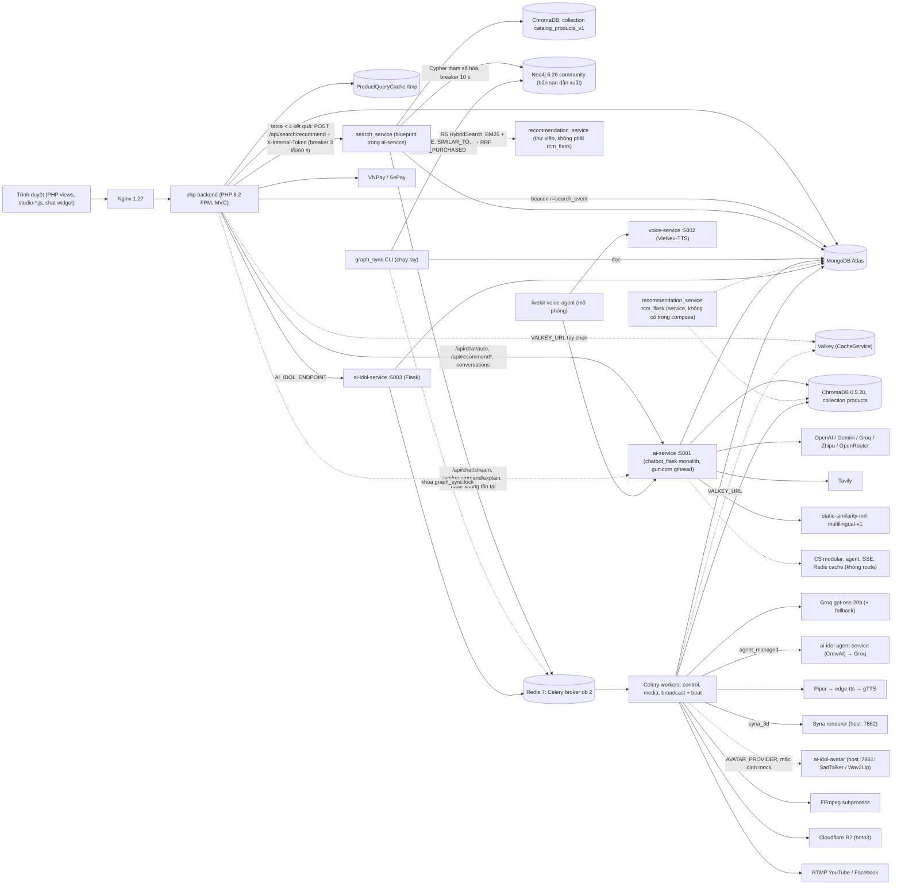

# Technology Inventory & Implementation Traceability (SkinSyntaxVN)

**Cập nhật 2026-10-22 (HEAD `42a3dfc`):** thêm Smart Search / Neo4j / graph_sync (8 commit sau `5994967`).
- §1: thêm hàng BE-26..BE-31, DB-08..DB-10, AI-29..AI-34, IDOL-14, INF-11; sửa BE-14, BE-24, DB-04, DB-05, AI-01, AI-10..AI-12, AI-21, INF-01, INF-03.
- §0 thêm phát hiện 6; §2.2, §2.3, §2.5 thêm cache/compose/proxy của Smart Search; §3.2 sửa phần Chroma (collection thứ hai `catalog_products_v1`).
- §3.3 viết lại (Neo4j: ABSENT → INTEGRATED); §3.4 thêm cột search_service; §3.5, §3.6, §3.7 bổ sung; §4 vẽ lại Mermaid; §5 thêm 4 hàng; §6 thêm 8 mục chi tiết (6.1); §7 đổi trạng thái GraphRAG, Neo4j, ChromaDB, Product Knowledge Graph, RRF; §8, §10 cập nhật.
- Test đã chạy lại 2026-10-22 (không chạm DB thật): `ai-service-flask` pytest `tests/search_service` + `tests/graph_sync` = 201 passed, 8 skipped (integration cần Neo4j thật, không chạy); PHP `SanPhamSearchTokenTest` 13, `SearchEventTest` 52, `SearchFallbackTest` 47 (đều 0 failed). Không chạy `ai-idol-service` pytest (working tree có sửa đổi chưa commit ở thư mục đó, kết quả không tương ứng HEAD).
- Số liệu mật độ graph/latency lấy từ tài liệu bàn giao (`docs/plans/smart-search-handoff.md`, `update_neo4j_search_recommendation.md`) là **bằng chứng phụ, chưa tái lập** trong lần cập nhật này.

Nhánh `syna`, HEAD lúc kiểm kê: `42a3dfc` (2026-10-22; bản đầu kiểm kê ở `5994967`, 2026-10-21). Working tree còn nhiều thay đổi chưa commit ở `ai-idol-service/`, `backend/` (support/home), `frontend/` — tài liệu này mô tả HEAD, không mô tả các thay đổi đó. Tài liệu bàn giao kỹ thuật cho AI Coding Agent kế tiếp.
File tổng của dự án vẫn là [`update.md`](update.md) (handoff Syna self-healing: state machine, data model, API, validation, TTS normalize). File này **không lặp lại** nội dung đó mà trỏ tới mục tương ứng (`update.md §N`). Chi tiết catalog constraints: [`update_catalog_constraints.md`](update_catalog_constraints.md). Chi tiết Smart Search/Neo4j (bằng chứng phụ): [`update_smart_search_neo4j.md`](update_smart_search_neo4j.md), [`update_neo4j_search_recommendation.md`](update_neo4j_search_recommendation.md), [`docs/plans/smart-search-handoff.md`](docs/plans/smart-search-handoff.md), schema đồ thị [`docs/neo4j/schema.md`](docs/neo4j/schema.md). Khi lệch giữa các tài liệu này và code, **code là nguồn đúng**.

**Phương pháp:** đọc manifest/lockfile, Dockerfile, `docker-compose.yml`, source, `git log`; grep có loại trừ `.git`, `.venv`, `vendor`, `node_modules`, `chroma_data`, `__pycache__`, `.gitnexus`. Chỉ đọc; không sửa code, không ghi DB, không chạy `backend/tests/*` (ghi Atlas thật).
**Bằng chứng:** `đường/dẫn:dòng` hoặc commit hash. Viết tắt: `AF/` = `ai-service-flask/`, `CS/` = `ai-service-flask/chatbot_service/`, `RS/` = `ai-service-flask/recommendation_service/`, `SS/` = `ai-service-flask/search_service/`, `GS/` = `ai-service-flask/graph_sync/`, `IS/` = `ai-idol-service/`, `AG/` = `ai-idol-agent-service/`, `AV/` = `ai-idol-avatar-service/`.
**Không có bí mật** trong tài liệu: chỉ ghi TÊN biến môi trường, không ghi giá trị `.env`. Không có benchmark tự đo; số liệu hiệu năng duy nhất là số do commit message tự ghi (nói rõ ở chỗ dùng).
Số dòng có thể lệch vài dòng sau các commit mới; khi lệch, tìm theo tên hàm/biến được nêu kèm.

### Thang trạng thái

| Status | Nghĩa |
|---|---|
| INSTALLED | Có trong manifest/lockfile/image, chưa thấy code dùng |
| REFERENCED | Có import/tên/biến/cấu hình nhưng không có luồng chạy thật |
| IMPLEMENTED | Có code thực thi, nhưng chưa nối vào entry point đang chạy hoặc chưa chứng minh chạy end-to-end |
| INTEGRATED | Được gọi trong luồng thật từ entry point (route, task, beat) |
| VERIFIED | INTEGRATED + có test/E2E/số đo thật có ghi nhận |
| PARTIAL | Chỉ một phần hoạt động (một nhánh rỗng, mặc định tắt, mô phỏng...) |
| PLANNED | Chỉ có trong docs/plan/báo cáo |
| DEPRECATED | Còn dấu vết nhưng đã thôi dùng |
| UNKNOWN | Không xác minh được bằng bằng chứng hiện có |
| ABSENT | Không có dấu vết nào (dùng cho mục roadmap) |

Có trong manifest **không** có nghĩa là đang hoạt động.

---

## 0. Sáu phát hiện quan trọng nhất (đọc trước khi sửa)

1. **Chatbot có hai bộ code, chỉ một bộ chạy.** Docker chạy monolith `CS/chatbot_flask.py` (`Dockerfile.ai:45` CMD `chatbot_service.chatbot_flask:app`). Bộ modular (`CS/pipeline.py`, `agent.py`, `agent_stream.py`, `router.py`, `llm_pool.py`, `session_cache.py`, `response_cache.py`, `redis_store.py`, `cart_analysis.py`) **không được route nào import** (grep không có lệnh import nào trong `AF/`). Toàn bộ route của monolith nằm ở `CS/chatbot_flask.py:~3134-3508`: `/health`, `/api/health`, `/api/chat`, `/api/chat/auto`, `/api/recommend`, `/api/recommend/profile|llamaindex|langchain-rag`, `/api/chat/conversations`. Từ `9dbc34c` monolith còn đăng ký thêm blueprint `search_bp` (`CS/chatbot_flask.py:3124-3131`, bọc try/except, lỗi import không chặn chat): `POST /api/search/recommend`, `GET /api/search/health` (xem phát hiện 6).
2. **Hybrid search của chat đang chạy gần như chỉ còn dense.** Monolith khởi tạo `BM25Search()` rỗng (`CS/chatbot_flask.py:137`), nên nhánh BM25 trả `[]`; lời gọi tìm kiếm chính đặt `use_reranker=False` (`:2506`, `:2572`). RRF vẫn chạy nhưng thực chất chỉ xếp lại một nhánh.
3. **Compose trỏ PHP tới hai route Flask không tồn tại:** `AI_CHAT_STREAM_ENDPOINT=.../api/chat/stream` và `AI_RECOMMENDATION_ENDPOINT=.../api/recommend/explain` (`docker-compose.yml:216-217`). Monolith không có hai route này; `/api/recommend/explain` chỉ có ở `RS/rcm_flask.py`, mà service đó không có trong compose. PHP có nhánh fallback khi stream lỗi (`HomeController.php` khoảng `:4160`, `stream_request_failed`).
4. **Recommender "Simple IMDb WR / TF-IDF / Hybrid V1" nằm ở PHP, không ở Python.** `backend/app/models/SanPham.php:1176-1187` (WR, m=21, C=4.8890), `backend/app/services/ContentBasedRecommender.php` (TF-IDF tự cài), `PersonalizedDealRanker.php`. Python không có scikit-learn.
5. **Kiểm tra xung đột thành phần trong giỏ là 4 luật cứng trong PHP** (`HomeController::detectCartIngredientConflicts`, `backend/app/controllers/HomeController.php:1858`), chạy trước khi gọi Flask, không dùng LLM.
6. **Smart Search là đường truy xuất thứ hai, tách khỏi chatbot, và là nơi Neo4j + hybrid thật sự chạy.** Khi trang `tatca` tìm ra `< 4` kết quả ở trang 1, PHP gọi `POST /api/search/recommend` (`SanPhamController.php:400-401`, `buildSearchFallback`); Flask chạy song song tối đa 5 nhánh (semantic, trending, same_brand, category_alt, personalized), mỗi nhánh có timeout chung `SEARCH_TIMEOUT_MS` (mặc định 800), rồi xếp hạng bằng trọng số, không dùng LLM (`SS/service.py`, `SS/ranker.py`). Nhánh `semantic` **tái dùng** `recommendation_service.HybridSearch` (BM25 + Chroma + RRF của RS) trên collection **riêng** `catalog_products_v1` (không phải `products`); nên code RS không còn "không chạy" hoàn toàn, nhưng `rcm_flask` vẫn không có trong compose. Neo4j chỉ Flask kết nối (PHP không). Neo4j hỏng → `degraded:true`, vẫn trả `semantic` + `trending`, không 5xx; Flask hỏng → PHP rơi về "bán chạy" (`SearchFallbackBuilder`, `SanPham::bestSellers`) và breaker 3 lỗi/60 s (`SearchRecommendClient.php`).

---

## 1. Ma trận công nghệ

Version lấy từ manifest/lockfile/image tag; `>=` là cận dưới, "không pin" khi manifest không ghi. "Host" là bản cài trong Python máy kiểm kê, không chắc bằng image Docker.

### 1.1 Frontend

| ID | Technology | Category | Version | Purpose | Module | Status | Evidence |
|---|---|---|---|---|---|---|---|
| FE-01 | PHP views (server-rendered) | UI | PHP 8.2 (image) | UI khách + admin | `frontend/views/*.php` | INTEGRATED | `Dockerfile.php:1`; router `backend/public/index.php:99-775` |
| FE-02 | Bootstrap CSS/JS (vendored) | UI lib | không pin | Layout | `frontend/public/assets/css/bootstrap.min.css`, `assets/js/bootstrap.bundle.min.js` | INTEGRATED | thư mục assets |
| FE-03 | Bootstrap Icons, FontAwesome (vendored) | UI lib | không pin | Icon | `assets/css/bootstrap-icons.min.css`, `fontawesome.min.css` | INTEGRATED | thư mục assets |
| FE-04 | Google Fonts (CDN) | UI | không pin | Font | `frontend/views/layouts/*` | INTEGRATED | grep `fonts.googleapis.com` |
| FE-05 | Chart.js (CDN jsdelivr) | Chart | 4.4.1 | Biểu đồ admin | `frontend/views` | INTEGRATED | grep `chart.js@4.4.1` |
| FE-06 | livekit-client (CDN) | Realtime | 2.1.2 | Live stream phía client | `frontend/views/live.php` | IMPLEMENTED (chưa xác minh chạy với LiveKit thật) | grep; token tự ký `LiveController.php:294` |
| FE-07 | Vanilla JS live-filter / live-search / smart-search | UI logic | n/a | Tìm/lọc tức thì | `frontend/public/assets/js/live-filter.js`, `live-search.js`, `smart-search.js` | INTEGRATED | `backend/public/index.php:12-17` (`session_write_close` cho live-filter) |
| FE-08 | Chat widget (JS inline trong view) | UI | n/a | Chat + thẻ xung đột | `frontend/views/components/ai_chat_widget.php:1667-1823` | INTEGRATED | route `ai_chat_*` `backend/public/index.php:241-268` |
| FE-09 | goiy-recommendation.js, chat-purchase.js, product-video.js | UI logic | n/a | Gợi ý, mua trong chat, video PDP | `frontend/public/assets/js/` | INTEGRATED | `backend/app/routes/store_assistance.php:22-24` |
| FE-10 | AI Idol Studio JS (`studio-*.js`) | UI | n/a | Studio tạo kịch bản/video | `frontend/public/assets/js/studio-*.js`, `frontend/views/admin/ai_idol/index.php` | VERIFIED (node --test 109/109, update.md §1.2; E2E mock §12.4) | `backend/app/routes/ai_idol.php` |
| FE-11 | Three.js (vendored) mascot 3D/demo | 3D | không pin | Mascot Syna | `frontend/public/ai-idol-mascot-3d/`, `ai-idol-mascot-demo/` | IMPLEMENTED (trang tĩnh độc lập) | `ai-idol-mascot-3d/package.json` |
| FE-12 | `node --test` | Test | Node không pin | Unit test JS | `frontend/public/assets/js/tests/*.test.js`, mascot `tests/` | VERIFIED (studio, update.md §1.2) | lệnh trong update.md §1.2 |
| FE-13 | Playwright (qua Playwright MCP) | E2E | không pin (không có package.json/playwright.config ở gốc) | E2E Studio, product video | `e2e/syna-self-healing.e2e.js`, `scripts/e2e/*.cjs` | PARTIAL (route backend bị mock: chứng minh UI, không chứng minh backend) | `e2e/syna-self-healing.e2e.js:2-4,15-30` |
| FE-14 | Expo / React Native | Mobile | expo ~57.0.24, react-native 0.86.3, react 19.2.3 | App di động | `mobile/` | INSTALLED (chưa xác minh gọi backend) | `mobile/package.json` |
| FE-15 | Khối "Gợi ý thêm" khi tìm ít kết quả (partial PHP + JS/CSS vanilla, gửi sự kiện bằng `navigator.sendBeacon`, fallback `fetch keepalive`, tới `r=search_event`) | UI | n/a | Hiển thị section Smart Search, chip, gửi sự kiện | `frontend/views/partials/search_fallback.php`, `frontend/public/assets/js/search-fallback.js`, `assets/css/search-fallback.css`, `frontend/views/tatca.php` | INTEGRATED; E2E Playwright MCP có ghi nhận trong handoff (ảnh `report/search-fallback-e2e/`, `report/search-final-e2e/`; bằng chứng phụ, chưa tái chạy) | commit `2f90ba0`, `8820877`; `docs/plans/smart-search-handoff.md` |

### 1.2 Backend (PHP)

| ID | Technology | Category | Version | Purpose | Module | Status | Evidence |
|---|---|---|---|---|---|---|---|
| BE-01 | PHP-FPM | Runtime | `php:8.2-fpm-alpine` | Chạy PHP | `Dockerfile.php:1` | INTEGRATED | compose `php-backend` |
| BE-02 | ext-mongodb (PECL) | Driver | không pin | BSON/driver | `Dockerfile.php:5-8` | INTEGRATED | idem |
| BE-03 | mongodb/mongodb | Library | 1.19.1 (lock) | Client/Collection API | `backend/app/config/db.php:55-97` | INTEGRATED | `backend/composer.lock` |
| BE-04 | predis/predis | Library | ^3.7 (lock v3.7.0) | Client Valkey cho CacheService | `backend/app/services/CacheService.php` | PARTIAL (chỉ bật khi có `VALKEY_URL`) | `backend/composer.json`; commit `39c6b88` |
| BE-05 | Front-controller `switch ($_GET['r'])` | Router | n/a | ~200 route | `backend/public/index.php:99-775`; bản XAMPP `index.php` gốc | INTEGRATED (hai bản router đã lệch nhau) | so sánh hai file |
| BE-06 | MVC thuần (không framework) | Architecture | n/a | Nghiệp vụ | `backend/app/{controllers,models,services}` | INTEGRATED | `HomeController.php` 5432 dòng |
| BE-07 | Session PHP + bcrypt | Auth | n/a | Đăng nhập khách/nhân viên | `AuthController.php:297,331`; `NguoiDung.php:40` | INTEGRATED | idem |
| BE-08 | OAuth Google/Facebook | Auth | n/a | Social login | `AuthController.php`, `config.php:97-102` | IMPLEMENTED (chưa xác minh kiểm chữ ký JWT, xem §11) | `backend/public/index.php:359-366` |
| BE-09 | CSRF token | Security | n/a | Chống CSRF | `AdminAiIdolController.php:81-110`, `ShopAssistantController` | PARTIAL (chỉ AI Idol admin + mua trong chat) | grep `csrf` |
| BE-10 | JWT HS256 tự ký | Auth | n/a | Token phòng LiveKit | `LiveController.php:294` | IMPLEMENTED | idem |
| BE-11 | Proxy cURL PHP → ai-service | Integration | ext-curl | Chat/gợi ý | `HomeController.php:1770-1795,3222-3260,3344-3382,3503-3530` | INTEGRATED | `config.php:122-131` |
| BE-12 | Proxy cURL PHP → ai-idol-service | Integration | ext-curl | Studio, video PDP | `AdminAiIdolController.php:39,166-170,342-348,509-516`; `ProductVideoClient.php` | INTEGRATED | update.md §6.1 |
| BE-13 | RecommendationClient (retry 2) | Integration | n/a | Client gợi ý có retry | `backend/app/services/RecommendationClient.php:134-148` | REFERENCED (không có chỗ nào khởi tạo) | grep `new RecommendationClient` = 0 |
| BE-14 | ProductQueryCache (file cache) | Performance | n/a | Giảm round-trip Atlas | `backend/app/services/ProductQueryCache.php` | VERIFIED (test `backend/tests/product_query_cache_test.php`; số đo trong commit message). Từ `42a3dfc` dùng thêm cho `suggest`/`trending`/`collection`/`recsections` (TTL 120 s) và `filterOptions:*` (600 s); từ `2f90ba0` cho `search:bestSellers:*` (300 s) | commit `bdc14ec`, `42a3dfc`, `2f90ba0`; `SanPham.php`, `HomeController.php` |
| BE-15 | CacheService (Valkey + L1 + file) | Performance | n/a | Cache-aside | `backend/app/services/CacheService.php` | PARTIAL (`VALKEY_URL` mặc định rỗng → L1 + file) | `docker-compose.yml:229-230` |
| BE-16 | Luật xung đột thành phần giỏ (4 luật) | Rule engine | n/a | Cảnh báo phối hợp hoạt chất | `HomeController.php:1858-1935`, gọi tại `:3143` | INTEGRATED (chưa thấy test riêng) | idem |
| BE-17 | Simple IMDb Weighted Rating | Recommender | n/a | Top sản phẩm theo rating | `backend/app/models/SanPham.php:1176-1221`; `PersonalizedDealRanker.php:198-203` | INTEGRATED | m=21, C=4.8890 `SanPham.php:1185-1187` |
| BE-18 | Content-based TF-IDF (tự cài) | Recommender | n/a | Tương tự theo nội dung | `backend/app/services/ContentBasedRecommender.php:892-1037` | INTEGRATED | cache `backend/app/content/tfidf_cache.json` |
| BE-19 | Hybrid V1 (hành vi + hồ sơ + loại da + ngân sách) | Recommender | n/a | Xếp hạng cá nhân hóa | `ContentBasedRecommender.php:1-40`; `PersonalizedDealRanker.php:34-48` | INTEGRATED (trọng số ghi "engineering baseline", chưa tune) | `ContentBasedRecommender.php:25-40` |
| BE-20 | CF/SVD/kNN, FP-Growth, BPR | Recommender | n/a | Collaborative + luật kết hợp | `backend/app/services/*`, `backend/experiments/` | PARTIAL/UNKNOWN (BPR cô lập trong experiments; cache `cf_model_cache.json`, `frequently_bought_together.json` chưa kiểm logic) | commit `6009104`, `25b792b` |
| BE-21 | VNPay | Payment | sandbox mặc định | Thanh toán | `backend/app/services/VnpayService.php`; route `index.php:202-212` | IMPLEMENTED (chưa xác minh với VNPay thật) | `config.php:116-119` |
| BE-22 | SePay / chuyển khoản | Payment | n/a | Xác nhận chuyển khoản | `config.php:104-114`; route `admin_sepay_webhook` | IMPLEMENTED | idem |
| BE-23 | Composer | Tooling | composer:2 | Cài deps | `Dockerfile.php:10-16` | INTEGRATED (dùng `composer update`, bỏ qua lock: build không tái lập) | `Dockerfile.php:16` |
| BE-24 | OPcache | Performance | memory 128; từ `42a3dfc` thêm `validate_timestamps=1`, `revalidate_freq=60`, `realpath_cache_size=4096K`, `realpath_cache_ttl=600` | Tăng tốc PHP; giảm kiểm tra timestamp trên bind-mount Windows | `Dockerfile.php:25-26`; `docker/php/zz-skinsyntax-opcache.ini` (COPY `Dockerfile.php:24`, mount ở compose) | INTEGRATED; số đo duy nhất là do commit message `42a3dfc` tự ghi (trang chủ khi cách 3 s: 0.80 s → ~0.07 s, không kèm file đo, chưa tái lập). Hệ quả: sửa PHP có thể mất tới 60 s mới áp dụng, trừ khi reload FPM | `docker/php/zz-skinsyntax-opcache.ini:1-3` |
| BE-25 | Test runner PHP | Test | không có | n/a | `backend/tests/*.php` chạy tay; không `phpunit.xml` | UNKNOWN (không runner, không CI). Test thuần PHP không DB trong `backend/tests/unit/` chạy trực tiếp bằng `php <file>` | glob |
| BE-26 | Token search không dấu (regex `[aàáạ...]` theo ký tự + AND giữa token, OR giữa trường, tối đa 6 token, stopword) | Search | n/a | Tìm sản phẩm theo từng token, không phân biệt dấu | `backend/app/models/SanPham.php` (`tokenizeSearchQuery`, `buildAccentInsensitiveRegex`, `buildTokenSearchFilter`); `SanPhamController.php` | VERIFIED (test `backend/tests/unit/SanPhamSearchTokenTest.php`: 13 passed, chạy 2026-10-22, thuần PHP không DB; truy vấn Atlas thật chỉ có trong handoff) | commit `e42f4ac` |
| BE-27 | SearchRecommendClient (cURL, timeout 1200/300 ms, không retry, circuit breaker 3 lỗi → mở 60 s) | Integration | ext-curl | PHP → Flask `/api/search/recommend`; validate response | `backend/app/services/SearchRecommendClient.php` (+ client Redis RESP tối giản `SearchBreakerRedis`) | VERIFIED (test `SearchFallbackTest.php`: 47 passed, 2026-10-22, transport giả) | commit `2f90ba0`; env `SEARCH_RECOMMEND_ENDPOINT`, `SEARCH_INTERNAL_TOKEN`, `SEARCH_RECOMMEND_TIMEOUT_MS`, `SEARCH_BREAKER_REDIS_URL` |
| BE-28 | SearchFallbackBuilder / SearchReasonFormatter / SearchSkinProfile / `config/search_reasons.php` | Search UI logic | n/a | Dựng section + chip + lý do tiếng Việt; hồ sơ da rút gọn `{skin_type, concerns}`; fallback "bán chạy" khi Flask lỗi | `backend/app/services/Search{FallbackBuilder,ReasonFormatter,SkinProfile}.php`, `backend/app/config/search_reasons.php` | VERIFIED (cùng `SearchFallbackTest.php` 47 passed; `SearchEventTest.php` 52 passed) | commit `2f90ba0`, `8820877` |
| BE-29 | SearchEventTracker (route `r=search_event`, CSRF HMAC không trạng thái, rate limit 60 sự kiện/60 s/phiên, body ≤ 4096 B) | Analytics | n/a | Ghi impression/click/add_to_cart/chip_click vào Mongo `search_events` (không lưu email/IP/UA) | `backend/app/services/SearchEventTracker.php`; `backend/public/index.php` case `search_event` | VERIFIED một phần (unit `SearchEventTest.php` 52 passed 2026-10-22; E2E beacon 204/403/400 ghi trong handoff, chưa tái chạy). Case chỉ được thêm ở `backend/public/index.php` và `frontend/public/index.php`; `index.php` gốc (XAMPP) không có case này (grep), tiếp tục lệch router (§2.4) | commit `2f90ba0`, `8820877`; env `SEARCH_EVENTS_ENABLED`, `SEARCH_USER_HASH_SALT` |
| BE-30 | AfterResponse (`register_shutdown_function` + `fastcgi_finish_request`) | Performance | n/a | Ghi `InteractionLogger::logSearch/logView` sau khi đã trả response | `backend/app/services/AfterResponse.php`, `InteractionLogger.php` (`captureContext`), `SanPhamController.php` | IMPLEMENTED/INTEGRATED (chưa có test riêng; chưa có số đo riêng; comment trong `AfterResponse.php` chỉ ước lượng ~40-60 ms mỗi round-trip Atlas) | commit `42a3dfc` |
| BE-31 | `SanPham::findVisibleByIds`, `orderByIds`, `bestSellers` | Model | n/a | Nạp sản phẩm theo id Flask trả về (đúng thứ tự) và danh sách bán chạy | `backend/app/models/SanPham.php` | VERIFIED một phần (`orderByIds` thuần, có test trong `SearchFallbackTest.php`; `findVisibleByIds`/`bestSellers` chạm Atlas, chưa có test không DB) | commit `e42f4ac` |

### 1.3 Databases

| ID | Technology | Category | Version | Purpose | Module | Status | Evidence |
|---|---|---|---|---|---|---|---|
| DB-01 | MongoDB Atlas (`mongodb+srv`) | Primary DB | server UNKNOWN | CSDL chính, giữ Atlas | `backend/app/config/db.php:55-97`; compose `DB_MODE: ${DB_MODE:-atlas}` | VERIFIED (truy vấn thật trong `bdc14ec`, `update_catalog_constraints.md §2`) | idem |
| DB-02 | MongoDB local `mongo:7` | DB dev | 7 | Dev/fallback | compose `mongodb` (27018:27017) | INSTALLED (php-backend vẫn `depends_on` nó dù mặc định Atlas) | `db.php:56-60` chỉ dùng khi `DB_MODE=local` |
| DB-03 | Valkey (PHP cache) | Cache | server UNKNOWN | Cache-aside PHP, purge video PDP | `CacheService.php`; `IS/core/publications.py:47-52` | PARTIAL (phụ thuộc `VALKEY_URL`) | `docker-compose.yml:229-230` |
| DB-04 | Redis 7 | Broker/cache | `redis:7-alpine` | Celery broker/backend (db 2), cache AI (db 0); từ `9dbc34c`/`2f90ba0`: cache kết quả `search:rec:v2:*` (TTL `SEARCH_CACHE_TTL` 300 s) và `search:trending:v1` phía Flask, khóa chống chạy trùng `graph_sync:lock` (`SET NX EX 1800`), breaker PHP `search:recommend:breaker:v1` qua `SEARCH_BREAKER_REDIS_URL` | compose `redis` | INTEGRATED (phía AI và breaker Smart Search); phần còn lại của PHP vẫn REFERENCED (`REDIS_URL` truyền vào nhưng PHP đọc `SEARCH_BREAKER_REDIS_URL` riêng cho breaker) | `docker-compose.yml:15,116,227`; grep `REDIS_URL` trong `backend/app` = 0 |
| DB-05 | ChromaDB server | Vector DB | `chromadb/chroma:0.5.20` | RAG sản phẩm (collection `products`) và Smart Search (collection `catalog_products_v1`) | compose `chromadb` (8000) | INTEGRATED (rủi ro lệch phiên bản client, §3.2) | `docker-compose.yml:59-60` |
| DB-06 | ChromaDB persistent local | Vector DB | Host chromadb 1.5.9 | Index tạo bởi script import | `database/chroma_db/` (gitignored) | INTEGRATED khi không có `CHROMA_HOST` | `database/import_chromadb.py` |
| DB-08 | Neo4j Community | Graph DB | `neo4j:5.26-community` + plugin APOC (`NEO4J_PLUGINS`), heap 512m, pagecache 128m, `mem_limit 1g` | Bản sao dẫn xuất của Mongo, chỉ để suy luận quan hệ cho Smart Search; xóa/dựng lại được, không ghi ngược Mongo | compose `neo4j` (`127.0.0.1:7474`, `127.0.0.1:7687`; volume `neo4j_data`, `neo4j_logs`); schema `docs/neo4j/schema.md`; ràng buộc `migrations/neo4j/001_constraints.cypher` | INTEGRATED (Flask `search_service` đọc, `graph_sync` ghi). Server không `depends_on` ở ai-service: tắt Neo4j thì degraded, không sập (compose chú thích). Số lượng node/cạnh thật (Product 2853, Brand 243, ...) chỉ có trong handoff, chưa tái kiểm | `docker-compose.yml:78-103`; commit `818184a` |
| DB-09 | Neo4j Python driver | Library | `neo4j>=5.20,<6` | Kết nối bolt, breaker, truy vấn tham số hóa | `AF/requirements.txt:34`; `SS/neo4j_client.py`, `GS/*` | INTEGRATED | commit `818184a` |
| DB-10 | Mongo collection `search_events` (TTL 180 ngày) | Event log | n/a | Sự kiện hiển thị/click/add_to_cart khối gợi ý; nguồn cho `scripts/search_metrics.py` | tạo bởi `AF/scripts/setup_search_events.py` (index `{ts:-1}` TTL + `{q_norm:1, ts:-1}`); ghi bởi `SearchEventTracker.php` | IMPLEMENTED/INTEGRATED trong code; collection có tồn tại trên Atlas hay không: UNKNOWN (không truy vấn Atlas); script setup là schema write, không chạy | commit `8820877`, `2f90ba0` |
| DB-07 | SQL legacy (MySQL/PostgreSQL) | DB | n/a | Schema/crawl cũ | `database/*.sql`, `spiders/skinSyntaxVN/step2_import_dbPostgresQL.py`; `RS/product_repository.py` (nguồn MySQL tùy chọn) | DEPRECATED (PHP dùng `$pdo` là `MongoDatabaseCompat`, `db.php:25-41`) | idem |

### 1.4 AI (ai-service-flask, ai-idol-service, ai-idol-agent-service)

| ID | Technology | Category | Version | Purpose | Module | Status | Evidence |
|---|---|---|---|---|---|---|---|
| AI-01 | Flask + gunicorn (chatbot) | Web | flask==3.0.3, gunicorn==23.0.0, gevent==24.11.1 | API chatbot + Smart Search :5001. Từ `9dbc34c`: worker class mặc định `gthread` (`GUNICORN_WORKER_CLASS`, `GUNICORN_THREADS` mặc định 8; compose đặt `gthread`) thay cho `sync`, vì một request chat/LLM dài làm nghẽn `/api/search/recommend` xếp sau (comment trong file) | `CS/chatbot_flask.py`, `AF/gunicorn_config.py` | INTEGRATED | `AF/requirements.txt:2-5`; `gunicorn_config.py` timeout 120, `worker_class` gthread, hook `post_fork` gọi `search_service.service.warm_up()` |
| AI-02 | LangChain core/community | LLM framework | langchain>=0.3.7 | Wrapper LLM | monolith gọi `llm.invoke` trực tiếp | PARTIAL (không dùng chain; `with_fallbacks` chỉ ở `CS/llm_pool.py:66-77`, không chạy) | `CS/chatbot_flask.py:3066` |
| AI-03 | OpenAI gpt-4o-mini / gpt-4o | LLM | langchain-openai>=0.2.10 | Sinh câu trả lời | `get_llms` | INTEGRATED (cần khóa) | `CS/chatbot_flask.py:281-296` |
| AI-04 | Gemini (`gemini-flash-latest`, `-flash-lite-latest`, `gemini-2.5-flash`) | LLM | langchain-google-genai>=1.0.0 | Fallback, xoay nhiều key | `get_llms` | INTEGRATED (cần khóa) | `CS/chatbot_flask.py:73-94,309-338` |
| AI-05 | Groq qua ChatOpenAI (`openai/gpt-oss-120b`, `openai/gpt-oss-20b`) | LLM | langchain-openai | Fallback | `get_llms` | INTEGRATED (cần khóa) | `CS/chatbot_flask.py:338-362` |
| AI-06 | Zhipu `glm-4-flash`, OpenRouter (llama-3.1-8b, mistral-7b, gemma-2-9b) | LLM | n/a | Fallback cuối | `get_llms` | INTEGRATED (cần khóa) | `CS/chatbot_flask.py:364-412` |
| AI-07 | LLM pool + cooldown 300 s | Resilience | n/a | Bỏ qua LLM bị 429/quota | `LLM_COOLDOWNS` | INTEGRATED | `CS/chatbot_flask.py:199-205,254-268,3066-3082` |
| AI-08 | Structured output Pydantic (`with_structured_output(PhanTichYeuCau)`) | LLM output | pydantic>=2,<3 | Parse yêu cầu | `parse_yeu_cau` | PARTIAL (chỉ khi model là Gemini; còn lại parse JSON bằng regex) | `CS/chatbot_flask.py:1124,1138-1149` |
| AI-09 | Embedding `sentence-transformers/static-similarity-mrl-multilingual-v1` | Embedding | sentence-transformers>=2.2.2, langchain-huggingface>=0.1.2 | Vector hóa query + sản phẩm | `AF/shared/embedding_provider.py:24-42` | INTEGRATED | `AF/shared/model_config.py:7-17` |
| AI-10 | ChromaDB collection `products` (chatbot, RS, AI Idol) và `catalog_products_v1` (Smart Search, thêm ở `9dbc34c`) | Vector DB | client chromadb>=1.0.0 (`AF/requirements.txt`); pin 0.4.24 (`CS/requirements_hybrid.txt`) | Retrieval sản phẩm | `CS/chatbot_flask.py:100-127`, `CS/retrieval.py:49-72` | INTEGRATED (rủi ro phiên bản) | §3.2 |
| AI-11 | BM25 tự cài | Lexical | n/a | Keyword search | `CS/hybrid_search.py:79-195`, `RS/hybrid_search.py:46-130` | PARTIAL (chat: index rỗng; RS: có nạp). Từ `9dbc34c` bản RS được dùng thật trong luồng Smart Search: `BM25Index(ttl_seconds=SEARCH_CATALOG_TTL*12)` nạp từ `CatalogStore` (Mongo), không rỗng | `CS/chatbot_flask.py:137`; `SS/branches.py:build_hybrid_search` |
| AI-12 | RRF (Reciprocal Rank Fusion), k=60 | Fusion | tự cài | Gộp dense + BM25 | `CS/hybrid_search.py:198-295`, `RS/hybrid_search.py:182-195` | INTEGRATED (chat: một nhánh rỗng; Smart Search: hai nhánh đều có dữ liệu, dùng bản RS) | alpha 0.5 `CS/chatbot_flask.py:138` |
| AI-13 | Cross-encoder `cross-encoder/mmarco-mMiniLMv2-L12-H384-v1` | Neural rerank | sentence-transformers | Rerank | `CS/hybrid_search.py:298-384`, `RS/reranker.py` | PARTIAL (chat chính tắt; chỉ rerank routine pool `CS/chatbot_flask.py:2852-2865`; RS có fallback heuristic) | `Dockerfile.ai:24-36` tải trước model |
| AI-14 | Chroma metadata filter (`$eq`, `$and`) | Retrieval | n/a | Lọc loại da/loại SP/thương hiệu/xuất xứ | `CS/retrieval.py:109-122` | INTEGRATED | `CS/chatbot_flask.py:1195` |
| AI-15 | Intent router (từ khóa → LLM) | Routing | n/a | Phân loại câu hỏi | `classify_intent`, `rule_based_parse` | INTEGRATED | `CS/chatbot_flask.py:477-676,992` |
| AI-16 | LangChain tool-calling agent (4 tool, max_iterations=6) | Agent | n/a | Câu hỏi nhiều bước | `CS/agent.py` | IMPLEMENTED, không chạy (không route gọi `run_agent`) | `CS/agent.py:148-458` |
| AI-17 | SSE streaming | Streaming | n/a | Stream token | `CS/agent_stream.py`, `CS/pipeline.py` | IMPLEMENTED, không chạy (không có `/api/chat/stream`) | route list `CS/chatbot_flask.py:3125-3499` |
| AI-18 | Redis session/response cache (CS) | Cache | redis>=5.0.0 | Lịch sử, cache câu trả lời | `CS/session_cache.py`, `CS/response_cache.py`, `CS/redis_store.py` | IMPLEMENTED, không chạy | §3.4 |
| AI-19 | Tavily web search | Tool | langchain-tavily, tavily-python | Tra cứu web | `_query_web` | INTEGRATED (cần `TAVILY_API_KEY`) | `CS/chatbot_flask.py:160-180` |
| AI-20 | Structured recommendation `/api/recommend` | Recommender | n/a | Gợi ý theo hồ sơ, không LLM | `AF/structured_recommendation.py` | INTEGRATED | gọi từ `CS/chatbot_flask.py:3317-3335` |
| AI-21 | Recommendation service 5 giai đoạn (`rcm_flask`) | Recommender | n/a | Profile → plan → hybrid → safety → rerank → conflict → output | `RS/pipeline.py:101-150`, `RS/rcm_flask.py` | IMPLEMENTED (không có trong compose; service `rcm_flask` vẫn không chạy). Các lớp `HybridSearch`/`ChromaRetrieval`/`product_text` của RS được `search_service` import và chạy trong tiến trình ai-service (xem AI-31). Nhánh vector của `rcm_flask` trên collection `products` vẫn nghi trả rỗng (§3.6) | compose không có service rcm; `SS/branches.py:88-94`, `SS/scripts/reindex_chroma.py` |
| AI-22 | LlamaIndex recommend | Recommender | llama-index>=0.10 | Vector + BM25 retriever | `AF/services/llamaindex_recommend_service.py`, `AF/recommendation/*` | IMPLEMENTED, mồ côi (blueprint không được đăng ký) | `AF/recommendation/routes.py`; không có `register_blueprint` |
| AI-23 | Luật xung đột hoạt chất (Python) | Rule engine | n/a | Xung đột trong combo gợi ý | `RS/knowledge/ingredient_rules.py`, `RS/conflict_checker.py:41-79`; `CS/agent.py:30-80` | PARTIAL (RS có chạy khi bật service; bảng trong `CS/agent.py` không chạy) | idem |
| AI-24 | TruLens (RAG triad qua LiteLLM) | Evaluation | trulens, litellm (`CS/requirements_eval.txt`) | Đánh giá chatbot | `CS/eval_trulens.py` | IMPLEMENTED, chưa có kết quả lưu | không tìm thấy file kết quả |
| AI-25 | `RAGEvaluator` heuristic | Evaluation | n/a | Chỉ số từ khóa trên mỗi request | `CS/rag_evaluation.py:196-266` | INTEGRATED (chạy mỗi request, chỉ là telemetry heuristic) | `CS/chatbot_flask.py:3084-3101` |
| AI-26 | `eval_recommendation.py` (20 case) | Evaluation | n/a | Harness tất định | `AF/eval_recommendation.py`, `AF/tests/recommendation_eval_cases.json` | IMPLEMENTED, chưa có báo cáo | không có `recommendation_eval_report_*.json` |
| AI-27 | RAGAS, wandb | Evaluation | ragas==0.1.12, wandb==0.15.12 | n/a | `CS/requirements_hybrid.txt` | INSTALLED (không import) | grep |
| AI-29 | Smart Search recommend API (`search_service`) | Retrieval/Recommender | Flask blueprint trong ai-service | `POST /api/search/recommend` (nhánh song song, timeout, xếp hạng trọng số, cache Redis, log JSON có `correlation_id`), `GET /api/search/health`; xác thực header `X-Internal-Token` = `SEARCH_INTERNAL_TOKEN`, trống thì chỉ loopback/private | `SS/{routes,service,branches,ranker,schemas,config,catalog,metrics}.py`; hợp đồng `SS/contract/recommend_response.schema.json` | VERIFIED (`tests/search_service`: 2026-10-22 chạy 201 passed cùng graph_sync, 8 integration skipped vì không có Neo4j; E2E/latency chỉ trong handoff) | commit `9dbc34c`; `CS/chatbot_flask.py:3124-3131` |
| AI-30 | Intent parser tiếng Việt tất định (không LLM) | NLU | `rapidfuzz>=3.9,<4` (`AF/requirements.txt:37`) | Tách hãng/danh mục/thành phần/loại da/mối quan tâm/lợi ích/khoảng giá từ câu truy vấn: làm sạch → bỏ dấu → giá → n-gram khớp dài nhất → fuzzy hãng (cutoff `SEARCH_FUZZY_CUTOFF` 88) → phủ định ("không", "free") → confidence | `SS/intent_parser.py`, `SS/dictionary.py` (EntityDictionary từ Neo4j, fallback Mongo/YAML), `AF/data/graph/{synonyms,ingredient_aliases}.yaml` | VERIFIED (`test_intent_parser.py`, `test_dictionary.py`, đã chạy 2026-10-22 trong 201 passed) | commit `9dbc34c`, `818184a` |
| AI-31 | Nhánh `semantic` của Smart Search: RS `HybridSearch` (BM25 + Chroma + RRF) trên `catalog_products_v1` | Hybrid retrieval | tái dùng RS; embedding `shared.embedding_provider` | Tìm theo nghĩa, nhân điểm ×1.2 nếu trùng danh mục của intent, lọc giá | `SS/branches.py:97-185`, `SS/scripts/reindex_chroma.py` (idempotent, Mongo read-only) | VERIFIED một phần (unit `test_service.py`, `test_mode_b.py` với giả lập; nạp thật vào Chroma chỉ có trong handoff) | commit `9dbc34c` |
| AI-32 | Nhánh đồ thị Neo4j: `same_brand`, `category_alt`, `personalized` (+ `similar_to` làm gợi ý theo seed ngữ nghĩa) | Graph retrieval | Cypher tham số hóa, plan cache theo kiểu tham số | §3.3 | `SS/graph_repository.py`, `SS/branches.py:281-379`, `SS/neo4j_client.py` | VERIFIED (unit giả lập đã chạy 2026-10-22; `test_graph_integration.py` cần Neo4j thật: 8 test skipped ở lần chạy này, ghi nhận passed trong handoff) | commit `9dbc34c` |
| AI-33 | Ranker trọng số + (tùy chọn) cross-encoder blend | Ranking | n/a | `WEIGHTS = graph .35 / semantic .30 / popularity .20 / personal .15` (+ `W_COP 0.10` khi bật CO_PURCHASED), phạt hết hàng 0.5, dedupe giữ section mạnh nhất, cắt `SEARCH_LIMIT_PER_SECTION` (8). Cross-encoder blend `0.7·score + 0.3·sigmoid(ce)` mặc định **tắt** (`SEARCH_RERANK_ENABLED`) | `SS/ranker.py`, `SS/config.py:38-46` | VERIFIED (`test_ranker.py`, `test_co_purchase_rank.py`: unit) | commit `9dbc34c`, `818184a` |
| AI-34 | `graph_sync` ETL Mongo → Neo4j (CLI `python -m graph_sync`) | Data pipeline | `neo4j>=5.20,<6`, `redis>=5.0.0` (khóa), `pymongo`; `import yaml` nhưng PyYAML **không** ghi trong `AF/requirements.txt` (đến gián tiếp qua langchain, chưa xác minh trong image) | `--full`, `--since`, `--dry-run`, `--similarity-only`, `--derive co_purchase --days N`; MERGE theo batch 500; khóa Redis `graph_sync:lock` TTL 1800 s; Mongo chỉ đọc | `GS/{__main__,extract,transform,load,ingredients,normalize,rules,similarity,co_purchase,report,migrate,config}.py`; `AF/data/graph/*.yaml` | VERIFIED (`tests/graph_sync`: chạy 2026-10-22, nằm trong 201 passed; chạy thật `--full` chỉ có trong handoff, chưa tái chạy) | commit `818184a` |
| AI-28 | `AF/chatvoice_service/` | Voice RAG | n/a | n/a | chỉ còn `__pycache__` | DEPRECATED (mất mã nguồn, không tracked) | `git ls-files` rỗng |
| IDOL-01 | Groq SDK | LLM client | `groq>=0.30,<1` | Draft/audit/repair kịch bản, parse brief | `IS/providers/llm_provider.py` | INTEGRATED (test dùng fake) | `IS/requirements.txt:10` |
| IDOL-02 | `openai/gpt-oss-20b` + fallback `qwen/qwen3.8-27b` | LLM model | n/a | Model mặc định AI Idol | `IS/config.py:23-28` | INTEGRATED (ID qwen chưa xác minh tồn tại trên Groq) | idem |
| IDOL-03 | Structured output JSON schema strict | LLM output | n/a | Parse brief → `AgentBrief` | `IS/providers/llm_provider.py:70-111,148-171`; `IS/agents/schemas.py:100-133` | VERIFIED (test `IS/tests/test_agent.py`, fake LLM) | `IS/agents/intent_parser.py:189` |
| IDOL-04 | CrewAI Script Council (writer + editor) | Multi-agent | `crewai==1.15.21` | Viết kịch bản 2 agent | `AG/script_council.py:111-194`, `AG/groq_llm.py` | INTEGRATED khi `agent_managed` và `AI_IDOL_SCRIPT_COUNCIL_ENABLED`; lỗi thì fallback 1 agent | `IS/engines/content_agent.py:69-79,220-232` |
| IDOL-05 | Intent classifier rule-based (9 nhãn) | Orchestration | n/a | Cổng trước LLM | `IS/agents/intent_classifier.py:17-173` | VERIFIED (test regression) | idem |
| IDOL-06 | Catalog Attribute Constraint Engine (regex + từ điển Mongo) | Constraint | n/a | HARD/SOFT/CONTENT constraint | `IS/agents/catalog_constraints.py` | VERIFIED (10 test pass, FakeDb) | commit `5994967`; `update_catalog_constraints.md` |
| IDOL-07 | Autopilot rule-based | Decision | n/a | Số lượng, khung giờ, kênh | `IS/agents/autopilot.py:28-165` | INTEGRATED (luật tất định) | test `test_autopilot_rules.py`, `test_autopilot_service.py` |
| IDOL-08 | ChromaDB client + RAG | Vector DB | `chromadb-client>=0.5,<0.6` | Kiến thức bổ trợ kịch bản | `IS/engines/knowledge_retriever.py` | INTEGRATED, fail-soft | `IS/core/pipeline.py:47,66-69` |
| IDOL-09 | sentence-transformers (AI Idol) | Embedding | `>=3,<6` | Embed query RAG | `IS/engines/knowledge_retriever.py:24-31` | INTEGRATED | `Dockerfile.ai-idol:17` cache model |
| IDOL-10 | Flask + gunicorn (AI Idol) | Web | Flask>=3,<4; gunicorn>=22,<24 | API :5003 | `IS/app.py` | INTEGRATED | `Dockerfile.ai-idol:30` (1 worker, 4 thread, timeout 120) |
| IDOL-11 | Celery + Redis | Queue | `celery[redis]>=5.4,<6` | 3 queue + beat | `IS/celery_app.py`, `IS/tasks.py` | INTEGRATED (không cài trong `.venv` local) | `IS/celery_app.py:6-61` |
| IDOL-12 | pymongo | DB client | `>=4.8,<5` | Trạng thái job/campaign/video | `IS/core/state_machine.py` | INTEGRATED | idem |
| IDOL-13 | PostHog | Analytics | `<4` | n/a | `IS/requirements.txt:12` | INSTALLED (không import) | grep `posthog` = 0 |
| IDOL-14 | Resolver nhiều sản phẩm trong một brief (`split_product_queries`, `_name_match`, `_clear_winner`, `_queries_grounded`) | Matching rule-based | n/a | Mỗi tên sản phẩm được khớp riêng (điểm 0.8·coverage + 0.2·tightness trên tên + hãng); tên không rõ thì hỏi lại (`unresolved_queries`, decision `QUERIES_DROPPED`); query do LLM bịa (<60% từ có trong brief) bị thay bằng cách tách tất định | `IS/agents/intent_parser.py`, `IS/agents/product_resolver.py`, `IS/agents/service.py` | VERIFIED (test `IS/tests/test_multi_product_resolve.py` thêm ở `fc755cd`; **chưa chạy lại** ở lần cập nhật này vì working tree `ai-idol-service/` có sửa đổi chưa commit) | commit `fc755cd` |

### 1.5 Multimedia

| ID | Technology | Category | Version | Purpose | Module | Status | Evidence |
|---|---|---|---|---|---|---|---|
| MM-01 | FFmpeg/ffprobe qua `subprocess` | Media | apt trong image | Chuẩn hóa audio, concat, mix, compose, cắt clip, RTMP | `IS/engines/*` | INTEGRATED | §3.8 |
| MM-02 | Piper TTS `vi_VN-vais1000-medium` | TTS | `piper-tts>=1.2,<2` | Giọng mặc định offline | `IS/providers/tts_provider.py:31-47` | INTEGRATED | `Dockerfile.ai-idol:20-24` tải model |
| MM-03 | edge-tts `vi-VN-HoaiMyNeural` | TTS | `>=6.1,<8` | Fallback 2 | `IS/providers/tts_provider.py:49-65` | IMPLEMENTED | idem |
| MM-04 | gTTS | TTS | `>=2.5,<3` | Fallback 3 | `IS/providers/tts_provider.py:70-79` | IMPLEMENTED | idem |
| MM-05 | SadTalker | Avatar | pin commit, ckpt `SadTalker_V0.0.2_256`, torch 1.9.1+cu111 | Talking head ảnh tĩnh | `AV/natural_sadtalker.py`, `AV/app.py`; client `IS/providers/avatar_provider.py` | IMPLEMENTED (mặc định `AVATAR_PROVIDER=mock`) | `IS/config.py:47`; `Dockerfile.ai-idol-avatar` |
| MM-06 | Wav2Lip | Lipsync | `wav2lip_gan.pth` | Lipsync video mẫu | `AV/wav2lip_runner.py`, `AV/app.py:254-310` | IMPLEMENTED | `IS/engines/avatar_engine.py:25-30` |
| MM-07 | MuseTalk, LivePortrait | Avatar | n/a | Placeholder | `IS/providers/avatar_provider.py` (`NotImplementedError`) | PLANNED | idem |
| MM-08 | Syna 3D renderer (service ngoài, host :7862) | Render | `RENDER_VERSION` | Render video Syna native | `IS/engines/syna_engine.py:112-181` | INTEGRATED (E2E update.md §12.4) | `SYNA_RENDER_URL` |
| MM-09 | boto3 → Cloudflare R2 | Storage | `boto3>=1.34,<2` | Upload video + poster PDP | `IS/engines/media_publisher.py:37-162` | INTEGRATED khi có env R2 | commit `9c04f59` |
| MM-10 | RTMP qua FFmpeg `-c copy` | Broadcast | n/a | YouTube/Facebook | `IS/engines/broadcast_engine.py:66-100` | IMPLEMENTED (chưa verify stream thật) | `IS/config.py:155-169` |
| MM-11 | Pillow title cards | Image | n/a | Thẻ tiêu đề | `IS/engines/title_cards.py:51-63` | IMPLEMENTED | idem |
| MM-12 | VieNeu-TTS (`v3turbo`, ONNX, int8) | TTS | vieneu>=3.3.0, onnxruntime>=1.20.0 | Giọng cho voice-service | `voice-service/model_loader.py:31`, `tts_engine.py` | INTEGRATED (service riêng :5002) | compose `voice-service` |
| MM-13 | FastAPI + uvicorn (voice-service) | Web | fastapi>=0.100 | `/api/tts`, `/api/tts/stream` (PCM 48 kHz) | `voice-service/app.py:41-89` | INTEGRATED | idem |
| MM-14 | LiveKit Agents | Realtime | livekit-agents>=0.8.0 | Co-host livestream | `livekit-voice-agent/agent.py` | PARTIAL/mô phỏng (không import `livekit`; publish là `asyncio.sleep`) | `livekit-voice-agent/agent.py:105-114` |
| MM-15 | Voice queue | Logic | n/a | Hàng đợi comment, ưu tiên, TTL | `livekit-voice-agent/voice_queue.py:25-140` | IMPLEMENTED (in-memory, không dùng Redis) | idem |
| MM-16 | STT | Voice | n/a | n/a | n/a | ABSENT | grep |

### 1.6 Infrastructure

| ID | Technology | Category | Version | Purpose | Module | Status | Evidence |
|---|---|---|---|---|---|---|---|
| INF-01 | Docker Compose | Orchestration | Compose spec, một file; từ `818184a` có thêm service `neo4j` và volume `neo4j_data`/`neo4j_logs`; `NEO4J_PASSWORD` bắt buộc (`${NEO4J_PASSWORD:?...}`) cho service neo4j | Chạy toàn hệ thống | `docker-compose.yml` | INTEGRATED | §2.3 |
| INF-02 | Nginx | Proxy | `nginx:1.27-alpine` | Reverse proxy + static | `nginx/nginx.conf` | INTEGRATED (không HTTPS, không rate limit) | idem |
| INF-03 | PHP-FPM pool tuning | Runtime | pm=static, max_children=20, max_requests=2000 | Giữ kết nối Atlas | `docker/php/zz-skinsyntax-fpm.conf:7-9` | VERIFIED theo commit `bdc14ec` (số đo chưa tái lập). Cùng file thêm `zz-skinsyntax-opcache.ini` ở `42a3dfc` (BE-24) | idem |
| INF-04 | Dockerfiles | Image | 7 file | Build service | `Dockerfile.php`, `Dockerfile.ai`, `Dockerfile.ai-idol`, `Dockerfile.ai-idol-agent`, `Dockerfile.ai-idol-avatar`, `voice-service/Dockerfile`, `livekit-voice-agent/Dockerfile` | INTEGRATED | idem |
| INF-05 | Volumes có tên | Storage | n/a | mongo/chroma/redis/uploads/model cache/ai_idol_storage | cuối `docker-compose.yml` | INTEGRATED | idem |
| INF-06 | Script PowerShell host (avatar, Syna, autostart) | Ops | n/a | Chạy service trên Windows host | `scripts/start-ai-idol-avatar.ps1`, `start-ai-idol-syna.ps1`, `register-ai-idol-syna-autostart.ps1` | IMPLEMENTED | idem |
| INF-07 | Script dữ liệu (import/migrate/seed) | Data ops | n/a | Nạp Mongo/Chroma | `database/*.py`, `scripts/*.php` | IMPLEMENTED | idem |
| INF-08 | Scraper | Data | script Python thuần (không phải Scrapy theo cấu trúc) | Thu thập sản phẩm | `spiders/` | IMPLEMENTED offline (thư viện UNKNOWN) | liệt kê thư mục |
| INF-09 | GitNexus | Code intelligence | `.gitnexus/run.cjs` | Impact/detect_changes | `AGENTS.md` | INTEGRATED vào quy trình | `AGENTS.md` |
| INF-10 | CI/CD | Pipeline | n/a | n/a | không thấy `.github/workflows` | UNKNOWN/không có | glob |
| INF-11 | Script vận hành Smart Search | Ops | n/a | Dựng schema/chỉ mục và chạy ETL/đo | `AF/scripts/setup_search_events.py` (tạo `search_events` + TTL: ghi schema Atlas, không chạy), `AF/scripts/search_metrics.py` (Mongo chỉ đọc; xuất 3 CSV vào `report/search-metrics/`), `migrations/neo4j/001_constraints.cypher` (chạy bằng `python -m graph_sync.migrate`), `SS/scripts/reindex_chroma.py`, `python -m graph_sync` | IMPLEMENTED (các lệnh chạy thật có ghi trong handoff, chưa tái chạy; không có CI) | commit `818184a`, `9dbc34c`, `8820877` |

---

## 2. Hồ sơ chi tiết (công nghệ nền: web, DB, infra)

### 2.1 MongoDB Atlas + PHP driver (DB-01, BE-02/03)
- **Nghiệp vụ:** toàn bộ dữ liệu sàn (sản phẩm, đơn, khách, live, video AI Idol). **Kỹ thuật:** `$pdo` trong PHP thực chất là `MongoDatabaseCompat` bọc `\MongoDB\Database` (`backend/app/config/db.php:25-41,74`).
- **Cấu hình:** `DB_MODE`, `MONGO_URI`, `MONGO_DB_NAME`/`MONGO_DB`; `serverSelectionTimeoutMS=5000`, `connectTimeoutMS=5000` (`db.php:81-84`). Không retry riêng, không fallback im lặng sang Mongo local (`db.php:88-90`); lỗi khởi tạo thì `die(...)` (`db.php:95-97`).
- **Hiệu năng:** commit `bdc14ec` (2026-10-15) ghi trong message: TTFB trang chủ 0.89 s → 0.086 s, product_collection 0.87 → 0.51 s, timkiem 0.73 → 0.47 s, goiy 1.18 → 0.81 s, "đo trên Docker local". Đây là số do commit tự ghi, không có file đo kèm, **chưa tái lập**. Comment `zz-skinsyntax-fpm.conf:3` ghi handshake Atlas khoảng 750 ms mỗi worker mới.
- **N+1 admin:** batch `$in` cho `QuanTri::listOrders` / `getNotificationCenterData` đã nằm trong HEAD từ commit `f66a997` (2026-10-16), test `backend/tests/quantri_n1_regression_test.php` (chỉ đọc Atlas, chưa chạy lại trong lần kiểm kê). Còn tồn tại: `listOrders` vẫn tải toàn bộ `hoa_don` rồi lọc trong PHP (`backend/app/models/QuanTri.php:1306-1325`); `getNotificationCenterData` aggregate `lich_su_chat` toàn bộ (`QuanTri.php:470`).
- **Collection PHP dùng nhiều nhất** (số lần tham chiếu `->collection->` trong `backend/app`): `san_pham` 61, `khach_hang` 50, `hoa_don` 40, `nguoidung` 22, `chi_tiet_hoa_don` 20, `phien_live` 16, `inventory_batches` 16. `danh_gia` và `danh_gia_san_pham` cùng tồn tại (legacy song song).
- **Index tạo trong code:** `danh_gia_san_pham` (unique sparse, `DanhGia.php:671-678`), `inventory_batches`/`inventory_movements` (`InventoryBatch.php:36-48`), voucher khách (`CustomerVoucher.php:90-100`), video watch sessions (`VideoWatchSession.php:58-63`), reward campaigns (`VideoRewardCampaign.php:55-59`), product videos (`ProductVideo.php:21-23`); AI Idol: `uniq_publish_key` partial (`IS/core/publications.py`, update.md §5). Index của `san_pham`, `hoa_don`, `khach_hang` không thấy trong `backend/app` → UNKNOWN (có thể tạo tay trên Atlas hoặc bằng `backend/tests/create_remaining_indexes.php`, script ghi DB thật, không chạy).
- **Migration:** đổi cluster chỉ cần `MONGO_URI`. Đổi sang CSDL khác rất tốn vì controller/model truy cập `$this->db->collection` trực tiếp ở hàng trăm chỗ. Quyết định dự án: **giữ Atlas**.

### 2.2 Cache: ProductQueryCache, CacheService/Valkey, Redis (BE-14/15, DB-03/04)
- **ProductQueryCache** (`backend/app/services/ProductQueryCache.php`, commit `bdc14ec`): file `sys_get_temp_dir()/skinsyntax-query-cache/<sha1>.cache`, ghi atomic, TTL theo mtime, không cache rỗng, `unserialize` có whitelist class BSON; lỗi FS bị nuốt. Nơi dùng: `SanPham.php` (lookup/allProducts/menuTree 600 s, latest 120 s), `HomeController.php:628`, `frontend/views/helpers.php:271`, `InventoryBatch.php:34`. `LISTING_PROJECTION` (`SanPham.php:7`) loại `mo_ta`, `thanh_phan_full`, `hdsd` khỏi listing.
  - Giới hạn: cache nằm trong `/tmp` của từng container, scale nhiều replica sẽ lệch tối đa bằng TTL. Key không theo người dùng: không được đưa dữ liệu cá nhân vào producer.
- **CacheService** (`backend/app/services/CacheService.php`): driver `CACHE_DRIVER` (mặc định `valkey`), `VALKEY_URL` (TLS `rediss://`), circuit breaker, L1 theo request, file fallback. Không có `VALKEY_URL` thì chỉ L1 + file. Cờ `?cache=off`, header `X-Cache-Disabled`, `?valkey_down=1` (`CacheService.php:40-47`) cho phép bất kỳ ai tắt cache.
- **AfterResponse (`42a3dfc`):** `InteractionLogger::logSearch/logView` chạy sau `fastcgi_finish_request` (`backend/app/services/AfterResponse.php`); task phải tự mang `user_id`/`session_id` (đã `captureContext()`), vì session đã đóng. CLI không có `fastcgi_finish_request` nên task chạy lúc shutdown.
- **Cache Smart Search:** Flask cache response (chỉ khi không `degraded`) ở Redis `search:rec:v2:<sha1>`, TTL `SEARCH_CACHE_TTL` (300 s), khóa theo q chuẩn hóa + hash hồ sơ da + cart + limit + exclude (+ `cop1` khi bật CO_PURCHASED) (`SS/service.py:cache_key`); `search:trending:v1` TTL `SEARCH_TRENDING_CACHE_TTL` 600 s; Redis lỗi = không cache. `CatalogStore` giữ snapshot sản phẩm trong RAM, làm mới nền theo `SEARCH_CATALOG_TTL` 300 s. Breaker phía PHP lưu ở CacheService/Valkey hoặc Redis (`SEARCH_BREAKER_REDIS_URL`).
- **Redis 7 (compose):** Celery AI Idol `AI_IDOL_REDIS_URL` db 2; ai-service `REDIS_URL` db 0. Lưu ý sửa thông tin: `update.md §1.1` ghi Redis db 0 là "cache PHP", nhưng code PHP không đọc `REDIS_URL` (grep = 0); cache PHP thật là CacheService qua `VALKEY_URL`. Ai-idol purge cache video PDP cũng qua `VALKEY_URL` (`IS/core/publications.py:47-52`).

### 2.3 Docker Compose, Nginx, PHP-FPM (INF-01..05)

| Service | Image/Build | Port host | Phụ thuộc chính | Healthcheck |
|---|---|---|---|---|
| mongodb | mongo:7 | 27018 | n/a | mongosh ping |
| chromadb | chromadb/chroma:0.5.20 | 8000 | n/a | heartbeat |
| neo4j | neo4j:5.26-community (APOC) | `127.0.0.1:7474`, `127.0.0.1:7687` | n/a (ai-service **không** `depends_on`; Neo4j tắt thì Smart Search degraded) | `cypher-shell RETURN 1` |
| redis | redis:7-alpine | 6380 | n/a | redis-cli ping |
| ai-service | Dockerfile.ai | 5001 | mongodb, chromadb, redis | `/api/health` |
| ai-idol-agent-service | Dockerfile.ai-idol-agent | không publish (5013 nội bộ) | n/a | `/api/health` |
| ai-idol-service | Dockerfile.ai-idol | 127.0.0.1:5003 | mongodb, chromadb, redis | `/api/health` |
| ai-idol-worker / control-worker / broadcast-worker / beat | cùng image ai-idol | không | như trên | không |
| php-backend | Dockerfile.php | không publish (9000) | mongodb, ai-service, ai-idol-service, redis | không |
| nginx | nginx:1.27-alpine | `${WEB_PORT:-80}` | php-backend | không |
| voice-service | ./voice-service | 5002 | n/a | không |
| livekit-voice-agent | ./livekit-voice-agent | không | voice-service, ai-service, redis | không |

- Service phụ thuộc host Windows (không có trong compose): avatar `AI_IDOL_AVATAR_SERVICE_URL` (host :7861), Syna renderer `SYNA_RENDER_URL` (host :7862).
- Nginx (`nginx/nginx.conf`): static 30 ngày `immutable` (tên file không có hash, nên khách có thể giữ JS/CSS cũ sau deploy); `/api/` trả 404; `fastcgi_read_timeout 120`, `fastcgi_buffering off` cho SSE; `client_max_body_size 20M` (`nginx.conf:20`). Không có HTTPS/HSTS/CSP/rate limit. Cổng 5001 của ai-service được publish ra host dù nginx ghi "chỉ gọi nội bộ".
- PHP-FPM: `pm=static`, 20 worker, `max_requests=2000`; `memory_limit 256M` (`backend/public/index.php:3`), nên trường hợp xấu có thể chiếm khoảng 5 GB RAM (suy ra từ cấu hình, chưa đo). Upload: `Dockerfile.php:27-28` đặt 20M, `backend/docker/php-uploads.ini` đặt 40M nhưng không thấy được copy/mount → UNKNOWN giá trị hiệu lực.

### 2.4 Router, xác thực, bảo mật (BE-05..10)
- Router: `backend/public/index.php` (775 dòng) và bản XAMPP `index.php` gốc (735 dòng) gần giống nhưng đã lệch (bản gốc thiếu `session_write_close` cho live-filter, CacheService, AdminInventoryController). Thêm route phải thêm ở cả hai hoặc bỏ một bản.
- Output buffer `fixMojibake` chạy trên mọi response HTML.
- Route debug có trên bản chạy: `test_system`, `test_score_component`, `test_match_component`, `ai_eval_score`, `ai_live_metrics` (`backend/public/index.php:270-288`); chưa xác minh có chặn quyền.
- Session PHP mặc định, không thấy `session_regenerate_id`/SameSite (UNKNOWN cờ cookie hiệu lực).
- **Rủi ro bí mật:** `backend/app/config/config.php` có giá trị mặc định gắn cứng cho secret/token/thông tin ngân hàng khi thiếu env (khoảng dòng 94, 101, 106-112, 134-135). Tài liệu này không ghi giá trị; nên xoay khóa và bỏ default (việc riêng, ngoài phạm vi kiểm kê).

### 2.5 Proxy PHP → dịch vụ AI (BE-11/12)

| Luồng | Hàm PHP | Endpoint (env) | Timeout | Fallback |
|---|---|---|---|---|
| Chat | `HomeController::aiChatApi` (`:3344`) → `postJsonRequest` | `AI_CHAT_ENDPOINT` → `ai-service:5001/api/chat/auto` | `AI_CHAT_TIMEOUT` (compose 60), connect 5 s | JSON lỗi; cache file `backend/storage/cache/ai_chat_responses.json` |
| Chat stream | `aiChatStream` (`:3348`) | `AI_CHAT_STREAM_ENDPOINT` → `/api/chat/stream` (**không tồn tại** ở Flask) | 15 s | nhánh `stream_request_failed` |
| Hội thoại | `callFlaskService` (`:3382`) | `/api/chat/conversations[/id]` | 15 s | mảng lỗi |
| Gợi ý | `goiyApi` (`:3352`) | `AI_RECOMMENDATION_*`, `AI_HYBRID_*`, `AI_LLAMA_INDEX_*` | 20/30/20 s | trang `goiy` dùng engine PHP; AI chỉ khi `AI_GOIY_SYNC_AI=1` (`HomeController.php:3580,3643`) |
| Smart Search | `SanPhamController::buildSearchFallback` → `SearchRecommendClient::recommend` (`:418-460`) | `SEARCH_RECOMMEND_ENDPOINT` (compose: `http://ai-service:5001/api/search/recommend`; trống thì suy từ host `AI_CHAT_ENDPOINT`), header `X-Internal-Token` = `SEARCH_INTERNAL_TOKEN`, `X-Request-Id` | `SEARCH_RECOMMEND_TIMEOUT_MS` 1200, connect `SEARCH_RECOMMEND_CONNECT_TIMEOUT_MS` 300; phía Flask `SEARCH_TIMEOUT_MS` 800 | null → `SearchFallbackBuilder` dùng "bán chạy" (`SanPham::bestSellers`); breaker 3 lỗi → mở 60 s; tắt bằng `SEARCH_FALLBACK_ENABLED=0` |
| Studio AI Idol | `AdminAiIdolController` | `AI_IDOL_ENDPOINT` → `ai-idol-service:5003` | 30 s, upload 60 s, stream không giới hạn | update.md §6 |
| Video PDP | `ProductVideoClient` | `/api/ai-idol/products/{id}/videos` | connect 500 ms, tổng 1500 ms | trả rỗng |

Mặc định trong `config.php:122-131` trỏ `127.0.0.1:5002` (Flask thật ở 5001); Docker ghi đè bằng env.

---

## 3. Phân tích sâu AI

### 3.1 LLM

| Hạng mục | Chatbot (`CS/chatbot_flask.py`, đang chạy) | AI Idol (`IS/providers/llm_provider.py`) | Script Council (`AG/`) |
|---|---|---|---|
| Provider | OpenAI → Gemini (nhiều key) → Groq → Zhipu → OpenRouter (`:254-412`) | Groq, "no paid fallback" (`llm_provider.py:21`) | Groq qua adapter `GroqCrewLLM` (`AG/groq_llm.py`) |
| Model ID | gpt-4o-mini, gpt-4o; `GEMINI_CHAT_MODEL`, gemini-flash-latest, gemini-flash-lite-latest, gemini-2.5-flash; openai/gpt-oss-120b, openai/gpt-oss-20b; glm-4-flash; OpenRouter llama-3.1-8b/mistral-7b/gemma-2-9b | `AI_IDOL_GROQ_MODEL`=`openai/gpt-oss-20b`; `AI_IDOL_GROQ_FALLBACK_MODELS`=`qwen/qwen3.8-27b` (`IS/config.py:23-28`) | writer `AI_IDOL_GROQ_MODEL`, editor `AI_IDOL_CREW_REVIEW_MODEL` |
| Prompt | hằng số trong monolith: `GENERAL_CONVERSATION_SYSTEM_PROMPT :591`, `COSMETIC_KNOWLEDGE_SYSTEM_PROMPT :633`, `_PARSE_PROMPT_TEMPLATE :719`, `ROUTINE_SYSTEM_PROMPT :1281`, `SYSTEM_PROMPT :1357`, `WEB_SYSTEM_PROMPT :1521`; dựng bằng `str.replace` | `IS/engines/content_agent.py`, `script_validator.py`, `script_repair.py`; brief `IS/agents/intent_parser.py` | `AG/script_council.py` |
| Tham số | OpenAI temperature 0.2, max_tokens 4096, max_retries 1; Gemini/Groq/Zhipu/OpenRouter temperature 0, max_tokens 4096, max_retries 0 (`:288-326`) | text temperature 0.6, `AI_IDOL_GROQ_MAX_COMPLETION_TOKENS` 700; structured temperature 0.1; gpt-oss `reasoning_effort=low`; prompt ≤ `AI_IDOL_GROQ_MAX_PROMPT_CHARS` 8000 (`llm_provider.py:130-173`) | writer temp 0.65, editor 0.25, max_tokens 650 (live) / 1400 (product_video), `max_iter=1` |
| Timeout | không đặt tường minh; chỉ gunicorn timeout 120 s | không đặt timeout cho client Groq (default SDK) | HTTP từ IS: `AI_IDOL_SCRIPT_COUNCIL_TIMEOUT` 240 s |
| Retry/fallback | lặp qua pool; lỗi 429/quota → cooldown 300 s; hết LLM → câu mẫu cố định (`:3066-3084`) | model chính → fallback; lỗi 413/TPM → thử lại 1 lần với prompt nén `AI_IDOL_GROQ_RETRY_PROMPT_CHARS` 5000; Celery retry cấp job | lỗi → 503 → IS fallback single-agent (`content_agent.py:224-232`) |
| Structured output | `with_structured_output(PhanTichYeuCau)` chỉ cho Gemini (`:1124`), còn lại regex JSON (`_extract_json_from_text :742`) | `response_format json_schema strict` (`llm_provider.py:164-171`) + schema `AGENT_BRIEF_JSON_SCHEMA` (`IS/agents/schemas.py:100-133`); không pydantic | text tự do |

Lưu ý: chatbot gọi thử "Hi" cho từng LLM khi dựng pool (`_test_llm_connection :207-231`), làm request đầu chậm và tốn token. Hiệu năng LLM: **chưa đo**.

### 3.2 Embedding và vector search
- **Model:** `sentence-transformers/static-similarity-mrl-multilingual-v1`, CPU, `normalize_embeddings=True` (`AF/shared/model_config.py:7-17`, `IS/engines/knowledge_retriever.py:24-31`). Tên model còn hard-code ở `CS/model_config.py:4`, `Dockerfile.ai:25`, `database/import_chromadb.py:36`, `database/import_chromadb_std.py:30`. LlamaIndex (mồ côi) dùng model khác: `paraphrase-multilingual-MiniLM-L12-v2` (`AF/recommendation/config.py:24-27`).
- **Collection:** `products`, dùng chung cho chatbot, recommendation_service (`RECOMMENDATION_CHROMA_COLLECTION`) và AI Idol (`AI_IDOL_CHROMA_COLLECTION`). **Từ `9dbc34c` có collection thứ hai `catalog_products_v1`** (`SEARCH_CHROMA_COLLECTION`, `SS/config.py`) chỉ cho Smart Search: id = `ma_san_pham`, metadata `{product_id, ma_san_pham, name, brand, category, sold}`, document = `recommendation_service.product_repository.product_text`, vector tính bằng cùng model embedding chung (`shared.embedding_provider`), không đặt `hnsw:space` (mặc định L2 như `products`). Dựng/làm mới bằng `docker exec skinsyntax-ai python -m search_service.scripts.reindex_chroma` (upsert idempotent, xóa id không còn trong catalog **chỉ trong collection này**, Mongo chỉ đọc; không đụng `products`). Có `CHROMA_HOST` → `HttpClient`, không có → `PersistentClient` ở `RS` `CHROMA_DIR`. Số lượng vector của collection này: chưa đếm (UNKNOWN trong lần cập nhật này).
- **Client:** có `CHROMA_HOST` → `chromadb.HttpClient` (Docker: `CHROMA_HOST=chromadb`); không có → `PersistentClient` tại `CHROMA_DB_PATH` (mặc định `database/chroma_db`).
- **Dữ liệu index local** (đọc SQLite chế độ read-only ngày 2026-10-21): `database/chroma_db/chroma.sqlite3` có collection `products`, **dimension 1024, 6377 vector**, 11 khóa metadata (`ten_san_pham`, `loai_san_pham`, `thuong_hieu`, `xuat_xu_thuong_hieu`, `noi_san_xuat`, `dung_tich`, `loai_da`, `mo_ta`, `thanh_phan_chinh`, `gia_ban`, `link_hinh_anh`), ID dạng `product_<mã>`, **không có** khóa `product_id`/`ma_san_pham`. `AF/chroma_data/chroma.sqlite3` rỗng.
- **Metric:** mặc định L2 (không đặt `hnsw:space`, `database/import_chromadb.py:39-42`). Query đã normalize; script import dùng `SentenceTransformerEmbeddingFunction` mặc định (không chỉ định normalize) → UNKNOWN có lệch chuẩn hóa hay không. `semantic_score = 1 - dist` (`CS/hybrid_search.py:506`) không bị chặn trong [0,1], chỉ dùng để xếp hạng.
- **Chunking:** không có. Một sản phẩm = một document ghép 10 trường (`database/import_chromadb.py:68-80`).
- **Reindex:** `python database/import_chromadb.py` (upsert batch 500 vào thư mục local). **Không có script nạp collection `products` vào Chroma server** của Docker (volume `chroma_data`) → UNKNOWN cách dữ liệu vào server cho `products`. Riêng `catalog_products_v1` có script `SS/scripts/reindex_chroma.py` chạy trong container (handoff ghi đã chạy với Chroma server 0.5.20; không tái chạy ở đây). `RS/retrieval.py:235-262` (`POST /api/recommend/index`) upsert metadata chỉ `{product_id, category, price}` vào cùng collection `products`, có thể **ghi đè metadata** chatbot cần (chưa chạy thử).
- **Lệch phiên bản Chroma:** `AF/requirements.txt` chromadb>=1.0.0; `CS/requirements_hybrid.txt` pin 0.4.24; `IS/requirements.txt` chromadb-client>=0.5,<0.6; server compose 0.5.20. Client 1.x với server 0.5.x có nguy cơ không tương thích API; chưa kiểm chứng bằng chạy thật trong lần cập nhật này. Bằng chứng phụ: handoff Smart Search ghi `reindex_chroma` và nhánh `semantic` chạy được trong container `skinsyntax-ai` với server 0.5.20 (qua `chromadb.HttpClient` + `langchain-chroma`), nên với đường này không thấy lỗi tương thích; chưa kiểm cho đường chatbot `products`.

### 3.3 GraphRAG / Neo4j / Product Knowledge Graph
**Trạng thái (cập nhật 2026-10-22): Neo4j INTEGRATED cho Smart Search; GraphRAG theo nghĩa "đồ thị làm ngữ cảnh cho LLM sinh câu trả lời" vẫn ABSENT.** Bản kiểm kê trước ghi ABSENT; sai kể từ `818184a`/`9dbc34c`. Chatbot (`CS/chatbot_flask.py`) **không** truy vấn Neo4j; chỉ `search_service` và `graph_sync` dùng. Đồ thị là bản sao dẫn xuất của Mongo (xóa dựng lại được, không ghi ngược), nguồn đầy đủ: `docs/neo4j/schema.md`.

**Node label (7 ràng buộc unique + 1 tùy chọn):** `Product{id:string,name,price,original_price,sold,rating,in_stock,active,updated_at,ingredient_source,category_source}`, `Brand{key,name}`, `Category{key,name,level 1..3}`, `Ingredient{key,name,inci,name_vi,role}`, `SkinType{key,name}`, `Concern{key,name}`, `Benefit{key,name}`, `Origin{key,name}` (không có unique constraint). Constraint/index: `migrations/neo4j/001_constraints.cypher` (`product_id`, `brand_key`, `category_key`, `ingredient_key`, `skintype_key`, `concern_key`, `benefit_key`; index `product_active`, `product_sold`; fulltext `entity_name` trên Product|Brand|Category|Ingredient `name`). Chạy bằng `python -m graph_sync.migrate` (idempotent).

**Relationship type (từ `GS/load.py` + `docs/neo4j/schema.md`):** `OF_BRAND`, `IN_CATEGORY` (chỉ gắn **lá**), `CHILD_OF` (level 3→2→1), `CONTAINS{rank}`, `SUITABLE_FOR{source:data|inferred}`, `TARGETS{source:inferred}`, `HAS_BENEFIT{source:inferred}`, `MADE_IN`, `HELPS` (Ingredient→Concern, 88 cạnh theo handoff), `CONFLICTS_WITH{severity,reason}` (lấy từ bảng luật có sẵn `recommendation_service/knowledge/ingredient_rules.py` qua `GS/rules.py:CONFLICT_SOURCE`, 12 cạnh theo handoff), `SIMILAR_TO{score,reason,shared}` (tính ở `GS/similarity.py`: `0.40·Jaccard(thành phần top-15) + 0.25·(cùng danh mục level 2 → 1, level 1 → 0.5) + 0.15·Jaccard(benefit) + 0.10·Jaccard(skin) + 0.10·cùng hãng`, top-k `SIMILAR_TOP_K` 10, ngưỡng 0.2), `CO_PURCHASED{count,updated_at}` (xem dưới). Suy luận `TARGETS`/`HAS_BENEFIT`/`SUITABLE_FOR(inferred)` hoàn toàn bằng luật YAML tất định (`AF/data/graph/ingredient_rules.yaml`, `synonyms.yaml`, `ingredient_aliases.yaml`), **không dùng LLM**.

**ETL `graph_sync` (`python -m graph_sync ...`, trong `ai-service-flask/`):**
1. `extract` đọc Mongo chỉ-đọc (`san_pham`, `thuong_hieu`, `danh_muc`, `xuat_xu`, `loai_da`; có `with_retry`); lọc sản phẩm ẩn theo cùng danh sách `trang_thai` như PHP `visibleProductFilter` (`GS/transform.py` `HIDDEN_STATUSES`).
2. `transform` (thuần, không I/O): chuẩn hóa key (chữ thường, bỏ dấu, `_`, từ điển đồng nghĩa), tách thành phần, tồn kho theo thứ tự trường như PHP `getProductStock`, mã loại da 4 = Unknown → không tạo cạnh, danh mục mồ côi → tách `danh_muc_day_du`.
3. `load` ghi bằng `UNWIND $rows ... MERGE` theo lô `BATCH_SIZE` 500; cạnh cũ của sản phẩm bị xóa rồi tạo lại; sản phẩm không còn trong Mongo bị đặt `active=false` (không xóa node); `CONFLICTS_WITH`/`HELPS`/`CHILD_OF` thay thế toàn bộ.
4. Chế độ: `--full`, `--since` (cờ có nhưng mã thoát 2 nếu không hỗ trợ), `--dry-run` (không ghi Neo4j), `--similarity-only`, `--derive co_purchase --days N`. Khóa Redis `graph_sync:lock` (`SET NX EX 1800`); mã thoát 0/1/2/3. Log không chứa URI/mật khẩu.
5. `co_purchase` (Bước 08): đơn `Hoàn thành`/`Hoan thanh` trong N ngày, mỗi SP tính một lần/đơn, bỏ đơn > 20 SP, giữ cặp `count ≥ 2`, top 20 mỗi SP, **xóa hết `CO_PURCHASED` cũ rồi ghi lại**. Chỉ đọc `hoa_don` + `chi_tiet_hoa_don`.

**Truy vấn đọc (`SS/graph_repository.py`, toàn bộ Cypher tham số hóa, giá luôn là số nguyên để Neo4j tái dùng một plan/kiểu tham số):**
- `SAME_BRAND`: `(:Brand{key})<-[:OF_BRAND]-(p:Product{active:true})` lọc giá, `near`=2 nếu cùng danh mục yêu cầu (đi qua `CHILD_OF*0..2`), =1 nếu cùng cha level 2; sắp theo `near, sold`. LIMIT 30.
- `CATEGORY_ALT_BY_BRAND`: lấy hồ sơ thành phần (tối đa 8 hoạt chất `rank ≤ 15`, loại role `base/humectant/emollient/preservative/fragrance`) của hãng trong danh mục, rồi xếp SP hãng khác cùng danh mục theo `ingredient_hits` (thành phần trong intent) → `shared_count` → `sold`. `CATEGORY_ALT_BY_SOLD` khi không có hãng hoặc kết quả rỗng. LIMIT 60.
- `SIMILAR_TO` (khi không có danh mục, confidence ≥ 0.5): từ ≤ 3 seed ngữ nghĩa, láng giềng cùng **lá** danh mục, điểm = `SIMILAR_TO.score + 0.05·số thành phần hoạt chất chung`.
- `PERSONALIZED`: lọc `SUITABLE_FOR`/`TARGETS` theo `skin_profile` (PHP) hoặc loại da/concern gõ trong câu, tùy chọn danh mục, **loại SP có thành phần `CONFLICTS_WITH` với SP đang trong giỏ**; sắp theo `concern_hits, sold`.
- `CO_PURCHASED`: tổng `count` từ SP trong giỏ tới ứng viên (chỉ khi `SEARCH_CO_PURCHASE_ENABLED=true` và có `cart_ids`).
- Timeout mỗi truy vấn `QUERY_TIMEOUT_S` 0.7 s; driver pool 20, `connection_timeout` 1 s; breaker 10 s (`SS/neo4j_client.py`): lỗi kết nối → mở breaker, thread nền thăm dò, nhánh đồ thị trả lỗi → `degraded_branches`. Driver tạo **sau fork** trong `post_fork` (không tạo ở master preload).

**Kết nối với ranking:** `same_brand`/`category_alt` đóng góp thành phần `graph` (0.35), `personalized` thành phần `personal` (0.15) (xem §3.4). Không có GDS/Graph algorithm, không có vector index trong Neo4j.

**Bằng chứng:** unit không cần Neo4j: `tests/search_service/{test_mode_b,test_service,test_ranker,test_co_purchase_rank}.py`, `tests/graph_sync/*` (chạy lại 2026-10-22: 201 passed, 8 skipped). Tích hợp Neo4j thật: `tests/search_service/test_graph_integration.py` (marker `integration`; **không chạy** ở lần này vì không đặt `NEO4J_*`). Handoff ghi (bằng chứng phụ) `--full` hai lần cho số node/cạnh y hệt, khớp Mongo (active 2853 = 2853), 8 integration passed, E2E tắt Neo4j vẫn có `semantic`+`trending`. Mật độ dữ liệu hiện tại của Neo4j trên máy khác: UNKNOWN.

**Chưa có / giới hạn:** (1) chatbot và LLM không dùng đồ thị (không GraphRAG đúng nghĩa); (2) đồng bộ là chạy tay, không có cron/beat/CI tự gọi `graph_sync` → đồ thị có thể lệch Mongo; (3) Neo4j Community, 1 node, không backup/HA; (4) `CO_PURCHASED` mặc định **tắt** và dữ liệu đơn hàng trong fixture có thể nhiễu (nhóm đơn > 20 SP bị bỏ).

### 3.4 Hybrid Search

| Thành phần | Chatbot (`CS/hybrid_search.py`) | recommendation_service (`RS/hybrid_search.py`) |
|---|---|---|
| Exact / fuzzy / n-gram | không có | không có (nhưng `search_service.intent_parser` có n-gram longest-match + fuzzy hãng bằng rapidfuzz, cutoff 88, trước bước truy xuất; và `SanPham.php` tìm Mongo bằng regex theo token không dấu, `e42f4ac`) |
| Dense (Chroma `query_embeddings` + `where`) | có, đang chạy (`:446-508`) | có, nhưng nghi trả rỗng (§3.6) |
| BM25 | k1=1.5, b=0.75, tách khoảng trắng, giữ dấu (`:140-195`); **index rỗng** trong monolith (`CS/chatbot_flask.py:137`); bản modular nạp từ Chroma (`CS/retrieval.py:85-105`, không chạy) | có nạp, bỏ dấu NFKD, làm mới theo `RECOMMENDATION_PRODUCT_TTL` 300 s |
| Gộp | RRF có trọng số: `α/(k+rank+1)` + `(1-α)/(k+rank+1)`, rank từ 0, k=60 (`:198-295`) | RRF `/(k+rank)`, rank từ 1 (`:182-195`); `RECOMMENDATION_RRF_K`, `RECOMMENDATION_RRF_ALPHA` |
| Alpha | 0.5 monolith (`CS/chatbot_flask.py:138`); 0.6 modular (`CS/retrieval.py:102`) | 0.5 (`RS/config.py:147`) |
| Rerank | `CrossEncoderReranker` LangChain; tắt ở lời gọi chính (`use_reranker=False`, `:2506,2572`); chỉ chạy ở bước gộp pool routine (`:2852-2865`); lỗi → giữ thứ tự RRF | cross-encoder; lỗi → heuristic (từ trùng + 0.1·rating/5) (`RS/reranker.py:33-64`) |
| Lọc sau truy xuất | Python: ngân sách, loại da, thành phần | SafetyFilter (không phải skincare, thành phần cần tránh, ngân sách) |

- **Smart Search (`search_service`, từ `9dbc34c`) là hybrid search thứ ba và là bản duy nhất hiện có cả hai nhánh lexical + dense cùng dữ liệu.** Luồng thực thi trong `SearchRecommendService.recommend` (`SS/service.py`):
  1. Cache Redis `search:rec:v2:*` (hit → trả ngay).
  2. `parse_intent(q)` tất định (§1 AI-30) → `intent` {brands, categories, ingredients, skin_types, concerns, benefits, price, confidence, brand_names, category_names}.
  3. Chạy song song (ThreadPool 5) các nhánh, chờ tối đa `SEARCH_TIMEOUT_MS` (800 ms); nhánh quá hạn hoặc lỗi → ghi vào `degraded_branches`, không làm hỏng response: `semantic` (RS `HybridSearch`: BM25 bỏ dấu + Chroma `catalog_products_v1` + RRF, `rrf_score` làm điểm thô, ×1.2 khi trùng danh mục intent, lọc giá; dùng `SemanticMemo` 30 s để `semantic` và `category_alt` dùng chung một lần tìm), `trending` (Mongo `hoa_don`/`chi_tiet_hoa_don` trong `SEARCH_TRENDING_DAYS` 14, fallback `so_luong_da_ban`; bỏ hết hàng), `same_brand`, `category_alt`, `personalized` (Neo4j, §3.3). Mỗi nhánh tối đa 30 ứng viên.
  4. Tùy chọn CO_PURCHASED boost (flag + `cart_ids`, timeout 250 ms).
  5. `ranker.combine`: min-max chuẩn hóa điểm trong từng nhánh, `score = 0.35·graph + 0.30·semantic + 0.15·personal + 0.20·popularity [+ 0.10·bought_together] − 0.5 nếu hết hàng`, trong đó `popularity = log1p(sold)/max` (`sold` từ snapshot catalog), `graph = max(same_brand, category_alt)`.
  6. Cross-encoder blend `0.7·score + 0.3·sigmoid(ce)` cho top-40: **mặc định tắt** (`SEARCH_RERANK_ENABLED=false`), vì trong gunicorn preload+fork cross-encoder CPU làm worker treo (comment `SS/config.py`); ngân sách `SEARCH_RERANK_BUDGET_MS` 250. Nghĩa là Neural Reranking của Smart Search vẫn PARTIAL.
  7. `dedupe` (mỗi SP chỉ ở section mạnh nhất, trừ `exclude_ids`) → `cut` theo thứ tự section `category_alt, same_brand, personalized, semantic, trending`, `SEARCH_LIMIT_PER_SECTION` 8 (tối đa 20).
  8. Ghi cache nếu không degraded; log JSON `search_recommend` (`took_ms`, `counts`, `cache_hit`, `correlation_id`; `q` chỉ ghi khi ≤ 50 ký tự). Không log token, user_hash, hồ sơ da.
  Khác biệt với hai bản kia: BM25 của RS bỏ dấu nên truy vấn không dấu khớp được (khác CS); `SearchRecommendService` không dùng LLM. Trọng số 0.35/0.30/0.20/0.15 và `W_COP=0.10` là giá trị kỹ thuật đặt tay, **chưa có tập ground truth hay số đo hit-rate/MRR** để tune.
- Ngoài ra có `AF/example_hybrid_search.py` (demo). `README_HYBRID_SEARCH.md` có bảng "Key Results" (Hit Rate 73 → 87%, MRR 0.61 → 0.76) lấy từ bài viết bên ngoài, **không phải số đo trên repo**; không dùng làm baseline.
- Lỗi nhỏ: `RankedDocument.__repr__` dùng format-spec không hợp lệ (`CS/hybrid_search.py:72-75`), có thể ném `ValueError` khi in (chưa chạy xác nhận).

### 3.5 Agent orchestration

**Chatbot:** không có multi-agent hay state graph. Luồng đang chạy là hàm tuần tự `xu_ly_cau_hoi` (`CS/chatbot_flask.py:2038`): contextualize (LLM, nếu có lịch sử) → `classify_intent` (từ khóa rồi LLM) → `rule_based_parse` / `parse_yeu_cau` → [Tavily] → hybrid search → lọc → chọn prompt → LLM pool → `RAGEvaluator` → lưu hội thoại Mongo `chat_conversations`. Hồ sơ/khảo sát: `CS/profile_state.py`, `survey_service.py`, `profile_service.py` (Mongo `khach_hang`, `skin_profile`). Agent LangChain tool-calling (`CS/agent.py`) và SSE (`CS/agent_stream.py`) có code nhưng không chạy.

**AI Idol:** orchestration là Celery + hàm Python thuần + Mongo, không có graph engine.
- Agent run: `process_agent_run` (`IS/agents/service.py`): `classify_intent` (rule, 9 nhãn) → `parse_agent_brief` (Groq structured) → `load_vocabulary` + `build_query_plan` + `execute_query` (rule + catalog constraints, đọc Mongo) → `resolve_products` → tạo campaign. Từ `fc755cd`, brief nêu nhiều sản phẩm ("A, B và C") được tách thành nhiều `product_queries` (`split_product_queries`), mỗi tên được khớp riêng; tên không rõ không bị điền bằng kết quả khớp mạnh nhất mà được hỏi lại (`unresolved_queries`); query do LLM đưa ra mà < 60% từ có trong brief bị thay bằng bản tách tất định (`_queries_grounded`). Trạng thái agent run: update.md §4.4.
- Job: `run_ai_idol_pipeline` (`IS/core/pipeline.py`), trạng thái job/segment/campaign: update.md §4.1-4.3, bảng chuyển trạng thái update.md §4.5. Mỗi chuyển trạng thái là một `find_one_and_update` có điều kiện (`claim_transition`, `IS/core/state_machine.py:106-113`); checkpoint ở `artifacts.*`.
- Human-in-the-loop: AUTO/MANUAL, cổng duyệt `IS/core/pipeline.py:137-188` (update.md §3.1). Self-healing: tối đa `AI_IDOL_MAX_SCRIPT_REPAIR_ATTEMPTS` lần, hết thì `AUTO_REPAIR_EXHAUSTED` (update.md §8).
- Multi-agent duy nhất: CrewAI Script Council 2 agent `Process.sequential`, không tool, `memory=False`, `allow_delegation=False` (`AG/script_council.py:139-193`); route `POST /api/script-council` bearer `AI_IDOL_INTERNAL_TOKEN` (`AG/app.py:66-90`).
- Celery (`IS/celery_app.py`): queue `control`, `media`, `broadcast`; `acks_late`, `reject_on_worker_lost`, `prefetch=1`, `visibility_timeout=14400`. Retry: `process_agent_run` max 2, `prepare_campaign` autoretry max 3, `generate_job` max 2 (`IS/tasks.py:22-70`). Beat: dispatch mỗi `AI_IDOL_DISPATCH_INTERVAL_SECONDS` (5 s), preflight 60 s, reap-stale 60 s, resume-waiting-renders 60 s, finalize-live 30 s, retry publish 600 s, product metrics crontab phút 30. Queue `agent` được worker lắng nghe nhưng không có task route.
- Watchdog `IS/core/watchdog.py`: `AI_IDOL_STALE_JOB_MINUTES` 45, `..._STARTING_MINUTES` 3, `..._ASSEMBLING_MINUTES` 60.

### 3.6 Constraint solver
- **OR-Tools CP-SAT: ABSENT** (grep `ortools`, `cp_model` = 0). Chỉ được nhắc như hướng dài hạn trong `docs/plans/2026-10-16-catalog-attribute-constraints.md` và `report/chatbot-audit-2026-09-09/README.md`.
- Thứ đang có: **Catalog Attribute Constraint Engine** rule-based (`IS/agents/catalog_constraints.py`, commit `5994967`): regex + từ điển dựng từ Mongo (`thuong_hieu`, `xuat_xu`, `noi_san_xuat`, `loai_da`); HARD (lọc) / SOFT (sắp xếp theo `soft_score`) / CONTENT (không lọc); thiếu dữ liệu thì đếm `missing_data`, không đoán. Chi tiết: `update_catalog_constraints.md`.
- **Smart Search (cập nhật 2026-10-22):** không có solver; ràng buộc là bộ lọc Cypher (giá, danh mục qua `CHILD_OF*0..2`, loại da, concern) và loại SP xung đột thành phần với giỏ (`CONFLICTS_WITH` trong `PERSONALIZED`). Vẫn rule-based, OR-Tools vẫn ABSENT.
- **recommendation_service:** ConflictChecker thay ứng viên tối đa 3 vòng (`RS/conflict_checker.py:41-79`), là heuristic, không phải solver. Lưu ý: `ChromaRetrieval._product_id` đọc `product_id|ma_san_pham|id` từ metadata và bỏ hit nếu rỗng (`RS/retrieval.py:200-223`); index hiện tại không có các khóa này, nên nhánh vector của RS trên collection `products` có khả năng luôn rỗng (chưa chạy xác nhận). Smart Search tránh vấn đề này bằng collection riêng `catalog_products_v1` có `product_id`/`ma_san_pham` trong metadata (`SS/scripts/reindex_chroma.py`).

### 3.7 Recommender

| Thuật toán | Vị trí | Logic | Trạng thái |
|---|---|---|---|
| Simple IMDb Weighted Rating | `backend/app/models/SanPham.php:1176-1221`; `PersonalizedDealRanker.php:198-203` | `WR = v/(v+m)·R + m/(v+m)·C`, m=21 (P75), C=4.8890, lọc `so_luong_danh_gia >= m`, cache JSON 24 h, lấy top 60 phía server | INTEGRATED |
| Content-based TF-IDF | `backend/app/services/ContentBasedRecommender.php:892-1037` | TF-IDF tự cài ("Config B") trên `san_pham`, cache `backend/app/content/tfidf_cache.json`; không dùng scikit-learn | INTEGRATED |
| Hybrid V1 | `ContentBasedRecommender.php:1-40`, `PersonalizedDealRanker.php:34-48` | hành vi cart .35 / view .35 / search .20 / purchase .10, decay tìm kiếm 1.0/0.6/0.3; profile 0.60 skin + 0.25 TF-IDF + 0.15 budget; hybrid 0.55 behavior + 0.45 profile. Ghi rõ "engineering baseline", chưa tune | INTEGRATED |
| CF/SVD/kNN, FP-Growth, BPR | `backend/app/services/*`, `backend/experiments/`; commit `6009104`, `aeddae4`, `fb7a116`, `25b792b` | collaborative + luật kết hợp; BPR cô lập | PARTIAL/UNKNOWN |
| Structured recommendation | `AF/structured_recommendation.py` | rule-based fit + hybrid retrieval, không LLM (`llm_explanation: None`) | INTEGRATED (`/api/recommend`) |
| recommendation_service | `RS/pipeline.py:101-150` | 5 giai đoạn, cache `RECOMMENDATION_CACHE_TTL` 120 s | IMPLEMENTED, không trong compose |
| LlamaIndex | `AF/services/llamaindex_recommend_service.py` | 58% vector / 32% BM25 / 8% rating / 6% phổ biến (`:370`) | IMPLEMENTED, mồ côi |
| Smart Search recommend | `SS/service.py`, `SS/ranker.py`, `SS/branches.py` | 5 nhánh song song (semantic, trending, same_brand, category_alt, personalized) + trọng số 0.35 graph / 0.30 semantic / 0.20 popularity / 0.15 personal, tùy chọn +0.10 bought_together; không LLM; section có lý do (`reason_code`: same_brand, same_category, shared_ingredients, fits_skin_type, targets_concern, semantic_match, trending, bought_together) | INTEGRATED (chỉ khi trang `tatca` < 4 kết quả); VERIFIED mức unit (`tests/search_service`, 2026-10-22) |
| Bought-together | `GS/co_purchase.py`, `SS/graph_repository.py:CO_PURCHASED` | đếm cặp SP cùng đơn `Hoàn thành` 90 ngày, `log1p(count)/max` | PARTIAL (mặc định tắt `SEARCH_CO_PURCHASE_ENABLED=false`, cần chạy `graph_sync --derive co_purchase`) |

Endpoint trùng tên: `/api/recommend/profile|llamaindex|langchain-rag` có ở cả monolith (`CS/chatbot_flask.py:3346-3348`, thực chất gọi RAG chat/structured recommendation) và `RS/rcm_flask.py`, với ngữ nghĩa khác nhau. Route "llamaindex" của monolith không dùng LlamaIndex. Không có Contextual Bandit.

### 3.8 Pipeline video AI Idol (thứ tự thực thi)
Trạng thái và cổng duyệt: update.md §3-4. Ở đây chỉ ghi công nghệ và artifact.

1. **Thu thập sản phẩm + giá** (`IS/engines/product_collector.py`, `IS/core/pricing.py`, update.md §5.4) → `ai_idol_jobs.product_snapshot`.
2. **RAG** (`IS/engines/knowledge_retriever.py`): Chroma `products`, `n_results=3`, lỗi trả chuỗi rỗng → `artifacts.knowledge`.
3. **Kịch bản** (`IS/engines/content_agent.py`): Groq; CrewAI Council nếu `agent_managed` → `artifacts.script_text`, `ai_idol_scripts`.
4. **Validate + repair** (`IS/engines/script_validator.py`, `script_repair.py`, `IS/core/script_recovery.py`): update.md §7-8.
5. **Duyệt AUTO/MANUAL** (`IS/core/pipeline.py:137-188`).
6. **TTS** (`IS/providers/tts_provider.py`, `IS/engines/voice_engine.py`, `IS/core/tts_normalize.py`): thứ tự `[AI_IDOL_TTS_PROVIDER, piper, edge, gtts]`; Piper CLI timeout 180 s; chuẩn hóa FFmpeg `highpass=75, lowpass=9500, afftdn, alimiter 0.88`, 44.1 kHz mono PCM16; khoảng nghỉ section `AI_IDOL_SECTION_PAUSE_MIN/MAX` (seed theo `job_id`) → `voice_{job}.wav` + `.timings.json`. `AUDIO_PIPELINE_VERSION="3"` (`IS/config.py:51`) đổi thì render lại giọng.
7. **Avatar**: `avatar_mode=syna_3d` → Syna renderer (`IS/engines/syna_engine.py`): health check `renderer==RENDER_VERSION`, POST `/render` (manifest + audio base64), timeout (10, 900), MP4 ≤128 MB, kiểm độ dài ±0.2 s, cache `syna_{job}_{sig}.mp4`; renderer không sẵn sàng → `WAITING_RENDERER`, beat requeue. Legacy: SadTalker/Wav2Lip qua `AI_IDOL_AVATAR_SERVICE_URL` (timeout `AI_IDOL_AVATAR_SERVICE_TIMEOUT` 14400 s) → `avatar_{job}.mp4`; mặc định `AVATAR_PROVIDER=mock`.
8. **Compose legacy** (`IS/engines/video_composer.py:163-200`): FFmpeg `overlay + subtitles`, `libx264`, `yuv420p`, `-c:a copy` → `final_{job}.mp4` → `artifacts.final_video_path`.
9. **Mix âm thanh** (`IS/engines/audio_mixer.py:167-212`): AAC 192k 44.1 kHz, nhạc nền ducking, loudnorm `AI_IDOL_AUDIO_TARGET_LUFS` (-14) → `<stem>.mix.mp4`.
10. **Clip trang sản phẩm** (`IS/engines/body_clip.py:53-60`): `libx264 veryfast crf20`, AAC 192k, `+faststart`, fade → `<stem>.body.mp4` → `ai_idol_videos.product_page_file_path`.
11. **Final check → READY** (`IS/core/pipeline.py:284-407`): file tồn tại, duration > 0.
12. **Ghép chương trình live** (`IS/engines/program_composer.py:37-62`): concat `-c copy`, lỗi thì re-encode `libx264 30fps + aac 128k` → `campaign_{id}.mp4` → `ai_idol_campaigns.master_video_path`.
13. **Upload R2** (`IS/engines/media_publisher.py:88-162`): poster bằng FFmpeg, key `product-videos/{video_id}-{token}.mp4/.jpg`, ghi `media.*` + `product_page_ready_at`; idempotent theo `product_page_ready_at`; tối đa 5 lần thử; xóa file local sau upload. Env: `R2_ACCOUNT_ID`, `R2_ACCESS_KEY_ID`, `R2_SECRET_ACCESS_KEY`, `R2_BUCKET`, `R2_PUBLIC_BASE_URL`.
14. **Publish trang sản phẩm** (`IS/core/publications.py`): `ai_product_videos.publish_key = "{job_id}:{product_id}:{script_version}"`, unique partial index `uniq_publish_key`, upsert `$setOnInsert`; purge cache qua `VALKEY_URL`.
15. **Livestream** (`IS/engines/broadcast_engine.py:66-100`): `internal` (giả lập trong Studio) hoặc `ffmpeg -re -stream_loop -1 -c:v copy -c:a copy -f flv <rtmp>`; retry `AI_IDOL_BROADCAST_MAX_RETRIES` 3; đích từ `YOUTUBE_RTMP_*`, `FACEBOOK_RTMP_*`, `AI_IDOL_RTMP_TARGETS_JSON`.
16. **Lịch** (`IS/celery_app.py`, `IS/tasks.py`, `IS/core/campaigns.py`): beat dispatch; trễ quá `AI_IDOL_BROADCAST_LATE_GRACE_MINUTES` (30) → `NEEDS_ATTENTION`.

Artifact nằm dưới `AI_IDOL_STORAGE_DIR` (`audio/`, `avatars/`, `backgrounds/`, `output/`, `programs/`, `tmp/`; volume `ai_idol_storage`), `IS/config.py:61-70`.

### 3.9 Voice và livestream co-host
- **voice-service:** FastAPI, singleton `TTSModelManager` (VieNeu-TTS `v3turbo`, ONNX, `PRECISION` int8, `NUM_THREADS` 4); `HF_HOME` mặc định hard-code `D:\hf_cache` (`voice-service/model_loader.py:6-8`), sai khi chạy Linux nếu không đặt env.
- **livekit-voice-agent:** gọi `AI_SERVICE_URL` (`/api/chat/auto`) → TTS stream → "phát". Hai lỗi thật: (1) không import `livekit`, publish chỉ là `asyncio.sleep(0.02)` (`agent.py:105-114`); (2) đọc `data.get("response")` (`livekit-voice-agent/agent.py:51`) trong khi `/api/chat/auto` trả khóa `answer`, nên luôn rơi vào câu mặc định.
- Không có STT.

---

## 4. Dependency graph (khớp code hiện tại)

Nét liền: gọi thật trong luồng chạy. Nét đứt: có code/cấu hình nhưng không chạy hoặc trỏ tới route không tồn tại.

---

## 5. Feature → Technology traceability (đúng thứ tự thực thi)

| Feature | Technology | Implementation File | Database | Input | Output | Status |
|---|---|---|---|---|---|---|
| Trang chủ | Nginx → FPM → router → HomeController::index; ProductQueryCache | `backend/public/index.php:108`, `HomeController.php:628`, `SanPham.php:350,731` | `san_pham`, `danh_muc`, `thuong_hieu` | GET `r=home` | HTML | VERIFIED theo `bdc14ec` (chưa tái lập) |
| Tìm kiếm tức thì | live-filter.js, `session_write_close` | `assets/js/live-filter.js`, `index.php:12-17,216-231` | `san_pham` | chuỗi gõ | HTML/JSON | INTEGRATED |
| Trang sản phẩm + video | SanPhamController::chitiet, ProductVideoClient | `index.php:128`, `ProductVideoClient.php` | `san_pham`, `danh_gia_san_pham`; video qua ai-idol | `r=chitiet&id` | HTML + video | INTEGRATED |
| Giỏ hàng | session PHP | `index.php:166-197`, `HomeController.php:662` | `$_SESSION` | id, số lượng | JSON/HTML | INTEGRATED (không CSRF) |
| Xung đột thành phần giỏ | 4 luật regex PHP | `HomeController.php:1858-1935`, gọi `:3143`; hiển thị `ai_chat_widget.php:1667` | `san_pham` (thành phần) | giỏ + câu hỏi | `conflicts[]` | INTEGRATED |
| Chat: 1) nhận request | PHP aiChatApi → cURL | `HomeController.php:3344,3222-3260` | `lich_su_chat`, file cache | message, giỏ, hồ sơ | payload JSON | INTEGRATED |
| Chat: 2) lịch sử + intent | Mongo, keyword + LLM | `CS/chatbot_flask.py:3216-3227`, `:477-676,992` | `chat_conversations` | message | intent | INTEGRATED |
| Chat: 3) parse yêu cầu | LLM + Pydantic (Gemini) / regex JSON | `CS/chatbot_flask.py:1124-1149` | n/a | message | `PhanTichYeuCau` | PARTIAL |
| Chat: 4) truy xuất | Chroma dense + BM25 rỗng + RRF, không rerank; Tavily khi cần | `CS/hybrid_search.py`, `CS/chatbot_flask.py:130-140,2506` | Chroma `products` | query + filter | sản phẩm | PARTIAL |
| Chat: 5) sinh trả lời | LLM pool + cooldown | `CS/chatbot_flask.py:3066-3084` | n/a | prompt | answer | INTEGRATED |
| Chat: 6) chấm + lưu | RAGEvaluator, Mongo | `CS/chatbot_flask.py:3084-3101` | `chat_conversations` | answer | JSON một lần (không stream) | INTEGRATED |
| Gợi ý (trang goiy) | WR + TF-IDF + Hybrid V1 (PHP); AI tùy chọn | `HomeController.php:726,3352,3580`, `GoiYContentBased.php`, `ContentBasedRecommender.php` | `san_pham`, `tuong_tac_nguoi_dung`, `hoa_don`, `backend/app/content/*.json` | hồ sơ da, hành vi | danh sách xếp hạng | INTEGRATED |
| Gợi ý `/api/recommend` | structured recommendation | `AF/structured_recommendation.py` | Chroma, Mongo | hồ sơ | sản phẩm + lý do | INTEGRATED |
| Tìm kiếm (trang `tatca`): 1) lọc Mongo theo token | `SanPham::tokenizeSearchQuery` + `buildTokenSearchFilter` (AND giữa token, OR giữa trường, regex không dấu); ghi log sau response (`AfterResponse`) | `SanPham.php`, `SanPhamController.php:~390-410`, `AfterResponse.php` | `san_pham`, `thuong_hieu`; log `tuong_tac_nguoi_dung` | `q` | danh sách + `total` | VERIFIED mức unit (`SanPhamSearchTokenTest` 13 passed 2026-10-22); kết quả Atlas thật chỉ trong handoff |
| Tìm kiếm: 2) Smart Search khi `total < 4` (trang 1) | PHP `SearchRecommendClient` → Flask `search_service` (intent → 5 nhánh song song → ranker → cache) → PHP `SanPham::findVisibleByIds` → `SearchFallbackBuilder` | `SanPhamController.php:400-460`, `SearchRecommendClient.php`, `SS/*`, `partials/search_fallback.php` | Neo4j, Chroma `catalog_products_v1`, Mongo (đọc catalog/đơn), Redis cache; PHP đọc `san_pham` | `q`, hồ sơ da rút gọn, `cart_ids`, `exclude_ids`, `user_hash` (SHA-256 có salt, tùy chọn) | các section có `reason_code` → thẻ SP có lý do | INTEGRATED; VERIFIED một phần (unit PHP 47 + Python 201 passed 2026-10-22; E2E trình duyệt chỉ ghi trong handoff, chưa tái chạy) |
| Tìm kiếm: 3) Flask/Neo4j lỗi | Neo4j: nhánh đồ thị degraded, vẫn `semantic`+`trending`. Flask: breaker PHP → "Sản phẩm bán chạy" | `SS/neo4j_client.py`, `SearchFallbackBuilder.php`, `SanPham::bestSellers` | `san_pham` | n/a | 8 SP bán chạy | VERIFIED mức unit (`test_mode_b.py`, `SearchFallbackTest.php`); E2E tắt container chỉ trong handoff |
| Tìm kiếm: 4) sự kiện | `search-fallback.js` → `r=search_event` → `SearchEventTracker` → `scripts/search_metrics.py` | `SearchEventTracker.php`, `AF/scripts/search_metrics.py`, `SS/metrics.py` | Mongo `search_events` (TTL 180 ngày) | impression/click/add_to_cart/chip_click | 204; báo cáo CSV | VERIFIED mức unit (`SearchEventTest` 52, `test_metrics.py`); collection trên Atlas: UNKNOWN |
| Đồng bộ đồ thị (vận hành) | `python -m graph_sync --full` / `--derive co_purchase` | `GS/*` | Mongo (đọc) → Neo4j | Mongo | node/cạnh Neo4j | IMPLEMENTED (chạy tay; chưa có lịch tự động) |
| Mua trong chat | ShopAssistantController (CSRF) | `store_assistance.php:22-24` | session | action | JSON | INTEGRATED |
| Thanh toán | VNPay / chuyển khoản | `index.php:176-215`, `HomeController.php:4612`, `VnpayService.php` | `hoa_don`, `chi_tiet_hoa_don`, `inventory_*`, voucher | giỏ, địa chỉ | đơn + redirect | IMPLEMENTED |
| Admin đơn hàng | QuanTri::listOrders (batch `$in`) | `QuanTri.php:1299-1368` | `hoa_don`, `khach_hang`, `chi_tiet_hoa_don` | bộ lọc | HTML | VERIFIED một phần (test N+1, commit `f66a997`) |
| AI Idol: 0) phân loại ý định | regex rule | `IS/agents/intent_classifier.py` | `ai_idol_agent_runs` | brief | intent | VERIFIED |
| AI Idol: 1) parse brief | Groq JSON schema | `IS/agents/intent_parser.py`, `IS/providers/llm_provider.py` | agent runs | brief | `AgentBrief` | VERIFIED (fake LLM) |
| AI Idol: 2) lọc catalog | catalog constraints | `IS/agents/command_query.py`, `catalog_constraints.py`, `query_sources.py` | `san_pham`, `thuong_hieu`, `xuat_xu`, `noi_san_xuat`, `loai_da` | brief | sản phẩm + evidence | VERIFIED (FakeDb) |
| AI Idol: 3-16) pipeline video | xem §3.8 | `IS/core/pipeline.py`, `IS/engines/*` | `ai_idol_jobs`, `ai_idol_scripts`, `ai_idol_videos`, `ai_product_videos`, `ai_idol_campaigns`, R2 | sản phẩm | video PDP / livestream | INTEGRATED (từng bước xem §3.8) |
| Co-host livestream | VoiceQueue → chat → VieNeu TTS | `livekit-voice-agent/agent.py`, `voice-service/app.py` | n/a | comment | PCM | PARTIAL (mô phỏng) |

---

## 6. Technology Change History

Các hàng ghi "(theo tiêu đề)" chỉ suy từ tiêu đề commit hoặc `git log -S`, chưa mở diff.

| Commit | Ngày | Thay đổi công nghệ | File chính |
|---|---|---|---|
| `ce7b1d4`, `281bafb` | 2026-01-24 | Postgres + AI service ban đầu (theo tiêu đề) | backend config |
| `2037e17` | 2026-03-21 | AI, thanh toán, admin; đụng manifest | manifest |
| `c3a0e1c` | 2026-05-21 | ChromaDB + chatbot Flask đa LLM (Gemini, Groq, OpenRouter, Zhipu) | `ai-service-flask/` |
| `dc13e48` | 2026-05-22 | Hybrid search + cross-encoder reranker tiếng Việt, Gemini 2.5 Flash | `CS/requirements_hybrid.txt`, `CS/hybrid_search.py` |
| `71c51cc` | 2026-05-22 | Pipeline định tuyến theo ngữ cảnh | `CS/pipeline.py` |
| `f04f47a` | 2026-08-18 | Live Stream AI Commerce Hub: LiveKit, agent RAG, auto-checkout | `livekit-voice-agent/` |
| `8b9cba9`, `87fa95a` | 2026-08-20 | LangChain RAG chatbot; thêm sentence-transformers | `AF/requirements.txt` |
| `c583225`, `8afd493` | 2026-08-26 | Skin Profile State Machine V2, Intent Router 6 nhóm | `CS/` |
| `6b4c78c`, `8e99bc8` | 2026-08-26/27 | Lưu lịch sử chat vào MongoDB | backend |
| `8207f0a`, `d405251`, `bb06362` | 2026-09-13 | Import dự phòng redis/trulens/cross-encoder; `requirements_eval.txt` | `CS/requirements_eval.txt` |
| `a428b5b` | 2026-09-13 | VieNeu và LiveKit xuất hiện trong requirements (theo `git log -S`) | `voice-service/`, `livekit-voice-agent/` |
| `bf674f0` | 2026-09-13 | Gunicorn mặc định 2 worker | `AF/gunicorn_config.py` |
| `47e9ac7` | 2026-09-19 | Thêm Syna AI Idol: ai-idol-service, agent-service (CrewAI), avatar-service; Celery, Groq, Piper/edge-tts/gTTS | 3 Dockerfile ai-idol, 3 requirements, compose |
| `5ad6678` | 2026-09-28 | Chuyển MongoDB Atlas; cache lookup N+1, index | `backend/app/config/db.php`, compose |
| `7e3582c` | 2026-09-28 | Recommendation Engine V1 (Simple, Content-Based, Hybrid V1); thêm app mobile | `mobile/package.json` |
| `6009104` | 2026-09-30 | Adaptive CB, interaction logging, CF/SVD/kNN, FP-Growth | backend |
| `aeddae4`, `fb7a116`, `25b792b` | 2026-10-01 | Thí nghiệm CF, BPR (cô lập) | `backend/experiments` |
| `bdc14ec` | 2026-10-15 | Perf Atlas: ProductQueryCache, LISTING_PROJECTION, PHP-FPM pm=static 20 | `ProductQueryCache.php`, `SanPham.php`, `HomeController.php`, `docker/php/zz-skinsyntax-fpm.conf` |
| `39c6b88` | 2026-10-15 | Valkey caching (predis ^3.7), video rewards, flash sale | `backend/composer.json/.lock`, compose, `config.php` |
| `9c04f59`, `c5646e8` | 2026-10-15 | Backup + merge `rcm_index`; boto3 (R2) xuất hiện (theo `git log -S`) | `IS/requirements.txt` |
| `d445536`, `ca3a4a6` | 2026-10-15/16 | Auto-publish video PDP; publish idempotent theo `publish_key` | `IS/` |
| `a8767ac`, `81fd0c4`, `e561728`, `9978d04` | 2026-10-16 | Pricing resolver, validator giá, đọc số/tiền tiếng Việt, chuẩn hóa TTS theo thực thể | `IS/` |
| `f66a997` | 2026-10-16 | Sửa N+1 admin (QuanTri), test hồi quy | `QuanTri.php`, `db.php`, `HomeController.php` |
| `20aba4f`, `585cffc`, `c5fd17f` | 2026-10-16 | Self-healing script, AUTO/MANUAL (`AI_IDOL_SELF_HEALING_ENABLED`) | `IS/config.py`, Studio JS |
| `8a4ba28` | 2026-10-16 | Handoff Syna (`update.md`) | `update.md` |
| `5994967` | 2026-10-21 | Catalog Attribute Constraint Engine | `IS/agents/catalog_constraints.py`, `update_catalog_constraints.md` |
| `e42f4ac` | 2026-10-21 | Tìm kiếm catalog theo token, không dấu (regex Mongo) | `SanPham.php`, `SanPhamController.php`, `SanPhamSearchTokenTest.php` |
| `818184a` | 2026-10-21 | Thêm Neo4j 5.26 (compose), driver `neo4j`, ETL `graph_sync`, CO_PURCHASED | `docker-compose.yml`, `AF/graph_sync/*`, `AF/requirements.txt`, `migrations/neo4j/` |
| `9dbc34c` | 2026-10-21 | Recommend API (`search_service`), rapidfuzz, gunicorn `sync` → `gthread` + warm-up | `AF/search_service/*`, `AF/gunicorn_config.py`, `CS/chatbot_flask.py` |
| `2f90ba0` | 2026-10-21 | PHP client/fallback/UI cho Smart Search; route `search_event` | `backend/app/services/Search*.php`, `search-fallback.{js,css}`, `partials/search_fallback.php` |
| `8820877` | 2026-10-21 | Script `search_events` + metrics | `AF/scripts/{setup_search_events,search_metrics}.py` |
| `7861238` | 2026-10-21 | Tài liệu + ảnh E2E Smart Search (không đổi công nghệ) | `update_smart_search_neo4j.md`, `update_neo4j_search_recommendation.md`, `docs/` |
| `fc755cd` | 2026-10-21 | AI Idol: tách và khớp riêng từng sản phẩm trong brief | `IS/agents/{intent_parser,product_resolver,service}.py` |
| `42a3dfc` | 2026-10-22 | Perf trang khách: opcache, log sau response, cache 120/600 s, lazy ảnh | `docker/php/zz-skinsyntax-opcache.ini`, `AfterResponse.php`, `SanPham.php` |

### 6.1 Chi tiết thay đổi sau `5994967` (2026-10-21 → 2026-10-22)

Mỗi mục: trước → sau; lý do (theo commit/code/handoff); file; dependency; DB; API; test; rollback; commit; trạng thái hiện tại. "Chưa tái chạy" = chỉ có bằng chứng phụ trong handoff.

**TC-2026-10-21-01 · Tìm kiếm token không dấu (`e42f4ac`)**
- Trước → sau: tìm nguyên cụm trên Mongo → tách ≤ 6 token (bỏ stopword `cho, và, của, các, loại, dành, the, for`), mỗi token phải khớp ≥ 1 trong `ten_san_pham, ma_san_pham, thuong_hieu, danh_muc_day_du, loai_san_pham, barcode` hoặc `ma_thuong_hieu` (tra bảng `thuong_hieu`), regex lớp ký tự có dấu/không dấu. `q` là số hoặc toàn stopword giữ hành vi cũ.
- Lý do: "torriden sữa rửa mặt" ra 0 kết quả (handoff ghi 0 → 1; chưa tái chạy). File: `SanPham.php`, `SanPhamController.php`, `backend/tests/unit/SanPhamSearchTokenTest.php`. Dep/DB/API: không đổi (không index mới; regex không dùng được index text, chi phí quét chưa đo).
- Test: `php backend/tests/unit/SanPhamSearchTokenTest.php` 13 passed (2026-10-22). Rollback: revert commit (hành vi cũ nằm ở nhánh `elseif`). Trạng thái: VERIFIED mức unit.

**TC-2026-10-21-02 · Neo4j + graph_sync (`818184a`)**
- Trước → sau: không có graph DB → service `neo4j:5.26-community` (APOC, 1 GB, cổng bind 127.0.0.1) + ETL Mongo→Neo4j + schema + 3 file YAML tri thức (`ingredient_aliases` 215 dòng, `ingredient_rules` 115, `synonyms` 82).
- Lý do: suy luận quan hệ (cùng hãng, cùng danh mục, thành phần chung, hợp loại da) mà Mongo/Chroma không làm tốt. Dep: `neo4j>=5.20,<6`. DB: Neo4j mới; Mongo chỉ đọc; env `NEO4J_URI`, `NEO4J_USER`, `NEO4J_PASSWORD` (chỉ tên), `.env.example` thêm các biến này; `.gitignore` thêm `neo4j/data|logs`. API: không. File: `docker-compose.yml`, `AF/graph_sync/*`, `AF/data/graph/*.yaml`, `migrations/neo4j/001_constraints.cypher`, `docs/neo4j/schema.md`, `tests/graph_sync/*` (7 file).
- Test: `tests/graph_sync` nằm trong 201 passed (2026-10-22, không Mongo/Neo4j thật). Rollback: bỏ service `neo4j` và volume; `SEARCH_GRAPH_ENABLED=false` đưa Smart Search về chế độ A; Neo4j xóa/dựng lại được vì chỉ là bản sao. Trạng thái: INTEGRATED; chạy `--full` thật chỉ có trong handoff.

**TC-2026-10-21-03 · Smart Search recommend API + gunicorn gthread (`9dbc34c`)**
- Trước → sau: ai-service chỉ chatbot, gunicorn `sync` → thêm blueprint `search_service` (`/api/search/recommend`, `/api/search/health`), `rapidfuzz`, collection Chroma `catalog_products_v1`, worker `gthread` (8 thread) + `post_fork` warm-up (catalog, BM25, embedding, từ điển, driver và plan Neo4j).
- Lý do (comment trong code): một request chat/LLM dài chặn request search xếp sau (head-of-line); driver Neo4j phải tạo sau fork. Handoff ghi p99 giảm từ 8339 ms xuống 67-272 ms (số tự ghi, chưa tái chạy, không dùng làm baseline).
- File: `AF/search_service/*` (config, routes, service, branches, ranker, graph_repository, neo4j_client, intent_parser, dictionary, catalog, metrics, schemas, `contract/recommend_response.schema.json`, `scripts/reindex_chroma.py`), `AF/gunicorn_config.py`, `CS/chatbot_flask.py` (+9 dòng đăng ký blueprint), `AF/requirements.txt`, `tests/search_service/*` (11 file test).
- DB: Chroma collection mới; Redis khóa `search:rec:v2:*`, `search:trending:v1`; Mongo chỉ đọc. API mới (nội bộ): `POST /api/search/recommend` (auth `X-Internal-Token`), `GET /api/search/health`; response có schema JSON + `test_contract.py`.
- Test: `tests/search_service` nằm trong 201 passed (2026-10-22); `test_graph_integration.py` 8 skipped (cần Neo4j). Rollback: `SEARCH_GRAPH_ENABLED=false` (tắt đồ thị), `GUNICORN_WORKER_CLASS=sync` (env), hoặc gỡ blueprint (bọc try/except trong `chatbot_flask.py`); xóa collection `catalog_products_v1` không ảnh hưởng `products`. Trạng thái: INTEGRATED, VERIFIED mức unit.

**TC-2026-10-21-04 · PHP fallback services + UI (`2f90ba0`)**
- Trước → sau: `SanPhamController` gọi các class chưa có trong repo → thêm `SearchRecommendClient` (breaker), `SearchFallbackBuilder`, `SearchReasonFormatter`, `SearchSkinProfile`, `SearchEventTracker`, `config/search_reasons.php`, partial + JS + CSS, route `search_event` ở 2 router (`backend/public/index.php`, `frontend/public/index.php`).
- Lý do: repo thiếu file mà controller `require` (theo tiêu đề commit). Dep: không. DB: Mongo `search_events` (ghi), chỉ lưu `user_hash`/`session_hash`, không email/IP/UA. API: route PHP `r=search_event` (POST JSON ≤ 4096 B, CSRF HMAC, rate limit 60 sự kiện/60 s, trả 204). Env (tên): `SEARCH_FALLBACK_ENABLED`, `SEARCH_RECOMMEND_ENDPOINT`, `SEARCH_INTERNAL_TOKEN`, `SEARCH_RECOMMEND_TIMEOUT_MS`, `SEARCH_RECOMMEND_CONNECT_TIMEOUT_MS`, `SEARCH_USER_HASH_SALT`, `SEARCH_BREAKER_REDIS_URL`, `SEARCH_EVENTS_ENABLED`.
- Test: `SearchFallbackTest.php` 47, `SearchEventTest.php` 52 passed (2026-10-22). Rollback: `SEARCH_FALLBACK_ENABLED=0` (PHP bỏ qua Smart Search) hoặc revert. Trạng thái: INTEGRATED.

**TC-2026-10-21-05 · `search_events` + metrics (`8820877`)**
- Trước → sau: không có đo lường tìm kiếm → script tạo collection `search_events` (index `{ts:-1}` TTL 180 ngày, `{q_norm:1, ts:-1}`) và `search_metrics.py` (tỷ lệ 0 kết quả, CTR/add-to-cart từng section, top-20 truy vấn rỗng; 3 CSV vào `report/search-metrics/`).
- DB: **ghi schema Atlas** khi chạy `setup_search_events.py` (retry 4 lần; không chạy ở lần cập nhật này). Dep/API: không. Test: `SS/metrics.py` có `test_metrics.py` (nằm trong 201 passed); hai script CLI chưa có test. Rollback: bỏ collection, `SEARCH_EVENTS_ENABLED=0`. Trạng thái: IMPLEMENTED; chưa cite số liệu thật nào.

**TC-2026-10-21-06 · Tài liệu Smart Search (`7861238`)** — chỉ docs/ảnh (`update_smart_search_neo4j.md`, `update_neo4j_search_recommendation.md`, `docs/plans/*`, `docs/prompts/smart-search/*`, `report/search-*`). Không đổi công nghệ. Dùng làm bằng chứng phụ: số p95/p99, số node Neo4j, kết quả E2E là **tự ghi, chưa tái chạy** ở lần này.

**TC-2026-10-21-07 · AI Idol nhiều sản phẩm (`fc755cd`)**
- Trước → sau: `product_queries = [toàn brief]`, sản phẩm khớp mạnh nhất che các tên khác → tách theo `, ; + và`, bỏ câu dẫn/đuôi lịch phát, khớp riêng từng tên (`0.8·coverage + 0.2·tightness`, cần người thắng rõ), tên không rõ thì hỏi lại; chống query LLM bịa. File: `IS/agents/{intent_classifier,intent_parser,product_resolver,service}.py`, `IS/core/campaigns.py`, `IS/tests/{test_multi_product_resolve,test_e2e_flow}.py`.
- Dep/DB/API: không đổi (thêm khóa `unresolved_queries` trong kết quả resolver nội bộ, quyết định `QUERIES_DROPPED`). Test: `test_multi_product_resolve.py` thêm mới; **chưa chạy lại** (working tree `ai-idol-service/` đang có thay đổi chưa commit). Rollback: revert. Trạng thái: VERIFIED theo test trong commit, chưa tái chạy.

**TC-2026-10-22-01 · Perf trang khách (`42a3dfc`)**
- Trước → sau: opcache kiểm timestamp mỗi request trên bind-mount Windows → `revalidate_freq=60` + realpath cache; ghi log tìm kiếm/xem SP đồng bộ → `AfterResponse` sau `fastcgi_finish_request`; thêm `ProductQueryCache` 120 s cho suggest/trending/collection/recsections, 600 s cho filter options; `loading="lazy" decoding="async"` cho ảnh danh sách; `LISTING_PROJECTION` cho suggest.
- File: `Dockerfile.php` (+COPY), `docker/php/zz-skinsyntax-opcache.ini`, `docker-compose.yml` (mount), `AfterResponse.php`, `InteractionLogger.php`, `SanPham.php`, `HomeController.php`, `SanPhamController.php`, views. Dep/DB/API: không đổi; document log giữ nguyên. Số đo duy nhất (trang chủ 0.80 s → ~0.07 s) do commit message tự ghi.
- Rủi ro: sửa PHP mất tối đa 60 s mới có hiệu lực (`docker exec skinsyntax-php kill -USR2 1` để áp dụng ngay); cache 120 s làm danh sách/gợi ý trễ tối đa 120 s; cache nằm trong `/tmp` từng container. Test: không có test riêng. Rollback: revert, xóa file ini. Trạng thái: INTEGRATED, hiệu năng chưa tái lập.

Commit đụng manifest (requirements/composer/compose/Dockerfile/package.json), cũ → mới: `2037e17`, `dc13e48`, `e58f8d3`, `f957891`, `b36339f`, `8b9cba9`, `87fa95a`, `22352a2`, `c583225`, `a428b5b`, `026c1f0`, `bb06362`, `bf674f0`, `47e9ac7`, `5ad6678`, `ecbe718`, `39c6b88`, `9c04f59`, `c5646e8`, `d3026b9`, `818184a`, `9dbc34c`, `42a3dfc`.

---

## 7. Roadmap: trạng thái thực

| Technology | Status | Bằng chứng code | Ghi chú / khoảng trống |
|---|---|---|---|
| LangGraph | ABSENT (PLANNED trong báo cáo) | không có import `langgraph`/`StateGraph` | đề xuất ở `report/chatbot-audit-2026-09-09/README.md`; plan catalog constraints coi là hướng bị loại |
| Multi-Agent | PARTIAL | `AG/script_council.py:114` (CrewAI 2 agent), gọi từ `IS/engines/content_agent.py:69-79,220-232` | chỉ cho viết kịch bản Syna; chatbot không có |
| GraphRAG | PARTIAL (graph-augmented retrieval cho gợi ý tìm kiếm; ABSENT với nghĩa đồ thị làm ngữ cảnh cho LLM) | `SS/graph_repository.py`, `SS/branches.py:281-379`; chatbot `CS/chatbot_flask.py` không truy vấn Neo4j | Đồ thị chỉ phục vụ xếp hạng Smart Search, không có bước sinh câu trả lời LLM dựa trên đồ thị. Chưa đủ điều kiện gọi là GraphRAG đầy đủ |
| ChromaDB | INTEGRATED | `CS/chatbot_flask.py:100-127`, `IS/engines/knowledge_retriever.py` (collection `products`); `SS/branches.py:27-62`, `SS/scripts/reindex_chroma.py` (collection `catalog_products_v1`) | Test chỉ mock/giả lập; lệch phiên bản client/server chưa kiểm cho đường chatbot; `products` vẫn chưa có script nạp vào server; `catalog_products_v1` có script riêng |
| Neo4j | INTEGRATED (Smart Search); VERIFIED một phần | compose `neo4j` (`docker-compose.yml:78-103`), `SS/neo4j_client.py`, `SS/graph_repository.py`, `GS/*`, `migrations/neo4j/001_constraints.cypher`; test `tests/search_service/*`, `tests/graph_sync/*` (201 passed, 2026-10-22, giả lập) | Test tích hợp Neo4j thật `test_graph_integration.py` chưa chạy lần này (8 skipped); chạy thật chỉ có trong handoff. Chatbot không dùng; đồng bộ chạy tay; không backup/HA |
| OR-Tools CP-SAT | ABSENT (PLANNED trong docs) | không có `ortools`/`cp_model` | thay bằng constraint engine rule-based (`5994967`) |
| RRF | INTEGRATED | `CS/hybrid_search.py:198-295`, `RS/hybrid_search.py:182-195` (RS dùng trong Smart Search qua `SS/branches.py`) | chat: nhánh BM25 rỗng; Smart Search: hai nhánh có dữ liệu; không có unit test riêng cho RRF của CS; chưa có đo hit-rate/MRR |
| Neural Reranking | PARTIAL | `CS/hybrid_search.py:298-384`, `RS/reranker.py`, `SS/ranker.py:cross_encoder_blend` | chat chính tắt rerank; Smart Search mặc định tắt (`SEARCH_RERANK_ENABLED=false`, lý do hiệu năng trong `SS/config.py`); có test blend (`test_ranker.py`); không có số đo chất lượng |
| Langfuse | ABSENT | không có | eval dùng TruLens (chưa có kết quả) |
| OpenTelemetry | REFERENCED (chỉ tắt) | `OTEL_SDK_DISABLED: "true"` (`docker-compose.yml:156`, `Dockerfile.ai-idol-agent:7-8`) | không có instrumentation |
| Contextual Bandit | ABSENT | grep `bandit`/`thompson`/`epsilon` = 0 | recommender là WR/TF-IDF/CF |
| LLM Structured Output | INTEGRATED / PARTIAL | AI Idol: `IS/providers/llm_provider.py:164-171` (VERIFIED bằng test fake); chatbot: `CS/chatbot_flask.py:1124` chỉ Gemini | `PhanTichYeuCau` định nghĩa trùng ở `CS/chatbot_flask.py:678` và `CS/schemas.py:69` |
| Product Knowledge Graph | INTEGRATED (bản dẫn xuất cho Smart Search) | Neo4j schema `docs/neo4j/schema.md`; `GS/transform.py`, `GS/rules.py`, `GS/similarity.py`; luật YAML `AF/data/graph/*.yaml` | Có Product/Brand/Category/Ingredient/SkinType/Concern/Benefit/Origin và `SIMILAR_TO`, `CONFLICTS_WITH`, `CO_PURCHASED`; không dùng cho chatbot/LLM; quan hệ `TARGETS`/`HAS_BENEFIT` là suy luận luật, không có nhãn chuyên gia |
| Autonomous Decision Engine | PARTIAL | `IS/agents/autopilot.py:28-165` | luật tất định, không học, không tối ưu |

---

## 8. TECHNOLOGY QUICK REFERENCE FOR NEXT AI AGENT

### 8.1 Entry point
| Service | Entry point | Cổng |
|---|---|---|
| Web | `nginx/nginx.conf` → `backend/public/index.php` (Docker); `index.php` gốc (XAMPP) | `WEB_PORT` (mặc định 80; `.env` local 8080, update.md §1.1) |
| Chatbot + Smart Search | `CS/chatbot_flask.py` (`Dockerfile.ai:45`), gunicorn `AF/gunicorn_config.py` (gthread, warm-up `post_fork`); blueprint `SS/routes.py` (`POST /api/search/recommend`, `GET /api/search/health`) | 5001 |
| Neo4j | compose `neo4j`; migration `python -m graph_sync.migrate`; ETL `python -m graph_sync` (chạy trong `ai-service-flask/` hoặc `docker exec skinsyntax-ai`) | 7687 bolt / 7474 http (chỉ 127.0.0.1) |
| Tìm kiếm phía PHP | `SanPhamController` (`:400-460`) → `SearchRecommendClient`; route `r=search_event` trong `backend/public/index.php` | qua Nginx |
| recommendation_service | `RS/rcm_flask.py` (không trong compose) | 5002 mặc định (trùng voice-service) |
| AI Idol API | `IS/app.py`; worker `IS/celery_app.py`, `IS/tasks.py` | 5003 (127.0.0.1) |
| Script Council | `AG/app.py` | 5013 nội bộ |
| Avatar (host) | `AV/app.py`, `scripts/start-ai-idol-avatar.ps1` | 7861 |
| Syna renderer (host) | `scripts/start-ai-idol-syna.ps1` (mã renderer ngoài 3 thư mục service) | 7862 |
| Voice | `voice-service/app.py` | 5002 |
| LiveKit co-host | `livekit-voice-agent/agent.py` | n/a |

### 8.2 File quan trọng
`backend/app/config/{db.php,config.php}`, `backend/public/index.php`, `backend/app/controllers/HomeController.php`, `backend/app/models/{SanPham.php,QuanTri.php}`, `backend/app/services/{ProductQueryCache.php,CacheService.php,ContentBasedRecommender.php,PersonalizedDealRanker.php}`; `CS/chatbot_flask.py`, `CS/hybrid_search.py`, `AF/shared/{model_config.py,embedding_provider.py}`, `database/import_chromadb.py`; Smart Search: `SS/{config,routes,service,branches,ranker,graph_repository,neo4j_client,intent_parser,dictionary,catalog,schemas,metrics}.py`, `SS/contract/recommend_response.schema.json`, `SS/scripts/reindex_chroma.py`; Neo4j: `GS/*`, `AF/data/graph/*.yaml`, `migrations/neo4j/001_constraints.cypher`, `docs/neo4j/schema.md`; PHP: `backend/app/services/{SearchRecommendClient,SearchFallbackBuilder,SearchEventTracker,SearchSkinProfile,SearchReasonFormatter,AfterResponse}.php`, `backend/app/config/search_reasons.php`, `frontend/views/partials/search_fallback.php`; `IS/config.py`, `IS/core/{pipeline.py,state_machine.py,publications.py}`, `IS/engines/*`, `IS/providers/*`, `IS/agents/*`; `AG/script_council.py`; `docker-compose.yml`, các `Dockerfile*`.

### 8.3 Cấu hình (chỉ tên biến)
- **PHP:** `DB_MODE`, `MONGO_URI`, `MONGO_DB_NAME`/`MONGO_DB`, `CACHE_DRIVER`, `VALKEY_URL`, `CACHE_PREFIX`, `AI_CHAT_ENDPOINT`, `AI_CHAT_STREAM_ENDPOINT`, `AI_CHAT_TIMEOUT`, `AI_RECOMMENDATION_ENDPOINT`/`_TIMEOUT`, `AI_HYBRID_RECOMMENDATION_ENDPOINT`/`_TIMEOUT`, `AI_LLAMA_INDEX_RECOMMENDATION_ENDPOINT`/`_TIMEOUT`, `AI_GOIY_SYNC_AI`, `AI_IDOL_ENDPOINT`, `PRODUCT_EVENTS_ENABLED`, `R2_PUBLIC_BASE_URL`, `LIVEKIT_URL`/`_API_KEY`/`_API_SECRET`, `VNPAY_*`, `ENV`.
- **ai-service-flask:** `OPENAI_API_KEY`, `OPENAI_CHAT_MODEL`, `GOOGLE_API_KEY(S)`, `GEMINI_CHAT_MODEL`, `GROQ_API_KEY`, `ZHIPU_API_KEY`, `OPENROUTER_API_KEY`, `TAVILY_API_KEY`, `EMBEDDING_MODEL`, `EMBEDDING_DEVICE`, `RERANKER_DEVICE`, `CHROMA_HOST`, `CHROMA_PORT`, `CHROMA_DB_PATH`, `MONGO_URI`, `MONGO_DB(_NAME)`, `REDIS_URL`, `REDIS_CACHE_TTL`, `CHATBOT_PORT`, `GUNICORN_WORKERS`, `RECOMMENDATION_*` (RRF_K, RRF_ALPHA, CHROMA_COLLECTION, CACHE_TTL, PRODUCT_TTL, REQUEST_TIMEOUT...).
- **Smart Search / Neo4j (chỉ tên biến):** Flask: `SEARCH_GRAPH_ENABLED` (code mặc định false, compose mặc định true), `SEARCH_SEMANTIC_ENABLED`, `SEARCH_RERANK_ENABLED`, `SEARCH_RERANK_TOP_N`, `SEARCH_RERANK_BUDGET_MS`, `SEARCH_CO_PURCHASE_ENABLED`, `SEARCH_CO_PURCHASE_TIMEOUT_MS`, `SEARCH_TIMEOUT_MS`, `SEARCH_LIMIT_PER_SECTION`, `SEARCH_CACHE_TTL`, `SEARCH_TRENDING_CACHE_TTL`, `SEARCH_TRENDING_DAYS`, `SEARCH_CATALOG_TTL`, `SEARCH_DICT_TTL`, `SEARCH_FUZZY_CUTOFF`, `SEARCH_CHROMA_COLLECTION`, `SEARCH_INTERNAL_TOKEN`, `NEO4J_URI`, `NEO4J_USER`, `NEO4J_PASSWORD`, `GUNICORN_WORKER_CLASS`, `GUNICORN_THREADS`; `graph_sync`: `BATCH_SIZE`, `SIMILAR_TOP_K`, `MONGO_URI`, `MONGO_DB_NAME`, `REDIS_URL`. PHP: `SEARCH_FALLBACK_ENABLED`, `SEARCH_RECOMMEND_ENDPOINT`, `SEARCH_RECOMMEND_TIMEOUT_MS`, `SEARCH_RECOMMEND_CONNECT_TIMEOUT_MS`, `SEARCH_INTERNAL_TOKEN`, `SEARCH_USER_HASH_SALT`, `SEARCH_BREAKER_REDIS_URL`, `SEARCH_EVENTS_ENABLED`. Phải đặt cùng giá trị `SEARCH_INTERNAL_TOKEN` cho PHP và Flask; đặt giá trị trong `.env` của bạn, không ghi vào tài liệu.
- **ai-idol-service:** `AI_IDOL_GROQ_MODEL`, `AI_IDOL_GROQ_FALLBACK_MODELS`, `AI_IDOL_GROQ_MAX_COMPLETION_TOKENS`, `AI_IDOL_GROQ_MAX_PROMPT_CHARS`, `AI_IDOL_GROQ_RETRY_PROMPT_CHARS`, `GROQ_API_KEY`, `AI_IDOL_SCRIPT_COUNCIL_ENABLED`, `AI_IDOL_SCRIPT_COUNCIL_TIMEOUT`, `AI_IDOL_SELF_HEALING_ENABLED`, `AI_IDOL_MAX_SCRIPT_REPAIR_ATTEMPTS`, `AI_IDOL_TTS_PROVIDER`, `AI_IDOL_PIPER_*`, `AVATAR_PROVIDER`, `AI_IDOL_AVATAR_SERVICE_URL`/`_TIMEOUT`, `SYNA_RENDER_URL`, `AI_IDOL_CHROMA_HOST`/`_PORT`/`_COLLECTION`, `AI_IDOL_REDIS_URL`, `AI_IDOL_STORAGE_DIR`, `AI_IDOL_AUDIO_*`, `AI_IDOL_MUSIC_*`, `AI_IDOL_BROADCAST_*`, `AI_IDOL_RTMP_TARGETS_JSON`, `AI_IDOL_STALE_*`, `AI_IDOL_DISPATCH_INTERVAL_SECONDS`, `AI_IDOL_INTERNAL_TOKEN`, `R2_*`, `VALKEY_URL`, `MONGO_URI`, `MONGO_DB`. Đầy đủ và mặc định: update.md §13.
- **ai-idol-agent-service:** `AI_IDOL_CREW_PORT`, `AI_IDOL_CREW_MAX_RPM`, `AI_IDOL_CREW_MAX_TOKENS(_LONG)`, `AI_IDOL_CREW_REVIEW_MODEL`, `AI_IDOL_CREW_MAX_REQUEST_BYTES`, `AI_IDOL_GROQ_MODEL`, `AI_IDOL_INTERNAL_TOKEN`, `GROQ_API_KEY`.
- **voice / livekit:** `TTS_PORT`, `PRECISION`, `NUM_THREADS`, `HF_HOME`; `AI_SERVICE_URL`, `TTS_SERVICE_URL`, `LIVEKIT_*`, `COOLDOWN_SECONDS`, `MAX_QUEUE_SIZE`, `TTL_SECONDS`.
- Biến đọc qua hàm bọc (vd `ss_env` trong `config.php`) có thể chưa được liệt kê hết.

### 8.4 Database
MongoDB Atlas (DB `skinsyntax`; thêm `search_events` nếu đã chạy `setup_search_events.py`); ChromaDB collection `products` (dùng chung 3 service) và `catalog_products_v1` (Smart Search); Neo4j 5.26 (bản sao dẫn xuất, volume `neo4j_data`); Redis 7 (Celery db 2, ai-service db 0, cache/breaker Smart Search); Valkey tùy chọn cho PHP. Collection AI Idol: update.md §5.

### 8.5 Cách test an toàn
- PHP: `php -l <file>`; **không chạy hàng loạt `backend/tests/*`** (ghi Atlas thật). Đọc trước rồi mới chạy từng script chỉ đọc (vd `product_query_cache_test.php`, `order_tabs_test.php`).
- JS: `node --test frontend/public/assets/js/tests/*.test.js` (phải dùng glob).
- ai-idol-service (FakeDb, an toàn): `cd ai-idol-service && ../.venv/Scripts/python.exe -m pytest tests -q -p no:cacheprovider`. Kết quả ngày 2026-10-21: chạy đầy đủ thì dừng ở collection (2 file import `celery`, `.venv` chưa cài). Bỏ `tests/test_campaign_recovery.py` và `tests/test_e2e_flow.py` thì **781 passed, 35 failed, 1 skipped** (137 s). Mới xác nhận 1 test fail do thiếu celery; 34 test còn lại chưa rõ nguyên nhân. `tests/test_catalog_constraints.py`: 10 passed.
- ai-service-flask (Smart Search + graph_sync, **an toàn**: dùng giả lập, không Mongo/Neo4j/Chroma thật; chạy ở thư mục `ai-service-flask/`, không đặt `NEO4J_*`/`MONGO_URI` trong môi trường): `../.venv/Scripts/python.exe -m pytest tests/search_service tests/graph_sync -q -p no:cacheprovider`. Kết quả 2026-10-22: **201 passed, 8 skipped** (6,8 s; 8 skipped là `test_graph_integration.py` cần Neo4j thật: `NEO4J_TEST_URI` + `NEO4J_PASSWORD`, marker `integration`; chỉ chạy khi có Neo4j **local**, mật khẩu lấy từ môi trường của bạn, không in ra). PHP thuần, không DB: `php backend/tests/unit/SanPhamSearchTokenTest.php` (13), `SearchEventTest.php` (52), `SearchFallbackTest.php` (47), cùng ngày: 0 failed.
- ai-service-flask phần còn lại: `AF/tests` (khoảng 65 test) và `RS/tests` (3 test) **chưa chạy**; một số cần Chroma/Mongo/LLM thật.
- **Không chạy** khi chưa được phép: `python -m graph_sync` (ghi Neo4j; `--dry-run` không ghi Neo4j nhưng vẫn đọc Mongo Atlas), `search_service.scripts.reindex_chroma` (ghi Chroma), `scripts/setup_search_events.py` (ghi schema Atlas), `docker compose down -v` (mất volume `neo4j_data`).
- E2E: Playwright MCP với `e2e/syna-self-healing.e2e.js` (route mock, admin seed `scripts/seed_admin_staff.php`).
- Compose: `docker compose config` để kiểm cú pháp (không `down -v`).

### 8.6 Bốn câu hỏi bắt buộc

**a) Sửa Hybrid Search cần kiểm tra gì?**
1. Xác định bản đang chạy: `CS/hybrid_search.py` (monolith chat + structured recommendation + code modular), `RS/hybrid_search.py` (**cũng được `search_service` import và chạy trong ai-service**, qua `SS/branches.py:build_hybrid_search` + `ChromaRetrieval`; sửa RS ảnh hưởng Smart Search dù `rcm_flask` không chạy), `AF/example_hybrid_search.py` (demo). Chạy GitNexus `impact` cho `HybridSearchPipeline`, `BM25Search`, `ReciprocalRankFusion`, `HybridSearch`, `BM25Index` trước khi sửa; chạy lại `tests/search_service` (đặc biệt `test_service.py`, `test_mode_b.py`, `test_ranker.py`).
2. BM25 của monolith đang rỗng (`CS/chatbot_flask.py:137`). Nếu nạp tài liệu: kiểm bộ nhớ (6377 doc), thời điểm nạp khi dùng Chroma HTTP, và ID `product_<mã>` khớp giữa BM25 và Chroma (`_resolve_doc_id`, `CS/hybrid_search.py:429-444`).
3. Reranker đang tắt ở lời gọi chính (`:2506`, `:2572`); bật lại sẽ tăng độ trễ CPU. Đồng bộ tên model giữa `AF/shared/model_config.py:11-14`, `CS/model_config.py:5`, `RS/config.py:148` (hard-code), `Dockerfile.ai:26`.
4. Công thức RRF khác nhau giữa CS (rank từ 0, `+1`) và RS (rank từ 1); alpha 0.5 / 0.6 / 0.5. `semantic_score` không bị chặn.
5. Filter `$eq` trên metadata thật (`loai_da`, `loai_san_pham`, `thuong_hieu`, `xuat_xu_thuong_hieu`); RS cần khóa `product_id` mà index hiện không có.
6. Tokenizer: CS giữ dấu, RS bỏ dấu; truy vấn không dấu không khớp ở CS.
7. Chưa có tập ground truth cho retrieval; sau khi sửa cần unit test BM25/RRF offline, đo hit-rate/MRR trên tập có nhãn tự dựng, và kiểm `/api/chat/auto` thật. Không dùng bảng "Key Results" trong README làm baseline.
8. Smart Search riêng: đổi trọng số `WEIGHTS`/`W_COP` hoặc thêm nhánh thì sửa `SS/config.py`, `SS/ranker.py`, `SS/service.py:cache_key` (đổi version khóa `search:rec:v2` khi đổi hình dạng response để không phục vụ cache cũ), hợp đồng `recommend_response.schema.json` + `backend/app/services/SearchRecommendClient.php` (`SECTION_KEYS`, `REASON_CODES`, `validateResponse`) và `SearchReasonFormatter`/`search_reasons.php`; hai phía phải khớp. Mỗi nhánh tối đa 30 ứng viên và tổng timeout 800 ms; bật lại reranker cần đo (comment trong `SS/config.py` ghi từng làm worker treo).

**b) Thay embedding model có phải reindex ChromaDB không?**
**Có, bắt buộc.** Index hiện có dimension 1024, 6377 vector tạo bằng `static-similarity-mrl-multilingual-v1`. Model khác chiều thì Chroma báo lỗi dimension; cùng chiều nhưng khác model thì không gian vector khác, kết quả sai mà không báo lỗi. Query lấy model từ `EMBEDDING_MODEL`, nên đổi env làm query đổi trong khi index giữ nguyên. Phải đổi đồng bộ ở `AF/shared/model_config.py`, `CS/model_config.py:4`, `Dockerfile.ai:25`, `database/import_chromadb.py:36`, `database/import_chromadb_std.py:30` và `IS/engines/knowledge_retriever.py` (AI Idol dùng chung collection `products`). **Smart Search có collection riêng `catalog_products_v1` dùng chung model này: đổi model thì phải chạy lại `python -m search_service.scripts.reindex_chroma` (upsert theo id nên không tự xóa vector cũ; nếu đổi chiều cần collection mới qua `SEARCH_CHROMA_COLLECTION`).** Neo4j không chứa vector nên **không** cần dựng lại khi đổi embedding (từ điển thực thể và `SIMILAR_TO` dựa trên thành phần/danh mục, không dựa embedding). Quy trình cho `products`: tạo collection mới (cân nhắc `metadata={"hnsw:space": "cosine"}`) → chạy lại script import → đưa dữ liệu vào Chroma server khi dùng `CHROMA_HOST` (chưa có script, cần viết) → restart worker để reset singleton embedding và BM25 → chạy lại đánh giá. LlamaIndex (mồ côi) có index riêng `database/recommendation_index`, build lại bằng `python -m recommendation.indexer`.

**c) Thay orchestration thì state transition nào bị ảnh hưởng?**
- AI Idol: state machine nằm ở Mongo (`claim_transition`, `IS/core/state_machine.py:106-113`) và Celery (`acks_late`, `reject_on_worker_lost`), **không** nằm trong thư viện orchestration. Thay Celery/hàm thuần bằng framework khác (vd LangGraph) ảnh hưởng trực tiếp:
  - transition của **agent run** (update.md §4.4) và bước chọn sản phẩm trong `process_agent_run`;
  - dispatch/retry của `prepare_campaign_task` → `generate_job_task` (`IS/tasks.py`);
  - campaign `SCHEDULED → STARTING → LIVE/NEEDS_ATTENTION` do beat điều khiển (`IS/tasks.py:98-135`).
- Transition của **job** (`CREATED → COLLECTING_PRODUCT → RETRIEVING_KNOWLEDGE → GENERATING_CONTENT/VALIDATING/REPAIRING → AWAITING_APPROVAL | AUTO_REPAIR_EXHAUSTED → GENERATING_VOICE → GENERATING_AVATAR/RENDERING | WAITING_RENDERER → READY`, update.md §4.1) nằm trong `run_ai_idol_pipeline`; giữ được nếu framework mới vẫn gọi hàm này và giữ quy tắc "mỗi transition là một update có điều kiện". Watchdog (`reap_stale_work`, `resume_waiting_renders`) dựa vào `status` + thời gian, phải giữ ngưỡng `AI_IDOL_STALE_*`.
- Smart Search: không có state machine; là pipeline không trạng thái (`intent → nhánh song song → ranker → cache`). Trạng thái duy nhất là breaker Neo4j trong tiến trình Flask (mở 10 s, probe nền) và breaker PHP (3 lỗi → 60 s, lưu Valkey/Redis); đổi orchestration (vd LangGraph) cần giữ hành vi degrade (nhánh lỗi không làm hỏng response) và hợp đồng response.
- Chatbot: không có state machine hội thoại trong luồng đang chạy (chỉ trạng thái hồ sơ da trong `CS/profile_state.py`); đổi orchestration ở đây chủ yếu ảnh hưởng thứ tự intent → parse → retrieval → LLM trong `xu_ly_cau_hoi`.

**d) Thay FFmpeg composer có ảnh hưởng artifact/publishing job không?**
Có, qua 4 hợp đồng ngầm:
1. **Tên/đường dẫn file:** `final_{job}.mp4` → `artifacts.final_video_path` (`IS/core/pipeline.py:341`) → `<stem>.mix.mp4`, `<stem>.body.mp4`, `.poster.jpg`; cleanup dùng `os.path.splitext(page_file)[0]` (`IS/engines/media_publisher.py:157`). Đổi quy tắc đặt tên sẽ làm sai `product_page_file_path`, poster và cleanup.
2. **Resume:** bước render bị bỏ qua nếu `final_video_path` đã tồn tại (`IS/core/pipeline.py:335`); đổi định dạng mà giữ tên thì artifact cũ bị tái dùng. Cân nhắc tăng phiên bản (tương tự `AUDIO_PIPELINE_VERSION`).
3. **Codec:** livestream dùng `-c copy` sang FLV (`IS/engines/broadcast_engine.py:89`), ghép chương trình thử `-c copy` trước (`IS/engines/program_composer.py:39-40`). Chuẩn hiện tại là H.264 `yuv420p` + AAC 44.1 kHz; lệch codec/fps/sample rate giữa segment sẽ làm concat copy hỏng (rơi về re-encode) hoặc làm RTMP lỗi.
4. **Publishing:** `publish_video` chỉ cần `product_page_file_path` và duration từ ffprobe; `publish_key = job_id:product_id:script_version` **không phụ thuộc file/encoder** (`IS/core/publications.py:185`), nên idempotency không bị phá. `final_machine_check` cần file tồn tại và duration > 0 (`IS/core/pipeline.py:284-308`).

### 8.7 Rủi ro khi sửa
- `HomeController.php` (5432 dòng), `QuanTri.php`, `SanPham.php`, `CS/chatbot_flask.py` (3580 dòng) là điểm giao nhiều luồng: bắt buộc GitNexus `impact` và báo HIGH/CRITICAL.
- Hai router PHP lệch nhau; route mới phải thêm ở cả hai.
- Thêm trường vào listing phải sửa `LISTING_PROJECTION`; không đưa dữ liệu cá nhân vào ProductQueryCache.
- Đổi output buffer `fixMojibake` hoặc `fastcgi_buffering` ảnh hưởng SSE.
- Collection Chroma `products` dùng chung 3 service; `POST /api/recommend/index` có thể ghi đè metadata.
- `Dockerfile.php` chạy `composer update` và ext-mongodb không pin: build không tái lập.
- `Dockerfile.ai-idol-avatar` chỉ COPY `app.py`, `sitecustomize.py`; image có thể không chạy được SadTalker/Wav2Lip (thực tế chạy trên host).
- Neo4j là bản sao: lệch Mongo cho tới lần chạy `graph_sync` kế tiếp (không có lịch tự động). `graph_sync --full` đặt `active=false` cho SP không còn trong Mongo; `--derive co_purchase` xóa toàn bộ `CO_PURCHASED` trước khi ghi lại.
- `NEO4J_PASSWORD` bắt buộc để service neo4j trong compose khởi động (`:?`); ai-service dùng cùng biến (mặc định rỗng thì không kết nối được, nhánh đồ thị degraded). Cổng Neo4j bind `127.0.0.1`.
- `/api/search/*` chỉ được bảo vệ bằng `X-Internal-Token` hoặc (khi token rỗng) bằng địa chỉ loopback/private; cổng 5001 vẫn publish ra host (§2.3). Đặt `SEARCH_INTERNAL_TOKEN` trong `.env`.
- `gthread` + `preload_app=True`: tài nguyên có socket (driver Neo4j, Mongo) phải tạo sau fork (`post_fork`); tạo sớm ở master có thể chia sẻ socket giữa worker.
- Opcache `revalidate_freq=60`: thay đổi PHP có thể không hiện ngay; `ProductQueryCache` 120 s làm số liệu danh sách trễ.
- Groq client không có timeout riêng; model fallback `qwen/qwen3.8-27b` chưa xác minh tồn tại.

---

## 9. Quy tắc cập nhật tài liệu sau mỗi lần sửa code

1. Thêm/bỏ/đổi phiên bản dependency (requirements, composer, package.json, Dockerfile, compose): sửa dòng tương ứng ở §1 (cột Version, Evidence) và thêm một hàng vào §6 với commit hash.
2. Đổi trạng thái thực (vd nối route cho code modular, bật reranker, nạp BM25): sửa cột Status ở §1, §5, §7 và mục liên quan ở §0. Chỉ ghi VERIFIED khi có test/E2E/số đo đã chạy, kèm ngày và lệnh.
3. Đổi model LLM/embedding, collection, metric, prompt location, timeout/retry: cập nhật §3.1 hoặc §3.2 và câu trả lời §8.6.
4. Đổi state machine, Celery queue/beat, pipeline video: cập nhật update.md §4 trước, rồi §3.5/§3.8 và §8.6c/d ở đây (chỉ trỏ, không chép).
5. Thêm env: chỉ ghi tên ở §8.3 (và update.md §13 nếu thuộc ai-idol-service). Không bao giờ ghi giá trị.
6. Số liệu hiệu năng: ghi nguồn (commit, file kết quả, lệnh, ngày, môi trường). Không có nguồn thì ghi "chưa đo".
7. Đổi Mermaid §4 khi thêm/bỏ service hoặc đổi đường gọi; nét đứt cho code chưa chạy.
8. Cập nhật dòng "HEAD lúc kiểm kê" ở đầu file. Khi nội dung một chủ đề dài, tách thành `update_<ten_cong_viec>.md` và trỏ từ `update.md`.
9. Chạy `git diff --check` trước khi commit tài liệu; không commit nếu chưa được yêu cầu.

---

## 10. UNKNOWN và điểm cần xác nhận

1. Dữ liệu collection `products` được đưa vào Chroma server Docker (volume `chroma_data`) bằng cách nào (collection `catalog_products_v1` có script riêng); tương thích client chromadb 1.x với server 0.5.20 cho đường chatbot (đường Smart Search có bằng chứng phụ trong handoff).
2. Index thực tế trên Atlas cho `san_pham`, `hoa_don`, `khach_hang`; phiên bản server Atlas và ext-mongodb.
3. Có lệch chuẩn hóa vector giữa script import và query hay không.
4. `VALKEY_URL` có được đặt thật không (không đọc `.env`), tức cache Valkey có bật không. PHP mặc định `CACHE_DRIVER=valkey` nhưng compose chỉ có Redis.
5. Model `qwen/qwen3.8-27b` có tồn tại trên Groq không.
6. Nguyên nhân 34/35 test fail của ai-idol-service (nghi thiếu celery, chưa chứng minh); kết quả test ai-service-flask, `eval_recommendation.py`, `eval_trulens.py` (chưa chạy).
7. Image `Dockerfile.ai-idol-avatar` có chạy được SadTalker/Wav2Lip không; mã nguồn Syna renderer nằm ngoài các thư mục service.
8. Xác minh chữ ký JWT social login; cờ cookie session; quyền truy cập các route debug.
9. PHP có gửi `AI_IDOL_INTERNAL_TOKEN` tới ai-idol-service không.
10. Giá trị upload hiệu lực (20M hay 40M); `backend/docker/php-uploads.ini` có được áp dụng không.
11. Logic `cf_model_cache.json`, `frequently_bought_together.json`; collection `gio_hang` có dùng thật không; tên collection thật của một số model video/voucher.
12. App mobile có gọi backend không; thư viện của `spiders/`; CI/CD.
13. Số TTFB của `bdc14ec` chưa tái lập; không có benchmark nào khác có nguồn cho LLM, retrieval, TTS, render.
14. `CS/agent.py`, `CS/agent_stream.py` không có import tĩnh nào; chưa loại trừ dispatch động.
15. Trạng thái Neo4j/Chroma thực tế trên máy chạy (số node/cạnh/vector hiện tại), lần chạy `graph_sync` gần nhất, collection `search_events` đã tạo trên Atlas chưa, `SEARCH_INTERNAL_TOKEN` có được đặt thật không (không đọc `.env`, không truy vấn dịch vụ đang chạy).
16. Hiệu quả thực của Smart Search (hit-rate, CTR, tỷ lệ 0 kết quả): chưa có số liệu có nguồn tái lập; `scripts/search_metrics.py` chưa chạy trong lần cập nhật này. Số p95/p99 trong handoff là tự ghi.
17. `PyYAML` có trong image `Dockerfile.ai` không (không ghi trong `AF/requirements.txt`, `graph_sync` import `yaml`).
18. Số vector của `catalog_products_v1` và thời điểm `reindex_chroma` gần nhất.
